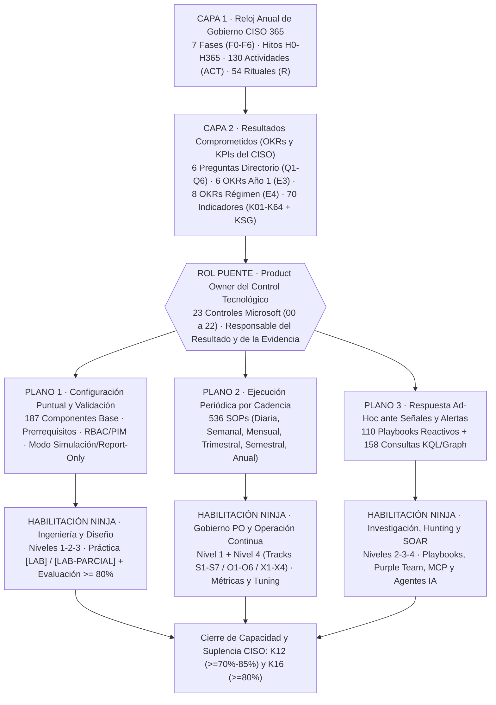

# Guía Maestra de Vinculación: Plan CISO 365, OKRs/KPIs, Excelencia Operacional y Ninja Training para Product Owners

**Fecha de corte y alineación:** `2026-11-12`  
**Ecosistema conectado:** Modelo Operativo CISO 365 (`v1.0`) · Catálogo KPIs/OKRs CISO de Frontera (`v1.0–v1.2`) · Guías de Excelencia Operacional Microsoft (`23` módulos `v2.0`) · Ninja Training Seguridad Microsoft (`15` programas, `387` módulos)  
**Audiencia:** CISO, Oficina del CISO, Product Owners de Controles Tecnológicos, Líderes de SOC, Ingeniería de Seguridad y GRC.

---

## 1. Cómo vincular la estrategia del CISO, la Excelencia Operacional y el Ninja Training

En la práctica empresarial, la brecha entre comprar tecnología de seguridad y reducir efectivamente el riesgo ocurre porque **el gobierno del CISO**, **la operación diaria del control** y **el entrenamiento profundo de las personas** viven en repositorios desconectados. Para cerrar esa brecha a través del rol de **Product Owner del Control Tecnológico** (*responsable de extremo a extremo del resultado de reducción de riesgo de un control mediante una tecnología*), este marco conecta los cuatro artefactos en una cadena trazable de cuatro capas:

### Síntesis cuantitativa auditada del puente de 4 capas

| Capa del Sistema | Artefacto Fuente | Volumen Conectado | Pregunta que resuelve para el Product Owner |
|---|---|---|---|
| **1. Agenda Anual CISO 365** | `AI_CISO_Atlas_CISO365` (`v1.0`) | `7` fases (`H0`–`H365`), `130` `ACT`, `54` rituales `R` | **¿Cuándo** necesita el CISO el diagnóstico, el quick win, el gobierno o la prueba bajo presión? |
| **2. OKRs y KPIs del CISO** | `AI_CISO_Atlas_KPIs_OKRs` (`v1.0–v1.2`) | `6` OKRs Año 1 (`18` KRs `E3`), `8` OKRs Régimen (`E4`), `70` indicadores (`K01`–`K64` + `KSG01`–`06`) | **¿Qué resultado de negocio/riesgo** debo demostrar ante el Comité y el Directorio (`Q1`–`Q6`)? |
| **3. Excelencia Operacional** | `AB - ExcelenciaOperacional` (`23` módulos) | `23` módulos, `184` KPIs técnicos y `833` acciones (`187` Config + `536` Rutinas + `110` Ad-Hoc) | **¿Qué hay que configurar una vez, qué revisar periódicamente y cómo actuar ante una alerta?** |
| **4. Entrenamiento Profundo** | `Ninja_Training_Seguridad_Microsoft_2026` | `15` programas, `387` módulos, `2165` ejercicios (`[LAB]`, `[LAB-PARCIAL]`, `[SOLO-PRODUCCION]`) | **¿Cómo aprendemos yo (Product Owner) y mi equipo técnico a ejecutarlo sin romper producción?** |

---

## 2. Anatomía del rol de Product Owner del Control Tecnológico

El **Product Owner (PO) de un Control Tecnológico** no necesita memorizar los `2.000` horas de estudio de los 15 programas Ninja ni ejecutar cada comando diario de consola, pero **tampoco puede gobernar a ciegas**. Su mandato frente al CISO exige claridad en dos dimensiones:

1. **Claridad operativa (Qué exigir y validar en los 3 planos de Excelencia Operacional):**
   - **Plano 1 · Configuración Puntual y Validación (Diseño y Cambios):** Se ejecuta al desplegar la capacidad o ante cambios mayores (`R52`). El PO exige que todo control nazca primero en modo observación (*Report-only* en Conditional Access, *Audit* en ASR, *Simulation* en DLP/Auto-labeling), valida exclusiones críticas (cuentas *Break-Glass*) y aprueba el pase a bloqueo (*Enforcement*) con evidencia de no-regresión.
   - **Plano 2 · Ejecución Periódica por Cadencia (Higiene y Sostenibilidad):** Rutinas **Diarias** (salud y colas críticas, `R04`), **Semanales** (afinamiento de falsos positivos y exposición, `R03`), **Mensuales** (tablero de métricas, licencias/SCUs y excepciones, `R06/R08/R09/R10`), **Trimestrales** (recertificación de privilegios/agentes `R16`, simulacros *Break-Glass* y *Purple Team* `R14`), **Semestrales** (ejercicios de mesa `R22`) y **Anuales** (evaluación de madurez NIST CSF 2.0 `R28` y pruebas integrales `R35/R37`).
   - **Plano 3 · Respuesta Ad-Hoc ante Señales y Alertas (Contención y Forense):** Playbooks reactivos (`AH-*`) disparados cuando una señal supera el umbral o ocurre un incidente. El PO no necesariamente ejecuta el comando de aislamiento a las 03:00 AM, pero **asegura que el playbook esté probado (`K32`), que el analista y su suplente estén certificados (`K12`, `K16`) y lidera la mejora post-incidente (`R51`, `K48`)**.

2. **Claridad formativa (Separación de rutas en el Ninja Training):**
   - **Ruta del Product Owner (20 a 35 h focalizadas por tecnología):** Combina los módulos de **Nivel 1 (Fundamentos, licencias, arquitectura y límites)** + selección estratégica de **Nivel 2 (Políticas clave y riesgos)** + **Nivel 4 completo (`S1–S7` en Defender XDR, `O1–O6` en Purview/Copilot/Cloud/Foundry, `X1–X4` en Entra/Security Copilot)**. Le otorga criterio técnico para cuestionar configuraciones, interpretar los 8 KPIs del módulo y aprobar cambios.
   - **Ruta del Ingeniero de Plataforma (Habilita el Plano 1 y automatización del Plano 2):** Foco en **Nivel 2 (Despliegue, políticas, conectores)** y **Nivel 3 (Política como código, APIs, Graph, conectores CCF, Customer Key, MCP)**, practicando primero en ejercicios `[LAB]` y `[LAB-PARCIAL]`.
   - **Ruta del Analista SOC / Custodio Operativo (Habilita Rutinas Diarias/Semanales del Plano 2 y el Plano 3 Ad-Hoc):** Foco en **KQL (`I4/I7/A2`)**, **Investigación e Incidentes (`M1–M11`)**, **Playbooks de Respuesta y Hunting (`A1–A5`)** y **Agentes de Triaje (`M6/X5`)**, exigiendo aprobación `>= 80 %` en las evaluaciones Ninja para certificar tanto al titular (`K12`) como al suplente (`K16`).

---

## 3. Sincronización con el Plan Anual CISO 365 (Entrenamiento y Ejecución Just-in-Time)

Intentar desplegar los 23 módulos de Excelencia Operacional o cursar los 15 programas Ninja al mismo tiempo paraliza al equipo. Siguiendo las **7 fases del Plan CISO 365 (`F0` a `F6`)**, la organización activa cada plano operativo y cada bloque de entrenamiento justo antes del hito que los requiere:

| Fase e Hito CISO 365 | Ventana | Foco del CISO (`ACT` clave) | Qué activa el Product Owner en Excelencia Operacional | Qué cursar en Ninja Training (Just-in-Time) |
|---|---|---|---|---|
| **F0 · Preparar (`H0`)** | D-30 a D0 | Mandato, alcance, reporte y diario de decisiones (`ACT-001` a `ACT-009`) | Revisión ejecutiva de `00_Marco_Maestro_CISO_SOC_y_NIST` y mapa de responsabilidades de los 23 controles. | Lectura ejecutiva PO: `02_Defender_XDR` (`S1`, `S7`), `01_Sentinel` (`I1`, `I2`) y `04_Security_Copilot` (`X1`). |
| **F1 · Recibir y escuchar (`H30`)** | Días 1–30 | Preparación mínima IR (`ACT-011`), urgencias (`ACT-015`), presupuesto (`ACT-017`), quién tiene las llaves (`ACT-023`) | Verificación de cuentas *Break-Glass* y Global Admins (`01_Entra_ID`), estado de sensores y playbooks críticos `AH-*` (`03`, `04`, `08`) y retención de auditoría (`19`). | Módulos rápidos de supervivencia: `03_Entra` (`I2`, `M3`, `A4`), `02_Defender_XDR` (`M1`, `A1`), `10_eDiscovery_Audit` (`I2`). |
| **F2 · Diagnosticar (`H60`)** | Días 31–60 | Línea base NIST CSF 2.0 (`ACT-031`), capacidades (`ACT-034`), MTTD/MTTC (`ACT-037`), exposición (`ACT-038`), IAM (`ACT-039`), datos (`ACT-040`), IA/agentes (`ACT-043`) | Medición inicial (en solo lectura) de los **184 KPIs técnicos**; activación de Compliance Manager (`13`), Exposure Management (`03`), DSPM / DSPM for AI (`13`, `22`). | Nivel 1 + Diagnóstico PO: `11_Compliance_Manager` (`I1`–`I3`), `02_Defender_XDR` (`M6`), `12_Purview_DSPM_IA` (`I1`–`I3`), `13_Copilot` (`I3`–`I5`). |
| **F3 · Priorizar y comprometer (`H100`)** | Días 61–100 | 3 resultados tempranos (`ACT-055`: `K33`, `K34`, `K28`), hoja de ruta y OKRs Año 1 (`ACT-059`), tablero v0 (`ACT-061`) | **Plano 1 (Quick Wins de alto impacto en simulación → producción):** Passkeys/MFA sin phishing y PIM JIT (`01`), Preset Policies/DMARC (`05`), protección de respaldos y claves (`12`, `21`). | Práctica en `[LAB]` previa a Quick Wins: `03_Entra` (`I3`, `I4`, `M3`), `02_Defender_XDR` (`I3`, `M3`), `05_MIP` (`I3`, `A3`). |
| **F4 · Instalar gobierno y operar (`H180`)** | Días 101–180 | Comité mensual (`ACT-073`/`R06`), política IA (`ACT-083`), exposición continua (`ACT-084`), identidad (`ACT-087`), plan de desarrollo (`ACT-089`), datos (`ACT-096`), telemetría (`ACT-097`) | Despliegue sistemático del **Plano 1 (Configuración base)** e institucionalización del **Plano 2 (Rutinas Diarias, Semanales y Mensuales)** en los 23 controles; formalización de titulares y suplentes. | Ejecución del **Plan Anual Ninja (`ACT-089` → `K12`, `K16`)**: Niveles 2 y 3 para ingenieros/analistas en `01` a `15` con meta de certificación `>= 80 %`. |
| **F5 · Ejecutar y probar (`H270`)** | Días 181–270 | Recuperación RTO/RPO (`ACT-109`), pruebas de controles y pentest (`ACT-110`), crisis ejecutiva (`ACT-111`), pruebas y red teaming de IA/agentes (`ACT-114`) | Ejecución bajo presión del **Plano 3 (Playbooks Ad-Hoc `AH-*`)**, rutinas **Trimestrales/Semestrales** (*Purple Team* `T-02`, *Tabletop* `R22`, revocación de agentes y fallback sin IA `K56`). | Módulos avanzados de validación adversaria: `02_Defender_XDR` (`A5`, `S4`), `13_Copilot` (`A8`), `15_Foundry` (`A1`, `A5`), `10_eDiscovery_Audit` (`M3`, `A3`). |
| **F6 · Demostrar y renovar (`H365`)** | Días 271–365 | Reevaluación de riesgos (`ACT-117`) y madurez (`ACT-118`), autoevaluación (`ACT-119`), OKRs Año 2 en estadio `E4` (`ACT-125`), informe anual (`ACT-126`/`H365`) | Ejecución de **Rutinas Anuales (`A-01`)** de los 23 módulos (Zero Trust Assessment, dossiers probatorios NIST CSF 2.0, Proof of Disposal, auditoría de costos/SCUs). | Módulos Nivel 4 de Gobierno, Métricas y ROI: `S3/S7` (`02`), `X2` (`04`), `O2/O3` (`05`–`12`), `O4/O6` (`13`), `O2/O3` (`14`, `15`). |

---

## 4. Trazabilidad de OKRs del CISO y Preguntas del Directorio hacia Controles y Ninja Training

### 4.1 OKRs del Año 1 del CISO (`A1-O1` a `A1-O6`, meta estadio `E3`)

| OKR Año 1 (CISO 365) | Hito | Indicadores Clave (`K##` / `KSG`) | Controles de Excelencia Operacional Primarios | Programas y Bloques Ninja Habilitadores |
|---|---|---|---|---|
| **A1-O1 · Conocer la verdad del área y acordar un mandato basado en evidencia** | `H100` | `H30`, `KSG04` (>=60%), `H100` | `00` Marco Maestro, `03` Defender XDR (MSEM), `13` Purview Suite (Compliance Manager & DSPM) | `02_Defender_XDR` (`I1`, `M6`, `S1`, `S3`), `11_Compliance_Manager` (`I1`–`I3`), `12_DSPM_IA` (`I1`–`I3`) |
| **A1-O2 · Instalar el sistema de gobierno y gestión del ciberriesgo** | `H180` | `KSG02` (>=70%), `K09` (>=60%), `KSG03` (>=60%) | `00` Marco Maestro, `02` Entra ID Governance, `13` Purview Suite, `16` DLCM/Records | `02_Defender_XDR` (`S1`, `S7`), `03_Entra` (`M4`), `11_Compliance_Manager` (`M1`, `M4`, `O1`–`O3`) |
| **A1-O3 · Probar que las capacidades críticas funcionan bajo presión** | `H270` | `K15` (>=50%), `K30` (>=60%), `K60` (>=60%) | `01` Entra ID (`T-01`/`T-02`), `03`–`06` Defender Suite (`AH-*`), `08` Sentinel, `19`–`21` Audit/eDiscovery/Key | `02_Defender_XDR` (`A1`, `A5`, `S2`, `S4`), `01_Sentinel` (`M9`, `X1`), `03_Entra` (`A2`, `A5`), `10_eDiscovery_Audit` (`M3`, `A3`) |
| **A1-O4 · Rendir cuentas con evidencia y renovar el mandato** | `H365` | `KSG01` (>=70%), `KSG06` (>=70%), `KSG05` (>=2,0) | `00` Marco Maestro, `13` Purview Suite, `19` Audit Premium, `20` eDiscovery Premium | `02_Defender_XDR` (`S3`, `S7`), `11_Compliance_Manager` (`M4`, `A3`, `O2`), `04_Security_Copilot` (`X2`) |
| **A1-O5 · Reducir la exposición en los escenarios de riesgo prioritarios** | `H365` | `K25` (<=10%), `K46` (>=70%), `K33` (>=50%) | `01` Entra ID, `03`–`06` Defender XDR/MDE/MDO/MDI, `10`–`12` Intune/Windows, `14`–`15` MIP/DLP | `03_Entra` (`I3`, `M1`, `M3`), `02_Defender_XDR` (`M3`, `M4`, `M6`, `M7`), `05_MIP` (`M1`, `M2`), `06_DLP` (`M1`, `M4`), `14_Defender_for_Cloud` (`B2`, `M2`, `M3`) |
| **A1-O6 · Gobernar la IA y los agentes antes de escalarlos** | `H365` | `K49` (>=50%), `K50` (>=50%), `K51` (>=60%) | `22` Microsoft Agent 365, `01`–`02` Entra Agent ID, `07` MDCA Shadow AI, `09` Security Copilot, `13`–`18` Purview IA | `13_Copilot_Studio` (`I3`, `M2`–`M8`, `O1`–`O6`), `03_Entra` (`X1`–`X7`), `12_DSPM_IA` (`I2`, `M1`–`M3`, `A3`), `15_Foundry` (`F1`–`F4`, `M1`–`M7`, `O1`–`O4`) |

### 4.2 OKRs de Régimen por Territorio (`T01` a `T08`, Año 2+ hacia estadio `E4`)

| Territorio AI CISO Atlas | Objetivo de Régimen (`E4`) | KRs Canónicos (`K##` y Meta `E4`) | Product Owners EO que sostienen el resultado | Programas Ninja Troncales |
|---|---|---|---|---|
| **T01 · Self & Judgment** | Hacer explícito, calibrado y revisable el juicio de seguridad | `K03 >= 75%`, `K08 >= 90%`, `K01 >= 0,2` (más `K05`, `K06` en crisis) | `00` Marco Maestro, `03` Defender XDR, `08` Sentinel, `16` DLCM (retención de actas) | `02_Defender_XDR` (`S2`, `S7`), `01_Sentinel` (`M8`, `M9`), `09_Purview_Lifecycle` (`I1`) |
| **T02 · Leadership & Organization** | Distribuir la responsabilidad del ciberriesgo y sostener un equipo preparado | `K09 >= 80%`, `K10 >= 60%`, `K16 >= 80%` (más `K11`, `K12`, `K15`) | Todos los `23` Product Owners (`K12`/`K16`), `02` Entra ID Gov (paquetes suplencia), `05` MDO (`K11`) | **Los 15 Programas Ninja** (evaluaciones `>= 80%` certifican titulares `K12` y suplentes `K16`), `02_Defender_XDR` (`I3`, `S1`, `S4`) |
| **T03 · Strategy & Business** | Convertir la inversión en seguridad en reducción de riesgo y velocidad de negocio | `K17 >= 80%`, `K19 >= 2`, `K20 <= 5 días` (más `K22 >= 70%`) | `00` Marco Maestro, `08` Sentinel (Data Lake FinOps), `09` Security Copilot (ROI SCUs), `13` Purview, `22` Agent 365 | `01_Sentinel` (`M3`, `M12`, `A8`), `04_Security_Copilot` (`I2`, `M7`, `X2`), `11_Compliance_Manager` (`I1`, `A2`), `14_Defender_for_Cloud` (`A8`) |
| **T04 · Risk & Resilience** | Mantener la exposición dentro del apetito y la recuperación probada | `K25 <= 5%`, `K30 >= 80%`, `K28 >= 85%` (más `K31`, `K32`) | `00` Marco Maestro, `02` Entra ID Gov, `03` Defender XDR, `07` MDCA, `08` Sentinel, `16` DLCM, `21` Customer Key | `02_Defender_XDR` (`M6`, `A1`, `S4`), `01_Sentinel` (`M13`, `X1`), `05_MIP` (`A3`), `09_Lifecycle` (`I3`, `M4`) |
| **T05 · Security Architecture** | Eliminar clases completas de ataque por diseño | `K33 >= 80%`, `K34 >= 75%`, `K35 >= 85%` (más `K37`, `K38`, `K39`) | `01`–`02` Entra, `04` MDE, `06` MDI, `10`–`12` Intune/Windows, `14`–`15` MIP/DLP | `03_Entra` (`I3`, `M1`, `M3`, `A4`), `02_Defender_XDR` (`M3`, `M4`, `M6`), `05_MIP` (`M1`–`M3`), `06_DLP` (`I2`–`M4`), `14_Defender_for_Cloud` (`B2`, `M8`, `W6`) |
| **T06 · Security Operations** | Detectar y contener en horas, aprendiendo de cada incidente | `K42 <= 8 h`, `K45 <= 4 h`, `K46 >= 85%` (más `K41`, `K43`, `K44`, `K48`) | `03`–`07` Defender Suite, `08` Sentinel, `09` Security Copilot, `19` Audit Premium | `01_Sentinel` (`M2`–`M13`, `A1`–`A3`, `X1`), `02_Defender_XDR` (`M1`–`M10`, `A1`–`A6`, `S2`–`S6`), `04_Security_Copilot` (`M1`–`M6`) |
| **T07 · AI & Autonomous Systems** | Gobernar la autoridad no humana antes de escalarla | `K49 >= 75%`, `K50 >= 75%`, `K56 >= 75%` (más `K51`–`K55`) | `22` Microsoft Agent 365, `01`–`02` Entra Agent ID, `07` MDCA, `09` Security Copilot, `13`–`19` Purview | `13_Copilot_Studio` (completo), `03_Entra` (`X1`–`X7`), `12_DSPM_IA` (completo), `15_Foundry` (completo), `04_Security_Copilot` (`X1`–`X5`), `14_Defender_for_Cloud` (`A1`, `A2`) |
| **T08 · Trust & Assurance** | Probar con evidencia lo que afirmamos sobre nuestra seguridad | `K57 >= 85%`, `K60 >= 80%`, `K61 >= 95%` (más `K58`, `K59`, `K63`, `K64`) | `13` Purview Suite (Compliance Manager), `16`–`21` Purview Cumplimiento/Legal/Soberanía, `00` Marco Maestro | `11_Compliance_Manager` (completo), `10_eDiscovery_Audit` (completo), `09_Lifecycle` (`A3`, `A4`, `O3`), `07_Insider_Risk` (`O3`), `08_Comm_Compliance` (`A2`, `A4`, `O3`) |

---

## 5. Fichas Operativas y Formativas de los 23 Product Owners (`00` a `22`)

Cada ficha entrega al **Product Owner del Control** su hoja de ruta completa: qué resultados le exige el CISO, qué KPIs monitorear, qué ejecutar/validar en los **tres planos operativos** y **qué módulos exactos estudiar** tanto él como su equipo técnico.

### 00. Marco Maestro CISO, SOC y NIST (`00_Marco_Maestro_CISO_SOC_y_NIST`)

- **Rol del Product Owner:** Product Owner de Gobierno Ciber, Arquitectura Zero Trust y Operación SOC (Deputy CISO / SecOps Lead)
- **Misión del Control (Outcome):** Orquestar la función transversal GOVERN de NIST CSF 2.0, la convergencia SIEM+XDR+CTEM en security.microsoft.com y los acuerdos por resultados (Outcome SLAs) con el SOC interno/MSSP.
- **Alineación CISO 365:** Preguntas Directorio `Q1, Q2, Q3, Q5, Q6` · OKR Año 1 `A1-O1, A1-O2, A1-O4, A1-O5` · Territorios Régimen `T01, T02, T03, T06, T08` · Fases `F0, F1, F2, F3, F4, F6` · Actividades `ACT-002, ACT-022, ACT-028, ACT-031, ACT-050, ACT-057` · Rituales `R03, R06, R07, R08, R12, R13`
- **Indicadores del CISO alimentados (`K##`):** `K09, K12, K14, K17, K18, K22, K25, K26, K31, K42, K45, K58, KSG01, KSG02, KSG04, KSG05`
- **Estado de cobertura Ninja Training:** **Integrada Multi-Programa (Cobertura Completa)** ([Abrir Guía EO](../Excelencia_Operacional/00_Marco_Maestro_CISO_SOC_y_NIST/Marco_Maestro_CISO_SOC_y_NIST_Guia_Excelencia_Operacional.html) · [Abrir Programa Ninja Primario](../Ninja_Training/02_Defender_XDR/Defender_XDR_Ninja_Training_2026.html))

**KPIs técnicos del Product Owner y gatillo de entrenamiento ante desvío:**

| KPI EO | Indicador Técnico | Meta Operativa | Alimenta CISO | SOPs que lo mueven | Módulos Ninja de Ajuste / Mejora |
|---|---|---|---|---|---|
| `KPI-01` | Velocidad de Reconocimiento y Contención Crítica (MTTA / MTTC P1) | MTTA <= 15 minutos; MTTC <= 60 minutos | `K32` | `D-02, D-04, D-06, S-02` | `04:I2` (Licencias y capacidad), `04:M6` (Agentes de Microsoft) |
| `KPI-02` | Cobertura de Autenticación Resistente a Phishing | 100% en Roles Privilegiados; >= 85% en Usuarios Generales | `K33` | `M-06` | `02:I3` (MDO: fundamentos), `02:M2` (MDO: investigación) |
| `KPI-03` | Índice de Mitigación de Rutas de Ataque Críticas y Postura (MSEM) | >= 90% rutas críticas mitigadas en SLA; Microsoft Secure Score >= 85% | `K46` | `D-04, D-06, S-02, M-03` | `02:M6` (Vulnerabilidades y exposición), `11:I1` (Puntuación y licencias) |
| `KPI-04` | Tasa de Automatización Tier-1 y Precisión de Agentes IA | 60% - 70% automatización Tier-1; >= 95% precisión validada de agentes IA | `K53` | `D-05, S-01, S-06, AH-02` | `02:S3` (Métricas y tableros), `02:S4` (Madurez y ejercicios) |
| `KPI-05` | Índice de Cero Privilegio Permanente (Zero Standing Privilege Ratio) | >= 98% vía PIM JIT (< 5 Global Administrators elegibles; solo 2 Break-Glass activas sin uso) | `K34` | `S-06, M-03` | `02:S3` (Métricas y tableros), `02:S4` (Madurez y ejercicios) |
| `KPI-06` | Efectividad Contractual del MSSP Basada en Resultados (Outcome SLA) | >= 90% precisión de escalamiento; >= 95% cumplimiento SLA en incidentes P1 | `K41` | `M-04, M-05` | `02:S3` (Métricas y tableros), `02:S4` (Madurez y ejercicios) |
| `KPI-07` | Índice de Sostenibilidad Operativa y Retención del Talento | Holgura operativa >= 15%; Retención anual del equipo >= 88% | `K41` | `M-01` | `02:S3` (Métricas y tableros), `02:S4` (Madurez y ejercicios) |
| `KPI-08` | Alineación al Apetito de Riesgo (FAIR) y Madurez NIST CSF 2.0 | 100% escenarios dentro de tolerancia o con plan financiado; >= 85% subcategorías en Tier 3 (Repeatable) | `K41` | `D-05, D-06, M-04, T-01` | `02:M7` (AIR e interrupción), `11:I1` (Puntuación y licencias) |

**Correspondencia por Plano Operativo (Qué hacer vs. Cómo aprenderlo):**

| Plano / Rol | Volumen y Ejemplos Clave en Excelencia Operacional | Validación Exigida por el Product Owner | Ruta Exacta en Ninja Training |
|---|---|---|---|
| **Gobierno del Product Owner** | Supervisión integral de `8` KPIs, `12` subcategorías NIST CSF 2.0 y decisiones de cambio/riesgo. | Revisar línea base mensual (`R08`), auditar excepciones (`R09`) y aprobar paso de simulación a bloqueo. | **Ruta PO:** [02·I1 Defender XDR hoy](../Ninja_Training/02_Defender_XDR/Defender_XDR_Ninja_Training_2026.html#I1), [02·S1 Modelo operativo](../Ninja_Training/02_Defender_XDR/Defender_XDR_Ninja_Training_2026.html#S1), [02·S2 Procesos e incidentes](../Ninja_Training/02_Defender_XDR/Defender_XDR_Ninja_Training_2026.html#S2), [02·S3 Métricas y tableros](../Ninja_Training/02_Defender_XDR/Defender_XDR_Ninja_Training_2026.html#S3), [02·S7 Gobierno y reporte](../Ninja_Training/02_Defender_XDR/Defender_XDR_Ninja_Training_2026.html#S7), [01·I1 Sentinel hoy](../Ninja_Training/01_Sentinel/Sentinel_Ninja_Training_2026.html#I1), [01·I2 Cómo se usa](../Ninja_Training/01_Sentinel/Sentinel_Ninja_Training_2026.html#I2) |
| **Plano 1 · Configuración Puntual** (`8` comp.) | `CFG-01` Unified SecOps Platform en Microsoft Defender Portal; `CFG-02` Microsoft Security Exposure Management (MSEM); `CFG-03` Plano de Control de Identidad, Red y Agentes (Microsoft Entra). | Practicar en `[LAB]` → desplegar en *Report-Only / Simulación / Piloto* → verificar 0 regresión y exclusión *Break-Glass*. | **Ruta Ingeniería:** [02·I2 Licencias, piloto y roles](../Ninja_Training/02_Defender_XDR/Defender_XDR_Ninja_Training_2026.html#I2), [02·M6 Vulnerabilidades y exposición](../Ninja_Training/02_Defender_XDR/Defender_XDR_Ninja_Training_2026.html#M6), [02·M8 Integración con Sentinel](../Ninja_Training/02_Defender_XDR/Defender_XDR_Ninja_Training_2026.html#M8), [02·A7 Multi-inquilino y MDR](../Ninja_Training/02_Defender_XDR/Defender_XDR_Ninja_Training_2026.html#A7), [01·M1 Workspaces y tenants](../Ninja_Training/01_Sentinel/Sentinel_Ninja_Training_2026.html#M1), [01·M3 Logs, niveles y costos](../Ninja_Training/01_Sentinel/Sentinel_Ninja_Training_2026.html#M3), [01·A8 Data lake y graph](../Ninja_Training/01_Sentinel/Sentinel_Ninja_Training_2026.html#A8) |
| **Plano 2 · Ejecución Periódica** (`23` SOPs) | `D-01` (Diaria) Supervisión matutina de cola unificada de incidentes críticos y traspaso 24x7 (SIEM + XDR); `D-02` (Diaria) Auditoría Human-ON-the-Loop del Action Center y Automatic Attack Disruption; `D-03` (Diaria) Verificación diaria de salud de conectores, telemetría XDR y consumo en Sentinel; `D-04` (Diaria) Vigilancia de cuentas Break-Glass y elevaciones privilegiadas críticas. | Evidencia auditable fechada por cadencia (`Diaria` a `Anual`) conciliada con los rituales `R03/R06/R16/R28`. | **Ruta Operación Continua:** [02·S3 Métricas y tableros](../Ninja_Training/02_Defender_XDR/Defender_XDR_Ninja_Training_2026.html#S3), [02·S4 Madurez y ejercicios](../Ninja_Training/02_Defender_XDR/Defender_XDR_Ninja_Training_2026.html#S4), [02·S5 Detección como proceso](../Ninja_Training/02_Defender_XDR/Defender_XDR_Ninja_Training_2026.html#S5), [02·S6 Automatización e IA](../Ninja_Training/02_Defender_XDR/Defender_XDR_Ninja_Training_2026.html#S6), [02·S7 Gobierno y reporte](../Ninja_Training/02_Defender_XDR/Defender_XDR_Ninja_Training_2026.html#S7), [01·M8 Workbooks y reportes](../Ninja_Training/01_Sentinel/Sentinel_Ninja_Training_2026.html#M8) |
| **Plano 3 · Respuesta Ad-Hoc** (`5` playbooks + `7` KQL) | `AH-01` Activación de crisis mayor (P1), contención coordinada XDR y gobierno ejecutivo de respuesta; `AH-02` Playbook de contención ante compromiso o comportamiento malicioso de agentes IA; `AH-03` Protocolo de apertura de emergencia y revisión Post-Mortem de cuenta Break-Glass. | Ejecutar simulacro semestral (`R22`/`K32`), medir MTTA/MTTC (`K42`/`K45`) y cerrar lecciones post-incidente (`R51`/`K48`). | **Ruta Analista IR / Hunting:** [02·M1 Incidentes y alertas](../Ninja_Training/02_Defender_XDR/Defender_XDR_Ninja_Training_2026.html#M1), [02·M7 AIR e interrupción](../Ninja_Training/02_Defender_XDR/Defender_XDR_Ninja_Training_2026.html#M7), [02·A1 Playbooks de respuesta](../Ninja_Training/02_Defender_XDR/Defender_XDR_Ninja_Training_2026.html#A1), [02·S2 Procesos e incidentes](../Ninja_Training/02_Defender_XDR/Defender_XDR_Ninja_Training_2026.html#S2), [01·M9 Incidentes](../Ninja_Training/01_Sentinel/Sentinel_Ninja_Training_2026.html#M9), [01·X1 SOAR con Logic Apps](../Ninja_Training/01_Sentinel/Sentinel_Ninja_Training_2026.html#X1) |

> **Nota de arquitectura formativa:** Cubierto íntegramente combinando el Track S1–S7 de Excelencia del SOC (Programa 02), Arquitectura Sentinel/MSSP (Programa 01), SOC Agéntico (Programa 04) y Compliance Manager NIST CSF 2.0 (Programa 11).

### 01. Microsoft Entra ID (`01_Microsoft_Entra_ID`)

- **Rol del Product Owner:** Product Owner de Identidad, Autenticación y Acceso Adaptativo (IAM & ITDR Product Owner)
- **Misión del Control (Outcome):** Eliminar el robo de credenciales y sesiones mediante Passkeys FIDO2/WHfB, Conditional Access adaptativo, Token Protection, CAE estricto, PIM JIT y contención automática ITDR.
- **Alineación CISO 365:** Preguntas Directorio `Q1, Q2, Q5` · OKR Año 1 `A1-O3, A1-O5, A1-O6` · Territorios Régimen `T05, T06, T07` · Fases `F1, F2, F3, F4, F5` · Actividades `ACT-023, ACT-039, ACT-055, ACT-087, ACT-093, ACT-110` · Rituales `R03, R04, R06, R08, R16, R35`
- **Indicadores del CISO alimentados (`K##`):** `K33, K34, K35, K42, K45, K50, K60, K63`
- **Estado de cobertura Ninja Training:** **Directa 1:1 (Cobertura Completa)** ([Abrir Guía EO](../Excelencia_Operacional/01_Microsoft_Entra_ID/Microsoft_Entra_ID_Guia_Excelencia_Operacional.html) · [Abrir Programa Ninja Primario](../Ninja_Training/03_Entra_Identidad_y_Agentes/Entra_Identidad_Ninja_Training_2026.html))

**KPIs técnicos del Product Owner y gatillo de entrenamiento ante desvío:**

| KPI EO | Indicador Técnico | Meta Operativa | Alimenta CISO | SOPs que lo mueven | Módulos Ninja de Ajuste / Mejora |
|---|---|---|---|---|---|
| `KPI-01` | Adopción de MFA Resistente a Phishing (Passkeys FIDO2 / WHfB / CBA) | 100% en Roles Administrativos; >= 85% en Usuarios Generales | `K33` | `S-02, S-04, T-02` | `03:I3` (Autenticación sin phishing), `02:I3` (MDO: fundamentos) |
| `KPI-02` | Cobertura Efectiva de Conditional Access sobre Inicios Exitosos | >= 99% (única excepción documentada: cuentas Break-Glass sin actividad normal) | `K43` | `D-01, D-03, S-01, S-04` | `03:M1` (Acceso condicional avanzado), `03:I4` (Acceso condicional esencial) |
| `KPI-03` | Tiempo Medio de Remediación de Identidades en Riesgo Alto (MTTR-Identity) | <= 15 minutos vía auto-remediación CA/XDR; <= 4 horas en casos que requieran triaje manual | `K53` | `D-01, D-02, D-07, S-05` | `04:I2` (Licencias y capacidad), `04:M6` (Agentes de Microsoft) |
| `KPI-04` | Índice de Elevación Just-In-Time (Zero Standing Admin Ratio) | 100% humanos vía PIM JIT (< 5 Global Administrators elegibles) | `K34` | `S-01, S-04, S-05, M-01` | `03:M3` (PIM: roles, grupos y alertas), `03:A4` (Arquitectura y privilegios) |
| `KPI-05` | Tasa Residual de Autenticación Heredada y MFA Telefónico (SMS/Voz) | 0.0% Legacy Auth; < 2% SMS/Voz en fase final de retiro | `K33` | `SM-01, AH-02` | `02:M6` (Vulnerabilidades y exposición), `02:I3` (MDO: fundamentos) |
| `KPI-06` | Higiene de Credenciales de Aplicaciones y Agentes IA Gobernados | >= 95% de conformidad sin secretos eternos ni agentes huérfanos | `K50` | `D-02, D-06, D-07, S-02` | `03:M4` (Gobernanza y externos), `03:X4` (Ciclo de vida y Agent 365) |
| `KPI-07` | Salud y Vigencia de Soporte de Sincronización Híbrida | >= 99.9% ciclos exitosos; >= 3 meses de margen antes del fin de soporte de la versión | `K33` | `D-08, M-02, M-03` | `03:I5` (Identidad híbrida), `03:M2` (ID Protection) |
| `KPI-08` | Identity Secure Score y Cumplimiento de Simulacro Break-Glass | Identity Secure Score >= 88%; Validación Break-Glass <= 90 días | `K34` | `S-05, M-04, T-01` | `03:M3` (PIM: roles, grupos y alertas), `03:A4` (Arquitectura y privilegios) |

**Correspondencia por Plano Operativo (Qué hacer vs. Cómo aprenderlo):**

| Plano / Rol | Volumen y Ejemplos Clave en Excelencia Operacional | Validación Exigida por el Product Owner | Ruta Exacta en Ninja Training |
|---|---|---|---|
| **Gobierno del Product Owner** | Supervisión integral de `8` KPIs, `11` subcategorías NIST CSF 2.0 y decisiones de cambio/riesgo. | Revisar línea base mensual (`R08`), auditar excepciones (`R09`) y aprobar paso de simulación a bloqueo. | **Ruta PO:** [03·I1 Entra hoy y licencias E5](../Ninja_Training/03_Entra_Identidad_y_Agentes/Entra_Identidad_Ninja_Training_2026.html#I1), [03·I3 Autenticación sin phishing](../Ninja_Training/03_Entra_Identidad_y_Agentes/Entra_Identidad_Ninja_Training_2026.html#I3), [03·I4 Acceso condicional esencial](../Ninja_Training/03_Entra_Identidad_y_Agentes/Entra_Identidad_Ninja_Training_2026.html#I4), [03·M1 Acceso condicional avanzado](../Ninja_Training/03_Entra_Identidad_y_Agentes/Entra_Identidad_Ninja_Training_2026.html#M1), [03·M2 ID Protection](../Ninja_Training/03_Entra_Identidad_y_Agentes/Entra_Identidad_Ninja_Training_2026.html#M2), [03·M3 PIM: roles, grupos y alertas](../Ninja_Training/03_Entra_Identidad_y_Agentes/Entra_Identidad_Ninja_Training_2026.html#M3), [03·A4 Arquitectura y privilegios](../Ninja_Training/03_Entra_Identidad_y_Agentes/Entra_Identidad_Ninja_Training_2026.html#A4) |
| **Plano 1 · Configuración Puntual** (`8` comp.) | `CFG-01` Directiva Unificada Authentication Methods, Passkeys (FIDO2) y External MFA (EAM); `CFG-02` Motor Microsoft Entra Conditional Access (Authentication Strengths & Managed Policies); `CFG-03` Controles Avanzados de Sesión: Token Protection y Continuous Access Evaluation (CAE). | Practicar en `[LAB]` → desplegar en *Report-Only / Simulación / Piloto* → verificar 0 regresión y exclusión *Break-Glass*. | **Ruta Ingeniería:** [03·P0 Protocolos y tokens](../Ninja_Training/03_Entra_Identidad_y_Agentes/Entra_Identidad_Ninja_Training_2026.html#P0), [03·I2 Administración del tenant](../Ninja_Training/03_Entra_Identidad_y_Agentes/Entra_Identidad_Ninja_Training_2026.html#I2), [03·I3 Autenticación sin phishing](../Ninja_Training/03_Entra_Identidad_y_Agentes/Entra_Identidad_Ninja_Training_2026.html#I3), [03·I4 Acceso condicional esencial](../Ninja_Training/03_Entra_Identidad_y_Agentes/Entra_Identidad_Ninja_Training_2026.html#I4), [03·I5 Identidad híbrida](../Ninja_Training/03_Entra_Identidad_y_Agentes/Entra_Identidad_Ninja_Training_2026.html#I5), [03·M1 Acceso condicional avanzado](../Ninja_Training/03_Entra_Identidad_y_Agentes/Entra_Identidad_Ninja_Training_2026.html#M1), [03·M3 PIM: roles, grupos y alertas](../Ninja_Training/03_Entra_Identidad_y_Agentes/Entra_Identidad_Ninja_Training_2026.html#M3) |
| **Plano 2 · Ejecución Periódica** (`23` SOPs) | `D-01` (Diaria) Triaje y remediación prioritaria de usuarios e inicios de sesión en riesgo alto (Entra ID Protection); `D-02` (Diaria) Monitoreo diario de identidades no humanas en riesgo (Workload Identities y Agentes IA); `D-03` (Diaria) Vigilancia de cuentas Break-Glass y asignaciones directas de roles fuera de PIM; `D-04` (Diaria) Caza diaria de Password Spray (50126), bloqueos MFA con contraseña válida (500121) y Legacy Auth. | Evidencia auditable fechada por cadencia (`Diaria` a `Anual`) conciliada con los rituales `R03/R06/R16/R28`. | **Ruta Operación Continua:** [03·M2 ID Protection](../Ninja_Training/03_Entra_Identidad_y_Agentes/Entra_Identidad_Ninja_Training_2026.html#M2), [03·M3 PIM: roles, grupos y alertas](../Ninja_Training/03_Entra_Identidad_y_Agentes/Entra_Identidad_Ninja_Training_2026.html#M3), [03·M5 Apps y consentimiento](../Ninja_Training/03_Entra_Identidad_y_Agentes/Entra_Identidad_Ninja_Training_2026.html#M5), [03·M6 Monitoreo y registros](../Ninja_Training/03_Entra_Identidad_y_Agentes/Entra_Identidad_Ninja_Training_2026.html#M6), [03·A1 Identidades de carga](../Ninja_Training/03_Entra_Identidad_y_Agentes/Entra_Identidad_Ninja_Training_2026.html#A1), [03·A3 Identidad como código](../Ninja_Training/03_Entra_Identidad_y_Agentes/Entra_Identidad_Ninja_Training_2026.html#A3) |
| **Plano 3 · Respuesta Ad-Hoc** (`5` playbooks + `7` KQL) | `AH-01` Playbook de respuesta ante Robo de Token / Adversary-in-the-Middle (AiTM); `AH-02` Playbook de contención en secuencia estricta ante compromiso de cuenta de usuario o administrador; `AH-03` Playbook de investigación y contención ante Password Spray / Credential Stuffing. | Ejecutar simulacro semestral (`R22`/`K32`), medir MTTA/MTTC (`K42`/`K45`) y cerrar lecciones post-incidente (`R51`/`K48`). | **Ruta Analista IR / Hunting:** [03·M2 ID Protection](../Ninja_Training/03_Entra_Identidad_y_Agentes/Entra_Identidad_Ninja_Training_2026.html#M2), [03·A2 ITDR](../Ninja_Training/03_Entra_Identidad_y_Agentes/Entra_Identidad_Ninja_Training_2026.html#A2), [03·A5 Respuesta a incidentes](../Ninja_Training/03_Entra_Identidad_y_Agentes/Entra_Identidad_Ninja_Training_2026.html#A5), [03·X5 Security Copilot en Entra](../Ninja_Training/03_Entra_Identidad_y_Agentes/Entra_Identidad_Ninja_Training_2026.html#X5), [02·M5 ID Protection: riesgo y CA](../Ninja_Training/02_Defender_XDR/Defender_XDR_Ninja_Training_2026.html#M5), [02·M7 AIR e interrupción](../Ninja_Training/02_Defender_XDR/Defender_XDR_Ninja_Training_2026.html#M7) |

> **Nota de arquitectura formativa:** Cobertura 1:1 total en el Programa 03 (Microsoft Entra: identidad y agentes), reforzada en ITDR por Programa 02 (I6, M5, M7) y Security Copilot para Entra en Programa 04 (M3).

### 02. Microsoft Entra ID Governance (`02_Microsoft_Entra_ID_Governance`)

- **Rol del Product Owner:** Product Owner de Gobierno de Identidades, Ciclo JML y Mínimo Privilegio (IGA Product Owner)
- **Misión del Control (Outcome):** Garantizar que toda identidad humana, externa B2B, de carga de trabajo y agéntica nazca, cambie y se revoque a tiempo con patrocinio verificable, recertificación anti-rubber-stamping y segregación de funciones (SoD).
- **Alineación CISO 365:** Preguntas Directorio `Q1, Q3, Q4, Q5` · OKR Año 1 `A1-O2, A1-O5, A1-O6` · Territorios Régimen `T02, T04, T05, T07, T08` · Fases `F1, F2, F4, F5` · Actividades `ACT-023, ACT-039, ACT-042, ACT-087, ACT-089, ACT-093` · Rituales `R07, R08, R16, R36, R37, R40`
- **Indicadores del CISO alimentados (`K##`):** `K09, K16, K31, K34, K49, K50, K57, K59`
- **Estado de cobertura Ninja Training:** **Directa Focalizada + Complemento Learn SC-300** ([Abrir Guía EO](../Excelencia_Operacional/02_Microsoft_Entra_ID_Governance/Microsoft_Entra_ID_Governance_Guia_Excelencia_Operacional.html) · [Abrir Programa Ninja Primario](../Ninja_Training/03_Entra_Identidad_y_Agentes/Entra_Identidad_Ninja_Training_2026.html))

**KPIs técnicos del Product Owner y gatillo de entrenamiento ante desvío:**

| KPI EO | Indicador Técnico | Meta Operativa | Alimenta CISO | SOPs que lo mueven | Módulos Ninja de Ajuste / Mejora |
|---|---|---|---|---|---|
| `KPI-01` | SLA de Revocación Integral Leaver (Offboarding Time-to-Revoke) | < 15 min (bajas urgentes) / < 3 h (bajas programadas) | `K32` | `D-01, D-05, T-01, AH-05` | `03:M4` (Gobernanza y externos), `03:X4` (Ciclo de vida y Agent 365) |
| `KPI-02` | Tasa de Onboarding Día-1 Automatizado sin Intervención Manual | >= 98 % | `K41` | `T-02, AH-04` | `03:I3` (Autenticación sin phishing), `03:M3` (PIM: roles, grupos y alertas) |
| `KPI-03` | Tasa de Decisión Explícita en Access Reviews (Efectividad Anti-Rubber-Stamping) | >= 95 % | `K53` | `D-03, D-06, S-01, S-05` | `03:M4` (Gobernanza y externos), `03:X4` (Ciclo de vida y Agent 365) |
| `KPI-04` | Índice de Cero Privilegios Permanentes (ZSP Ratio en Roles Críticos) | 100 % | `K34` | `D-04, D-08, S-03, T-01` | `03:M3` (PIM: roles, grupos y alertas), `03:A4` (Arquitectura y privilegios) |
| `KPI-05` | Cobertura de Aplicaciones Tier-1 y Tier-2 bajo Entitlement Management | >= 90 % | `K43` | `D-08, S-04, T-02` | `03:M4` (Gobernanza y externos), `03:X4` (Ciclo de vida y Agent 365) |
| `KPI-06` | Higiene de Cuentas Huérfanas (Account Discovery Remediation Rate) | >= 99 % | `K09` | `S-02, S-04, T-02, AH-05` | `04:I2` (Licencias y capacidad), `04:M6` (Agentes de Microsoft) |
| `KPI-07` | Cobertura de Patrocinio Humano sobre Guests B2B y Agentes IA | 100 % | `K50` | `S-05, M-01, AH-02` | `03:M4` (Gobernanza y externos), `03:X4` (Ciclo de vida y Agent 365) |
| `KPI-08` | Cumplimiento de Separation of Duties (SoD Zero-Conflict Rate) | 100 % | `K09` | `S-03` | `03:M3` (PIM: roles, grupos y alertas), `03:M4` (Gobernanza y externos) |

**Correspondencia por Plano Operativo (Qué hacer vs. Cómo aprenderlo):**

| Plano / Rol | Volumen y Ejemplos Clave en Excelencia Operacional | Validación Exigida por el Product Owner | Ruta Exacta en Ninja Training |
|---|---|---|---|
| **Gobierno del Product Owner** | Supervisión integral de `8` KPIs, `12` subcategorías NIST CSF 2.0 y decisiones de cambio/riesgo. | Revisar línea base mensual (`R08`), auditar excepciones (`R09`) y aprobar paso de simulación a bloqueo. | **Ruta PO:** [03·I1 Entra hoy y licencias E5](../Ninja_Training/03_Entra_Identidad_y_Agentes/Entra_Identidad_Ninja_Training_2026.html#I1), [03·M3 PIM: roles, grupos y alertas](../Ninja_Training/03_Entra_Identidad_y_Agentes/Entra_Identidad_Ninja_Training_2026.html#M3), [03·M4 Gobernanza y externos](../Ninja_Training/03_Entra_Identidad_y_Agentes/Entra_Identidad_Ninja_Training_2026.html#M4), [03·A4 Arquitectura y privilegios](../Ninja_Training/03_Entra_Identidad_y_Agentes/Entra_Identidad_Ninja_Training_2026.html#A4), [03·X4 Ciclo de vida y Agent 365](../Ninja_Training/03_Entra_Identidad_y_Agentes/Entra_Identidad_Ninja_Training_2026.html#X4), [04·M3 Identidad y acceso](../Ninja_Training/04_Security_Copilot/Security_Copilot_Ninja_Training_2026.html#M3), [04·M6 Agentes de Microsoft](../Ninja_Training/04_Security_Copilot/Security_Copilot_Ninja_Training_2026.html#M6) |
| **Plano 1 · Configuración Puntual** (`8` comp.) | `CFG-01` HR-Driven & API-Driven Inbound Provisioning; `CFG-02` Lifecycle Workflows (LCW) y Custom Task Extensions; `CFG-03` Entitlement Management (Catálogos, Access Packages y My Access). | Practicar en `[LAB]` → desplegar en *Report-Only / Simulación / Piloto* → verificar 0 regresión y exclusión *Break-Glass*. | **Ruta Ingeniería:** [03·M3 PIM: roles, grupos y alertas](../Ninja_Training/03_Entra_Identidad_y_Agentes/Entra_Identidad_Ninja_Training_2026.html#M3), [03·M4 Gobernanza y externos](../Ninja_Training/03_Entra_Identidad_y_Agentes/Entra_Identidad_Ninja_Training_2026.html#M4), [03·A1 Identidades de carga](../Ninja_Training/03_Entra_Identidad_y_Agentes/Entra_Identidad_Ninja_Training_2026.html#A1), [03·A3 Identidad como código](../Ninja_Training/03_Entra_Identidad_y_Agentes/Entra_Identidad_Ninja_Training_2026.html#A3), [03·X2 Microsoft Entra Agent ID](../Ninja_Training/03_Entra_Identidad_y_Agentes/Entra_Identidad_Ninja_Training_2026.html#X2), [03·X4 Ciclo de vida y Agent 365](../Ninja_Training/03_Entra_Identidad_y_Agentes/Entra_Identidad_Ninja_Training_2026.html#X4), [13·A7 Identidades de agentes](../Ninja_Training/13_Seguridad_de_Copilot_y_Copilot_Studio/Seguridad_Copilot_Copilot_Studio_Ninja_Training_2026.html#A7) |
| **Plano 2 · Ejecución Periódica** (`23` SOPs) | `D-01` (Diaria) Supervisión y remediación de ejecuciones fallidas en Lifecycle Workflows (JML); `D-02` (Diaria) Monitoreo de salud y cuarentenas en HR-Driven / API-Driven Inbound Provisioning; `D-03` (Diaria) Resolución de solicitudes de Access Packages en estado DeliveryFailed o por expirar; `D-04` (Diaria) Revisión de alertas PIM y auditoría de activaciones JIT en roles Tier-0. | Evidencia auditable fechada por cadencia (`Diaria` a `Anual`) conciliada con los rituales `R03/R06/R16/R28`. | **Ruta Operación Continua:** [03·M3 PIM: roles, grupos y alertas](../Ninja_Training/03_Entra_Identidad_y_Agentes/Entra_Identidad_Ninja_Training_2026.html#M3), [03·M4 Gobernanza y externos](../Ninja_Training/03_Entra_Identidad_y_Agentes/Entra_Identidad_Ninja_Training_2026.html#M4), [03·M6 Monitoreo y registros](../Ninja_Training/03_Entra_Identidad_y_Agentes/Entra_Identidad_Ninja_Training_2026.html#M6), [03·X4 Ciclo de vida y Agent 365](../Ninja_Training/03_Entra_Identidad_y_Agentes/Entra_Identidad_Ninja_Training_2026.html#X4), [03·X5 Security Copilot en Entra](../Ninja_Training/03_Entra_Identidad_y_Agentes/Entra_Identidad_Ninja_Training_2026.html#X5), [04·M3 Identidad y acceso](../Ninja_Training/04_Security_Copilot/Security_Copilot_Ninja_Training_2026.html#M3) |
| **Plano 3 · Respuesta Ad-Hoc** (`5` playbooks + `7` KQL) | `AH-01` Playbook de desvinculación hostil o compromiso crítico de identidad empleada/privilegiada; `AH-02` Playbook Kill-Switch sobre identidad de Agente IA o Agent Identity Blueprint comprometido; `AH-03` Playbook de desconexión de emergencia de proveedor externo B2B comprometido (Supply Chain Cutoff). | Ejecutar simulacro semestral (`R22`/`K32`), medir MTTA/MTTC (`K42`/`K45`) y cerrar lecciones post-incidente (`R51`/`K48`). | **Ruta Analista IR / Hunting:** [03·M3 PIM: roles, grupos y alertas](../Ninja_Training/03_Entra_Identidad_y_Agentes/Entra_Identidad_Ninja_Training_2026.html#M3), [03·A2 ITDR](../Ninja_Training/03_Entra_Identidad_y_Agentes/Entra_Identidad_Ninja_Training_2026.html#A2), [03·A5 Respuesta a incidentes](../Ninja_Training/03_Entra_Identidad_y_Agentes/Entra_Identidad_Ninja_Training_2026.html#A5), [03·X4 Ciclo de vida y Agent 365](../Ninja_Training/03_Entra_Identidad_y_Agentes/Entra_Identidad_Ninja_Training_2026.html#X4), [04·M3 Identidad y acceso](../Ninja_Training/04_Security_Copilot/Security_Copilot_Ninja_Training_2026.html#M3) |

> **Nota de arquitectura formativa:** El Programa 03 cubre PIM (M3), Gobernanza/Externos (M4), Identidad como código (A3) y Ciclo de vida Agent 365 (X4). Para diseño profundo de Lifecycle Workflows (100 flujos/Custom Extensions) y Verified ID + Face Check, complementar con rutas oficiales MS Learn de Entra ID Governance / SC-300.

### 03. Defender XDR (`03_Microsoft_Defender_XDR`)

- **Rol del Product Owner:** Product Owner de Plataforma Unificada XDR, Gestión de Exposición (CTEM) e Incidentes (XDR & CTEM Product Owner)
- **Misión del Control (Outcome):** Reducir MTTD/MTTC en toda la superficie multi-dominio correlacionando señales en una cola única, conteniendo ataques a velocidad de máquina (Attack Disruption) y cerrando rutas críticas de ataque en MSEM.
- **Alineación CISO 365:** Preguntas Directorio `Q1, Q2, Q4` · OKR Año 1 `A1-O3, A1-O5` · Territorios Régimen `T04, T06, T07` · Fases `F1, F2, F4, F5` · Actividades `ACT-011, ACT-032, ACT-037, ACT-038, ACT-084, ACT-094` · Rituales `R03, R04, R06, R08, R22, R32`
- **Indicadores del CISO alimentados (`K##`):** `K05, K06, K09, K19, K26, K32, K39, K41, K42, K43, K44, K45, K46, K48, K55`
- **Estado de cobertura Ninja Training:** **Directa 1:1 (Cobertura Completa)** ([Abrir Guía EO](../Excelencia_Operacional/03_Microsoft_Defender_XDR/Microsoft_Defender_XDR_Guia_Excelencia_Operacional.html) · [Abrir Programa Ninja Primario](../Ninja_Training/02_Defender_XDR/Defender_XDR_Ninja_Training_2026.html))

**KPIs técnicos del Product Owner y gatillo de entrenamiento ante desvío:**

| KPI EO | Indicador Técnico | Meta Operativa | Alimenta CISO | SOPs que lo mueven | Módulos Ninja de Ajuste / Mejora |
|---|---|---|---|---|---|
| `KPI-01` | Tiempo de reconocimiento / triaje inicial por percentiles (MTTA p50 / p90) | Severidad Crítica/Alta: p50 < 15 min, p90 < 30 min; Media: p90 < 2 horas | `K42` | `D-01, S-06` | `04:I2` (Licencias y capacidad), `04:M6` (Agentes de Microsoft) |
| `KPI-02` | Tiempo hasta la primera acción de contención efectiva (MTTC p50 / p90) | Automático (Attack Disruption): < 5 min; Manual en Severidad Alta: p90 < 60 min | `K32` | `M-02, AH-02` | `02:M3` (MDE: ASR y protección), `02:I4` (MDE: fundamentos) |
| `KPI-03` | Tiempo de resolución y cierre validado (MTTR p50 / p90) | Severidad Alta: p50 < 6 horas, p90 < 24 horas; Media: p90 < 72 horas | `K05` | `D-08` | `02:M1` (Incidentes y alertas), `02:M6` (Vulnerabilidades y exposición) |
| `KPI-04` | Tasa de falsos positivos por regla y fuente (FP Rate) | Global < 15%; < 10% en reglas personalizadas de severidad Alta | `K05` | `D-06, S-02, SM-01` | `02:M1` (Incidentes y alertas), `02:M6` (Vulnerabilidades y exposición) |
| `KPI-05` | Tasa de resolución y contención automatizada con control de reversiones | > 50% en severidades Baja/Media con tasa de reversión (Undo) < 2% | `K53` | `D-03, M-01, M-02, M-04` | `02:M7` (AIR e interrupción), `01:M13` (Automatización esencial) |
| `KPI-06` | Tasa de conversión de cacerías de amenazas (Hunt-to-Detection Rate) | >= 20% de conversión mensual | `K44` | `D-07, S-01, S-02, SM-01` | `02:M1` (Incidentes y alertas), `02:M6` (Vulnerabilidades y exposición) |
| `KPI-07` | Reducción de rutas de ataque críticas y avance de Security Initiatives (CTEM) | Tendencia decreciente mensual en Choke points críticos; >= 80% de meta en iniciativas priorizadas | `K46` | `D-01, D-03, S-03, M-06` | `02:M6` (Vulnerabilidades y exposición), `02:M1` (Incidentes y alertas) |
| `KPI-08` | Cobertura efectiva de sensores XDR multi-dominio | > 98% en endpoints corporativos y 100% en controladores de dominio / infraestructura Tier-0 | `K41` | `D-01, D-03, S-01, M-05` | `02:I5` (MDI: fundamentos), `02:M4` (MDI: postura y respuesta) |

**Correspondencia por Plano Operativo (Qué hacer vs. Cómo aprenderlo):**

| Plano / Rol | Volumen y Ejemplos Clave en Excelencia Operacional | Validación Exigida por el Product Owner | Ruta Exacta en Ninja Training |
|---|---|---|---|
| **Gobierno del Product Owner** | Supervisión integral de `8` KPIs, `12` subcategorías NIST CSF 2.0 y decisiones de cambio/riesgo. | Revisar línea base mensual (`R08`), auditar excepciones (`R09`) y aprobar paso de simulación a bloqueo. | **Ruta PO:** [02·I1 Defender XDR hoy](../Ninja_Training/02_Defender_XDR/Defender_XDR_Ninja_Training_2026.html#I1), [02·I2 Licencias, piloto y roles](../Ninja_Training/02_Defender_XDR/Defender_XDR_Ninja_Training_2026.html#I2), [02·M1 Incidentes y alertas](../Ninja_Training/02_Defender_XDR/Defender_XDR_Ninja_Training_2026.html#M1), [02·M6 Vulnerabilidades y exposición](../Ninja_Training/02_Defender_XDR/Defender_XDR_Ninja_Training_2026.html#M6), [02·M7 AIR e interrupción](../Ninja_Training/02_Defender_XDR/Defender_XDR_Ninja_Training_2026.html#M7), [02·S1 Modelo operativo](../Ninja_Training/02_Defender_XDR/Defender_XDR_Ninja_Training_2026.html#S1), [02·S2 Procesos e incidentes](../Ninja_Training/02_Defender_XDR/Defender_XDR_Ninja_Training_2026.html#S2) |
| **Plano 1 · Configuración Puntual** (`8` comp.) | `CFG-01` Incident Queue & Case Management; `CFG-02` Automatic Attack Disruption & Predictive Shielding; `CFG-03` Action Center Unificado. | Practicar en `[LAB]` → desplegar en *Report-Only / Simulación / Piloto* → verificar 0 regresión y exclusión *Break-Glass*. | **Ruta Ingeniería:** [02·I1 Defender XDR hoy](../Ninja_Training/02_Defender_XDR/Defender_XDR_Ninja_Training_2026.html#I1), [02·I2 Licencias, piloto y roles](../Ninja_Training/02_Defender_XDR/Defender_XDR_Ninja_Training_2026.html#I2), [02·M6 Vulnerabilidades y exposición](../Ninja_Training/02_Defender_XDR/Defender_XDR_Ninja_Training_2026.html#M6), [02·M7 AIR e interrupción](../Ninja_Training/02_Defender_XDR/Defender_XDR_Ninja_Training_2026.html#M7), [02·M8 Integración con Sentinel](../Ninja_Training/02_Defender_XDR/Defender_XDR_Ninja_Training_2026.html#M8), [02·M10 Detecciones y ajuste](../Ninja_Training/02_Defender_XDR/Defender_XDR_Ninja_Training_2026.html#M10), [02·A2 Automatización y Logic Apps](../Ninja_Training/02_Defender_XDR/Defender_XDR_Ninja_Training_2026.html#A2) |
| **Plano 2 · Ejecución Periódica** (`24` SOPs) | `D-01` (Diaria) Triaje priorizado de la cola unificada de incidentes y casos; `D-02` (Diaria) Supervisión, aprobación y auditoría del Action Center unificado; `D-03` (Diaria) Monitoreo del panel ITDR, usuarios riesgosos y salud de sensores MDI v3.x; `D-04` (Diaria) Revisión de campañas activas de correo/colaboración y clics en URLs maliciosas. | Evidencia auditable fechada por cadencia (`Diaria` a `Anual`) conciliada con los rituales `R03/R06/R16/R28`. | **Ruta Operación Continua:** [02·M1 Incidentes y alertas](../Ninja_Training/02_Defender_XDR/Defender_XDR_Ninja_Training_2026.html#M1), [02·M6 Vulnerabilidades y exposición](../Ninja_Training/02_Defender_XDR/Defender_XDR_Ninja_Training_2026.html#M6), [02·M9 Hunting](../Ninja_Training/02_Defender_XDR/Defender_XDR_Ninja_Training_2026.html#M9), [02·M10 Detecciones y ajuste](../Ninja_Training/02_Defender_XDR/Defender_XDR_Ninja_Training_2026.html#M10), [02·A3 Hunting e inteligencia](../Ninja_Training/02_Defender_XDR/Defender_XDR_Ninja_Training_2026.html#A3), [02·A5 Ingeniería y purple team](../Ninja_Training/02_Defender_XDR/Defender_XDR_Ninja_Training_2026.html#A5) |
| **Plano 3 · Respuesta Ad-Hoc** (`4` playbooks + `7` KQL) | `AH-01` Ejecución del Playbook de respuesta ante Ransomware operado por humanos y Attack Disruption; `AH-02` Ejecución del Playbook de contención ante robo de tokens de sesión y ataques AiTM; `AH-03` Ejecución del Playbook ante Compromiso de Correo Empresarial (BEC) y campaña masiva de phishing. | Ejecutar simulacro semestral (`R22`/`K32`), medir MTTA/MTTC (`K42`/`K45`) y cerrar lecciones post-incidente (`R51`/`K48`). | **Ruta Analista IR / Hunting:** [02·M1 Incidentes y alertas](../Ninja_Training/02_Defender_XDR/Defender_XDR_Ninja_Training_2026.html#M1), [02·M7 AIR e interrupción](../Ninja_Training/02_Defender_XDR/Defender_XDR_Ninja_Training_2026.html#M7), [02·A1 Playbooks de respuesta](../Ninja_Training/02_Defender_XDR/Defender_XDR_Ninja_Training_2026.html#A1), [02·A2 Automatización y Logic Apps](../Ninja_Training/02_Defender_XDR/Defender_XDR_Ninja_Training_2026.html#A2), [02·A6 Security Copilot y agentes](../Ninja_Training/02_Defender_XDR/Defender_XDR_Ninja_Training_2026.html#A6), [02·S2 Procesos e incidentes](../Ninja_Training/02_Defender_XDR/Defender_XDR_Ninja_Training_2026.html#S2) |

> **Nota de arquitectura formativa:** Cobertura 1:1 nativa y exhaustiva en el Programa 02 (Defender XDR Ninja Training, incluyendo Exposure Management en M6 y Excelencia del SOC en S1–S7).

### 04. Defender for Endpoint (`04_Microsoft_Defender_for_Endpoint`)

- **Rol del Product Owner:** Product Owner de Protección, Detección y Vulnerabilidades en Endpoints y Servidores (EDR & MDVM Product Owner)
- **Misión del Control (Outcome):** Asegurar cobertura saludable >=98% de sensores EDR, reducción de superficie de ataque (ASR en Block), Tamper Protection, remediación oportuna de CVEs explotados y aislamiento de hosts en minutos.
- **Alineación CISO 365:** Preguntas Directorio `Q1, Q2` · OKR Año 1 `A1-O3, A1-O5` · Territorios Régimen `T05, T06` · Fases `F2, F3, F4, F5` · Actividades `ACT-032, ACT-037, ACT-038, ACT-084, ACT-097, ACT-110` · Rituales `R03, R04, R06, R08, R35`
- **Indicadores del CISO alimentados (`K##`):** `K35, K39, K41, K42, K45, K46, K60`
- **Estado de cobertura Ninja Training:** **Directa Integrada (XDR + Cloud Servers)** ([Abrir Guía EO](../Excelencia_Operacional/04_Microsoft_Defender_for_Endpoint/Microsoft_Defender_for_Endpoint_Guia_Excelencia_Operacional.html) · [Abrir Programa Ninja Primario](../Ninja_Training/02_Defender_XDR/Defender_XDR_Ninja_Training_2026.html))

**KPIs técnicos del Product Owner y gatillo de entrenamiento ante desvío:**

| KPI EO | Indicador Técnico | Meta Operativa | Alimenta CISO | SOPs que lo mueven | Módulos Ninja de Ajuste / Mejora |
|---|---|---|---|---|---|
| `KPI-01` | Cobertura efectiva de incorporación MDE (Onboarding Coverage) | >= 98% en estaciones de trabajo/VDI y 100% en servidores críticos | `K43` | `S-04` | `02:M3` (MDE: ASR y protección), `02:I4` (MDE: fundamentos) |
| `KPI-02` | Tasa de salud activa de sensores EDR y actualidad antimalware | >= 96% sostenido | `K41` | `D-04, D-06, S-01, AH-03` | `02:M3` (MDE: ASR y protección), `02:I4` (MDE: fundamentos) |
| `KPI-03` | Tiempo hasta aislamiento o contención de endpoint comprometido (MTTC-EP p50 / p90) | p50 < 15 minutos; p90 < 45 minutos | `K41` | `D-01, D-05, D-06, S-03` | `02:M3` (MDE: ASR y protección), `02:I4` (MDE: fundamentos) |
| `KPI-04` | Cobertura de las 19 reglas ASR en modo Block | 3/3 Standard protection rules en Block y >= 14 reglas totales en Block en estaciones corporativas | `K43` | `D-07, S-02, SM-01, SM-02` | `02:M3` (MDE: ASR y protección), `02:I4` (MDE: fundamentos) |
| `KPI-05` | Cobertura efectiva de Tamper Protection / Controlled Configuration | >= 99% (permitiendo únicamente ventanas temporales auditadas en Troubleshooting mode) | `K43` | `D-03, S-02, S-05` | `02:M3` (MDE: ASR y protección), `02:I4` (MDE: fundamentos) |
| `KPI-06` | Organizational Exposure Score en Defender Vulnerability Management | Exposure Score < 30 (Low exposure) o reducción neta trimestral sostenida | `K46` | `D-04, D-06, M-02` | `02:M6` (Vulnerabilidades y exposición), `02:M3` (MDE: ASR y protección) |
| `KPI-07` | Cumplimiento de SLA de remediación en CVEs Críticos con exploit activo | >= 90% en <= 7 días (<= 48 horas para activos expuestos o críticos) | `K46` | `S-01, S-04, M-05, AH-02` | `02:M6` (Vulnerabilidades y exposición), `02:M3` (MDE: ASR y protección) |
| `KPI-08` | Adopción del nivel Full Automation en grupos de dispositivos | >= 90% en estaciones de usuario (manteniendo supervisión Semi solo donde sea estrictamente necesario) | `K35` | `D-02, S-05` | `02:M3` (MDE: ASR y protección), `02:M6` (Vulnerabilidades y exposición) |

**Correspondencia por Plano Operativo (Qué hacer vs. Cómo aprenderlo):**

| Plano / Rol | Volumen y Ejemplos Clave en Excelencia Operacional | Validación Exigida por el Product Owner | Ruta Exacta en Ninja Training |
|---|---|---|---|
| **Gobierno del Product Owner** | Supervisión integral de `8` KPIs, `12` subcategorías NIST CSF 2.0 y decisiones de cambio/riesgo. | Revisar línea base mensual (`R08`), auditar excepciones (`R09`) y aprobar paso de simulación a bloqueo. | **Ruta PO:** [02·I4 MDE: fundamentos](../Ninja_Training/02_Defender_XDR/Defender_XDR_Ninja_Training_2026.html#I4), [02·M3 MDE: ASR y protección](../Ninja_Training/02_Defender_XDR/Defender_XDR_Ninja_Training_2026.html#M3), [02·M6 Vulnerabilidades y exposición](../Ninja_Training/02_Defender_XDR/Defender_XDR_Ninja_Training_2026.html#M6), [02·M7 AIR e interrupción](../Ninja_Training/02_Defender_XDR/Defender_XDR_Ninja_Training_2026.html#M7), [02·S3 Métricas y tableros](../Ninja_Training/02_Defender_XDR/Defender_XDR_Ninja_Training_2026.html#S3), [14·B4 Defender for Servers P1 y P2](../Ninja_Training/14_Defender_for_Cloud/Defender_for_Cloud_Ninja_Training_2026.html#B4), [14·O2 KPI e informes ejecutivos](../Ninja_Training/14_Defender_for_Cloud/Defender_for_Cloud_Ninja_Training_2026.html#O2) |
| **Plano 1 · Configuración Puntual** (`8` comp.) | `CFG-01` Sensor EDR y Device Timeline (6 meses); `CFG-02` Next-Generation Protection + AIR integrado en pila Antivirus; `CFG-03` Attack Surface Reduction (19 Reglas ASR) y Network/Web Protection. | Practicar en `[LAB]` → desplegar en *Report-Only / Simulación / Piloto* → verificar 0 regresión y exclusión *Break-Glass*. | **Ruta Ingeniería:** [02·I2 Licencias, piloto y roles](../Ninja_Training/02_Defender_XDR/Defender_XDR_Ninja_Training_2026.html#I2), [02·I4 MDE: fundamentos](../Ninja_Training/02_Defender_XDR/Defender_XDR_Ninja_Training_2026.html#I4), [02·M3 MDE: ASR y protección](../Ninja_Training/02_Defender_XDR/Defender_XDR_Ninja_Training_2026.html#M3), [02·M6 Vulnerabilidades y exposición](../Ninja_Training/02_Defender_XDR/Defender_XDR_Ninja_Training_2026.html#M6), [02·M7 AIR e interrupción](../Ninja_Training/02_Defender_XDR/Defender_XDR_Ninja_Training_2026.html#M7), [14·B4 Defender for Servers P1 y P2](../Ninja_Training/14_Defender_for_Cloud/Defender_for_Cloud_Ninja_Training_2026.html#B4), [14·M3 Servers P2: MDE y sin agente](../Ninja_Training/14_Defender_for_Cloud/Defender_for_Cloud_Ninja_Training_2026.html#M3) |
| **Plano 2 · Ejecución Periódica** (`24` SOPs) | `D-01` (Diaria) Triaje de incidentes y alertas EDR/AV priorizando datos sensibles y hosts VDI efímeros; `D-02` (Diaria) Revisión y aprobación de remediaciones en Action Center (pila AV/AIR y acciones manuales); `D-03` (Diaria) Detección y respuesta inmediata ante intentos de evasión en Tamper Protection; `D-04` (Diaria) Control diario de salud de sensores EDR y actualización de motor/plataforma Defender Antivirus. | Evidencia auditable fechada por cadencia (`Diaria` a `Anual`) conciliada con los rituales `R03/R06/R16/R28`. | **Ruta Operación Continua:** [02·M3 MDE: ASR y protección](../Ninja_Training/02_Defender_XDR/Defender_XDR_Ninja_Training_2026.html#M3), [02·M6 Vulnerabilidades y exposición](../Ninja_Training/02_Defender_XDR/Defender_XDR_Ninja_Training_2026.html#M6), [02·M9 Hunting](../Ninja_Training/02_Defender_XDR/Defender_XDR_Ninja_Training_2026.html#M9), [02·M10 Detecciones y ajuste](../Ninja_Training/02_Defender_XDR/Defender_XDR_Ninja_Training_2026.html#M10), [02·A5 Ingeniería y purple team](../Ninja_Training/02_Defender_XDR/Defender_XDR_Ninja_Training_2026.html#A5), [04·M4 Endpoints y vulnerabilidades](../Ninja_Training/04_Security_Copilot/Security_Copilot_Ninja_Training_2026.html#M4) |
| **Plano 3 · Respuesta Ad-Hoc** (`4` playbooks + `7` KQL) | `AH-01` Contención quirúrgica y forensia en tiempo real con Isolate Device, Investigation Package y Live Response; `AH-02` Contención de red sobre activos no gestionados (Contain Device / Contain IP) y cuentas comprometidas (Contain User); `AH-03` Bloqueo de emergencia multi-motor de indicadores IoC y activación de Restrict App Execution. | Ejecutar simulacro semestral (`R22`/`K32`), medir MTTA/MTTC (`K42`/`K45`) y cerrar lecciones post-incidente (`R51`/`K48`). | **Ruta Analista IR / Hunting:** [02·M1 Incidentes y alertas](../Ninja_Training/02_Defender_XDR/Defender_XDR_Ninja_Training_2026.html#M1), [02·M7 AIR e interrupción](../Ninja_Training/02_Defender_XDR/Defender_XDR_Ninja_Training_2026.html#M7), [02·A1 Playbooks de respuesta](../Ninja_Training/02_Defender_XDR/Defender_XDR_Ninja_Training_2026.html#A1), [02·A2 Automatización y Logic Apps](../Ninja_Training/02_Defender_XDR/Defender_XDR_Ninja_Training_2026.html#A2), [04·M1 SOC: triage e investigación](../Ninja_Training/04_Security_Copilot/Security_Copilot_Ninja_Training_2026.html#M1), [04·M4 Endpoints y vulnerabilidades](../Ninja_Training/04_Security_Copilot/Security_Copilot_Ninja_Training_2026.html#M4) |

> **Nota de arquitectura formativa:** Cubierto en el Programa 02 (I4, M3, M6, M7, A1, A5) para estaciones y en el Programa 14 (B4, M3, M4) para cargas de servidor (Defender for Servers Plan 2).

### 05. Defender for Office 365 (`05_Microsoft_Defender_for_Office_365`)

- **Rol del Product Owner:** Product Owner de Seguridad de Correo, Colaboración y Resiliencia Humana Anti-Phishing (MDO Product Owner)
- **Misión del Control (Outcome):** Bloquear campañas de phishing/BEC/malware en correo y Teams, erradicar overrides inseguros, garantizar DMARC p=reject y elevar la tasa de reporte humano en simulaciones.
- **Alineación CISO 365:** Preguntas Directorio `Q1, Q2` · OKR Año 1 `A1-O3, A1-O5` · Territorios Régimen `T02, T05, T06` · Fases `F2, F3, F4, F5` · Actividades `ACT-037, ACT-044, ACT-055, ACT-064, ACT-088, ACT-094` · Rituales `R03, R04, R06, R08, R41`
- **Indicadores del CISO alimentados (`K##`):** `K11, K35, K42, K45, K55, K60`
- **Estado de cobertura Ninja Training:** **Directa Integrada (Programa 02 Defender XDR)** ([Abrir Guía EO](../Excelencia_Operacional/05_Microsoft_Defender_for_Office_365/Microsoft_Defender_for_Office_365_Guia_Excelencia_Operacional.html) · [Abrir Programa Ninja Primario](../Ninja_Training/02_Defender_XDR/Defender_XDR_Ninja_Training_2026.html))

**KPIs técnicos del Product Owner y gatillo de entrenamiento ante desvío:**

| KPI EO | Indicador Técnico | Meta Operativa | Alimenta CISO | SOPs que lo mueven | Módulos Ninja de Ajuste / Mejora |
|---|---|---|---|---|---|
| `KPI-01` | Tiempo medio y p90 de reconocimiento de incidentes MDO (MTTA) | Mediana (p50) < 15 min / p90 < 30 min en severidad Alta | `K11` | `D-01` | `02:I3` (MDO: fundamentos), `02:M2` (MDO: investigación) |
| `KPI-02` | Tiempo de contencion de campana y clics maliciosos (MTTC-MDO) | p90 < 30 minutos (severidad Alta) / < 2 horas (severidad Media) | `K41` | `D-03, D-06, D-07, S-02` | `02:I3` (MDO: fundamentos), `02:M2` (MDO: investigación) |
| `KPI-03` | Tasa de automatizacion efectiva en AIR y Security Alert Triage Agent | > 80% de automatizacion con < 2% de acciones revertidas | `K53` | `SM-01` | `02:M7` (AIR e interrupción), `04:I2` (Licencias y capacidad) |
| `KPI-04` | Mensajes maliciosos entregados por System Overrides | Tendencia a 0 (0 reglas ETR con SCL=-1 sin excepcion temporal aprobada) | `K11` | `D-06, S-07, AH-03, AH-04` | `02:I3` (MDO: fundamentos), `02:M2` (MDO: investigación) |
| `KPI-05` | Indice de alineacion en Configuration Analyzer (Standard / Strict) | >= 95% de alineacion tecnica y 0 desviaciones sin aprobacion | `K11` | `S-05` | `02:I3` (MDO: fundamentos), `02:M2` (MDO: investigación) |
| `KPI-06` | Tasa de compromiso en Attack Simulation Training (AST Compromise Rate) | < 6% poblacion general y < 3% en Priority Accounts | `K41` | `D-01, D-05, M-04, AH-02` | `02:I3` (MDO: fundamentos), `02:M2` (MDO: investigación) |
| `KPI-07` | Ratio de reporte frente a compromiso humano (Report-to-Compromise Ratio) | > 3:1 con > 95% de finalizacion de capacitacion correctiva en 30 dias | `K11` | `D-01, D-03, D-05, S-05` | `02:A5` (Ingeniería y purple team), `02:M2` (MDO: investigación) |
| `KPI-08` | Cobertura de autenticacion criptografica DMARC p=reject y DKIM | 100% de dominios corporativos | `K43` | `S-06, T-01` | `02:I3` (MDO: fundamentos), `02:M2` (MDO: investigación) |

**Correspondencia por Plano Operativo (Qué hacer vs. Cómo aprenderlo):**

| Plano / Rol | Volumen y Ejemplos Clave en Excelencia Operacional | Validación Exigida por el Product Owner | Ruta Exacta en Ninja Training |
|---|---|---|---|
| **Gobierno del Product Owner** | Supervisión integral de `8` KPIs, `10` subcategorías NIST CSF 2.0 y decisiones de cambio/riesgo. | Revisar línea base mensual (`R08`), auditar excepciones (`R09`) y aprobar paso de simulación a bloqueo. | **Ruta PO:** [02·I3 MDO: fundamentos](../Ninja_Training/02_Defender_XDR/Defender_XDR_Ninja_Training_2026.html#I3), [02·M2 MDO: investigación](../Ninja_Training/02_Defender_XDR/Defender_XDR_Ninja_Training_2026.html#M2), [02·M7 AIR e interrupción](../Ninja_Training/02_Defender_XDR/Defender_XDR_Ninja_Training_2026.html#M7), [02·S3 Métricas y tableros](../Ninja_Training/02_Defender_XDR/Defender_XDR_Ninja_Training_2026.html#S3), [04·M1 SOC: triage e investigación](../Ninja_Training/04_Security_Copilot/Security_Copilot_Ninja_Training_2026.html#M1), [04·M6 Agentes de Microsoft](../Ninja_Training/04_Security_Copilot/Security_Copilot_Ninja_Training_2026.html#M6) |
| **Plano 1 · Configuración Puntual** (`8` comp.) | `CFG-01` Preset Security Policies (Built-in, Standard y Strict); `CFG-02` Safe Attachments y Dynamic Delivery (Correo, SPO, ODB y Teams); `CFG-03` Safe Links (Correo, Microsoft Teams y Aplicaciones Microsoft 365). | Practicar en `[LAB]` → desplegar en *Report-Only / Simulación / Piloto* → verificar 0 regresión y exclusión *Break-Glass*. | **Ruta Ingeniería:** [02·I2 Licencias, piloto y roles](../Ninja_Training/02_Defender_XDR/Defender_XDR_Ninja_Training_2026.html#I2), [02·I3 MDO: fundamentos](../Ninja_Training/02_Defender_XDR/Defender_XDR_Ninja_Training_2026.html#I3), [02·M2 MDO: investigación](../Ninja_Training/02_Defender_XDR/Defender_XDR_Ninja_Training_2026.html#M2), [02·M7 AIR e interrupción](../Ninja_Training/02_Defender_XDR/Defender_XDR_Ninja_Training_2026.html#M7), [02·M10 Detecciones y ajuste](../Ninja_Training/02_Defender_XDR/Defender_XDR_Ninja_Training_2026.html#M10) |
| **Plano 2 · Ejecución Periódica** (`25` SOPs) | `D-01` (Diaria) Triaje priorizado de la cola unificada de incidentes MDO en Defender XDR; `D-02` (Diaria) Revision y aprobacion de investigaciones AIR pendientes en Action Center; `D-03` (Diaria) Gestion de envios reportados por usuarios en Outlook y Microsoft Teams; `D-04` (Diaria) Gestion segura de cuarentena y solicitudes de liberacion (Correo y Teams). | Evidencia auditable fechada por cadencia (`Diaria` a `Anual`) conciliada con los rituales `R03/R06/R16/R28`. | **Ruta Operación Continua:** [02·M2 MDO: investigación](../Ninja_Training/02_Defender_XDR/Defender_XDR_Ninja_Training_2026.html#M2), [02·M9 Hunting](../Ninja_Training/02_Defender_XDR/Defender_XDR_Ninja_Training_2026.html#M9), [02·M10 Detecciones y ajuste](../Ninja_Training/02_Defender_XDR/Defender_XDR_Ninja_Training_2026.html#M10), [02·S3 Métricas y tableros](../Ninja_Training/02_Defender_XDR/Defender_XDR_Ninja_Training_2026.html#S3), [02·S4 Madurez y ejercicios](../Ninja_Training/02_Defender_XDR/Defender_XDR_Ninja_Training_2026.html#S4), [04·M6 Agentes de Microsoft](../Ninja_Training/04_Security_Copilot/Security_Copilot_Ninja_Training_2026.html#M6) |
| **Plano 3 · Respuesta Ad-Hoc** (`4` playbooks + `6` KQL) | `AH-01` Playbook de respuesta ante brote masivo de Phishing, AiTM o Quishing (Outbreak); `AH-02` Playbook de respuesta y rehabilitacion ante compromiso de buzon / fraude BEC; `AH-03` Playbook de contencion de ataques en Microsoft Teams (Mensajes, Dominios Externos y Chats). | Ejecutar simulacro semestral (`R22`/`K32`), medir MTTA/MTTC (`K42`/`K45`) y cerrar lecciones post-incidente (`R51`/`K48`). | **Ruta Analista IR / Hunting:** [02·M1 Incidentes y alertas](../Ninja_Training/02_Defender_XDR/Defender_XDR_Ninja_Training_2026.html#M1), [02·M2 MDO: investigación](../Ninja_Training/02_Defender_XDR/Defender_XDR_Ninja_Training_2026.html#M2), [02·M7 AIR e interrupción](../Ninja_Training/02_Defender_XDR/Defender_XDR_Ninja_Training_2026.html#M7), [02·A1 Playbooks de respuesta](../Ninja_Training/02_Defender_XDR/Defender_XDR_Ninja_Training_2026.html#A1), [02·A2 Automatización y Logic Apps](../Ninja_Training/02_Defender_XDR/Defender_XDR_Ninja_Training_2026.html#A2), [04·M1 SOC: triage e investigación](../Ninja_Training/04_Security_Copilot/Security_Copilot_Ninja_Training_2026.html#M1) |

> **Nota de arquitectura formativa:** Cubierto en el Programa 02 (I3 MDO fundamentos, M2 MDO investigación, M7 AIR/ZAP, A1 Playbooks BEC/Phishing) y agentes de triaje phishing en Programa 04 (M6).

### 06. Defender for Identity (`06_Microsoft_Defender_for_Identity`)

- **Rol del Product Owner:** Product Owner de Seguridad de Infraestructura de Identidad Híbrida Tier-0 (ITDR Active Directory / MDI Product Owner)
- **Misión del Control (Outcome):** Blindar controladores de dominio, AD FS, AD CS y Entra Connect con el sensor unificado MDI v3.x, erradicando NTLMv1/delegaciones inseguras y frenando movimientos laterales hacia Tier-0.
- **Alineación CISO 365:** Preguntas Directorio `Q1, Q2` · OKR Año 1 `A1-O3, A1-O5` · Territorios Régimen `T05, T06` · Fases `F1, F2, F4, F5` · Actividades `ACT-023, ACT-037, ACT-038, ACT-039, ACT-087, ACT-097` · Rituales `R03, R04, R06, R08, R16, R35`
- **Indicadores del CISO alimentados (`K##`):** `K34, K35, K41, K42, K45, K46, K60`
- **Estado de cobertura Ninja Training:** **Directa Integrada (Programas 02 y 03)** ([Abrir Guía EO](../Excelencia_Operacional/06_Microsoft_Defender_for_Identity/Microsoft_Defender_for_Identity_Guia_Excelencia_Operacional.html) · [Abrir Programa Ninja Primario](../Ninja_Training/02_Defender_XDR/Defender_XDR_Ninja_Training_2026.html))

**KPIs técnicos del Product Owner y gatillo de entrenamiento ante desvío:**

| KPI EO | Indicador Técnico | Meta Operativa | Alimenta CISO | SOPs que lo mueven | Módulos Ninja de Ajuste / Mejora |
|---|---|---|---|---|---|
| `KPI-01` | Cobertura y salud operativa de sensores Tier-0 (Sensor v3.x Health Rate) | 100% de cobertura de instalacion y >= 99,5% de estado saludable | `K43` | `D-04, S-06, AH-04` | `02:I5` (MDI: fundamentos), `02:M4` (MDI: postura y respuesta) |
| `KPI-02` | Tiempo de reconocimiento en incidentes criticos de identidad (MTTA-ITDR) | Mediana (p50) < 10 min / p90 < 15 min en severidad Alta | `K34` | `D-01, D-02, D-04, D-05` | `02:I5` (MDI: fundamentos), `02:M4` (MDI: postura y respuesta) |
| `KPI-03` | Tiempo medio de contencion de identidad hibrida (MTTC-ID) | p90 < 15 minutos (automatica con Attack Disruption o manual asistida) | `K32` | `D-01, D-02, D-04, D-05` | `02:M4` (MDI: postura y respuesta), `02:M6` (Vulnerabilidades y exposición) |
| `KPI-04` | Cumplimiento de postura ISPA e Identity Security Initiative | >= 85% con crecimiento mensual sostenido | `K46` | `D-01, S-01, S-03, M-02` | `02:M6` (Vulnerabilidades y exposición), `02:M4` (MDI: postura y respuesta) |
| `KPI-05` | Volumen residual de autenticaciones heredadas (NTLMv1 y LDAP Simple Bind) | 0 eventos NTLMv1 y reduccion trimestral >= 25% en LDAP Simple Bind hasta llegar a 0 | `K41` | `D-01, D-02, D-03` | `02:I5` (MDI: fundamentos), `02:M4` (MDI: postura y respuesta) |
| `KPI-06` | Rutas de ataque criticas abiertas hacia activos Tier-0 (Attack Paths to Tier-0) | 0 rutas criticas con credenciales expuestas o delegaciones explotables | `K34` | `D-02, S-03, SM-01, AH-01` | `02:M6` (Vulnerabilidades y exposición), `02:M4` (MDI: postura y respuesta) |
| `KPI-07` | Tasa de falsos positivos en detecciones MDI | < 10% manteniendo 0 exclusiones globales amplias | `K41` | `S-04, M-05, SM-01` | `02:I5` (MDI: fundamentos), `02:M4` (MDI: postura y respuesta) |
| `KPI-08` | Exposiciones criticas abiertas en infraestructura Tier-0 (Spooler, Unconstrained, ESC1) | Exactamente 0 hallazgos abiertos | `K46` | `D-01` | `02:M6` (Vulnerabilidades y exposición), `02:I5` (MDI: fundamentos) |

**Correspondencia por Plano Operativo (Qué hacer vs. Cómo aprenderlo):**

| Plano / Rol | Volumen y Ejemplos Clave en Excelencia Operacional | Validación Exigida por el Product Owner | Ruta Exacta en Ninja Training |
|---|---|---|---|
| **Gobierno del Product Owner** | Supervisión integral de `8` KPIs, `10` subcategorías NIST CSF 2.0 y decisiones de cambio/riesgo. | Revisar línea base mensual (`R08`), auditar excepciones (`R09`) y aprobar paso de simulación a bloqueo. | **Ruta PO:** [02·I5 MDI: fundamentos](../Ninja_Training/02_Defender_XDR/Defender_XDR_Ninja_Training_2026.html#I5), [02·M4 MDI: postura y respuesta](../Ninja_Training/02_Defender_XDR/Defender_XDR_Ninja_Training_2026.html#M4), [02·M6 Vulnerabilidades y exposición](../Ninja_Training/02_Defender_XDR/Defender_XDR_Ninja_Training_2026.html#M6), [02·S3 Métricas y tableros](../Ninja_Training/02_Defender_XDR/Defender_XDR_Ninja_Training_2026.html#S3), [03·I5 Identidad híbrida](../Ninja_Training/03_Entra_Identidad_y_Agentes/Entra_Identidad_Ninja_Training_2026.html#I5), [03·A4 Arquitectura y privilegios](../Ninja_Training/03_Entra_Identidad_y_Agentes/Entra_Identidad_Ninja_Training_2026.html#A4) |
| **Plano 1 · Configuración Puntual** (`8` comp.) | `CFG-01` Sensor Unificado MDI v3.x (AD DS, AD FS, AD CS y Entra Connect); `CFG-02` Identity Security Dashboard y Coverage & Maturity; `CFG-03` Identity Inventory (Humanas, NHI y Agentes IA) e Identity Risk Score. | Practicar en `[LAB]` → desplegar en *Report-Only / Simulación / Piloto* → verificar 0 regresión y exclusión *Break-Glass*. | **Ruta Ingeniería:** [02·I5 MDI: fundamentos](../Ninja_Training/02_Defender_XDR/Defender_XDR_Ninja_Training_2026.html#I5), [02·M4 MDI: postura y respuesta](../Ninja_Training/02_Defender_XDR/Defender_XDR_Ninja_Training_2026.html#M4), [02·M6 Vulnerabilidades y exposición](../Ninja_Training/02_Defender_XDR/Defender_XDR_Ninja_Training_2026.html#M6), [02·M7 AIR e interrupción](../Ninja_Training/02_Defender_XDR/Defender_XDR_Ninja_Training_2026.html#M7), [03·I5 Identidad híbrida](../Ninja_Training/03_Entra_Identidad_y_Agentes/Entra_Identidad_Ninja_Training_2026.html#I5), [03·A4 Arquitectura y privilegios](../Ninja_Training/03_Entra_Identidad_y_Agentes/Entra_Identidad_Ninja_Training_2026.html#A4) |
| **Plano 2 · Ejecución Periódica** (`22` SOPs) | `D-01` (Diaria) Revision diaria del Identity Security Dashboard y panel Coverage & Maturity; `D-02` (Diaria) Triaje priorizado de incidentes de identidad en la cola unificada de Defender XDR; `D-03` (Diaria) Verificacion de actividad en Honeytokens y modificaciones en grupos sensibles; `D-04` (Diaria) Monitoreo y resolucion de Health Issues (pestanas Global y Sensor). | Evidencia auditable fechada por cadencia (`Diaria` a `Anual`) conciliada con los rituales `R03/R06/R16/R28`. | **Ruta Operación Continua:** [02·M4 MDI: postura y respuesta](../Ninja_Training/02_Defender_XDR/Defender_XDR_Ninja_Training_2026.html#M4), [02·M6 Vulnerabilidades y exposición](../Ninja_Training/02_Defender_XDR/Defender_XDR_Ninja_Training_2026.html#M6), [02·M9 Hunting](../Ninja_Training/02_Defender_XDR/Defender_XDR_Ninja_Training_2026.html#M9), [02·M10 Detecciones y ajuste](../Ninja_Training/02_Defender_XDR/Defender_XDR_Ninja_Training_2026.html#M10), [03·I5 Identidad híbrida](../Ninja_Training/03_Entra_Identidad_y_Agentes/Entra_Identidad_Ninja_Training_2026.html#I5), [03·M6 Monitoreo y registros](../Ninja_Training/03_Entra_Identidad_y_Agentes/Entra_Identidad_Ninja_Training_2026.html#M6) |
| **Plano 3 · Respuesta Ad-Hoc** (`4` playbooks + `6` KQL) | `AH-01` Playbook de contencion y erradicacion ante ataque DCSync, Golden Ticket o Diamond Ticket; `AH-02` Playbook de respuesta ante abuso de Active Directory Certificate Services (ESC1, ESC8, ESC11, Certighost); `AH-03` Playbook de respuesta inmediata P1 ante interaccion con cuenta o equipo Honeytoken. | Ejecutar simulacro semestral (`R22`/`K32`), medir MTTA/MTTC (`K42`/`K45`) y cerrar lecciones post-incidente (`R51`/`K48`). | **Ruta Analista IR / Hunting:** [02·M4 MDI: postura y respuesta](../Ninja_Training/02_Defender_XDR/Defender_XDR_Ninja_Training_2026.html#M4), [02·M7 AIR e interrupción](../Ninja_Training/02_Defender_XDR/Defender_XDR_Ninja_Training_2026.html#M7), [02·A1 Playbooks de respuesta](../Ninja_Training/02_Defender_XDR/Defender_XDR_Ninja_Training_2026.html#A1), [02·A3 Hunting e inteligencia](../Ninja_Training/02_Defender_XDR/Defender_XDR_Ninja_Training_2026.html#A3), [02·A5 Ingeniería y purple team](../Ninja_Training/02_Defender_XDR/Defender_XDR_Ninja_Training_2026.html#A5), [03·A2 ITDR](../Ninja_Training/03_Entra_Identidad_y_Agentes/Entra_Identidad_Ninja_Training_2026.html#A2) |

> **Nota de arquitectura formativa:** Cubierto de punta a punta entre Programa 02 (I5 MDI fundamentos, M4 MDI postura y respuesta con sensor v3.x, M6 exposición) y Programa 03 (I5 Identidad híbrida, A2 ITDR, A4 Tier-0).

### 07. Defender for Cloud Apps (`07_Microsoft_Defender_for_Cloud_Apps`)

- **Rol del Product Owner:** Product Owner de Seguridad SaaS, Gobierno OAuth y Descubrimiento de Shadow IT / Shadow AI (CASB & SSPM Product Owner)
- **Misión del Control (Outcome):** Descubrir y gobernar aplicaciones SaaS e IA generativa en la sombra, auditar permisos OAuth de alto privilegio, mejorar SSPM y completar la migración de File Policies a Purview antes del 6-ene-2027.
- **Alineación CISO 365:** Preguntas Directorio `Q1, Q4, Q5` · OKR Año 1 `A1-O5, A1-O6` · Territorios Régimen `T04, T05, T06, T07` · Fases `F2, F4, F5` · Actividades `ACT-042, ACT-043, ACT-048, ACT-082, ACT-085, ACT-096` · Rituales `R03, R06, R07, R08, R36, R37`
- **Indicadores del CISO alimentados (`K##`):** `K27, K31, K35, K42, K45, K49, K52`
- **Estado de cobertura Ninja Training:** **Distribuida Multi-Programa + Nota de Transición 2027** ([Abrir Guía EO](../Excelencia_Operacional/07_Microsoft_Defender_for_Cloud_Apps/Microsoft_Defender_for_Cloud_Apps_Guia_Excelencia_Operacional.html) · [Abrir Programa Ninja Primario](../Ninja_Training/13_Seguridad_de_Copilot_y_Copilot_Studio/Seguridad_Copilot_Copilot_Studio_Ninja_Training_2026.html))

**KPIs técnicos del Product Owner y gatillo de entrenamiento ante desvío:**

| KPI EO | Indicador Técnico | Meta Operativa | Alimenta CISO | SOPs que lo mueven | Módulos Ninja de Ajuste / Mejora |
|---|---|---|---|---|---|
| `KPI-01` | Tiempo medio de reconocimiento de incidentes CASB (MTTA-CASB) | < 15 minutos (High) / < 60 minutos (Medium) | `K42` | `D-01, D-08` | `13:M8` (Shadow AI e IA de terceros), `05:M4` (Escáner y Cloud Apps) |
| `KPI-02` | Tiempo medio de contención de amenazas SaaS y OAuth (MTTC-SaaS) | < 30 minutos (severidad Crítica / Alta) | `K41` | `D-02, D-03, S-05, S-06` | `03:M5` (Apps y consentimiento), `03:A1` (Identidades de carga) |
| `KPI-03` | Tasa de falsos positivos en políticas de Defender for Cloud Apps (FPR) | < 15% | `K27` | `D-01, S-04, M-01` | `13:M8` (Shadow AI e IA de terceros), `05:M4` (Escáner y Cloud Apps) |
| `KPI-04` | Aplicaciones de IA Generativa (Shadow AI) sin clasificación de gobierno | 0 aplicaciones sin clasificar al cierre semanal | `K37` | `D-03, D-05, S-01, M-05` | `05:I3` (Taxonomía y publicación), `05:M1` (Etiquetado automático) |
| `KPI-05` | Exposición de aplicaciones OAuth de alto privilegio no verificadas o inactivas | 0 aplicaciones pendientes por más de 7 días | `K34` | `D-03, D-05, D-06, S-01` | `03:M5` (Apps y consentimiento), `03:A1` (Identidades de carga) |
| `KPI-06` | Tasa de remediación de recomendaciones SSPM en Secure Score | >= 75% en controles de impacto alto | `K27` | `S-01, T-02, SM-01` | `13:M8` (Shadow AI e IA de terceros), `05:M4` (Escáner y Cloud Apps) |
| `KPI-07` | Disponibilidad operativa de App Connectors, CAAC y Log Collectors | >= 99,5% | `K41` | `D-08, S-02` | `13:M8` (Shadow AI e IA de terceros), `13:O4` (Métricas e informes) |
| `KPI-08` | Avance de migración de File Policies hacia Microsoft Purview | 100% completado antes del 15 de diciembre de 2026 (retiro oficial: 6 de enero de 2027) | `K52` | `D-07, S-05, M-04` | `02:A5` (Ingeniería y purple team), `13:A8` (Red teaming y respuesta) |

**Correspondencia por Plano Operativo (Qué hacer vs. Cómo aprenderlo):**

| Plano / Rol | Volumen y Ejemplos Clave en Excelencia Operacional | Validación Exigida por el Product Owner | Ruta Exacta en Ninja Training |
|---|---|---|---|
| **Gobierno del Product Owner** | Supervisión integral de `8` KPIs, `10` subcategorías NIST CSF 2.0 y decisiones de cambio/riesgo. | Revisar línea base mensual (`R08`), auditar excepciones (`R09`) y aprobar paso de simulación a bloqueo. | **Ruta PO:** [13·M8 Shadow AI e IA de terceros](../Ninja_Training/13_Seguridad_de_Copilot_y_Copilot_Studio/Seguridad_Copilot_Copilot_Studio_Ninja_Training_2026.html#M8), [13·O4 Métricas e informes](../Ninja_Training/13_Seguridad_de_Copilot_y_Copilot_Studio/Seguridad_Copilot_Copilot_Studio_Ninja_Training_2026.html#O4), [03·M5 Apps y consentimiento](../Ninja_Training/03_Entra_Identidad_y_Agentes/Entra_Identidad_Ninja_Training_2026.html#M5), [03·M8 Global Secure Access](../Ninja_Training/03_Entra_Identidad_y_Agentes/Entra_Identidad_Ninja_Training_2026.html#M8), [05·M4 Escáner y Cloud Apps](../Ninja_Training/05_Purview_Information_Protection/Purview_Information_Protection_Ninja_Training_2026.html#M4), [12·M3 IA de terceros](../Ninja_Training/12_Purview_DSPM_y_Seguridad_de_datos_para_IA/Purview_DSPM_IA_Ninja_Training_2026.html#M3) |
| **Plano 1 · Configuración Puntual** (`8` comp.) | `CFG-01` Cloud Discovery y Catálogo de Aplicaciones (>31.000 apps / GenAI); `CFG-02` Application Inventory Unificado (SaaS y OAuth); `CFG-03` App Connectors (Conectores API SaaS). | Practicar en `[LAB]` → desplegar en *Report-Only / Simulación / Piloto* → verificar 0 regresión y exclusión *Break-Glass*. | **Ruta Ingeniería:** [03·M1 Acceso condicional avanzado](../Ninja_Training/03_Entra_Identidad_y_Agentes/Entra_Identidad_Ninja_Training_2026.html#M1), [03·M5 Apps y consentimiento](../Ninja_Training/03_Entra_Identidad_y_Agentes/Entra_Identidad_Ninja_Training_2026.html#M5), [03·M8 Global Secure Access](../Ninja_Training/03_Entra_Identidad_y_Agentes/Entra_Identidad_Ninja_Training_2026.html#M8), [13·M8 Shadow AI e IA de terceros](../Ninja_Training/13_Seguridad_de_Copilot_y_Copilot_Studio/Seguridad_Copilot_Copilot_Studio_Ninja_Training_2026.html#M8), [05·M4 Escáner y Cloud Apps](../Ninja_Training/05_Purview_Information_Protection/Purview_Information_Protection_Ninja_Training_2026.html#M4), [06·M3 Copilot, IA y red](../Ninja_Training/06_Purview_DLP/Purview_DLP_Ninja_Training_2026.html#M3) |
| **Plano 2 · Ejecución Periódica** (`24` SOPs) | `D-01` (Diaria) Triaje de incidentes y alertas CASB en cola unificada de Microsoft Defender XDR; `D-02` (Diaria) Análisis de datos de detección de amenazas y anomalías comportamentales (UEBA); `D-03` (Diaria) Revisión diaria de App Governance y aplicaciones OAuth de alto riesgo; `D-04` (Diaria) Revisión de alertas y registros de Conditional Access App Control (CAAC) e In-Browser Protection. | Evidencia auditable fechada por cadencia (`Diaria` a `Anual`) conciliada con los rituales `R03/R06/R16/R28`. | **Ruta Operación Continua:** [13·M8 Shadow AI e IA de terceros](../Ninja_Training/13_Seguridad_de_Copilot_y_Copilot_Studio/Seguridad_Copilot_Copilot_Studio_Ninja_Training_2026.html#M8), [13·O4 Métricas e informes](../Ninja_Training/13_Seguridad_de_Copilot_y_Copilot_Studio/Seguridad_Copilot_Copilot_Studio_Ninja_Training_2026.html#O4), [12·M3 IA de terceros](../Ninja_Training/12_Purview_DSPM_y_Seguridad_de_datos_para_IA/Purview_DSPM_IA_Ninja_Training_2026.html#M3), [12·O2 Métricas y mejora continua](../Ninja_Training/12_Purview_DSPM_y_Seguridad_de_datos_para_IA/Purview_DSPM_IA_Ninja_Training_2026.html#O2), [03·M5 Apps y consentimiento](../Ninja_Training/03_Entra_Identidad_y_Agentes/Entra_Identidad_Ninja_Training_2026.html#M5), [03·M6 Monitoreo y registros](../Ninja_Training/03_Entra_Identidad_y_Agentes/Entra_Identidad_Ninja_Training_2026.html#M6) |
| **Plano 3 · Respuesta Ad-Hoc** (`5` playbooks + `7` KQL) | `AH-01` Playbook de respuesta ante compromiso de aplicación OAuth o campaña de Consent Phishing; `AH-02` Playbook de contención e investigación forense ante exfiltración masiva de datos en SaaS; `AH-03` Respuesta preventiva ante vulnerabilidad Zero-Day o incidente de seguridad en proveedor SaaS. | Ejecutar simulacro semestral (`R22`/`K32`), medir MTTA/MTTC (`K42`/`K45`) y cerrar lecciones post-incidente (`R51`/`K48`). | **Ruta Analista IR / Hunting:** [03·M5 Apps y consentimiento](../Ninja_Training/03_Entra_Identidad_y_Agentes/Entra_Identidad_Ninja_Training_2026.html#M5), [03·A5 Respuesta a incidentes](../Ninja_Training/03_Entra_Identidad_y_Agentes/Entra_Identidad_Ninja_Training_2026.html#A5), [02·M1 Incidentes y alertas](../Ninja_Training/02_Defender_XDR/Defender_XDR_Ninja_Training_2026.html#M1), [02·M7 AIR e interrupción](../Ninja_Training/02_Defender_XDR/Defender_XDR_Ninja_Training_2026.html#M7), [02·A1 Playbooks de respuesta](../Ninja_Training/02_Defender_XDR/Defender_XDR_Ninja_Training_2026.html#A1), [13·A4 Defender XDR para la IA](../Ninja_Training/13_Seguridad_de_Copilot_y_Copilot_Studio/Seguridad_Copilot_Copilot_Studio_Ninja_Training_2026.html#A4) |

> **Nota de arquitectura formativa:** No existe un cuaderno aislado de MDCA clásico en los 15 programas 2026: sus capacidades vigentes están repartidas en Entra M5/M8 (OAuth/GSA), MIP M4 (retiro File Policies 6-ene-2027), DSPM M3 y Copilot M8 (Shadow AI). Para controles de sesión CAAC legados SaaS no-IA, complementar con documentación MS Learn de MDCA.

### 08. Microsoft Sentinel (`08_Microsoft_Sentinel`)

- **Rol del Product Owner:** Product Owner de Plataforma SIEM, Ingeniería de Detección, Data Lake y Automatización SOAR (SIEM & SOAR Product Owner)
- **Misión del Control (Outcome):** Operar Sentinel unificado en el portal Defender antes del 31-mar-2027, maximizar la eficiencia financiera entre Analytics Tier y Sentinel Data Lake, validar cobertura MITRE ATT&CK y automatizar el enriquecimiento/respuesta con Logic Apps.
- **Alineación CISO 365:** Preguntas Directorio `Q2, Q3, Q4` · OKR Año 1 `A1-O3, A1-O5` · Territorios Régimen `T03, T04, T06, T07` · Fases `F1, F2, F4, F5, F6` · Actividades `ACT-011, ACT-017, ACT-037, ACT-094, ACT-097, ACT-099` · Rituales `R03, R04, R06, R08, R10, R22`
- **Indicadores del CISO alimentados (`K##`):** `K05, K06, K17, K24, K32, K41, K42, K43, K44, K45, K48, K55, K61, K62`
- **Estado de cobertura Ninja Training:** **Directa 1:1 (Cobertura Completa — 41 Módulos)** ([Abrir Guía EO](../Excelencia_Operacional/08_Microsoft_Sentinel/Microsoft_Sentinel_Guia_Excelencia_Operacional.html) · [Abrir Programa Ninja Primario](../Ninja_Training/01_Sentinel/Sentinel_Ninja_Training_2026.html))

**KPIs técnicos del Product Owner y gatillo de entrenamiento ante desvío:**

| KPI EO | Indicador Técnico | Meta Operativa | Alimenta CISO | SOPs que lo mueven | Módulos Ninja de Ajuste / Mejora |
|---|---|---|---|---|---|
| `KPI-01` | Tiempo medio de triaje / reconocimiento de incidentes (MTTA) | < 15 minutos (Crítico / High) y < 45 minutos (Medium) | `K42` | `D-01, D-08` | `01:I4` (KQL esencial), `01:M4` (Enriquecimiento) |
| `KPI-02` | Tiempo medio de cierre / resolución de incidentes (MTTC / MTTR) | < 4 horas (High) / < 24 horas (Medium) | `K32` | `D-01, D-08, AH-05` | `04:I2` (Licencias y capacidad), `04:M6` (Agentes de Microsoft) |
| `KPI-03` | Tasa de falsos positivos del catálogo de detección (FPR) | < 15% global (< 20% máximo por regla individual antes de tuning obligatorio) | `K41` | `D-03, S-03, S-04, M-06` | `01:I4` (KQL esencial), `01:M4` (Enriquecimiento) |
| `KPI-04` | Tasa de éxito de ejecución de Playbooks SOAR (Playbook Success Rate) | >= 98% | `K32` | `D-02, D-03, D-06, S-01` | `01:M13` (Automatización esencial), `01:X1` (SOAR con Logic Apps) |
| `KPI-05` | Porcentaje de incidentes con enriquecimiento o triaje automatizado | >= 70% | `K42` | `D-01, D-06, D-07, D-08` | `01:M13` (Automatización esencial), `01:X1` (SOAR con Logic Apps) |
| `KPI-06` | Disponibilidad de conectores críticos e integridad de reglas activas | >= 99,5% disponibilidad de conectores y 0 reglas AUTO DISABLED | `K41` | `S-01, S-02, M-05, SM-01` | `01:M2` (Recolección de datos), `01:A5` (Conectores CCF) |
| `KPI-07` | Cobertura activa sobre técnicas prioritarias de MITRE ATT&CK v18 | >= 80% de las técnicas prioritarias del perfil de amenaza organizacional | `K43` | `D-02, D-05, D-08, S-02` | `01:I4` (KQL esencial), `01:M4` (Enriquecimiento) |
| `KPI-08` | Índice de optimización de valor de datos en Analytics Tier (Data Value Efficiency) | >= 95% (reubicando tablas secundarias sin reglas hacia el Sentinel Data Lake) | `K41` | `D-02, D-03, S-02, S-03` | `01:M3` (Logs, niveles y costos), `01:A8` (Data lake y graph) |

**Correspondencia por Plano Operativo (Qué hacer vs. Cómo aprenderlo):**

| Plano / Rol | Volumen y Ejemplos Clave en Excelencia Operacional | Validación Exigida por el Product Owner | Ruta Exacta en Ninja Training |
|---|---|---|---|
| **Gobierno del Product Owner** | Supervisión integral de `8` KPIs, `11` subcategorías NIST CSF 2.0 y decisiones de cambio/riesgo. | Revisar línea base mensual (`R08`), auditar excepciones (`R09`) y aprobar paso de simulación a bloqueo. | **Ruta PO:** [01·I1 Sentinel hoy](../Ninja_Training/01_Sentinel/Sentinel_Ninja_Training_2026.html#I1), [01·I2 Cómo se usa](../Ninja_Training/01_Sentinel/Sentinel_Ninja_Training_2026.html#I2), [01·M1 Workspaces y tenants](../Ninja_Training/01_Sentinel/Sentinel_Ninja_Training_2026.html#M1), [01·M3 Logs, niveles y costos](../Ninja_Training/01_Sentinel/Sentinel_Ninja_Training_2026.html#M3), [01·M8 Workbooks y reportes](../Ninja_Training/01_Sentinel/Sentinel_Ninja_Training_2026.html#M8), [01·M12 Salud y optimización](../Ninja_Training/01_Sentinel/Sentinel_Ninja_Training_2026.html#M12), [01·A3 Casos de uso](../Ninja_Training/01_Sentinel/Sentinel_Ninja_Training_2026.html#A3) |
| **Plano 1 · Configuración Puntual** (`8` comp.) | `CFG-01` Unified SecOps Experience en Microsoft Defender Portal; `CFG-02` Microsoft Sentinel Data Lake y Gestión de Niveles de Tablas; `CFG-03` Content Hub, Data Connectors (CCF), AMA y Logs Ingestion API. | Practicar en `[LAB]` → desplegar en *Report-Only / Simulación / Piloto* → verificar 0 regresión y exclusión *Break-Glass*. | **Ruta Ingeniería:** [01·P0 Prerrequisitos](../Ninja_Training/01_Sentinel/Sentinel_Ninja_Training_2026.html#P0), [01·I3 Despliegue y primeros pasos](../Ninja_Training/01_Sentinel/Sentinel_Ninja_Training_2026.html#I3), [01·M1 Workspaces y tenants](../Ninja_Training/01_Sentinel/Sentinel_Ninja_Training_2026.html#M1), [01·M2 Recolección de datos](../Ninja_Training/01_Sentinel/Sentinel_Ninja_Training_2026.html#M2), [01·M3 Logs, niveles y costos](../Ninja_Training/01_Sentinel/Sentinel_Ninja_Training_2026.html#M3), [01·M4 Enriquecimiento](../Ninja_Training/01_Sentinel/Sentinel_Ninja_Training_2026.html#M4), [01·M5 Transformación de logs](../Ninja_Training/01_Sentinel/Sentinel_Ninja_Training_2026.html#M5) |
| **Plano 2 · Ejecución Periódica** (`24` SOPs) | `D-01` (Diaria) Triaje, asignación e investigación profunda de incidentes en cola unificada; `D-02` (Diaria) Ejecución de consultas proactivas de Threat Hunting, campañas Hunts y gestión de Bookmarks; `D-03` (Diaria) Monitoreo de salud, optimización y habilitación de reglas analíticas y Custom Detections; `D-04` (Diaria) Verificación de salud de Data Connectors y control diario de volumen de ingesta. | Evidencia auditable fechada por cadencia (`Diaria` a `Anual`) conciliada con los rituales `R03/R06/R16/R28`. | **Ruta Operación Continua:** [01·I4 KQL esencial](../Ninja_Training/01_Sentinel/Sentinel_Ninja_Training_2026.html#I4), [01·M4 Enriquecimiento](../Ninja_Training/01_Sentinel/Sentinel_Ninja_Training_2026.html#M4), [01·M7 Analítica y detecciones](../Ninja_Training/01_Sentinel/Sentinel_Ninja_Training_2026.html#M7), [01·M8 Workbooks y reportes](../Ninja_Training/01_Sentinel/Sentinel_Ninja_Training_2026.html#M8), [01·M10 Hunting](../Ninja_Training/01_Sentinel/Sentinel_Ninja_Training_2026.html#M10), [01·M11 UEBA](../Ninja_Training/01_Sentinel/Sentinel_Ninja_Training_2026.html#M11) |
| **Plano 3 · Respuesta Ad-Hoc** (`5` playbooks + `6` KQL) | `AH-01` Playbook mayor de contención y erradicación ante campaña de Ransomware Humano multi-dominio; `AH-02` Playbook de respuesta ante compromiso crítico de identidad híbrida, administrador o Service Principal; `AH-03` Campaña de caza de emergencia (Emergency Hunt) y retro-búsqueda en Data Lake ante Zero-Day / CVE crítico. | Ejecutar simulacro semestral (`R22`/`K32`), medir MTTA/MTTC (`K42`/`K45`) y cerrar lecciones post-incidente (`R51`/`K48`). | **Ruta Analista IR / Hunting:** [01·M9 Incidentes](../Ninja_Training/01_Sentinel/Sentinel_Ninja_Training_2026.html#M9), [01·M10 Hunting](../Ninja_Training/01_Sentinel/Sentinel_Ninja_Training_2026.html#M10), [01·M13 Automatización esencial](../Ninja_Training/01_Sentinel/Sentinel_Ninja_Training_2026.html#M13), [01·A6 APIs](../Ninja_Training/01_Sentinel/Sentinel_Ninja_Training_2026.html#A6), [01·X1 SOAR con Logic Apps](../Ninja_Training/01_Sentinel/Sentinel_Ninja_Training_2026.html#X1), [01·X2 Security Copilot](../Ninja_Training/01_Sentinel/Sentinel_Ninja_Training_2026.html#X2) |

> **Nota de arquitectura formativa:** Cobertura 1:1 exhaustiva en el Programa 01 (Microsoft Sentinel Ninja Training, 41 módulos desde fundamentos hasta Data Lake, Graph, MCP y Agent Loop en Logic Apps).

### 09. Microsoft Security Copilot (`09_Microsoft_Security_Copilot`)

- **Rol del Product Owner:** Product Owner de Operaciones Agénticas en Seguridad y Eficiencia Analítica (Agentic SOC Product Owner)
- **Misión del Control (Outcome):** Rentabilizar las SCUs incluidas en M365 E5/E7 y elásticas en Azure, gobernando agentes de triaje, promptbooks, plugins y servidores MCP con supervisión humana calibrada, trazabilidad Purview y ROI medible en MTTR.
- **Alineación CISO 365:** Preguntas Directorio `Q2, Q3, Q5` · OKR Año 1 `A1-O5, A1-O6` · Territorios Régimen `T03, T06, T07` · Fases `F2, F4, F5` · Actividades `ACT-037, ACT-043, ACT-083, ACT-089, ACT-097, ACT-114` · Rituales `R03, R06, R08, R10, R37, R40`
- **Indicadores del CISO alimentados (`K##`):** `K12, K19, K42, K44, K45, K49, K50, K53, K55`
- **Estado de cobertura Ninja Training:** **Directa 1:1 (Cobertura Completa — 30 Módulos)** ([Abrir Guía EO](../Excelencia_Operacional/09_Microsoft_Security_Copilot/Microsoft_Security_Copilot_Guia_Excelencia_Operacional.html) · [Abrir Programa Ninja Primario](../Ninja_Training/04_Security_Copilot/Security_Copilot_Ninja_Training_2026.html))

**KPIs técnicos del Product Owner y gatillo de entrenamiento ante desvío:**

| KPI EO | Indicador Técnico | Meta Operativa | Alimenta CISO | SOPs que lo mueven | Módulos Ninja de Ajuste / Mejora |
|---|---|---|---|---|---|
| `KPI-01` | Reducción Porcentual de MTTR en Incidentes Asistidos por Security Copilot | >= 30 % | `K41` | `D-01, D-03, M-04, AH-01` | `04:I2` (Licencias y capacidad), `04:M6` (Agentes de Microsoft) |
| `KPI-02` | Índice de Aprovechamiento Óptimo de SCUs Incluidas en M365 E5/E7 | 70 % - 92 % | `K41` | `M-01` | `04:I2` (Licencias y capacidad), `04:M6` (Agentes de Microsoft) |
| `KPI-03` | Tasa de Concordancia Analítica de Agentes de Triaje (Defender y Purview) | >= 94 % | `K53` | `D-02, D-03, D-05, S-01` | `02:I3` (MDO: fundamentos), `02:M2` (MDO: investigación) |
| `KPI-04` | Continuidad de Autenticación de Agentes Autónomos (Zero Auth-Expiry Downtime) | 100 % | `K53` | `D-02, D-05, S-01, S-04` | `01:M2` (Recolección de datos), `01:A5` (Conectores CCF) |
| `KPI-05` | Adopción de Microsoft Entra Agent ID en Agentes Microsoft Soportados | 100 % | `K53` | `D-02, D-04, D-05, D-07` | `03:X2` (Microsoft Entra Agent ID), `03:X4` (Ciclo de vida y Agent 365) |
| `KPI-06` | Cobertura de Telemetría Purview Audit y DSPM for AI | 100 % | `K41` | `D-05, S-01, S-06, M-03` | `04:I2` (Licencias y capacidad), `04:M6` (Agentes de Microsoft) |
| `KPI-07` | Tiempo Medio de Respuesta ante Alertas XPIADetected / JailbreakDetected | < 30 min | `K32` | `D-02, D-05, D-06, D-07` | `04:I5` (Prompting para seguridad), `04:M1` (SOC: triage e investigación) |
| `KPI-08` | Tasa de Calidad Validada en Respuestas y Promptbooks (Looks Right Rate) | >= 90 % | `K12` | `S-03, M-04, AH-04` | `04:I2` (Licencias y capacidad), `04:M6` (Agentes de Microsoft) |

**Correspondencia por Plano Operativo (Qué hacer vs. Cómo aprenderlo):**

| Plano / Rol | Volumen y Ejemplos Clave en Excelencia Operacional | Validación Exigida por el Product Owner | Ruta Exacta en Ninja Training |
|---|---|---|---|
| **Gobierno del Product Owner** | Supervisión integral de `8` KPIs, `12` subcategorías NIST CSF 2.0 y decisiones de cambio/riesgo. | Revisar línea base mensual (`R08`), auditar excepciones (`R09`) y aprobar paso de simulación a bloqueo. | **Ruta PO:** [04·I1 Qué es hoy](../Ninja_Training/04_Security_Copilot/Security_Copilot_Ninja_Training_2026.html#I1), [04·I2 Licencias y capacidad](../Ninja_Training/04_Security_Copilot/Security_Copilot_Ninja_Training_2026.html#I2), [04·M6 Agentes de Microsoft](../Ninja_Training/04_Security_Copilot/Security_Copilot_Ninja_Training_2026.html#M6), [04·M7 Gobierno, costos y auditoría](../Ninja_Training/04_Security_Copilot/Security_Copilot_Ninja_Training_2026.html#M7), [04·X1 Hacia el SOC agéntico](../Ninja_Training/04_Security_Copilot/Security_Copilot_Ninja_Training_2026.html#X1), [04·X2 Casos de uso, métricas y ROI](../Ninja_Training/04_Security_Copilot/Security_Copilot_Ninja_Training_2026.html#X2), [04·X3 Seguridad de IA y agentes](../Ninja_Training/04_Security_Copilot/Security_Copilot_Ninja_Training_2026.html#X3) |
| **Plano 1 · Configuración Puntual** (`8` comp.) | `CFG-01` Security Copilot Standalone Portal, Workspaces y Pinboard; `CFG-02` Motor de Capacidad SCU (Default Inclusion E5/E7, Provisioned y Overage); `CFG-03` Experiencias Embedded y Agentes en Microsoft Defender XDR. | Practicar en `[LAB]` → desplegar en *Report-Only / Simulación / Piloto* → verificar 0 regresión y exclusión *Break-Glass*. | **Ruta Ingeniería:** [04·P0 Prerrequisitos de IA](../Ninja_Training/04_Security_Copilot/Security_Copilot_Ninja_Training_2026.html#P0), [04·I2 Licencias y capacidad](../Ninja_Training/04_Security_Copilot/Security_Copilot_Ninja_Training_2026.html#I2), [04·I3 Experiencia independiente](../Ninja_Training/04_Security_Copilot/Security_Copilot_Ninja_Training_2026.html#I3), [04·I4 Experiencias embebidas](../Ninja_Training/04_Security_Copilot/Security_Copilot_Ninja_Training_2026.html#I4), [04·M6 Agentes de Microsoft](../Ninja_Training/04_Security_Copilot/Security_Copilot_Ninja_Training_2026.html#M6), [04·M7 Gobierno, costos y auditoría](../Ninja_Training/04_Security_Copilot/Security_Copilot_Ninja_Training_2026.html#M7), [04·A1 Promptbooks personalizados](../Ninja_Training/04_Security_Copilot/Security_Copilot_Ninja_Training_2026.html#A1) |
| **Plano 2 · Ejecución Periódica** (`23` SOPs) | `D-01` (Diaria) Monitoreo FinOps diario de consumo de SCUs (Default Inclusion E5/E7, Provisioned y Overage); `D-02` (Diaria) Supervisión de veredictos autónomos y feedback del Phishing / Security Alert Triage Agent; `D-03` (Diaria) Triaje e investigación asistida de incidentes unificados XDR + Sentinel con control anti-overreliance; `D-04` (Diaria) Revisión diaria de sugerencias del Conditional Access Optimization Agent e Identity Risk Agent. | Evidencia auditable fechada por cadencia (`Diaria` a `Anual`) conciliada con los rituales `R03/R06/R16/R28`. | **Ruta Operación Continua:** [04·I5 Prompting para seguridad](../Ninja_Training/04_Security_Copilot/Security_Copilot_Ninja_Training_2026.html#I5), [04·M1 SOC: triage e investigación](../Ninja_Training/04_Security_Copilot/Security_Copilot_Ninja_Training_2026.html#M1), [04·M2 Inteligencia de amenazas](../Ninja_Training/04_Security_Copilot/Security_Copilot_Ninja_Training_2026.html#M2), [04·M3 Identidad y acceso](../Ninja_Training/04_Security_Copilot/Security_Copilot_Ninja_Training_2026.html#M3), [04·M4 Endpoints y vulnerabilidades](../Ninja_Training/04_Security_Copilot/Security_Copilot_Ninja_Training_2026.html#M4), [04·M5 Datos y cumplimiento](../Ninja_Training/04_Security_Copilot/Security_Copilot_Ninja_Training_2026.html#M5) |
| **Plano 3 · Respuesta Ad-Hoc** (`5` playbooks + `7` KQL) | `AH-01` Playbook de escalamiento de emergencia ante saturación del 100 % de SCUs en incidente crítico; `AH-02` Playbook de contención ante XPIA confirmado, Jailbreak o agente/plugin comprometido; `AH-03` Playbook de remediación ante exposición interna de datos sensibles en una Shared Session. | Ejecutar simulacro semestral (`R22`/`K32`), medir MTTA/MTTC (`K42`/`K45`) y cerrar lecciones post-incidente (`R51`/`K48`). | **Ruta Analista IR / Hunting:** [04·M1 SOC: triage e investigación](../Ninja_Training/04_Security_Copilot/Security_Copilot_Ninja_Training_2026.html#M1), [04·M2 Inteligencia de amenazas](../Ninja_Training/04_Security_Copilot/Security_Copilot_Ninja_Training_2026.html#M2), [04·A1 Promptbooks personalizados](../Ninja_Training/04_Security_Copilot/Security_Copilot_Ninja_Training_2026.html#A1), [04·A3 Logic Apps](../Ninja_Training/04_Security_Copilot/Security_Copilot_Ninja_Training_2026.html#A3), [04·X3 Seguridad de IA y agentes](../Ninja_Training/04_Security_Copilot/Security_Copilot_Ninja_Training_2026.html#X3), [04·X4 Operar un parque de agentes](../Ninja_Training/04_Security_Copilot/Security_Copilot_Ninja_Training_2026.html#X4) |

> **Nota de arquitectura formativa:** Cobertura 1:1 completa en el Programa 04 (Microsoft Security Copilot Ninja Training: hacia el SOC agéntico, 30 módulos).

### 10. Microsoft Intune Plan 1 (`10_Microsoft_Intune_Plan_1`)

- **Rol del Product Owner:** Product Owner de Gestión Unificada, Conformidad y Postura de Dispositivos (UEM & Device Compliance Product Owner)
- **Misión del Control (Outcome):** Asegurar que 0 dispositivos no conformes accedan a recursos corporativos, garantizando onboarding EDR >=98%, cifrado con clave en custodia, baselines sin conflictos CSP, Hotpatch y doble aprobación administrativa (MAA).
- **Alineación CISO 365:** Preguntas Directorio `Q1, Q2` · OKR Año 1 `A1-O3, A1-O5` · Territorios Régimen `T05, T06, T08` · Fases `F2, F3, F4, F5` · Actividades `ACT-032, ACT-038, ACT-039, ACT-055, ACT-084, ACT-095` · Rituales `R03, R06, R08, R35, R50`
- **Indicadores del CISO alimentados (`K##`):** `K33, K35, K39, K41, K46, K60, K63`
- **Estado de cobertura Ninja Training:** **Parcial por Intersección + Ruta MS Learn MD-102 Requerida** ([Abrir Guía EO](../Excelencia_Operacional/10_Microsoft_Intune_Plan_1/Microsoft_Intune_Plan_1_Guia_Excelencia_Operacional.html) · [Abrir Programa Ninja Primario](../Ninja_Training/03_Entra_Identidad_y_Agentes/Entra_Identidad_Ninja_Training_2026.html))

**KPIs técnicos del Product Owner y gatillo de entrenamiento ante desvío:**

| KPI EO | Indicador Técnico | Meta Operativa | Alimenta CISO | SOPs que lo mueven | Módulos Ninja de Ajuste / Mejora |
|---|---|---|---|---|---|
| `KPI-01` | Dispositivos Noncompliant con sesión corporativa activa | 0 dispositivos | `K33` | `D-01, D-06, S-06, AH-02` | `03:M6` (Monitoreo y registros), `03:M7` (Dispositivos e identidad) |
| `KPI-02` | Cobertura efectiva de onboarding EDR en flota gestionada | >= 98 % | `K43` | `D-01, D-02, D-03` | `02:M3` (MDE: ASR y protección), `02:I4` (MDE: fundamentos) |
| `KPI-03` | Tasa de cifrado verificado con Recovery Key en custodia | >= 99 % (100 % restante con excepción aprobada <= 90 días) | `K37` | `D-05, M-01, AH-01` | `03:M6` (Monitoreo y registros), `03:M7` (Dispositivos e identidad) |
| `KPI-04` | Adherencia limpia a Security Baselines sin conflictos CSP | >= 95 % y 0 conflictos CSP > 7 días | `K35` | `D-04, S-03, M-03, AH-01` | `03:M6` (Monitoreo y registros), `03:M7` (Dispositivos e identidad) |
| `KPI-05` | Cumplimiento de SLA en Security Tasks críticas y CISA KEV | >= 95 % (100 % KEV con acción iniciada en <= 48h) | `K33` | `D-04, S-02, S-03, M-03` | `02:M6` (Vulnerabilidades y exposición), `03:M6` (Monitoreo y registros) |
| `KPI-06` | Tasa de adopción de Hotpatch updates sin reinicio (Windows 11 24H2+) | >= 85 % | `K46` | `D-07, M-05, T-01` | `03:M6` (Monitoreo y registros), `03:M7` (Dispositivos e identidad) |
| `KPI-07` | Integridad de doble control administrativo (MAA + ITSM) | 100 % (0 cambios no autorizados) | `K33` | `D-03, D-04, S-04, S-06` | `03:M6` (Monitoreo y registros), `03:M7` (Dispositivos e identidad) |
| `KPI-08` | Higiene de inventario activo y erradicación de Phantom Compliant | < 3 % inactivos y 0 equipos activos en bajas RRHH > 48h | `K33` | `D-01, D-02, S-06, M-01` | `03:M6` (Monitoreo y registros), `03:M7` (Dispositivos e identidad) |

**Correspondencia por Plano Operativo (Qué hacer vs. Cómo aprenderlo):**

| Plano / Rol | Volumen y Ejemplos Clave en Excelencia Operacional | Validación Exigida por el Product Owner | Ruta Exacta en Ninja Training |
|---|---|---|---|
| **Gobierno del Product Owner** | Supervisión integral de `8` KPIs, `12` subcategorías NIST CSF 2.0 y decisiones de cambio/riesgo. | Revisar línea base mensual (`R08`), auditar excepciones (`R09`) y aprobar paso de simulación a bloqueo. | **Ruta PO:** [03·I4 Acceso condicional esencial](../Ninja_Training/03_Entra_Identidad_y_Agentes/Entra_Identidad_Ninja_Training_2026.html#I4), [03·M1 Acceso condicional avanzado](../Ninja_Training/03_Entra_Identidad_y_Agentes/Entra_Identidad_Ninja_Training_2026.html#M1), [03·M7 Dispositivos e identidad](../Ninja_Training/03_Entra_Identidad_y_Agentes/Entra_Identidad_Ninja_Training_2026.html#M7), [02·I4 MDE: fundamentos](../Ninja_Training/02_Defender_XDR/Defender_XDR_Ninja_Training_2026.html#I4), [02·M3 MDE: ASR y protección](../Ninja_Training/02_Defender_XDR/Defender_XDR_Ninja_Training_2026.html#M3), [02·M6 Vulnerabilidades y exposición](../Ninja_Training/02_Defender_XDR/Defender_XDR_Ninja_Training_2026.html#M6), [04·M4 Endpoints y vulnerabilidades](../Ninja_Training/04_Security_Copilot/Security_Copilot_Ninja_Training_2026.html#M4) |
| **Plano 1 · Configuración Puntual** (`8` comp.) | `CFG-01` Device Compliance Engine & Global Compliance Settings; `CFG-02` Settings Catalog y Gestión Declarativa Multiplataforma (CSP / Apple DDM); `CFG-03` Security Baselines para Windows, Edge, M365 Apps y Defender. | Practicar en `[LAB]` → desplegar en *Report-Only / Simulación / Piloto* → verificar 0 regresión y exclusión *Break-Glass*. | **Ruta Ingeniería:** [03·M1 Acceso condicional avanzado](../Ninja_Training/03_Entra_Identidad_y_Agentes/Entra_Identidad_Ninja_Training_2026.html#M1), [03·M7 Dispositivos e identidad](../Ninja_Training/03_Entra_Identidad_y_Agentes/Entra_Identidad_Ninja_Training_2026.html#M7), [03·A4 Arquitectura y privilegios](../Ninja_Training/03_Entra_Identidad_y_Agentes/Entra_Identidad_Ninja_Training_2026.html#A4), [02·I4 MDE: fundamentos](../Ninja_Training/02_Defender_XDR/Defender_XDR_Ninja_Training_2026.html#I4), [02·M3 MDE: ASR y protección](../Ninja_Training/02_Defender_XDR/Defender_XDR_Ninja_Training_2026.html#M3), [02·M6 Vulnerabilidades y exposición](../Ninja_Training/02_Defender_XDR/Defender_XDR_Ninja_Training_2026.html#M6), [13·I6 Identidad y dispositivos](../Ninja_Training/13_Seguridad_de_Copilot_y_Copilot_Studio/Seguridad_Copilot_Copilot_Studio_Ninja_Training_2026.html#I6) |
| **Plano 2 · Ejecución Periódica** (`23` SOPs) | `D-01` (Diaria) Detección de dispositivos Noncompliant con sesión corporativa activa; `D-02` (Diaria) Verificación de salud del conector Defender for Endpoint y cobertura EDR/AV; `D-03` (Diaria) Conciliación de cambios administrativos y bandeja Multi Admin Approval (MAA); `D-04` (Diaria) Control diario de errores y conflictos CSP en Security Baselines. | Evidencia auditable fechada por cadencia (`Diaria` a `Anual`) conciliada con los rituales `R03/R06/R16/R28`. | **Ruta Operación Continua:** [03·M6 Monitoreo y registros](../Ninja_Training/03_Entra_Identidad_y_Agentes/Entra_Identidad_Ninja_Training_2026.html#M6), [03·M7 Dispositivos e identidad](../Ninja_Training/03_Entra_Identidad_y_Agentes/Entra_Identidad_Ninja_Training_2026.html#M7), [02·M3 MDE: ASR y protección](../Ninja_Training/02_Defender_XDR/Defender_XDR_Ninja_Training_2026.html#M3), [02·M6 Vulnerabilidades y exposición](../Ninja_Training/02_Defender_XDR/Defender_XDR_Ninja_Training_2026.html#M6), [04·M4 Endpoints y vulnerabilidades](../Ninja_Training/04_Security_Copilot/Security_Copilot_Ninja_Training_2026.html#M4), [04·M6 Agentes de Microsoft](../Ninja_Training/04_Security_Copilot/Security_Copilot_Ninja_Training_2026.html#M6) |
| **Plano 3 · Respuesta Ad-Hoc** (`5` playbooks + `7` KQL) | `AH-01` Playbook IR-01: Contención, investigación y remediación de dispositivo corporativo comprometido; `AH-02` Playbook IR-02: Respuesta proporcional ante pérdida, robo físico o baja hostil de dispositivo; `AH-03` Playbook IR-03: Compromiso de cuenta administrativa o alteración masiva del plano Intune. | Ejecutar simulacro semestral (`R22`/`K32`), medir MTTA/MTTC (`K42`/`K45`) y cerrar lecciones post-incidente (`R51`/`K48`). | **Ruta Analista IR / Hunting:** [02·M1 Incidentes y alertas](../Ninja_Training/02_Defender_XDR/Defender_XDR_Ninja_Training_2026.html#M1), [02·M3 MDE: ASR y protección](../Ninja_Training/02_Defender_XDR/Defender_XDR_Ninja_Training_2026.html#M3), [02·A1 Playbooks de respuesta](../Ninja_Training/02_Defender_XDR/Defender_XDR_Ninja_Training_2026.html#A1), [03·A5 Respuesta a incidentes](../Ninja_Training/03_Entra_Identidad_y_Agentes/Entra_Identidad_Ninja_Training_2026.html#A5), [04·M4 Endpoints y vulnerabilidades](../Ninja_Training/04_Security_Copilot/Security_Copilot_Ninja_Training_2026.html#M4) |

> **Nota de arquitectura formativa:** BRECHA FORMATIVA IDENTIFICADA: La colección Ninja 2026 no incluye un programa exclusivo de Microsoft Intune. Los puntos de control Zero Trust (Device Compliance + CA en Entra M7, onboarding EDR/ASR/MDVM en Defender I4/M3/M6 y Copilot en Intune en Security Copilot M4) están cubiertos; para Autopilot, políticas CSP, MAM, Windows Hotpatch y Multi Admin Approval (MAA), asignar ruta oficial Microsoft Learn MD-102 / Microsoft Intune Fundamentals.

### 11. Microsoft Intune Suite (`11_Microsoft_Intune_Suite`)

- **Rol del Product Owner:** Product Owner de Mínimo Privilegio en Endpoint, PKI Cloud y Soporte Seguro (Intune Suite Product Owner)
- **Misión del Control (Outcome):** Eliminar administradores locales permanentes mediante Endpoint Privilege Management (EPM), automatizar certificados con Cloud PKI, acelerar parcheo de apps de terceros (EAM) y auditar soporte remoto (Remote Help).
- **Alineación CISO 365:** Preguntas Directorio `Q1, Q2, Q3` · OKR Año 1 `A1-O5` · Territorios Régimen `T03, T05, T06` · Fases `F2, F4, F5` · Actividades `ACT-023, ACT-038, ACT-039, ACT-084, ACT-087, ACT-095` · Rituales `R03, R06, R08, R16, R35`
- **Indicadores del CISO alimentados (`K##`):** `K20, K33, K34, K35, K46, K60`
- **Estado de cobertura Ninja Training:** **Parcial por Intersección + Ruta MS Learn Intune Suite Requerida** ([Abrir Guía EO](../Excelencia_Operacional/11_Microsoft_Intune_Suite/Microsoft_Intune_Suite_Guia_Excelencia_Operacional.html) · [Abrir Programa Ninja Primario](../Ninja_Training/03_Entra_Identidad_y_Agentes/Entra_Identidad_Ninja_Training_2026.html))

**KPIs técnicos del Product Owner y gatillo de entrenamiento ante desvío:**

| KPI EO | Indicador Técnico | Meta Operativa | Alimenta CISO | SOPs que lo mueven | Módulos Ninja de Ajuste / Mejora |
|---|---|---|---|---|---|
| `KPI-01` | Tasa de Endpoints Windows sin Administradores Locales Permanentes | >= 98 % | `K34` | `D-01, D-07, S-01, M-05` | `02:M6` (Vulnerabilidades y exposición), `02:M9` (Hunting) |
| `KPI-02` | Proporción de Elevaciones Gestionadas vs. No Gestionadas (EPM) | >= 99 % (< 1 % Unmanaged) | `K34` | `D-03, M-01` | `02:M6` (Vulnerabilidades y exposición), `02:M9` (Hunting) |
| `KPI-03` | Tiempo Medio de Resolución de Solicitudes JIT Support Approved (EPM) | <= 30 minutos | `K34` | `D-01, S-01` | `04:I2` (Licencias y capacidad), `04:M6` (Agentes de Microsoft) |
| `KPI-04` | Cumplimiento de Parcheo de Aplicaciones del Enterprise App Catalog (CVEs Críticos/Altos) | >= 95 % en 7 días (>= 99 % en 48 h para 0-day) | `K46` | `D-02, D-05, S-02, M-01` | `02:M6` (Vulnerabilidades y exposición), `02:M9` (Hunting) |
| `KPI-05` | Tasa de Éxito de Emisión y Renovación SCEP en Microsoft Cloud PKI | >= 99 % | `K20` | `D-04, D-06, S-04, M-03` | `02:M6` (Vulnerabilidades y exposición), `02:M9` (Hunting) |
| `KPI-06` | Conformidad de Sesiones Privilegiadas Remote Help Conciliadas con Ticket | 100 % | `K34` | `D-03, S-05, SM-01, AH-05` | `02:M6` (Vulnerabilidades y exposición), `02:M9` (Hunting) |
| `KPI-07` | Tasa de Diagnóstico Resuelto con Device Query sin Sesión Interactiva | >= 45 % | `K20` | `D-07, S-03, S-06, AH-04` | `02:M6` (Vulnerabilidades y exposición), `02:M9` (Hunting) |
| `KPI-08` | Disponibilidad Operativa de Sitios Microsoft Tunnel for MAM | >= 99,9 % | `K41` | `D-04, D-06, S-04, M-03` | `02:M6` (Vulnerabilidades y exposición), `02:M9` (Hunting) |

**Correspondencia por Plano Operativo (Qué hacer vs. Cómo aprenderlo):**

| Plano / Rol | Volumen y Ejemplos Clave en Excelencia Operacional | Validación Exigida por el Product Owner | Ruta Exacta en Ninja Training |
|---|---|---|---|
| **Gobierno del Product Owner** | Supervisión integral de `8` KPIs, `12` subcategorías NIST CSF 2.0 y decisiones de cambio/riesgo. | Revisar línea base mensual (`R08`), auditar excepciones (`R09`) y aprobar paso de simulación a bloqueo. | **Ruta PO:** [03·I3 Autenticación sin phishing](../Ninja_Training/03_Entra_Identidad_y_Agentes/Entra_Identidad_Ninja_Training_2026.html#I3), [03·M7 Dispositivos e identidad](../Ninja_Training/03_Entra_Identidad_y_Agentes/Entra_Identidad_Ninja_Training_2026.html#M7), [03·A4 Arquitectura y privilegios](../Ninja_Training/03_Entra_Identidad_y_Agentes/Entra_Identidad_Ninja_Training_2026.html#A4), [02·M3 MDE: ASR y protección](../Ninja_Training/02_Defender_XDR/Defender_XDR_Ninja_Training_2026.html#M3), [02·M6 Vulnerabilidades y exposición](../Ninja_Training/02_Defender_XDR/Defender_XDR_Ninja_Training_2026.html#M6), [04·M4 Endpoints y vulnerabilidades](../Ninja_Training/04_Security_Copilot/Security_Copilot_Ninja_Training_2026.html#M4), [04·M6 Agentes de Microsoft](../Ninja_Training/04_Security_Copilot/Security_Copilot_Ninja_Training_2026.html#M6) |
| **Plano 1 · Configuración Puntual** (`8` comp.) | `CFG-01` Endpoint Privilege Management (EPM) y Motor WinDC; `CFG-02` Microsoft Cloud PKI (Cloud Root, Issuing CA, BYOCA y SCEP RA); `CFG-03` Enterprise Application Management (EAM) y Enterprise App Catalog. | Practicar en `[LAB]` → desplegar en *Report-Only / Simulación / Piloto* → verificar 0 regresión y exclusión *Break-Glass*. | **Ruta Ingeniería:** [03·I3 Autenticación sin phishing](../Ninja_Training/03_Entra_Identidad_y_Agentes/Entra_Identidad_Ninja_Training_2026.html#I3), [03·M7 Dispositivos e identidad](../Ninja_Training/03_Entra_Identidad_y_Agentes/Entra_Identidad_Ninja_Training_2026.html#M7), [03·A4 Arquitectura y privilegios](../Ninja_Training/03_Entra_Identidad_y_Agentes/Entra_Identidad_Ninja_Training_2026.html#A4), [02·M3 MDE: ASR y protección](../Ninja_Training/02_Defender_XDR/Defender_XDR_Ninja_Training_2026.html#M3), [02·M6 Vulnerabilidades y exposición](../Ninja_Training/02_Defender_XDR/Defender_XDR_Ninja_Training_2026.html#M6) |
| **Plano 2 · Ejecución Periódica** (`23` SOPs) | `D-01` (Diaria) Triaje y resolución JIT de solicitudes Support approved en Endpoint Privilege Management; `D-02` (Diaria) Monitoreo de anomalías críticas de dispositivos en Intune Advanced Analytics; `D-03` (Diaria) Supervisión de sesiones activas, Compliance Warnings y elevaciones UAC en Remote Help; `D-04` (Diaria) Verificación de salud de sitios contenedorizados y bloqueos por root en Microsoft Tunnel for MAM. | Evidencia auditable fechada por cadencia (`Diaria` a `Anual`) conciliada con los rituales `R03/R06/R16/R28`. | **Ruta Operación Continua:** [02·M6 Vulnerabilidades y exposición](../Ninja_Training/02_Defender_XDR/Defender_XDR_Ninja_Training_2026.html#M6), [02·M9 Hunting](../Ninja_Training/02_Defender_XDR/Defender_XDR_Ninja_Training_2026.html#M9), [04·M4 Endpoints y vulnerabilidades](../Ninja_Training/04_Security_Copilot/Security_Copilot_Ninja_Training_2026.html#M4), [04·M6 Agentes de Microsoft](../Ninja_Training/04_Security_Copilot/Security_Copilot_Ninja_Training_2026.html#M6), [03·M6 Monitoreo y registros](../Ninja_Training/03_Entra_Identidad_y_Agentes/Entra_Identidad_Ninja_Training_2026.html#M6), [03·M7 Dispositivos e identidad](../Ninja_Training/03_Entra_Identidad_y_Agentes/Entra_Identidad_Ninja_Training_2026.html#M7) |
| **Plano 3 · Respuesta Ad-Hoc** (`5` playbooks + `7` KQL) | `AH-01` Playbook de contención ante revocación de versión maliciosa o CVE 0-day en Enterprise App Catalog; `AH-02` Playbook de emergencia ante abuso de regla de elevación o compromiso de certificado en EPM; `AH-03` Playbook de revocación inmediata de certificados SCEP en Cloud PKI por robo o compromiso de endpoint. | Ejecutar simulacro semestral (`R22`/`K32`), medir MTTA/MTTC (`K42`/`K45`) y cerrar lecciones post-incidente (`R51`/`K48`). | **Ruta Analista IR / Hunting:** [02·M1 Incidentes y alertas](../Ninja_Training/02_Defender_XDR/Defender_XDR_Ninja_Training_2026.html#M1), [02·M7 AIR e interrupción](../Ninja_Training/02_Defender_XDR/Defender_XDR_Ninja_Training_2026.html#M7), [02·A1 Playbooks de respuesta](../Ninja_Training/02_Defender_XDR/Defender_XDR_Ninja_Training_2026.html#A1), [04·M4 Endpoints y vulnerabilidades](../Ninja_Training/04_Security_Copilot/Security_Copilot_Ninja_Training_2026.html#M4) |

> **Nota de arquitectura formativa:** BRECHA FORMATIVA IDENTIFICADA: CBA/PKI y privilegios están conectados en Entra I3/M7/A4, vulnerabilidades de terceros en Defender M6 y Device Query/Copilot en Security Copilot M4. La configuración profunda de reglas de elevación EPM, jerarquías SCEP Cloud PKI, Remote Help y Tunnel for MAM requiere suplementar con documentación interactiva de Microsoft Intune Suite en MS Learn.

### 12. Windows Enterprise Security y Cifrado (`12_Windows_Enterprise_Security_y_Cifrado`)

- **Rol del Product Owner:** Product Owner de Endurecimiento de Plataforma Windows 11 E5 y Cifrado (Windows Platform Security Product Owner)
- **Misión del Control (Outcome):** Blindar la raíz de confianza del endpoint mediante BitLocker en custodia, migración obligatoria a Windows UEFI CA 2023, VBS/Credential Guard, Windows LAPS, WHfB, Administrator Protection y App Control for Business.
- **Alineación CISO 365:** Preguntas Directorio `Q1, Q2, Q4` · OKR Año 1 `A1-O3, A1-O5` · Territorios Régimen `T04, T05, T06` · Fases `F2, F3, F4, F5` · Actividades `ACT-023, ACT-038, ACT-039, ACT-055, ACT-084, ACT-087` · Rituales `R03, R06, R08, R16, R35, R50`
- **Indicadores del CISO alimentados (`K##`):** `K33, K34, K35, K46, K60`
- **Estado de cobertura Ninja Training:** **Parcial por Intersección + Ruta MS Learn Windows Security Requerida** ([Abrir Guía EO](../Excelencia_Operacional/12_Windows_Enterprise_Security_y_Cifrado/Windows_Enterprise_Security_y_Cifrado_Guia_Excelencia_Operacional.html) · [Abrir Programa Ninja Primario](../Ninja_Training/02_Defender_XDR/Defender_XDR_Ninja_Training_2026.html))

**KPIs técnicos del Product Owner y gatillo de entrenamiento ante desvío:**

| KPI EO | Indicador Técnico | Meta Operativa | Alimenta CISO | SOPs que lo mueven | Módulos Ninja de Ajuste / Mejora |
|---|---|---|---|---|---|
| `KPI-01` | Cobertura Efectiva de Cifrado BitLocker con Clave Escrowed en Entra ID | >= 99,5 % | `K37` | `D-01, D-02, D-05, D-08` | `02:M3` (MDE: ASR y protección), `02:M6` (Vulnerabilidades y exposición) |
| `KPI-02` | Tasa de Transición Completada hacia Certificados Windows UEFI CA 2023 | >= 98 % (100 % en equipos fabricados desde 2024) | `K41` | `D-03, S-01, S-03, M-05` | `02:M3` (MDE: ASR y protección), `02:M6` (Vulnerabilidades y exposición) |
| `KPI-03` | Cumplimiento de Aislamiento VBS, HVCI y Credential Guard en Ejecución | >= 97 % | `K41` | `D-07, S-02` | `02:M3` (MDE: ASR y protección), `02:I4` (MDE: fundamentos) |
| `KPI-04` | Salud de Respaldo y Rotación Vigente en Windows LAPS | >= 99 % | `K34` | `D-02, D-05, S-04, M-03` | `02:M3` (MDE: ASR y protección), `02:M6` (Vulnerabilidades y exposición) |
| `KPI-05` | Tiempo de Rotación Post-Exposición de Claves BitLocker y Contraseñas LAPS | <= 4 horas | `K34` | `D-01, D-02, D-05, D-06` | `04:I2` (Licencias y capacidad), `04:M6` (Agentes de Microsoft) |
| `KPI-06` | Adopción de Inicio de Sesión Sin Contraseña (WHfB + FIDO2) | >= 92 % | `K33` | `D-02, M-03, T-01, AH-02` | `03:I3` (Autenticación sin phishing), `02:M3` (MDE: ASR y protección) |
| `KPI-07` | Cobertura de Políticas App Control for Business en Modo Enforced | >= 90 % (100 % para Vulnerable Driver Blocklist) | `K46` | `D-04, D-08, S-03, S-04` | `02:M6` (Vulnerabilidades y exposición), `02:M3` (MDE: ASR y protección) |
| `KPI-08` | Conformidad de Perfiles Activos en Windows Firewall with Advanced Security | >= 99,8 % | `K33` | `D-01, D-02, D-03, D-05` | `02:M3` (MDE: ASR y protección), `02:M6` (Vulnerabilidades y exposición) |

**Correspondencia por Plano Operativo (Qué hacer vs. Cómo aprenderlo):**

| Plano / Rol | Volumen y Ejemplos Clave en Excelencia Operacional | Validación Exigida por el Product Owner | Ruta Exacta en Ninja Training |
|---|---|---|---|
| **Gobierno del Product Owner** | Supervisión integral de `8` KPIs, `12` subcategorías NIST CSF 2.0 y decisiones de cambio/riesgo. | Revisar línea base mensual (`R08`), auditar excepciones (`R09`) y aprobar paso de simulación a bloqueo. | **Ruta PO:** [03·I3 Autenticación sin phishing](../Ninja_Training/03_Entra_Identidad_y_Agentes/Entra_Identidad_Ninja_Training_2026.html#I3), [03·M7 Dispositivos e identidad](../Ninja_Training/03_Entra_Identidad_y_Agentes/Entra_Identidad_Ninja_Training_2026.html#M7), [03·A4 Arquitectura y privilegios](../Ninja_Training/03_Entra_Identidad_y_Agentes/Entra_Identidad_Ninja_Training_2026.html#A4), [02·I4 MDE: fundamentos](../Ninja_Training/02_Defender_XDR/Defender_XDR_Ninja_Training_2026.html#I4), [02·M3 MDE: ASR y protección](../Ninja_Training/02_Defender_XDR/Defender_XDR_Ninja_Training_2026.html#M3), [02·M6 Vulnerabilidades y exposición](../Ninja_Training/02_Defender_XDR/Defender_XDR_Ninja_Training_2026.html#M6) |
| **Plano 1 · Configuración Puntual** (`8` comp.) | `CFG-01` BitLocker Drive Encryption y BitLocker To Go; `CFG-02` Personal Data Encryption (PDE) y PDE for Known Folders; `CFG-03` UEFI Secure Boot (Windows UEFI CA 2023), TPM 2.0, System Guard y Microsoft Pluton. | Practicar en `[LAB]` → desplegar en *Report-Only / Simulación / Piloto* → verificar 0 regresión y exclusión *Break-Glass*. | **Ruta Ingeniería:** [03·I3 Autenticación sin phishing](../Ninja_Training/03_Entra_Identidad_y_Agentes/Entra_Identidad_Ninja_Training_2026.html#I3), [03·M7 Dispositivos e identidad](../Ninja_Training/03_Entra_Identidad_y_Agentes/Entra_Identidad_Ninja_Training_2026.html#M7), [03·A4 Arquitectura y privilegios](../Ninja_Training/03_Entra_Identidad_y_Agentes/Entra_Identidad_Ninja_Training_2026.html#A4), [02·I4 MDE: fundamentos](../Ninja_Training/02_Defender_XDR/Defender_XDR_Ninja_Training_2026.html#I4), [02·M3 MDE: ASR y protección](../Ninja_Training/02_Defender_XDR/Defender_XDR_Ninja_Training_2026.html#M3), [02·M6 Vulnerabilidades y exposición](../Ninja_Training/02_Defender_XDR/Defender_XDR_Ninja_Training_2026.html#M6) |
| **Plano 2 · Ejecución Periódica** (`23` SOPs) | `D-01` (Diaria) Monitoreo diario de estado de cifrado BitLocker y remediación de fallos de habilitación silenciosa; `D-02` (Diaria) Auditoría diaria de lecturas de claves BitLocker y contraseñas Windows LAPS en Entra AuditLogs; `D-03` (Diaria) Vigilancia diaria de errores en la actualización de certificados Windows UEFI CA 2023; `D-04` (Diaria) Triaje diario de bloqueos y auditorías de App Control for Business y Vulnerable Driver Blocklist. | Evidencia auditable fechada por cadencia (`Diaria` a `Anual`) conciliada con los rituales `R03/R06/R16/R28`. | **Ruta Operación Continua:** [02·M3 MDE: ASR y protección](../Ninja_Training/02_Defender_XDR/Defender_XDR_Ninja_Training_2026.html#M3), [02·M6 Vulnerabilidades y exposición](../Ninja_Training/02_Defender_XDR/Defender_XDR_Ninja_Training_2026.html#M6), [02·M9 Hunting](../Ninja_Training/02_Defender_XDR/Defender_XDR_Ninja_Training_2026.html#M9), [03·M6 Monitoreo y registros](../Ninja_Training/03_Entra_Identidad_y_Agentes/Entra_Identidad_Ninja_Training_2026.html#M6), [03·M7 Dispositivos e identidad](../Ninja_Training/03_Entra_Identidad_y_Agentes/Entra_Identidad_Ninja_Training_2026.html#M7), [04·M4 Endpoints y vulnerabilidades](../Ninja_Training/04_Security_Copilot/Security_Copilot_Ninja_Training_2026.html#M4) |
| **Plano 3 · Respuesta Ad-Hoc** (`5` playbooks + `7` KQL) | `AH-01` Playbook de contención y evidencia regulatoria ante robo o extravío físico de portátil corporativo; `AH-02` Playbook de rotación de emergencia tras exposición de clave BitLocker o contraseña Windows LAPS; `AH-03` Playbook de remediación ante fallo de actualización Windows UEFI CA 2023 (Evento 1795 / 0x4104) o bucle BitLocker. | Ejecutar simulacro semestral (`R22`/`K32`), medir MTTA/MTTC (`K42`/`K45`) y cerrar lecciones post-incidente (`R51`/`K48`). | **Ruta Analista IR / Hunting:** [02·M1 Incidentes y alertas](../Ninja_Training/02_Defender_XDR/Defender_XDR_Ninja_Training_2026.html#M1), [02·M7 AIR e interrupción](../Ninja_Training/02_Defender_XDR/Defender_XDR_Ninja_Training_2026.html#M7), [02·A1 Playbooks de respuesta](../Ninja_Training/02_Defender_XDR/Defender_XDR_Ninja_Training_2026.html#A1), [03·A5 Respuesta a incidentes](../Ninja_Training/03_Entra_Identidad_y_Agentes/Entra_Identidad_Ninja_Training_2026.html#A5) |

> **Nota de arquitectura formativa:** BRECHA FORMATIVA IDENTIFICADA: WHfB/FIDO2 y estaciones PAW se cubren en Entra I3/M7/A4 y ASR/NGP/MDVM en Defender XDR I4/M3/M6. La transición de certificados Secure Boot UEFI CA 2023, políticas binarias App Control for Business (WDAC), BitLocker y rotación Windows LAPS deben complementarse con la guía oficial Windows 11 Security en Microsoft Learn.

### 13. Microsoft Purview Suite (`13_Microsoft_Purview_Suite_Arquitectura_y_Gobierno`)

- **Rol del Product Owner:** Product Owner de Arquitectura de Seguridad de Datos, Cumplimiento Continuo y DSPM para IA (Purview Lead / Data Governance PO)
- **Misión del Control (Outcome):** Gobernar transversalmente el patrimonio de datos e interacciones de IA mediante DSPM, DSPM for AI, Adaptive Protection, Compliance Manager (NIST CSF 2.0 y regulaciones MCSA) y control FinOps de medidores PAYG.
- **Alineación CISO 365:** Preguntas Directorio `Q1, Q2, Q3, Q5` · OKR Año 1 `A1-O1, A1-O2, A1-O5, A1-O6` · Territorios Régimen `T03, T05, T07, T08` · Fases `F2, F3, F4, F5, F6` · Actividades `ACT-028, ACT-031, ACT-033, ACT-040, ACT-043, ACT-083` · Rituales `R06, R08, R10, R20, R28, R30`
- **Indicadores del CISO alimentados (`K##`):** `K17, K22, K25, K37, K49, K51, K52, K57, K59, K60, K64`
- **Estado de cobertura Ninja Training:** **Directa Multi-Programa (Programas 11, 12 y 13)** ([Abrir Guía EO](../Excelencia_Operacional/13_Microsoft_Purview_Suite_Arquitectura_y_Gobierno/Microsoft_Purview_Suite_Arquitectura_y_Gobierno_Guia_Excelencia_Operacional.html) · [Abrir Programa Ninja Primario](../Ninja_Training/12_Purview_DSPM_y_Seguridad_de_datos_para_IA/Purview_DSPM_IA_Ninja_Training_2026.html))

**KPIs técnicos del Product Owner y gatillo de entrenamiento ante desvío:**

| KPI EO | Indicador Técnico | Meta Operativa | Alimenta CISO | SOPs que lo mueven | Módulos Ninja de Ajuste / Mejora |
|---|---|---|---|---|---|
| `KPI-01` | Cobertura de etiquetado de sensibilidad sobre activos con datos sensibles | >= 90 % en repositorios críticos M365 y Fabric | `K37` | `D-06, S-01, S-03, S-04` | `05:I3` (Taxonomía y publicación), `05:M1` (Etiquetado automático) |
| `KPI-02` | Índice de sitios con oversharing crítico expuestos a IA | < 2 % (0 vínculos Anyone en sitios Highly Confidential) | `K52` | `D-01, D-02, S-01, M-04` | `12:I2` (DSPM para IA), `12:M4` (SharePoint y sobreexposición) |
| `KPI-03` | Cobertura de políticas Purview sobre agentes IA activos | 100 % | `K53` | `D-01, D-02, D-03, D-05` | `13:M5` (Agentes en Microsoft 365), `05:I3` (Taxonomía y publicación) |
| `KPI-04` | Compliance Score sobre controles gestionados por el cliente | >= 85 % (100 % en controles Preventative mandatory de 27 puntos) | `K57` | `D-04, D-06, S-01, S-02` | `11:I1` (Puntuación y licencias), `11:I3` (Acciones y evidencias) |
| `KPI-05` | Tiempo medio de triaje (MTTA) en incidentes convergentes Datos + XDR | <= 30 minutos (High) / <= 4 horas (Medium) | `K52` | `D-01, D-02, D-03, D-06` | `05:I3` (Taxonomía y publicación), `05:M1` (Etiquetado automático) |
| `KPI-06` | Efectividad operativa de Adaptive Protection y Device Onboarding | 100 % políticas activas y >= 98 % endpoints con onboarding saludable | `K37` | `D-04, T-01, SM-01` | `05:I3` (Taxonomía y publicación), `05:M1` (Etiquetado automático) |
| `KPI-07` | Cumplimiento de segregación jurisdiccional y acceso JIT a contenido | 100 % (0 accesos permanentes a texto plano de archivos/prompts) | `K34` | `D-04, D-05, S-04, T-01` | `05:I3` (Taxonomía y publicación), `05:M1` (Etiquetado automático) |
| `KPI-08` | Adherencia presupuestaria FinOps en medidores Purview PAYG y SCUs | <= 100 % (variación no planificada < 10 %) | `K41` | `D-07, M-03, AH-05` | `05:I3` (Taxonomía y publicación), `05:M1` (Etiquetado automático) |

**Correspondencia por Plano Operativo (Qué hacer vs. Cómo aprenderlo):**

| Plano / Rol | Volumen y Ejemplos Clave en Excelencia Operacional | Validación Exigida por el Product Owner | Ruta Exacta en Ninja Training |
|---|---|---|---|
| **Gobierno del Product Owner** | Supervisión integral de `8` KPIs, `12` subcategorías NIST CSF 2.0 y decisiones de cambio/riesgo. | Revisar línea base mensual (`R08`), auditar excepciones (`R09`) y aprobar paso de simulación a bloqueo. | **Ruta PO:** [12·I1 DSPM hoy](../Ninja_Training/12_Purview_DSPM_y_Seguridad_de_datos_para_IA/Purview_DSPM_IA_Ninja_Training_2026.html#I1), [12·I2 DSPM para IA](../Ninja_Training/12_Purview_DSPM_y_Seguridad_de_datos_para_IA/Purview_DSPM_IA_Ninja_Training_2026.html#I2), [12·I3 Riesgo de datos y exposición](../Ninja_Training/12_Purview_DSPM_y_Seguridad_de_datos_para_IA/Purview_DSPM_IA_Ninja_Training_2026.html#I3), [12·M2 Agentes y Agent 365](../Ninja_Training/12_Purview_DSPM_y_Seguridad_de_datos_para_IA/Purview_DSPM_IA_Ninja_Training_2026.html#M2), [12·O1 Modelo operativo](../Ninja_Training/12_Purview_DSPM_y_Seguridad_de_datos_para_IA/Purview_DSPM_IA_Ninja_Training_2026.html#O1), [12·O2 Métricas y mejora continua](../Ninja_Training/12_Purview_DSPM_y_Seguridad_de_datos_para_IA/Purview_DSPM_IA_Ninja_Training_2026.html#O2), [12·O3 Gobierno y privacidad MCSA](../Ninja_Training/12_Purview_DSPM_y_Seguridad_de_datos_para_IA/Purview_DSPM_IA_Ninja_Training_2026.html#O3) |
| **Plano 1 · Configuración Puntual** (`8` comp.) | `CFG-01` Unified Microsoft Purview Portal & Settings Plane; `CFG-02` Data Security Posture Management (DSPM Unificado y AI Observability); `CFG-03` Data Security Investigations (DSI). | Practicar en `[LAB]` → desplegar en *Report-Only / Simulación / Piloto* → verificar 0 regresión y exclusión *Break-Glass*. | **Ruta Ingeniería:** [12·P0 Prerrequisitos y licencias](../Ninja_Training/12_Purview_DSPM_y_Seguridad_de_datos_para_IA/Purview_DSPM_IA_Ninja_Training_2026.html#P0), [12·I1 DSPM hoy](../Ninja_Training/12_Purview_DSPM_y_Seguridad_de_datos_para_IA/Purview_DSPM_IA_Ninja_Training_2026.html#I1), [12·I2 DSPM para IA](../Ninja_Training/12_Purview_DSPM_y_Seguridad_de_datos_para_IA/Purview_DSPM_IA_Ninja_Training_2026.html#I2), [12·M1 Interacciones de Copilot](../Ninja_Training/12_Purview_DSPM_y_Seguridad_de_datos_para_IA/Purview_DSPM_IA_Ninja_Training_2026.html#M1), [12·M2 Agentes y Agent 365](../Ninja_Training/12_Purview_DSPM_y_Seguridad_de_datos_para_IA/Purview_DSPM_IA_Ninja_Training_2026.html#M2), [12·M3 IA de terceros](../Ninja_Training/12_Purview_DSPM_y_Seguridad_de_datos_para_IA/Purview_DSPM_IA_Ninja_Training_2026.html#M3), [12·M4 SharePoint y sobreexposición](../Ninja_Training/12_Purview_DSPM_y_Seguridad_de_datos_para_IA/Purview_DSPM_IA_Ninja_Training_2026.html#M4) |
| **Plano 2 · Ejecución Periódica** (`22` SOPs) | `D-01` (Diaria) Revisión del panel Posture y avance de Data Security Objectives en DSPM; `D-02` (Diaria) Monitoreo diario de AI observability: Copilot, agentes y Microsoft Agent 365; `D-03` (Diaria) Triaje convergente de alertas Purview (DLP e Insider Risk) en Microsoft Defender XDR; `D-04` (Diaria) Supervisión del bucle dinámico Adaptive Protection (IRM <-> DLP <-> Entra CA). | Evidencia auditable fechada por cadencia (`Diaria` a `Anual`) conciliada con los rituales `R03/R06/R16/R28`. | **Ruta Operación Continua:** [12·I3 Riesgo de datos y exposición](../Ninja_Training/12_Purview_DSPM_y_Seguridad_de_datos_para_IA/Purview_DSPM_IA_Ninja_Training_2026.html#I3), [12·M1 Interacciones de Copilot](../Ninja_Training/12_Purview_DSPM_y_Seguridad_de_datos_para_IA/Purview_DSPM_IA_Ninja_Training_2026.html#M1), [12·M4 SharePoint y sobreexposición](../Ninja_Training/12_Purview_DSPM_y_Seguridad_de_datos_para_IA/Purview_DSPM_IA_Ninja_Training_2026.html#M4), [12·A3 Gobierno de IA y regulación](../Ninja_Training/12_Purview_DSPM_y_Seguridad_de_datos_para_IA/Purview_DSPM_IA_Ninja_Training_2026.html#A3), [12·O2 Métricas y mejora continua](../Ninja_Training/12_Purview_DSPM_y_Seguridad_de_datos_para_IA/Purview_DSPM_IA_Ninja_Training_2026.html#O2), [11·I3 Acciones y evidencias](../Ninja_Training/11_Purview_Compliance_Manager/Purview_Compliance_Manager_Ninja_Training_2026.html#I3) |
| **Plano 3 · Respuesta Ad-Hoc** (`5` playbooks + `7` KQL) | `AH-01` Playbook DSI-01: Investigación con IA y mitigación ante brecha o exfiltración confirmada de datos; `AH-02` Playbook AI-01: Contención de fuga de datos o abuso en Copilot, Foundry o Microsoft Agent 365; `AH-03` Playbook GOV-01: Despliegue acelerado de evaluación regulatoria ante requerimiento de supervisor. | Ejecutar simulacro semestral (`R22`/`K32`), medir MTTA/MTTC (`K42`/`K45`) y cerrar lecciones post-incidente (`R51`/`K48`). | **Ruta Analista IR / Hunting:** [12·A1 Agentes de Security Copilot](../Ninja_Training/12_Purview_DSPM_y_Seguridad_de_datos_para_IA/Purview_DSPM_IA_Ninja_Training_2026.html#A1), [12·A4 Automatización y SOC](../Ninja_Training/12_Purview_DSPM_y_Seguridad_de_datos_para_IA/Purview_DSPM_IA_Ninja_Training_2026.html#A4), [13·A4 Defender XDR para la IA](../Ninja_Training/13_Seguridad_de_Copilot_y_Copilot_Studio/Seguridad_Copilot_Copilot_Studio_Ninja_Training_2026.html#A4), [13·A5 Sentinel para la IA](../Ninja_Training/13_Seguridad_de_Copilot_y_Copilot_Studio/Seguridad_Copilot_Copilot_Studio_Ninja_Training_2026.html#A5) |

> **Nota de arquitectura formativa:** Cubierto al 100% por la combinación exacta de Programa 12 (Purview DSPM y seguridad de datos para IA), Programa 11 (Purview Compliance Manager) y Programa 13 (Seguridad de Copilot y SharePoint Advanced Management).

### 14. Purview Information Protection (`14_Purview_Information_Protection`)

- **Rol del Product Owner:** Product Owner de Clasificación, Taxonomía de Sensibilidad y Cifrado de Información (MIP Product Owner)
- **Misión del Control (Outcome):** Clasificar y proteger criptográficamente la información crítica en archivos, correos, contenedores Teams/SharePoint y Microsoft Fabric, asegurando herencia y respeto de derechos VIEW/EXTRACT por Copilot y agentes.
- **Alineación CISO 365:** Preguntas Directorio `Q1, Q5` · OKR Año 1 `A1-O5, A1-O6` · Territorios Régimen `T02, T05, T07, T08` · Fases `F2, F4, F5` · Actividades `ACT-040, ACT-092, ACT-096, ACT-110, ACT-114` · Rituales `R06, R08, R13, R35, R37`
- **Indicadores del CISO alimentados (`K##`):** `K14, K37, K52, K60, K64`
- **Estado de cobertura Ninja Training:** **Directa 1:1 (Cobertura Completa — Programa 05)** ([Abrir Guía EO](../Excelencia_Operacional/14_Purview_Information_Protection/Purview_Information_Protection_Guia_Excelencia_Operacional.html) · [Abrir Programa Ninja Primario](../Ninja_Training/05_Purview_Information_Protection/Purview_Information_Protection_Ninja_Training_2026.html))

**KPIs técnicos del Product Owner y gatillo de entrenamiento ante desvío:**

| KPI EO | Indicador Técnico | Meta Operativa | Alimenta CISO | SOPs que lo mueven | Módulos Ninja de Ajuste / Mejora |
|---|---|---|---|---|---|
| `KPI-01` | Cobertura de Clasificación sobre Datos Sensibles | >= 85 % en entornos Microsoft 365 E5 (>= 70 % en E3) | `K37` | `D-02, D-03, D-06, D-07` | `05:I3` (Taxonomía y publicación), `05:M1` (Etiquetado automático) |
| `KPI-02` | Tasa de Automatización y Etiquetado por Defecto | >= 65 % con tendencia trimestral creciente | `K37` | `D-07, S-02, S-03, M-01` | `05:I3` (Taxonomía y publicación), `05:M1` (Etiquetado automático) |
| `KPI-03` | Cobertura de Etiquetas de Contenedor en Sitios y Teams | >= 95 % general y 100 % en sitios habilitados para Microsoft 365 Copilot | `K37` | `D-02, D-04, D-05, S-04` | `05:I3` (Taxonomía y publicación), `05:M1` (Etiquetado automático) |
| `KPI-04` | Tiempo Medio de Reconocimiento (MTTA) en Incidentes Críticos de Datos | < 60 minutos (severidad Critical) / < 4 horas (severidad High) | `K42` | `D-03, D-08, S-02, M-05` | `05:M1` (Etiquetado automático), `05:M4` (Escáner y Cloud Apps) |
| `KPI-05` | Tiempo Medio de Contención Criptográfica (MTTC) | < 4 horas (severidad Critical) / < 8 horas (severidad High) | `K32` | `D-08, SM-01, A-01, AH-02` | `05:M1` (Etiquetado automático), `05:M4` (Escáner y Cloud Apps) |
| `KPI-06` | Tasa de Éxito de Auto-Labeling en Servicio | >= 98 % | `K37` | `D-02, D-06, M-03` | `05:I3` (Taxonomía y publicación), `05:M1` (Etiquetado automático) |
| `KPI-07` | Tasa de Justificación Válida en Bajadas de Etiqueta (Downgrades) | >= 95 % y 100 % de remociones masivas investigadas | `K37` | `D-02, D-04, D-05, D-07` | `05:I3` (Taxonomía y publicación), `05:M1` (Etiquetado automático) |
| `KPI-08` | Cumplimiento de Gestión de Cambios Administrativos | 100 % (tolerancia cero a cambios no autorizados) | `K34` | `D-02, M-06, T-01, T-02` | `05:I3` (Taxonomía y publicación), `05:M1` (Etiquetado automático) |

**Correspondencia por Plano Operativo (Qué hacer vs. Cómo aprenderlo):**

| Plano / Rol | Volumen y Ejemplos Clave en Excelencia Operacional | Validación Exigida por el Product Owner | Ruta Exacta en Ninja Training |
|---|---|---|---|
| **Gobierno del Product Owner** | Supervisión integral de `8` KPIs, `12` subcategorías NIST CSF 2.0 y decisiones de cambio/riesgo. | Revisar línea base mensual (`R08`), auditar excepciones (`R09`) y aprobar paso de simulación a bloqueo. | **Ruta PO:** [05·I1 Qué incluye E3, E5 y E7](../Ninja_Training/05_Purview_Information_Protection/Purview_Information_Protection_Ninja_Training_2026.html#I1), [05·I2 Clasificación de datos](../Ninja_Training/05_Purview_Information_Protection/Purview_Information_Protection_Ninja_Training_2026.html#I2), [05·I3 Taxonomía y publicación](../Ninja_Training/05_Purview_Information_Protection/Purview_Information_Protection_Ninja_Training_2026.html#I3), [05·M1 Etiquetado automático](../Ninja_Training/05_Purview_Information_Protection/Purview_Information_Protection_Ninja_Training_2026.html#M1), [05·M2 Cifrado y control de uso](../Ninja_Training/05_Purview_Information_Protection/Purview_Information_Protection_Ninja_Training_2026.html#M2), [05·A1 Copilot y agentes](../Ninja_Training/05_Purview_Information_Protection/Purview_Information_Protection_Ninja_Training_2026.html#A1), [05·O1 Modelo operativo y adopción](../Ninja_Training/05_Purview_Information_Protection/Purview_Information_Protection_Ninja_Training_2026.html#O1) |
| **Plano 1 · Configuración Puntual** (`9` comp.) | `CFG-01` Sensitivity Labels y Esquema Moderno de Label Groups; `CFG-02` Políticas de Publicación (Label Publishing Policies); `CFG-03` Motor de Auto-Labeling en Servicio (Service-Side Auto-Labeling). | Practicar en `[LAB]` → desplegar en *Report-Only / Simulación / Piloto* → verificar 0 regresión y exclusión *Break-Glass*. | **Ruta Ingeniería:** [05·P0 Portal, permisos y facturación](../Ninja_Training/05_Purview_Information_Protection/Purview_Information_Protection_Ninja_Training_2026.html#P0), [05·I2 Clasificación de datos](../Ninja_Training/05_Purview_Information_Protection/Purview_Information_Protection_Ninja_Training_2026.html#I2), [05·I3 Taxonomía y publicación](../Ninja_Training/05_Purview_Information_Protection/Purview_Information_Protection_Ninja_Training_2026.html#I3), [05·M1 Etiquetado automático](../Ninja_Training/05_Purview_Information_Protection/Purview_Information_Protection_Ninja_Training_2026.html#M1), [05·M2 Cifrado y control de uso](../Ninja_Training/05_Purview_Information_Protection/Purview_Information_Protection_Ninja_Training_2026.html#M2), [05·M3 Contenedores, Teams y Fabric](../Ninja_Training/05_Purview_Information_Protection/Purview_Information_Protection_Ninja_Training_2026.html#M3), [05·M4 Escáner y Cloud Apps](../Ninja_Training/05_Purview_Information_Protection/Purview_Information_Protection_Ninja_Training_2026.html#M4) |
| **Plano 2 · Ejecución Periódica** (`25` SOPs) | `D-01` (Diaria) Verificación de salud de ingesta y telemetría de Information Protection; `D-02` (Diaria) Auditoría de cambios administrativos del día anterior sobre etiquetas y políticas; `D-03` (Diaria) Triaje de alertas e incidentes relacionados con clasificación y datos sensibles; `D-04` (Diaria) Caza diaria de bajadas de nivel (downgrades) y remoción de etiquetas o cifrado. | Evidencia auditable fechada por cadencia (`Diaria` a `Anual`) conciliada con los rituales `R03/R06/R16/R28`. | **Ruta Operación Continua:** [05·M1 Etiquetado automático](../Ninja_Training/05_Purview_Information_Protection/Purview_Information_Protection_Ninja_Training_2026.html#M1), [05·M4 Escáner y Cloud Apps](../Ninja_Training/05_Purview_Information_Protection/Purview_Information_Protection_Ninja_Training_2026.html#M4), [05·A2 PowerShell, Graph y SDK](../Ninja_Training/05_Purview_Information_Protection/Purview_Information_Protection_Ninja_Training_2026.html#A2), [05·O1 Modelo operativo y adopción](../Ninja_Training/05_Purview_Information_Protection/Purview_Information_Protection_Ninja_Training_2026.html#O1), [05·O2 Métricas y mejora continua](../Ninja_Training/05_Purview_Information_Protection/Purview_Information_Protection_Ninja_Training_2026.html#O2), [05·O3 Gobierno y normativa MCSA](../Ninja_Training/05_Purview_Information_Protection/Purview_Information_Protection_Ninja_Training_2026.html#O3) |
| **Plano 3 · Respuesta Ad-Hoc** (`5` playbooks + `7` KQL) | `AH-01` Investigación forense ante remoción o degradación masiva de etiquetas; `AH-02` Contención criptográfica inmediata (revocación RMS, bloqueo de cuenta y Hold forense); `AH-03` Remediación de urgencia por oversharing crítico en contenedores o exposición en Copilot. | Ejecutar simulacro semestral (`R22`/`K32`), medir MTTA/MTTC (`K42`/`K45`) y cerrar lecciones post-incidente (`R51`/`K48`). | **Ruta Analista IR / Hunting:** [05·M2 Cifrado y control de uso](../Ninja_Training/05_Purview_Information_Protection/Purview_Information_Protection_Ninja_Training_2026.html#M2), [05·A2 PowerShell, Graph y SDK](../Ninja_Training/05_Purview_Information_Protection/Purview_Information_Protection_Ninja_Training_2026.html#A2), [05·A4 Monitoreo y SOC](../Ninja_Training/05_Purview_Information_Protection/Purview_Information_Protection_Ninja_Training_2026.html#A4) |

> **Nota de arquitectura formativa:** Cobertura 1:1 total en el Programa 05 (Purview Information Protection Ninja Training, 18 módulos).

### 15. Purview Data Loss Prevention (`15_Purview_Data_Loss_Prevention`)

- **Rol del Product Owner:** Product Owner de Prevención Unificada de Fuga de Datos en Nube, Endpoint, Red e IA (DLP Product Owner)
- **Misión del Control (Outcome):** Impedir la exfiltración no autorizada en Exchange, SharePoint, Teams, Endpoints, navegadores y prompts de IA con alta relación señal/ruido (>=75% TP), migrando el 100% de File Policies de MDCA antes del 6-ene-2027.
- **Alineación CISO 365:** Preguntas Directorio `Q1, Q2, Q5` · OKR Año 1 `A1-O5, A1-O6` · Territorios Régimen `T05, T06, T07, T08` · Fases `F2, F4, F5` · Actividades `ACT-040, ACT-083, ACT-096, ACT-110, ACT-114` · Rituales `R03, R04, R06, R08, R35, R37`
- **Indicadores del CISO alimentados (`K##`):** `K37, K42, K45, K52, K60, K64`
- **Estado de cobertura Ninja Training:** **Directa 1:1 (Cobertura Completa — Programa 06)** ([Abrir Guía EO](../Excelencia_Operacional/15_Purview_Data_Loss_Prevention/Purview_Data_Loss_Prevention_Guia_Excelencia_Operacional.html) · [Abrir Programa Ninja Primario](../Ninja_Training/06_Purview_DLP/Purview_DLP_Ninja_Training_2026.html))

**KPIs técnicos del Product Owner y gatillo de entrenamiento ante desvío:**

| KPI EO | Indicador Técnico | Meta Operativa | Alimenta CISO | SOPs que lo mueven | Módulos Ninja de Ajuste / Mejora |
|---|---|---|---|---|---|
| `KPI-01` | Tasa de Verdaderos Positivos (Precisión de Alertas DLP) | >= 75 % | `K37` | `D-01, D-03, D-08, S-01` | `06:M1` (Ajuste y falsos positivos), `06:M2` (Alertas e investigación) |
| `KPI-02` | Cobertura Efectiva de Flota en Endpoint DLP | >= 98 % | `K37` | `D-01, D-05, S-03, S-04` | `06:I3` (Endpoints y navegadores), `06:M1` (Ajuste y falsos positivos) |
| `KPI-03` | Tiempo Medio de Reconocimiento (MTTA) en Alertas DLP Críticas/Altas | < 30 minutos (Críticas) / < 2 horas (Altas) | `K52` | `D-01, D-03, D-08, S-01` | `04:I2` (Licencias y capacidad), `04:M6` (Agentes de Microsoft) |
| `KPI-04` | Tiempo Medio de Contención de Exfiltración (MTTC) | < 2 horas (Críticas) / < 6 horas (Altas) | `K37` | `D-05, M-02, SM-01, AH-01` | `06:I3` (Endpoints y navegadores), `06:M1` (Ajuste y falsos positivos) |
| `KPI-05` | Tasa de Anulación por Usuario (Override Rate) | < 5 % general y 100 % de overrides en reglas altas auditados en 24h | `K37` | `D-04, D-07, S-05` | `06:I3` (Endpoints y navegadores), `06:M1` (Ajuste y falsos positivos) |
| `KPI-06` | Proporción de Políticas en Enforcement Activo vs. Simulación | >= 85 % (cero políticas >30 días en simulación sin decisión) | `K37` | `D-02, S-02, S-03, M-04` | `13:A8` (Red teaming y respuesta), `06:M1` (Ajuste y falsos positivos) |
| `KPI-07` | Tasa de Prevención en Interacciones IA (Copilot y Shadow AI) | >= 95 % en políticas activas | `K37` | `D-06, S-02, S-05, M-05` | `13:M8` (Shadow AI e IA de terceros), `06:M1` (Ajuste y falsos positivos) |
| `KPI-08` | Cumplimiento de Migración MDCA (2027-01-06) y Control de Cambios | 100 % | `K52` | `D-02, D-08, S-04, M-01` | `13:M8` (Shadow AI e IA de terceros), `06:M1` (Ajuste y falsos positivos) |

**Correspondencia por Plano Operativo (Qué hacer vs. Cómo aprenderlo):**

| Plano / Rol | Volumen y Ejemplos Clave en Excelencia Operacional | Validación Exigida por el Product Owner | Ruta Exacta en Ninja Training |
|---|---|---|---|
| **Gobierno del Product Owner** | Supervisión integral de `8` KPIs, `12` subcategorías NIST CSF 2.0 y decisiones de cambio/riesgo. | Revisar línea base mensual (`R08`), auditar excepciones (`R09`) y aprobar paso de simulación a bloqueo. | **Ruta PO:** [06·I1 Ubicaciones y licencias](../Ninja_Training/06_Purview_DLP/Purview_DLP_Ninja_Training_2026.html#I1), [06·I2 Diseño y simulación](../Ninja_Training/06_Purview_DLP/Purview_DLP_Ninja_Training_2026.html#I2), [06·M1 Ajuste y falsos positivos](../Ninja_Training/06_Purview_DLP/Purview_DLP_Ninja_Training_2026.html#M1), [06·M3 Copilot, IA y red](../Ninja_Training/06_Purview_DLP/Purview_DLP_Ninja_Training_2026.html#M3), [06·M4 Protección adaptativa](../Ninja_Training/06_Purview_DLP/Purview_DLP_Ninja_Training_2026.html#M4), [06·O1 Modelo operativo](../Ninja_Training/06_Purview_DLP/Purview_DLP_Ninja_Training_2026.html#O1), [06·O2 Métricas y mejora continua](../Ninja_Training/06_Purview_DLP/Purview_DLP_Ninja_Training_2026.html#O2) |
| **Plano 1 · Configuración Puntual** (`9` comp.) | `CFG-01` Motor Cloud DLP para Exchange, SharePoint, OneDrive y Microsoft Teams; `CFG-02` Endpoint DLP Built-in (Windows 10/11, Windows Server y macOS); `CFG-03` Endpoint DLP Just-in-Time (JIT) Protection. | Practicar en `[LAB]` → desplegar en *Report-Only / Simulación / Piloto* → verificar 0 regresión y exclusión *Break-Glass*. | **Ruta Ingeniería:** [06·P0 Portal, roles y prueba](../Ninja_Training/06_Purview_DLP/Purview_DLP_Ninja_Training_2026.html#P0), [06·I1 Ubicaciones y licencias](../Ninja_Training/06_Purview_DLP/Purview_DLP_Ninja_Training_2026.html#I1), [06·I2 Diseño y simulación](../Ninja_Training/06_Purview_DLP/Purview_DLP_Ninja_Training_2026.html#I2), [06·I3 Endpoints y navegadores](../Ninja_Training/06_Purview_DLP/Purview_DLP_Ninja_Training_2026.html#I3), [06·M3 Copilot, IA y red](../Ninja_Training/06_Purview_DLP/Purview_DLP_Ninja_Training_2026.html#M3), [06·M4 Protección adaptativa](../Ninja_Training/06_Purview_DLP/Purview_DLP_Ninja_Training_2026.html#M4), [06·A1 DLP como código](../Ninja_Training/06_Purview_DLP/Purview_DLP_Ninja_Training_2026.html#A1) |
| **Plano 2 · Ejecución Periódica** (`23` SOPs) | `D-01` (Diaria) Verificación diaria de onboarding de endpoints, salud de Evidence Collection y regla Alert Tuning en Defender XDR; `D-02` (Diaria) Auditoría de cambios administrativos en políticas DLP, exclusiones y grupos restringidos; `D-03` (Diaria) Triaje unificado de incidentes y alertas DLP por severidad en Microsoft Defender XDR; `D-04` (Diaria) Revisión diaria de eventos Block with Override y justificaciones de negocio declaradas. | Evidencia auditable fechada por cadencia (`Diaria` a `Anual`) conciliada con los rituales `R03/R06/R16/R28`. | **Ruta Operación Continua:** [06·M1 Ajuste y falsos positivos](../Ninja_Training/06_Purview_DLP/Purview_DLP_Ninja_Training_2026.html#M1), [06·M2 Alertas e investigación](../Ninja_Training/06_Purview_DLP/Purview_DLP_Ninja_Training_2026.html#M2), [06·A1 DLP como código](../Ninja_Training/06_Purview_DLP/Purview_DLP_Ninja_Training_2026.html#A1), [06·O1 Modelo operativo](../Ninja_Training/06_Purview_DLP/Purview_DLP_Ninja_Training_2026.html#O1), [06·O2 Métricas y mejora continua](../Ninja_Training/06_Purview_DLP/Purview_DLP_Ninja_Training_2026.html#O2), [06·O3 Gobierno, privacidad y MCSA](../Ninja_Training/06_Purview_DLP/Purview_DLP_Ninja_Training_2026.html#O3) |
| **Plano 3 · Respuesta Ad-Hoc** (`4` playbooks + `7` KQL) | `AH-01` Contención e investigación ante exfiltración activa confirmada en Endpoint o Nube; `AH-02` Respuesta inmediata ante exposición accidental en Microsoft Teams o compartición externa en SharePoint; `AH-03` Contención ante volcado de datos sensibles en herramientas GenAI públicas o prompts críticos. | Ejecutar simulacro semestral (`R22`/`K32`), medir MTTA/MTTC (`K42`/`K45`) y cerrar lecciones post-incidente (`R51`/`K48`). | **Ruta Analista IR / Hunting:** [06·M2 Alertas e investigación](../Ninja_Training/06_Purview_DLP/Purview_DLP_Ninja_Training_2026.html#M2), [06·A2 SOC: Defender XDR y Sentinel](../Ninja_Training/06_Purview_DLP/Purview_DLP_Ninja_Training_2026.html#A2), [06·A4 Security Copilot y agentes](../Ninja_Training/06_Purview_DLP/Purview_DLP_Ninja_Training_2026.html#A4), [04·M5 Datos y cumplimiento](../Ninja_Training/04_Security_Copilot/Security_Copilot_Ninja_Training_2026.html#M5) |

> **Nota de arquitectura formativa:** Cobertura 1:1 total en el Programa 06 (Purview Data Loss Prevention Ninja Training, 18 módulos).

### 16. Purview DLCM y Records Management (`16_Purview_Data_Lifecycle_y_Records_Management`)

- **Rol del Product Owner:** Product Owner de Ciclo de Vida Documental, Minimización ROT y Registros Inmutables (DLCM & Records Product Owner)
- **Misión del Control (Outcome):** Garantizar la retención regulatoria por carga de trabajo y eventos (incluidas interacciones de Copilot/agentes), la minimización de datos obsoletos (ROT) previa a IA y la disposición auditable con Proof of Disposal.
- **Alineación CISO 365:** Preguntas Directorio `Q4, Q5` · OKR Año 1 `A1-O2, A1-O6` · Territorios Régimen `T04, T07, T08` · Fases `F2, F4, F5, F6` · Actividades `ACT-033, ACT-040, ACT-091, ACT-092, ACT-096, ACT-122` · Rituales `R06, R08, R20, R30, R37`
- **Indicadores del CISO alimentados (`K##`):** `K03, K29, K37, K57, K59, K64`
- **Estado de cobertura Ninja Training:** **Directa 1:1 (Cobertura Completa — Programa 09)** ([Abrir Guía EO](../Excelencia_Operacional/16_Purview_Data_Lifecycle_y_Records_Management/Purview_Data_Lifecycle_y_Records_Management_Guia_Excelencia_Operacional.html) · [Abrir Programa Ninja Primario](../Ninja_Training/09_Purview_Ciclo_de_vida_y_Registros/Purview_Lifecycle_Records_Ninja_Training_2026.html))

**KPIs técnicos del Product Owner y gatillo de entrenamiento ante desvío:**

| KPI EO | Indicador Técnico | Meta Operativa | Alimenta CISO | SOPs que lo mueven | Módulos Ninja de Ajuste / Mejora |
|---|---|---|---|---|---|
| `KPI-01` | Cobertura de Cargas de Trabajo con Directiva Base (Incluyendo IA) | 100% | `K43` | `D-01, D-02, D-03` | `09:I3` (Registros y plan de archivos), `09:M2` (Revisión de eliminación) |
| `KPI-02` | Cumplimiento de SLA en Revisiones de Disposición | >= 95% (0 ítems > 30 días) | `K03` | `D-03, S-03, AH-02` | `09:M1` (Autoaplicación de etiquetas), `09:M2` (Revisión de eliminación) |
| `KPI-03` | Completitud de Resguardo Mensual de Proof of Disposal | 100% (12/12 meses) | `K41` | `M-01, M-04, M-05` | `09:M1` (Autoaplicación de etiquetas), `09:M2` (Revisión de eliminación) |
| `KPI-04` | Precisión en Políticas de Auto-Aplicación de Etiquetas | >= 92% | `K37` | `D-01, D-02, D-08, S-01` | `09:M1` (Autoaplicación de etiquetas), `09:M2` (Revisión de eliminación) |
| `KPI-05` | Conciliación de Eventos y Asset ID en Event-Based Retention | >= 99% | `K03` | `D-04, M-01, M-04` | `09:I3` (Registros y plan de archivos), `09:M2` (Revisión de eliminación) |
| `KPI-06` | Reducción de Deuda de Retención en Exempleados | Reducción sostenida hasta 0 retenciones infinitas sin causa legal | `K41` | `D-01, D-02, D-07, D-08` | `09:I3` (Registros y plan de archivos), `09:M2` (Revisión de eliminación) |
| `KPI-07` | Tasa de Minimización de Datos ROT Pre-IA | >= 85% anual | `K03` | `D-05, M-03, A-01, AH-01` | `09:I3` (Registros y plan de archivos), `09:M2` (Revisión de eliminación) |
| `KPI-08` | Integridad de Cambios Administrativos y Priority Cleanup | 100% | `K03` | `D-02, D-05, S-05, T-01` | `09:M1` (Autoaplicación de etiquetas), `09:M2` (Revisión de eliminación) |

**Correspondencia por Plano Operativo (Qué hacer vs. Cómo aprenderlo):**

| Plano / Rol | Volumen y Ejemplos Clave en Excelencia Operacional | Validación Exigida por el Product Owner | Ruta Exacta en Ninja Training |
|---|---|---|---|
| **Gobierno del Product Owner** | Supervisión integral de `8` KPIs, `12` subcategorías NIST CSF 2.0 y decisiones de cambio/riesgo. | Revisar línea base mensual (`R08`), auditar excepciones (`R09`) y aprobar paso de simulación a bloqueo. | **Ruta PO:** [09·P0 Prerrequisitos y licencias](../Ninja_Training/09_Purview_Ciclo_de_vida_y_Registros/Purview_Lifecycle_Records_Ninja_Training_2026.html#P0), [09·I1 Directivas y etiquetas](../Ninja_Training/09_Purview_Ciclo_de_vida_y_Registros/Purview_Lifecycle_Records_Ninja_Training_2026.html#I1), [09·I3 Registros y plan de archivos](../Ninja_Training/09_Purview_Ciclo_de_vida_y_Registros/Purview_Lifecycle_Records_Ninja_Training_2026.html#I3), [09·M2 Revisión de eliminación](../Ninja_Training/09_Purview_Ciclo_de_vida_y_Registros/Purview_Lifecycle_Records_Ninja_Training_2026.html#M2), [09·A1 Retención de Copilot e IA](../Ninja_Training/09_Purview_Ciclo_de_vida_y_Registros/Purview_Lifecycle_Records_Ninja_Training_2026.html#A1), [09·O1 Modelo operativo](../Ninja_Training/09_Purview_Ciclo_de_vida_y_Registros/Purview_Lifecycle_Records_Ninja_Training_2026.html#O1), [09·O2 Métricas y mejora continua](../Ninja_Training/09_Purview_Ciclo_de_vida_y_Registros/Purview_Lifecycle_Records_Ninja_Training_2026.html#O2) |
| **Plano 1 · Configuración Puntual** (`8` comp.) | `CFG-01` Retention Policies y Ubicaciones Separadas para Copilot e IA; `CFG-02` Adaptive Policy Scopes (Ámbitos de Política Adaptables); `CFG-03` File Plan y Catálogo de Retention Labels. | Practicar en `[LAB]` → desplegar en *Report-Only / Simulación / Piloto* → verificar 0 regresión y exclusión *Break-Glass*. | **Ruta Ingeniería:** [09·P0 Prerrequisitos y licencias](../Ninja_Training/09_Purview_Ciclo_de_vida_y_Registros/Purview_Lifecycle_Records_Ninja_Training_2026.html#P0), [09·I1 Directivas y etiquetas](../Ninja_Training/09_Purview_Ciclo_de_vida_y_Registros/Purview_Lifecycle_Records_Ninja_Training_2026.html#I1), [09·I2 Retención por carga de trabajo](../Ninja_Training/09_Purview_Ciclo_de_vida_y_Registros/Purview_Lifecycle_Records_Ninja_Training_2026.html#I2), [09·I3 Registros y plan de archivos](../Ninja_Training/09_Purview_Ciclo_de_vida_y_Registros/Purview_Lifecycle_Records_Ninja_Training_2026.html#I3), [09·M1 Autoaplicación de etiquetas](../Ninja_Training/09_Purview_Ciclo_de_vida_y_Registros/Purview_Lifecycle_Records_Ninja_Training_2026.html#M1), [09·M3 Retención por eventos](../Ninja_Training/09_Purview_Ciclo_de_vida_y_Registros/Purview_Lifecycle_Records_Ninja_Training_2026.html#M3), [09·M4 Archivo, inactivos y PST](../Ninja_Training/09_Purview_Ciclo_de_vida_y_Registros/Purview_Lifecycle_Records_Ninja_Training_2026.html#M4) |
| **Plano 2 · Ejecución Periódica** (`23` SOPs) | `D-01` (Diaria) Monitoreo de estado de distribución y errores en políticas de retención y etiquetas; `D-02` (Diaria) Auditoría diaria de cambios administrativos en políticas, etiquetas y Set-RegulatoryComplianceUI; `D-03` (Diaria) Seguimiento de cola activa de revisiones de disposición próximas a vencer o auto-aprobarse; `D-04` (Diaria) Conciliación diaria de eventos transaccionales en Event-Based Retention. | Evidencia auditable fechada por cadencia (`Diaria` a `Anual`) conciliada con los rituales `R03/R06/R16/R28`. | **Ruta Operación Continua:** [09·M1 Autoaplicación de etiquetas](../Ninja_Training/09_Purview_Ciclo_de_vida_y_Registros/Purview_Lifecycle_Records_Ninja_Training_2026.html#M1), [09·M2 Revisión de eliminación](../Ninja_Training/09_Purview_Ciclo_de_vida_y_Registros/Purview_Lifecycle_Records_Ninja_Training_2026.html#M2), [09·M4 Archivo, inactivos y PST](../Ninja_Training/09_Purview_Ciclo_de_vida_y_Registros/Purview_Lifecycle_Records_Ninja_Training_2026.html#M4), [09·A2 APIs y automatización](../Ninja_Training/09_Purview_Ciclo_de_vida_y_Registros/Purview_Lifecycle_Records_Ninja_Training_2026.html#A2), [09·O1 Modelo operativo](../Ninja_Training/09_Purview_Ciclo_de_vida_y_Registros/Purview_Lifecycle_Records_Ninja_Training_2026.html#O1), [09·O2 Métricas y mejora continua](../Ninja_Training/09_Purview_Ciclo_de_vida_y_Registros/Purview_Lifecycle_Records_Ninja_Training_2026.html#O2) |
| **Plano 3 · Respuesta Ad-Hoc** (`5` playbooks + `7` KQL) | `AH-01` Ejecución de Priority Cleanup ante derrame crítico de datos sensibles (Data Spillage); `AH-02` Congelamiento inmediato de disposición y aplicación de eDiscovery Hold ante litigio o brecha; `AH-03` Respuesta ante desactivación o alteración maliciosa de políticas de retención. | Ejecutar simulacro semestral (`R22`/`K32`), medir MTTA/MTTC (`K42`/`K45`) y cerrar lecciones post-incidente (`R51`/`K48`). | **Ruta Analista IR / Hunting:** [09·M2 Revisión de eliminación](../Ninja_Training/09_Purview_Ciclo_de_vida_y_Registros/Purview_Lifecycle_Records_Ninja_Training_2026.html#M2), [09·A3 Holds y eDiscovery](../Ninja_Training/09_Purview_Ciclo_de_vida_y_Registros/Purview_Lifecycle_Records_Ninja_Training_2026.html#A3) |

> **Nota de arquitectura formativa:** Cobertura 1:1 total en el Programa 09 (Purview Ciclo de vida de los datos y Gestión de registros Ninja Training, 18 módulos).

### 17. Purview Insider Risk Management (`17_Purview_Insider_Risk_Management`)

- **Rol del Product Owner:** Product Owner de Gestión de Riesgo Interno con Privacidad por Diseño (Insider Risk Product Owner)
- **Misión del Control (Outcome):** Detectar y contener proporcionalmente exfiltraciones por desvinculación, robo de propiedad intelectual y uso riesgoso de IA, preservando seudonimización, doble control con RR.HH./Legal y Adaptive Protection.
- **Alineación CISO 365:** Preguntas Directorio `Q1, Q2, Q5` · OKR Año 1 `A1-O5, A1-O6` · Territorios Régimen `T05, T06, T07, T08` · Fases `F2, F4, F5` · Actividades `ACT-040, ACT-092, ACT-094, ACT-096, ACT-114` · Rituales `R03, R04, R06, R08, R22, R37`
- **Indicadores del CISO alimentados (`K##`):** `K37, K42, K45, K52, K55, K64`
- **Estado de cobertura Ninja Training:** **Directa 1:1 (Cobertura Completa — Programa 07)** ([Abrir Guía EO](../Excelencia_Operacional/17_Purview_Insider_Risk_Management/Purview_Insider_Risk_Management_Guia_Excelencia_Operacional.html) · [Abrir Programa Ninja Primario](../Ninja_Training/07_Purview_Insider_Risk/Purview_Insider_Risk_Ninja_Training_2026.html))

**KPIs técnicos del Product Owner y gatillo de entrenamiento ante desvío:**

| KPI EO | Indicador Técnico | Meta Operativa | Alimenta CISO | SOPs que lo mueven | Módulos Ninja de Ajuste / Mejora |
|---|---|---|---|---|---|
| `KPI-01` | Tiempo Medio de Triaje de Alertas Críticas (MTTA - High Severity) | <= 4 horas hábiles (100% < 24 h) | `K42` | `D-02, D-04` | `07:I3` (Triage y casos), `07:M1` (Políticas por escenario) |
| `KPI-02` | Tasa de Verdaderos Positivos por Política (Signal-to-Noise Ratio) | >= 65% | `K37` | `D-01, S-02, S-03, M-02` | `07:I3` (Triage y casos), `07:M1` (Políticas por escenario) |
| `KPI-03` | Disponibilidad y Frescura de Conectores Críticos (HR y Endpoints) | >= 99% | `K41` | `D-01, S-05, AH-01` | `07:I3` (Triage y casos), `07:M1` (Políticas por escenario) |
| `KPI-04` | Efectividad de Contención Automática (Adaptive Protection) | >= 95% | `K37` | `D-06, M-03, T-02, SM-01` | `06:I3` (Endpoints y navegadores), `06:M1` (Ajuste y falsos positivos) |
| `KPI-05` | Tasa de Corrección Conductual Post-Notificación (Notices) | >= 85% | `K41` | `SM-01` | `07:I3` (Triage y casos), `07:M1` (Políticas por escenario) |
| `KPI-06` | Cumplimiento de Privacidad, Segregación SoD y Doble Autorización Forense | 100% | `K37` | `D-07, D-08, M-05, T-01` | `07:I3` (Triage y casos), `07:M1` (Políticas por escenario) |
| `KPI-07` | Tiempo Medio de Escalamiento Defensible a Purview eDiscovery | <= 8 horas | `K57` | `D-02, A-01, AH-03` | `07:I3` (Triage y casos), `07:M1` (Políticas por escenario) |
| `KPI-08` | Continuidad del Alert Triage Agent y Cobertura de Políticas IA / Agentes | 100% | `K53` | `D-01, D-02, D-04, M-02` | `13:M5` (Agentes en Microsoft 365), `07:I3` (Triage y casos) |

**Correspondencia por Plano Operativo (Qué hacer vs. Cómo aprenderlo):**

| Plano / Rol | Volumen y Ejemplos Clave en Excelencia Operacional | Validación Exigida por el Product Owner | Ruta Exacta en Ninja Training |
|---|---|---|---|
| **Gobierno del Product Owner** | Supervisión integral de `8` KPIs, `12` subcategorías NIST CSF 2.0 y decisiones de cambio/riesgo. | Revisar línea base mensual (`R08`), auditar excepciones (`R09`) y aprobar paso de simulación a bloqueo. | **Ruta PO:** [07·I1 Privacidad y licencias](../Ninja_Training/07_Purview_Insider_Risk/Purview_Insider_Risk_Ninja_Training_2026.html#I1), [07·I2 Indicadores y conectores](../Ninja_Training/07_Purview_Insider_Risk/Purview_Insider_Risk_Ninja_Training_2026.html#I2), [07·M1 Políticas por escenario](../Ninja_Training/07_Purview_Insider_Risk/Purview_Insider_Risk_Ninja_Training_2026.html#M1), [07·M3 Protección adaptativa](../Ninja_Training/07_Purview_Insider_Risk/Purview_Insider_Risk_Ninja_Training_2026.html#M3), [07·M4 RR. HH., Legal y eDiscovery](../Ninja_Training/07_Purview_Insider_Risk/Purview_Insider_Risk_Ninja_Training_2026.html#M4), [07·O1 Modelo operativo](../Ninja_Training/07_Purview_Insider_Risk/Purview_Insider_Risk_Ninja_Training_2026.html#O1), [07·O2 Métricas y mejora continua](../Ninja_Training/07_Purview_Insider_Risk/Purview_Insider_Risk_Ninja_Training_2026.html#O2) |
| **Plano 1 · Configuración Puntual** (`8` comp.) | `CFG-01` Insider Risk Analytics y Calibración en Tiempo Real; `CFG-02` Motor de Políticas, Plantillas Escenificadas y Monitoreo de IA / Agentes; `CFG-03` Motores ML de Secuencias, Exfiltración Acumulada, Peer Groups y Boosters. | Practicar en `[LAB]` → desplegar en *Report-Only / Simulación / Piloto* → verificar 0 regresión y exclusión *Break-Glass*. | **Ruta Ingeniería:** [07·P0 Prerrequisitos y auditoría](../Ninja_Training/07_Purview_Insider_Risk/Purview_Insider_Risk_Ninja_Training_2026.html#P0), [07·I1 Privacidad y licencias](../Ninja_Training/07_Purview_Insider_Risk/Purview_Insider_Risk_Ninja_Training_2026.html#I1), [07·I2 Indicadores y conectores](../Ninja_Training/07_Purview_Insider_Risk/Purview_Insider_Risk_Ninja_Training_2026.html#I2), [07·M1 Políticas por escenario](../Ninja_Training/07_Purview_Insider_Risk/Purview_Insider_Risk_Ninja_Training_2026.html#M1), [07·M3 Protección adaptativa](../Ninja_Training/07_Purview_Insider_Risk/Purview_Insider_Risk_Ninja_Training_2026.html#M3), [07·A1 IA y agentes](../Ninja_Training/07_Purview_Insider_Risk/Purview_Insider_Risk_Ninja_Training_2026.html#A1), [07·A3 Triage Agent](../Ninja_Training/07_Purview_Insider_Risk/Purview_Insider_Risk_Ninja_Training_2026.html#A3) |
| **Plano 2 · Ejecución Periódica** (`23` SOPs) | `D-01` (Diaria) Verificación de salud de conectores de señales (HR Data, Physical Badging y endpoints); `D-02` (Diaria) Triaje priorizado de alertas High Severity y vista del Purview Alert Triage Agent; `D-03` (Diaria) Análisis contextual de secuencias y exfiltración acumulada en Activity Explorer; `D-04` (Diaria) Monitoreo diario de alertas de Risky AI Usage y Risky Agents (Preview). | Evidencia auditable fechada por cadencia (`Diaria` a `Anual`) conciliada con los rituales `R03/R06/R16/R28`. | **Ruta Operación Continua:** [07·I3 Triage y casos](../Ninja_Training/07_Purview_Insider_Risk/Purview_Insider_Risk_Ninja_Training_2026.html#I3), [07·M1 Políticas por escenario](../Ninja_Training/07_Purview_Insider_Risk/Purview_Insider_Risk_Ninja_Training_2026.html#M1), [07·A3 Triage Agent](../Ninja_Training/07_Purview_Insider_Risk/Purview_Insider_Risk_Ninja_Training_2026.html#A3), [07·O1 Modelo operativo](../Ninja_Training/07_Purview_Insider_Risk/Purview_Insider_Risk_Ninja_Training_2026.html#O1), [07·O2 Métricas y mejora continua](../Ninja_Training/07_Purview_Insider_Risk/Purview_Insider_Risk_Ninja_Training_2026.html#O2), [07·O3 Gobierno, privacidad y MCSA](../Ninja_Training/07_Purview_Insider_Risk/Purview_Insider_Risk_Ninja_Training_2026.html#O3) |
| **Plano 3 · Respuesta Ad-Hoc** (`5` playbooks + `7` KQL) | `AH-01` Investigación urgente de robo de propiedad intelectual por usuario saliente o prioritario; `AH-02` Activación controlada de captura visual Forensic Evidence con doble autorización; `AH-03` Escalamiento formal de caso confirmado hacia Microsoft Purview eDiscovery (Premium). | Ejecutar simulacro semestral (`R22`/`K32`), medir MTTA/MTTC (`K42`/`K45`) y cerrar lecciones post-incidente (`R51`/`K48`). | **Ruta Analista IR / Hunting:** [07·I3 Triage y casos](../Ninja_Training/07_Purview_Insider_Risk/Purview_Insider_Risk_Ninja_Training_2026.html#I3), [07·M2 Investigación y forense](../Ninja_Training/07_Purview_Insider_Risk/Purview_Insider_Risk_Ninja_Training_2026.html#M2), [07·M4 RR. HH., Legal y eDiscovery](../Ninja_Training/07_Purview_Insider_Risk/Purview_Insider_Risk_Ninja_Training_2026.html#M4), [07·A2 Defender XDR y Sentinel](../Ninja_Training/07_Purview_Insider_Risk/Purview_Insider_Risk_Ninja_Training_2026.html#A2), [13·A3 Riesgo interno y CC para IA](../Ninja_Training/13_Seguridad_de_Copilot_y_Copilot_Studio/Seguridad_Copilot_Copilot_Studio_Ninja_Training_2026.html#A3) |

> **Nota de arquitectura formativa:** Cobertura 1:1 total en el Programa 07 (Purview Insider Risk Management Ninja Training, 18 módulos).

### 18. Purview Communication Compliance (`18_Purview_Communication_Compliance`)

- **Rol del Product Owner:** Product Owner de Cumplimiento de Comunicaciones, Supervisión Regulatoria y Barreras de Información (Comm Compliance PO)
- **Misión del Control (Outcome):** Cumplir cuotas de supervisión regulatoria (SEC/FINRA/conducta), gobernar conflictos de interés (Information Barriers) y auditar interacciones inapropiadas o riesgosas en Teams, correo, Copilot y agentes.
- **Alineación CISO 365:** Preguntas Directorio `Q5` · OKR Año 1 `A1-O2, A1-O6` · Territorios Régimen `T02, T07, T08` · Fases `F2, F4, F5` · Actividades `ACT-033, ACT-043, ACT-083, ACT-091, ACT-107, ACT-114` · Rituales `R06, R08, R20, R30, R37`
- **Indicadores del CISO alimentados (`K##`):** `K11, K52, K53, K57, K59, K64`
- **Estado de cobertura Ninja Training:** **Directa 1:1 (Cobertura Completa — Programa 08)** ([Abrir Guía EO](../Excelencia_Operacional/18_Purview_Communication_Compliance/Purview_Communication_Compliance_Guia_Excelencia_Operacional.html) · [Abrir Programa Ninja Primario](../Ninja_Training/08_Purview_Communication_Compliance/Purview_Communication_Compliance_Ninja_Training_2026.html))

**KPIs técnicos del Product Owner y gatillo de entrenamiento ante desvío:**

| KPI EO | Indicador Técnico | Meta Operativa | Alimenta CISO | SOPs que lo mueven | Módulos Ninja de Ajuste / Mejora |
|---|---|---|---|---|---|
| `KPI-01` | SLA de Triaje de Alertas de Severidad Alta (LLM >= 4 y Amenazas) | >= 98 % | `K42` | `D-01, D-07` | `08:I3` (Revisión y remediación), `08:A2` (Reportes y auditoría) |
| `KPI-02` | Cumplimiento de Cuota de Supervisión Regulatoria (SEC / FINRA) | 100 % (0 ítems pendientes > 5 días hábiles) | `K37` | `D-02, D-04, D-08, S-03` | `08:I3` (Revisión y remediación), `08:A2` (Reportes y auditoría) |
| `KPI-03` | Tasa de Precisión de Políticas (Actionable / True Positive Rate) | >= 65 % (Falsos positivos <= 35 %) | `K11` | `D-06, S-03, M-02` | `08:I3` (Revisión y remediación), `08:A2` (Reportes y auditoría) |
| `KPI-04` | Cobertura de Supervisión sobre Aplicaciones GenAI y Agentes (Agent 365) | 100 % | `K53` | `D-02, D-04, D-08, S-05` | `13:M5` (Agentes en Microsoft 365), `08:I3` (Revisión y remediación) |
| `KPI-05` | Tiempo Medio de Contención de Mensajes Reportados en Teams | <= 4 horas laborales | `K32` | `D-03, D-04, D-08, S-03` | `08:I3` (Revisión y remediación), `08:A2` (Reportes y auditoría) |
| `KPI-06` | Salud de Capacidad de Buzones de Supervisión (Review Mailboxes) | 100 % (0 desactivaciones automáticas por saturación) | `K11` | `D-02, D-04, D-08, S-01` | `08:I3` (Revisión y remediación), `08:A2` (Reportes y auditoría) |
| `KPI-07` | Índice de Integridad de Segregación RBAC y Seudonimización | 100 % | `K11` | `M-02` | `08:I3` (Revisión y remediación), `08:A2` (Reportes y auditoría) |
| `KPI-08` | Efectividad Pedagógica Post-Notificación (Tasa de No-Reincidencia) | >= 85 % | `K11` | `D-01, D-02, D-03` | `08:I3` (Revisión y remediación), `08:A2` (Reportes y auditoría) |

**Correspondencia por Plano Operativo (Qué hacer vs. Cómo aprenderlo):**

| Plano / Rol | Volumen y Ejemplos Clave en Excelencia Operacional | Validación Exigida por el Product Owner | Ruta Exacta en Ninja Training |
|---|---|---|---|
| **Gobierno del Product Owner** | Supervisión integral de `8` KPIs, `12` subcategorías NIST CSF 2.0 y decisiones de cambio/riesgo. | Revisar línea base mensual (`R08`), auditar excepciones (`R09`) y aprobar paso de simulación a bloqueo. | **Ruta PO:** [08·I1 Canales y licencias](../Ninja_Training/08_Purview_Communication_Compliance/Purview_Communication_Compliance_Ninja_Training_2026.html#I1), [08·I2 Políticas y clasificadores](../Ninja_Training/08_Purview_Communication_Compliance/Purview_Communication_Compliance_Ninja_Training_2026.html#I2), [08·M1 Copilot y apps de IA](../Ninja_Training/08_Purview_Communication_Compliance/Purview_Communication_Compliance_Ninja_Training_2026.html#M1), [08·M2 Information Barriers](../Ninja_Training/08_Purview_Communication_Compliance/Purview_Communication_Compliance_Ninja_Training_2026.html#M2), [08·M3 Privacidad y roles](../Ninja_Training/08_Purview_Communication_Compliance/Purview_Communication_Compliance_Ninja_Training_2026.html#M3), [08·O1 Modelo operativo](../Ninja_Training/08_Purview_Communication_Compliance/Purview_Communication_Compliance_Ninja_Training_2026.html#O1), [08·O2 Métricas y mejora continua](../Ninja_Training/08_Purview_Communication_Compliance/Purview_Communication_Compliance_Ninja_Training_2026.html#O2) |
| **Plano 1 · Configuración Puntual** (`8` comp.) | `CFG-01` Motor de Políticas, Plantillas Inteligentes y Condition Builder; `CFG-02` Clasificadores Entrenables de Microsoft y Azure AI Content Safety (LLM); `CFG-03` Inspector de Adjuntos Modernos, Escaneo OCR y Análisis de Sentimiento. | Practicar en `[LAB]` → desplegar en *Report-Only / Simulación / Piloto* → verificar 0 regresión y exclusión *Break-Glass*. | **Ruta Ingeniería:** [08·P0 Portal y permisos](../Ninja_Training/08_Purview_Communication_Compliance/Purview_Communication_Compliance_Ninja_Training_2026.html#P0), [08·I1 Canales y licencias](../Ninja_Training/08_Purview_Communication_Compliance/Purview_Communication_Compliance_Ninja_Training_2026.html#I1), [08·I2 Políticas y clasificadores](../Ninja_Training/08_Purview_Communication_Compliance/Purview_Communication_Compliance_Ninja_Training_2026.html#I2), [08·M1 Copilot y apps de IA](../Ninja_Training/08_Purview_Communication_Compliance/Purview_Communication_Compliance_Ninja_Training_2026.html#M1), [08·M2 Information Barriers](../Ninja_Training/08_Purview_Communication_Compliance/Purview_Communication_Compliance_Ninja_Training_2026.html#M2), [08·M3 Privacidad y roles](../Ninja_Training/08_Purview_Communication_Compliance/Purview_Communication_Compliance_Ninja_Training_2026.html#M3), [08·A1 Conectores de terceros](../Ninja_Training/08_Purview_Communication_Compliance/Purview_Communication_Compliance_Ninja_Training_2026.html#A1) |
| **Plano 2 · Ejecución Periódica** (`23` SOPs) | `D-01` (Diaria) Triaje priorizado de alertas por severidad LLM (>= 4), sentimiento negativo y patrones repetitivos; `D-02` (Diaria) Supervisión de interacciones riesgosas en IA Generativa (Prompt Shields, Protected material y SITs); `D-03` (Diaria) Atención y remoción en Teams de mensajes reportados por usuarios (User-reported messages); `D-04` (Diaria) Ejecución de muestreo diario de supervisión regulatoria financiera (SEC / FINRA / MiFID II). | Evidencia auditable fechada por cadencia (`Diaria` a `Anual`) conciliada con los rituales `R03/R06/R16/R28`. | **Ruta Operación Continua:** [08·I3 Revisión y remediación](../Ninja_Training/08_Purview_Communication_Compliance/Purview_Communication_Compliance_Ninja_Training_2026.html#I3), [08·A2 Reportes y auditoría](../Ninja_Training/08_Purview_Communication_Compliance/Purview_Communication_Compliance_Ninja_Training_2026.html#A2), [08·A4 Supervisión financiera](../Ninja_Training/08_Purview_Communication_Compliance/Purview_Communication_Compliance_Ninja_Training_2026.html#A4), [08·O1 Modelo operativo](../Ninja_Training/08_Purview_Communication_Compliance/Purview_Communication_Compliance_Ninja_Training_2026.html#O1), [08·O2 Métricas y mejora continua](../Ninja_Training/08_Purview_Communication_Compliance/Purview_Communication_Compliance_Ninja_Training_2026.html#O2), [08·O3 Gobierno, privacidad y MCSA](../Ninja_Training/08_Purview_Communication_Compliance/Purview_Communication_Compliance_Ninja_Training_2026.html#O3) |
| **Plano 3 · Respuesta Ad-Hoc** (`5` playbooks + `7` KQL) | `AH-01` Playbook de emergencia ante amenaza inminente de violencia física, autolesión o acoso grave; `AH-02` Playbook de respuesta ante ataque de Prompt Injection / Jailbreak o exfiltración vía Copilot / Agent 365; `AH-03` Playbook de contingencia ante saturación del 90-95 % o desactivación por límite de 100 GB / 1M mensajes. | Ejecutar simulacro semestral (`R22`/`K32`), medir MTTA/MTTC (`K42`/`K45`) y cerrar lecciones post-incidente (`R51`/`K48`). | **Ruta Analista IR / Hunting:** [08·I3 Revisión y remediación](../Ninja_Training/08_Purview_Communication_Compliance/Purview_Communication_Compliance_Ninja_Training_2026.html#I3), [08·M4 Insider Risk y eDiscovery](../Ninja_Training/08_Purview_Communication_Compliance/Purview_Communication_Compliance_Ninja_Training_2026.html#M4), [13·A3 Riesgo interno y CC para IA](../Ninja_Training/13_Seguridad_de_Copilot_y_Copilot_Studio/Seguridad_Copilot_Copilot_Studio_Ninja_Training_2026.html#A3) |

> **Nota de arquitectura formativa:** Cobertura 1:1 total en el Programa 08 (Purview Communication Compliance e Information Barriers Ninja Training, 18 módulos).

### 19. Purview Audit (Premium) (`19_Purview_Audit_Premium`)

- **Rol del Product Owner:** Product Owner de Trazabilidad Forense Inmutable y Telemetría de Auditoría (Purview Audit Product Owner)
- **Misión del Control (Outcome):** Garantizar 100% de telemetría forense avanzada (MailItemsAccessed, SearchQueryInitiated, Copilot/Agent logs), retención regulatoria de 1 a 10 años y migración total a Microsoft Graph AuditLogQuery antes de oct-2027.
- **Alineación CISO 365:** Preguntas Directorio `Q2, Q4, Q5` · OKR Año 1 `A1-O3, A1-O6` · Territorios Régimen `T06, T07, T08` · Fases `F1, F2, F4, F5` · Actividades `ACT-011, ACT-033, ACT-037, ACT-091, ACT-097, ACT-105` · Rituales `R04, R06, R08, R20, R51`
- **Indicadores del CISO alimentados (`K##`):** `K41, K42, K53, K57, K60, K61`
- **Estado de cobertura Ninja Training:** **Directa 1:1 Compartida (Programa 10 eDiscovery y Audit)** ([Abrir Guía EO](../Excelencia_Operacional/19_Purview_Audit_Premium/Purview_Audit_Premium_Guia_Excelencia_Operacional.html) · [Abrir Programa Ninja Primario](../Ninja_Training/10_Purview_eDiscovery_y_Audit/Purview_eDiscovery_Audit_Ninja_Training_2026.html))

**KPIs técnicos del Product Owner y gatillo de entrenamiento ante desvío:**

| KPI EO | Indicador Técnico | Meta Operativa | Alimenta CISO | SOPs que lo mueven | Módulos Ninja de Ajuste / Mejora |
|---|---|---|---|---|---|
| `KPI-01` | Cobertura Efectiva del Plan Microsoft 365 Advanced Auditing en Población E5 | 100 % | `K43` | `D-03, D-08, S-01, S-04` | `10:I2` (Audit Standard y Premium), `10:I3` (Búsqueda y KeyQL) |
| `KPI-02` | Cobertura de Activación de SearchQueryInitiatedExchange en Buzones | 100 % | `K43` | `D-01, D-02, S-02, S-06` | `10:I2` (Audit Standard y Premium), `10:I3` (Búsqueda y KeyQL) |
| `KPI-03` | Integridad Continua del Pipeline UAL y Cero Bypass No Autorizado | 100 % | `K41` | `D-01, T-01, AH-03` | `10:I2` (Audit Standard y Premium), `10:M3` (Audit para investigaciones) |
| `KPI-04` | Porcentaje de Migración a Microsoft Graph AuditLogQuery API (MC1505599) | 100 % antes de Q2 2027 (retiro definitivo 15-oct-2027) | `K41` | `D-03, D-07, D-08, S-01` | `01:M13` (Automatización esencial), `01:X1` (SOAR con Logic Apps) |
| `KPI-05` | Tiempo Medio de Triaje ante Estrangulamiento MailItemsAccessed (IsThrottled) | <= 30 minutos | `K42` | `D-02, D-03, AH-01` | `10:I2` (Audit Standard y Premium), `10:M3` (Audit para investigaciones) |
| `KPI-06` | Conformidad de Retención Regulatoria (1 Año / 10 Años / Data Lake SPN) | 100 % | `K57` | `S-01, S-03, M-02, A-01` | `01:M3` (Logs, niveles y costos), `01:A8` (Data lake y graph) |
| `KPI-07` | Tasa de Extracciones Forenses Sin Truncamiento (isRecordCountLimitExceeded = false) | 100 % | `K41` | `D-06, AH-04` | `10:I2` (Audit Standard y Premium), `10:M3` (Audit para investigaciones) |
| `KPI-08` | Salud y Puntualidad del Streaming OfficeActivity hacia Microsoft Sentinel | >= 99,5 % | `K41` | `D-03` | `10:I2` (Audit Standard y Premium), `10:M3` (Audit para investigaciones) |

**Correspondencia por Plano Operativo (Qué hacer vs. Cómo aprenderlo):**

| Plano / Rol | Volumen y Ejemplos Clave en Excelencia Operacional | Validación Exigida por el Product Owner | Ruta Exacta en Ninja Training |
|---|---|---|---|
| **Gobierno del Product Owner** | Supervisión integral de `8` KPIs, `12` subcategorías NIST CSF 2.0 y decisiones de cambio/riesgo. | Revisar línea base mensual (`R08`), auditar excepciones (`R09`) y aprobar paso de simulación a bloqueo. | **Ruta PO:** [10·P0 Prerrequisitos y licencias](../Ninja_Training/10_Purview_eDiscovery_y_Audit/Purview_eDiscovery_Audit_Ninja_Training_2026.html#P0), [10·I2 Audit Standard y Premium](../Ninja_Training/10_Purview_eDiscovery_y_Audit/Purview_eDiscovery_Audit_Ninja_Training_2026.html#I2), [10·M3 Audit para investigaciones](../Ninja_Training/10_Purview_eDiscovery_y_Audit/Purview_eDiscovery_Audit_Ninja_Training_2026.html#M3), [10·A1 IA y agentes como evidencia](../Ninja_Training/10_Purview_eDiscovery_y_Audit/Purview_eDiscovery_Audit_Ninja_Training_2026.html#A1), [10·O1 Modelo operativo](../Ninja_Training/10_Purview_eDiscovery_y_Audit/Purview_eDiscovery_Audit_Ninja_Training_2026.html#O1), [10·O2 Métricas y mejora continua](../Ninja_Training/10_Purview_eDiscovery_y_Audit/Purview_eDiscovery_Audit_Ninja_Training_2026.html#O2), [10·O3 Gobierno, privacidad y MCSA](../Ninja_Training/10_Purview_eDiscovery_y_Audit/Purview_eDiscovery_Audit_Ninja_Training_2026.html#O3) |
| **Plano 1 · Configuración Puntual** (`8` comp.) | `CFG-01` Unified Audit Log (UAL) Pipeline; `CFG-02` Búsqueda Asíncrona en el Portal de Microsoft Purview (New Search); `CFG-03` Microsoft Graph AuditLogQuery API v1.0 (GA Octubre 2026). | Practicar en `[LAB]` → desplegar en *Report-Only / Simulación / Piloto* → verificar 0 regresión y exclusión *Break-Glass*. | **Ruta Ingeniería:** [10·P0 Prerrequisitos y licencias](../Ninja_Training/10_Purview_eDiscovery_y_Audit/Purview_eDiscovery_Audit_Ninja_Training_2026.html#P0), [10·I2 Audit Standard y Premium](../Ninja_Training/10_Purview_eDiscovery_y_Audit/Purview_eDiscovery_Audit_Ninja_Training_2026.html#I2), [10·A1 IA y agentes como evidencia](../Ninja_Training/10_Purview_eDiscovery_y_Audit/Purview_eDiscovery_Audit_Ninja_Training_2026.html#A1), [10·A2 Graph y PowerShell](../Ninja_Training/10_Purview_eDiscovery_y_Audit/Purview_eDiscovery_Audit_Ninja_Training_2026.html#A2), [10·A3 IR, Sentinel y Defender XDR](../Ninja_Training/10_Purview_eDiscovery_y_Audit/Purview_eDiscovery_Audit_Ninja_Training_2026.html#A3), [13·A1 Auditoría de Copilot y agentes](../Ninja_Training/13_Seguridad_de_Copilot_y_Copilot_Studio/Seguridad_Copilot_Copilot_Studio_Ninja_Training_2026.html#A1) |
| **Plano 2 · Ejecución Periódica** (`23` SOPs) | `D-01` (Diaria) Verificación automatizada de integridad del pipeline UAL, AuditDisabled y cero cuentas en Audit Bypass; `D-02` (Diaria) Caza de estrangulamiento MailItemsAccessed (IsThrottled = True) y sincronizaciones masivas anómalas; `D-03` (Diaria) Monitoreo de salud, latencia y cuota del conector OfficeActivity hacia Microsoft Sentinel; `D-04` (Diaria) Detección de XPIADetected, JailbreakDetected y acceso IA a recursos altamente confidenciales en CopilotInteraction. | Evidencia auditable fechada por cadencia (`Diaria` a `Anual`) conciliada con los rituales `R03/R06/R16/R28`. | **Ruta Operación Continua:** [10·I2 Audit Standard y Premium](../Ninja_Training/10_Purview_eDiscovery_y_Audit/Purview_eDiscovery_Audit_Ninja_Training_2026.html#I2), [10·I3 Búsqueda y KeyQL](../Ninja_Training/10_Purview_eDiscovery_y_Audit/Purview_eDiscovery_Audit_Ninja_Training_2026.html#I3), [10·A2 Graph y PowerShell](../Ninja_Training/10_Purview_eDiscovery_y_Audit/Purview_eDiscovery_Audit_Ninja_Training_2026.html#A2), [10·O1 Modelo operativo](../Ninja_Training/10_Purview_eDiscovery_y_Audit/Purview_eDiscovery_Audit_Ninja_Training_2026.html#O1), [10·O2 Métricas y mejora continua](../Ninja_Training/10_Purview_eDiscovery_y_Audit/Purview_eDiscovery_Audit_Ninja_Training_2026.html#O2), [10·O3 Gobierno, privacidad y MCSA](../Ninja_Training/10_Purview_eDiscovery_y_Audit/Purview_eDiscovery_Audit_Ninja_Training_2026.html#O3) |
| **Plano 3 · Respuesta Ad-Hoc** (`5` playbooks + `7` KQL) | `AH-01` Playbook forense de respuesta a compromiso BEC / robo de token (MailItemsAccessed Bind vs. Sync e IsThrottled); `AH-02` Playbook de investigación forense de reconocimiento o exfiltración asistida por Copilot / Agent 365; `AH-03` Playbook crítico ante desactivación maliciosa de auditoría o activación de Mailbox Audit Bypass. | Ejecutar simulacro semestral (`R22`/`K32`), medir MTTA/MTTC (`K42`/`K45`) y cerrar lecciones post-incidente (`R51`/`K48`). | **Ruta Analista IR / Hunting:** [10·M3 Audit para investigaciones](../Ninja_Training/10_Purview_eDiscovery_y_Audit/Purview_eDiscovery_Audit_Ninja_Training_2026.html#M3), [10·A2 Graph y PowerShell](../Ninja_Training/10_Purview_eDiscovery_y_Audit/Purview_eDiscovery_Audit_Ninja_Training_2026.html#A2), [10·A3 IR, Sentinel y Defender XDR](../Ninja_Training/10_Purview_eDiscovery_y_Audit/Purview_eDiscovery_Audit_Ninja_Training_2026.html#A3), [10·A4 Security Copilot y DSI](../Ninja_Training/10_Purview_eDiscovery_y_Audit/Purview_eDiscovery_Audit_Ninja_Training_2026.html#A4), [01·M9 Incidentes](../Ninja_Training/01_Sentinel/Sentinel_Ninja_Training_2026.html#M9) |

> **Nota de arquitectura formativa:** Cubierto directamente en el Programa 10 (Purview eDiscovery y Audit Ninja Training: I2, I3, M3, A1, A2 AuditLogQuery Graph, A3 IR/Sentinel, O1–O3) y en Programa 13 (A1 Auditoría de Copilot y agentes).

### 20. Purview eDiscovery Premium (`20_Purview_eDiscovery_Premium`)

- **Rol del Product Owner:** Product Owner de Preservación Legal, Investigaciones Digitales y Cadena de Custodia (eDiscovery Product Owner)
- **Misión del Control (Outcome):** Ejecutar preservaciones legales (Legal Holds) en horas, optimizar la revisión analítica en la experiencia moderna unificada de eDiscovery (incluidos Teams y Copilot), responder DSR en plazo y contener derrames de datos.
- **Alineación CISO 365:** Preguntas Directorio `Q4, Q5` · OKR Año 1 `A1-O3, A1-O4` · Territorios Régimen `T04, T08` · Fases `F1, F2, F4, F5` · Actividades `ACT-011, ACT-033, ACT-092, ACT-094, ACT-099, ACT-107` · Rituales `R06, R08, R20, R22, R51`
- **Indicadores del CISO alimentados (`K##`):** `K32, K57, K59, K61, K64`
- **Estado de cobertura Ninja Training:** **Directa 1:1 Compartida (Programa 10 eDiscovery y Audit)** ([Abrir Guía EO](../Excelencia_Operacional/20_Purview_eDiscovery_Premium/Purview_eDiscovery_Premium_Guia_Excelencia_Operacional.html) · [Abrir Programa Ninja Primario](../Ninja_Training/10_Purview_eDiscovery_y_Audit/Purview_eDiscovery_Audit_Ninja_Training_2026.html))

**KPIs técnicos del Product Owner y gatillo de entrenamiento ante desvío:**

| KPI EO | Indicador Técnico | Meta Operativa | Alimenta CISO | SOPs que lo mueven | Módulos Ninja de Ajuste / Mejora |
|---|---|---|---|---|---|
| `KPI-01` | Efectividad de Aplicación de Holds Legales | >= 99.5 % (remediación de errores en < 24 h) | `K57` | `D-06, S-02, S-05, M-02` | `10:I1` (eDiscovery unificado), `10:M1` (Holds y custodios) |
| `KPI-02` | Tiempo Medio de Congelamiento Probatorio (MTTH) | <= 4 horas en investigaciones críticas | `K57` | `AH-02` | `10:I1` (eDiscovery unificado), `10:M1` (Holds y custodios) |
| `KPI-03` | Tasa de Acuse de Notificación Legal por Custodios | >= 98 % dentro de 10 días hábiles | `K32` | `D-02, D-06, S-01, M-02` | `09:I3` (Registros y plan de archivos), `09:M2` (Revisión de eliminación) |
| `KPI-04` | Ratio de Reducción Documental por Analítica (Culling Rate) | >= 45 % en casos con más de 10.000 ítems | `K32` | `D-01, S-03, S-06` | `10:I1` (eDiscovery unificado), `10:M1` (Holds y custodios) |
| `KPI-05` | Tiempo de Contención ante Derrame de Datos en IA (Search & Purge) | <= 2 horas | `K32` | `D-08, S-05, M-05, A-01` | `10:I1` (eDiscovery unificado), `10:M1` (Holds y custodios) |
| `KPI-06` | Cumplimiento de Segregación eDiscovery Administrator | <= 3 cuentas nominales humanas y 0 Service Principals | `K57` | `D-05, M-01, T-02, A-01` | `10:I1` (eDiscovery unificado), `10:M1` (Holds y custodios) |
| `KPI-07` | Cumplimiento en Plazo de Solicitudes Regulatorias y DSR | 100 % | `K57` | `D-07, AH-03` | `10:I1` (eDiscovery unificado), `10:M1` (Holds y custodios) |
| `KPI-08` | Higiene de Exportaciones y Control de Desvío PAYG | 0 paquetes perdidos y <= 5 % de desvío mensual PAYG | `K41` | `D-01, D-04, D-07, D-08` | `10:I2` (Audit Standard y Premium), `10:M3` (Audit para investigaciones) |

**Correspondencia por Plano Operativo (Qué hacer vs. Cómo aprenderlo):**

| Plano / Rol | Volumen y Ejemplos Clave en Excelencia Operacional | Validación Exigida por el Product Owner | Ruta Exacta en Ninja Training |
|---|---|---|---|
| **Gobierno del Product Owner** | Supervisión integral de `8` KPIs, `12` subcategorías NIST CSF 2.0 y decisiones de cambio/riesgo. | Revisar línea base mensual (`R08`), auditar excepciones (`R09`) y aprobar paso de simulación a bloqueo. | **Ruta PO:** [10·P0 Prerrequisitos y licencias](../Ninja_Training/10_Purview_eDiscovery_y_Audit/Purview_eDiscovery_Audit_Ninja_Training_2026.html#P0), [10·I1 eDiscovery unificado](../Ninja_Training/10_Purview_eDiscovery_y_Audit/Purview_eDiscovery_Audit_Ninja_Training_2026.html#I1), [10·M1 Holds y custodios](../Ninja_Training/10_Purview_eDiscovery_y_Audit/Purview_eDiscovery_Audit_Ninja_Training_2026.html#M1), [10·M2 Review sets y analítica](../Ninja_Training/10_Purview_eDiscovery_y_Audit/Purview_eDiscovery_Audit_Ninja_Training_2026.html#M2), [10·M4 Exportación y custodia](../Ninja_Training/10_Purview_eDiscovery_y_Audit/Purview_eDiscovery_Audit_Ninja_Training_2026.html#M4), [10·O1 Modelo operativo](../Ninja_Training/10_Purview_eDiscovery_y_Audit/Purview_eDiscovery_Audit_Ninja_Training_2026.html#O1), [10·O2 Métricas y mejora continua](../Ninja_Training/10_Purview_eDiscovery_y_Audit/Purview_eDiscovery_Audit_Ninja_Training_2026.html#O2) |
| **Plano 1 · Configuración Puntual** (`8` comp.) | `CFG-01` Experiencia Moderna Unificada de Cases y Caso Sistema Content Search; `CFG-02` Mapeo Unificado de Data Sources y Contenedores SharePoint Embedded; `CFG-03` Motor de Preservación In-Place (Hold Policies & Hold Report). | Practicar en `[LAB]` → desplegar en *Report-Only / Simulación / Piloto* → verificar 0 regresión y exclusión *Break-Glass*. | **Ruta Ingeniería:** [10·P0 Prerrequisitos y licencias](../Ninja_Training/10_Purview_eDiscovery_y_Audit/Purview_eDiscovery_Audit_Ninja_Training_2026.html#P0), [10·I1 eDiscovery unificado](../Ninja_Training/10_Purview_eDiscovery_y_Audit/Purview_eDiscovery_Audit_Ninja_Training_2026.html#I1), [10·I3 Búsqueda y KeyQL](../Ninja_Training/10_Purview_eDiscovery_y_Audit/Purview_eDiscovery_Audit_Ninja_Training_2026.html#I3), [10·M1 Holds y custodios](../Ninja_Training/10_Purview_eDiscovery_y_Audit/Purview_eDiscovery_Audit_Ninja_Training_2026.html#M1), [10·A1 IA y agentes como evidencia](../Ninja_Training/10_Purview_eDiscovery_y_Audit/Purview_eDiscovery_Audit_Ninja_Training_2026.html#A1), [10·A2 Graph y PowerShell](../Ninja_Training/10_Purview_eDiscovery_y_Audit/Purview_eDiscovery_Audit_Ninja_Training_2026.html#A2), [13·A2 Retención y eDiscovery](../Ninja_Training/13_Seguridad_de_Copilot_y_Copilot_Studio/Seguridad_Copilot_Copilot_Studio_Ninja_Training_2026.html#A2) |
| **Plano 2 · Ejecución Periódica** (`23` SOPs) | `D-01` (Diaria) Supervisión de procesos largos y reintento de ubicaciones fallidas en Process Manager; `D-02` (Diaria) Verificación de propagación efectiva de Hold policies nuevas o modificadas; `D-03` (Diaria) Triaje y constitución formal de casos escalados desde Insider Risk Management o incidentes DLP; `D-04` (Diaria) Control de caducidad de exportaciones (14 y 30 días) y borrado de paquetes obsoletos. | Evidencia auditable fechada por cadencia (`Diaria` a `Anual`) conciliada con los rituales `R03/R06/R16/R28`. | **Ruta Operación Continua:** [10·M1 Holds y custodios](../Ninja_Training/10_Purview_eDiscovery_y_Audit/Purview_eDiscovery_Audit_Ninja_Training_2026.html#M1), [10·M2 Review sets y analítica](../Ninja_Training/10_Purview_eDiscovery_y_Audit/Purview_eDiscovery_Audit_Ninja_Training_2026.html#M2), [10·M4 Exportación y custodia](../Ninja_Training/10_Purview_eDiscovery_y_Audit/Purview_eDiscovery_Audit_Ninja_Training_2026.html#M4), [10·O1 Modelo operativo](../Ninja_Training/10_Purview_eDiscovery_y_Audit/Purview_eDiscovery_Audit_Ninja_Training_2026.html#O1), [10·O2 Métricas y mejora continua](../Ninja_Training/10_Purview_eDiscovery_y_Audit/Purview_eDiscovery_Audit_Ninja_Training_2026.html#O2), [10·O3 Gobierno, privacidad y MCSA](../Ninja_Training/10_Purview_eDiscovery_y_Audit/Purview_eDiscovery_Audit_Ninja_Training_2026.html#O3) |
| **Plano 3 · Respuesta Ad-Hoc** (`5` playbooks + `7` KQL) | `AH-01` Playbook Search & Purge ante derrame de datos sensibles en prompts/respuestas de Copilot e IA; `AH-02` Playbook de congelamiento legal inmediato (Emergency Litigation Hold); `AH-03` Playbook de atención de solicitudes DSR (GDPR / Ley 21.719 / LFPDPPP) con censura en línea. | Ejecutar simulacro semestral (`R22`/`K32`), medir MTTA/MTTC (`K42`/`K45`) y cerrar lecciones post-incidente (`R51`/`K48`). | **Ruta Analista IR / Hunting:** [10·I3 Búsqueda y KeyQL](../Ninja_Training/10_Purview_eDiscovery_y_Audit/Purview_eDiscovery_Audit_Ninja_Training_2026.html#I3), [10·M1 Holds y custodios](../Ninja_Training/10_Purview_eDiscovery_y_Audit/Purview_eDiscovery_Audit_Ninja_Training_2026.html#M1), [10·M2 Review sets y analítica](../Ninja_Training/10_Purview_eDiscovery_y_Audit/Purview_eDiscovery_Audit_Ninja_Training_2026.html#M2), [10·M4 Exportación y custodia](../Ninja_Training/10_Purview_eDiscovery_y_Audit/Purview_eDiscovery_Audit_Ninja_Training_2026.html#M4), [10·A3 IR, Sentinel y Defender XDR](../Ninja_Training/10_Purview_eDiscovery_y_Audit/Purview_eDiscovery_Audit_Ninja_Training_2026.html#A3), [10·A4 Security Copilot y DSI](../Ninja_Training/10_Purview_eDiscovery_y_Audit/Purview_eDiscovery_Audit_Ninja_Training_2026.html#A4) |

> **Nota de arquitectura formativa:** Cubierto directamente en el Programa 10 (Purview eDiscovery y Audit Ninja Training: I1 experiencia unificada, I3 KeyQL, M1 Holds, M2 Review sets, M4 Exportación, A1 IA como evidencia, A4 DSI).

### 21. Customer Lockbox, Customer Key y M365 PAM (`21_Customer_Lockbox_Customer_Key_y_M365_PAM`)

- **Rol del Product Owner:** Product Owner de Soberanía Criptográfica, Control de Acceso del Proveedor y PAM M365 (Sovereignty & Lockbox Product Owner)
- **Misión del Control (Outcome):** Garantizar soberanía criptográfica sobre datos en reposo (Customer Key con Azure Key Vault / Managed HSM), aprobación explícita sobre soporte Microsoft (Customer Lockbox) y elevación peer-review por tarea en M365 PAM.
- **Alineación CISO 365:** Preguntas Directorio `Q1, Q4, Q5` · OKR Año 1 `A1-O3, A1-O5` · Territorios Régimen `T04, T05, T08` · Fases `F2, F4, F5` · Actividades `ACT-022, ACT-023, ACT-033, ACT-040, ACT-041, ACT-096` · Rituales `R07, R08, R16, R17, R20, R35`
- **Indicadores del CISO alimentados (`K##`):** `K28, K30, K31, K34, K37, K57, K60`
- **Estado de cobertura Ninja Training:** **Focalizada (MIP A3 + Audit + Entra) + Complemento MS Learn Lockbox/PAM** ([Abrir Guía EO](../Excelencia_Operacional/21_Customer_Lockbox_Customer_Key_y_M365_PAM/Customer_Lockbox_Customer_Key_y_M365_PAM_Guia_Excelencia_Operacional.html) · [Abrir Programa Ninja Primario](../Ninja_Training/05_Purview_Information_Protection/Purview_Information_Protection_Ninja_Training_2026.html))

**KPIs técnicos del Product Owner y gatillo de entrenamiento ante desvío:**

| KPI EO | Indicador Técnico | Meta Operativa | Alimenta CISO | SOPs que lo mueven | Módulos Ninja de Ajuste / Mejora |
|---|---|---|---|---|---|
| `KPI-01` | Cobertura de Auditoría Post-Acceso Lockbox (Microsoft Operator) | 100 % en <= 24 h | `K43` | `D-01, D-02, D-04, D-05` | `05:A3` (Customer Key y DKE), `05:O2` (Métricas y mejora continua) |
| `KPI-02` | Cobertura Efectiva de Cifrado Customer Key | >= 99.9 % | `K37` | `D-01, D-02, D-04, D-07` | `05:I3` (Taxonomía y publicación), `05:M1` (Etiquetado automático) |
| `KPI-03` | Incidencias de Fallback No Planificado a la Availability Key | 0 eventos por error operativo | `K28` | `D-04, S-05, AH-02` | `05:A3` (Customer Key y DKE), `05:O2` (Métricas y mejora continua) |
| `KPI-04` | Cumplimiento de Inmutabilidad en Bóvedas Criptográficas | 100 % | `K28` | `M-01, M-03` | `05:A3` (Customer Key y DKE), `05:O2` (Métricas y mejora continua) |
| `KPI-05` | Margen de Seguridad de Licenciamiento Customer Key | >= 5 % de superávit continuo | `K28` | `D-01, D-02, D-04, D-07` | `05:A3` (Customer Key y DKE), `05:O2` (Métricas y mejora continua) |
| `KPI-06` | Tasa de Aprobación Peer-Review en M365 PAM sin Autoaprobación | 100 % (0 autoaprobaciones) | `K34` | `D-02, D-03, S-04` | `05:I3` (Taxonomía y publicación), `05:M1` (Etiquetado automático) |
| `KPI-07` | Higiene y No Interactividad de SystemAccounts en M365 PAM | <= 2 cuentas y 100 % no interactivo | `K34` | `D-06, M-01` | `05:A3` (Customer Key y DKE), `05:O2` (Métricas y mejora continua) |
| `KPI-08` | Tasa de Éxito en Pruebas Trimestrales de Restauración de Claves | 100 % | `K28` | `T-02` | `05:A3` (Customer Key y DKE), `05:O2` (Métricas y mejora continua) |

**Correspondencia por Plano Operativo (Qué hacer vs. Cómo aprenderlo):**

| Plano / Rol | Volumen y Ejemplos Clave en Excelencia Operacional | Validación Exigida por el Product Owner | Ruta Exacta en Ninja Training |
|---|---|---|---|
| **Gobierno del Product Owner** | Supervisión integral de `8` KPIs, `12` subcategorías NIST CSF 2.0 y decisiones de cambio/riesgo. | Revisar línea base mensual (`R08`), auditar excepciones (`R09`) y aprobar paso de simulación a bloqueo. | **Ruta PO:** [05·M2 Cifrado y control de uso](../Ninja_Training/05_Purview_Information_Protection/Purview_Information_Protection_Ninja_Training_2026.html#M2), [05·A3 Customer Key y DKE](../Ninja_Training/05_Purview_Information_Protection/Purview_Information_Protection_Ninja_Training_2026.html#A3), [05·O3 Gobierno y normativa MCSA](../Ninja_Training/05_Purview_Information_Protection/Purview_Information_Protection_Ninja_Training_2026.html#O3), [10·I2 Audit Standard y Premium](../Ninja_Training/10_Purview_eDiscovery_y_Audit/Purview_eDiscovery_Audit_Ninja_Training_2026.html#I2), [10·O3 Gobierno, privacidad y MCSA](../Ninja_Training/10_Purview_eDiscovery_y_Audit/Purview_eDiscovery_Audit_Ninja_Training_2026.html#O3), [03·M3 PIM: roles, grupos y alertas](../Ninja_Training/03_Entra_Identidad_y_Agentes/Entra_Identidad_Ninja_Training_2026.html#M3), [03·A4 Arquitectura y privilegios](../Ninja_Training/03_Entra_Identidad_y_Agentes/Entra_Identidad_Ninja_Training_2026.html#A4) |
| **Plano 1 · Configuración Puntual** (`8` comp.) | `CFG-01` Microsoft Purview Customer Lockbox (para Microsoft 365); `CFG-02` Customer Lockbox for Microsoft Azure (Control Complementario MCSB PA-8); `CFG-03` Infraestructura Raíz Azure Key Vault Premium (HSM) y Managed HSM. | Practicar en `[LAB]` → desplegar en *Report-Only / Simulación / Piloto* → verificar 0 regresión y exclusión *Break-Glass*. | **Ruta Ingeniería:** [05·M2 Cifrado y control de uso](../Ninja_Training/05_Purview_Information_Protection/Purview_Information_Protection_Ninja_Training_2026.html#M2), [05·A2 PowerShell, Graph y SDK](../Ninja_Training/05_Purview_Information_Protection/Purview_Information_Protection_Ninja_Training_2026.html#A2), [05·A3 Customer Key y DKE](../Ninja_Training/05_Purview_Information_Protection/Purview_Information_Protection_Ninja_Training_2026.html#A3), [03·M3 PIM: roles, grupos y alertas](../Ninja_Training/03_Entra_Identidad_y_Agentes/Entra_Identidad_Ninja_Training_2026.html#M3), [03·A4 Arquitectura y privilegios](../Ninja_Training/03_Entra_Identidad_y_Agentes/Entra_Identidad_Ninja_Training_2026.html#A4) |
| **Plano 2 · Ejecución Periódica** (`23` SOPs) | `D-01` (Diaria) Evaluación y decisión anti-phishing sobre solicitudes Customer Lockbox (M365 y Azure); `D-02` (Diaria) Auditoría forense posterior de sesiones aprobadas ejecutadas por Microsoft Operator; `D-03` (Diaria) Revisión y aprobación peer-review de solicitudes JIT de tareas en M365 PAM; `D-04` (Diaria) Monitoreo de eventos Fallback to availability key (CustomerKeyServiceEncryption). | Evidencia auditable fechada por cadencia (`Diaria` a `Anual`) conciliada con los rituales `R03/R06/R16/R28`. | **Ruta Operación Continua:** [05·A3 Customer Key y DKE](../Ninja_Training/05_Purview_Information_Protection/Purview_Information_Protection_Ninja_Training_2026.html#A3), [05·O2 Métricas y mejora continua](../Ninja_Training/05_Purview_Information_Protection/Purview_Information_Protection_Ninja_Training_2026.html#O2), [05·O3 Gobierno y normativa MCSA](../Ninja_Training/05_Purview_Information_Protection/Purview_Information_Protection_Ninja_Training_2026.html#O3), [10·I2 Audit Standard y Premium](../Ninja_Training/10_Purview_eDiscovery_y_Audit/Purview_eDiscovery_Audit_Ninja_Training_2026.html#I2), [10·M3 Audit para investigaciones](../Ninja_Training/10_Purview_eDiscovery_y_Audit/Purview_eDiscovery_Audit_Ninja_Training_2026.html#M3), [10·A2 Graph y PowerShell](../Ninja_Training/10_Purview_eDiscovery_y_Audit/Purview_eDiscovery_Audit_Ninja_Training_2026.html#A2) |
| **Plano 3 · Respuesta Ad-Hoc** (`5` playbooks + `7` KQL) | `AH-01` Playbook de reemplazo de claves raíz ante sospecha de compromiso (Método -Replace); `AH-02` Playbook de recuperación ante pérdida total de claves del cliente usando la Availability Key; `AH-03` Playbook de rechazo inmediato de solicitud Customer Lockbox anómala o detección de phishing. | Ejecutar simulacro semestral (`R22`/`K32`), medir MTTA/MTTC (`K42`/`K45`) y cerrar lecciones post-incidente (`R51`/`K48`). | **Ruta Analista IR / Hunting:** [05·A3 Customer Key y DKE](../Ninja_Training/05_Purview_Information_Protection/Purview_Information_Protection_Ninja_Training_2026.html#A3), [05·A4 Monitoreo y SOC](../Ninja_Training/05_Purview_Information_Protection/Purview_Information_Protection_Ninja_Training_2026.html#A4), [10·M3 Audit para investigaciones](../Ninja_Training/10_Purview_eDiscovery_y_Audit/Purview_eDiscovery_Audit_Ninja_Training_2026.html#M3), [10·A3 IR, Sentinel y Defender XDR](../Ninja_Training/10_Purview_eDiscovery_y_Audit/Purview_eDiscovery_Audit_Ninja_Training_2026.html#A3) |

> **Nota de arquitectura formativa:** Customer Key y DKE cuentan con el módulo específico A3 del Programa 05 (Purview Information Protection). Para los flujos operativos de aprobación de Customer Lockbox y directivas granulares de Microsoft 365 Privileged Access Management (PAM), complementar con las guías dedicadas de Microsoft Purview Service Assurance en MS Learn.

### 22. Microsoft Agent 365 (`22_Microsoft_Agent_365`)

- **Rol del Product Owner:** Product Owner de Gobierno, Identidad, Seguridad y Observabilidad del Parque de Agentes IA (AI & Agent 365 Product Owner)
- **Misión del Control (Outcome):** Gobernar la autoridad no humana en la Empresa de Frontera mediante Registro Unificado Agent 365, Entra Agent ID, patrocinio humano obligatorio, gateways MCP, DSPM/DLP para IA, red teaming y apagado seguro sin detener el negocio.
- **Alineación CISO 365:** Preguntas Directorio `Q1, Q3, Q5` · OKR Año 1 `A1-O6` · Territorios Régimen `T07, T05, T06, T08` · Fases `F2, F4, F5, F6` · Actividades `ACT-043, ACT-083, ACT-086, ACT-093, ACT-096, ACT-114` · Rituales `R06, R08, R12, R13, R16, R37`
- **Indicadores del CISO alimentados (`K##`):** `K20, K49, K50, K51, K52, K53, K54, K55, K56`
- **Estado de cobertura Ninja Training:** **Convergencia Total en 4 Programas Ninja de IA (03, 12, 13 y 15)** ([Abrir Guía EO](../Excelencia_Operacional/22_Microsoft_Agent_365/Microsoft_Agent_365_Guia_Excelencia_Operacional.html) · [Abrir Programa Ninja Primario](../Ninja_Training/13_Seguridad_de_Copilot_y_Copilot_Studio/Seguridad_Copilot_Copilot_Studio_Ninja_Training_2026.html))

**KPIs técnicos del Product Owner y gatillo de entrenamiento ante desvío:**

| KPI EO | Indicador Técnico | Meta Operativa | Alimenta CISO | SOPs que lo mueven | Módulos Ninja de Ajuste / Mejora |
|---|---|---|---|---|---|
| `KPI-01` | Cobertura de Agentes Gobernados en Microsoft Agent 365 | >= 98 % | `K53` | `D-01, D-02, D-03, D-04` | `03:X2` (Microsoft Entra Agent ID), `03:X4` (Ciclo de vida y Agent 365) |
| `KPI-02` | Tasa de Agentes con Owner y Sponsor Humano Activo | 100 % (0 agentes huérfanos por más de 24 horas) | `K50` | `D-01, D-02, D-03, D-04` | `03:M4` (Gobernanza y externos), `03:X4` (Ciclo de vida y Agent 365) |
| `KPI-03` | Cobertura de Identidad Entra Agent ID y Acceso Condicional | >= 99 % | `K53` | `D-01, D-02, D-03, D-04` | `03:M5` (Apps y consentimiento), `03:A1` (Identidades de carga) |
| `KPI-04` | Tiempo Medio de Contención de Agentes de Alto Riesgo (MTTC-Agent) | <= 30 minutos | `K53` | `D-01, D-02, D-03, D-04` | `03:M2` (ID Protection), `03:A2` (ITDR) |
| `KPI-05` | Tasa de Mitigación de Agentes Locales Shadow AI No Autorizados | >= 95 % en menos de 7 días | `K49` | `D-01, D-02, D-03, D-04` | `13:M8` (Shadow AI e IA de terceros), `13:M2` (DSPM para IA) |
| `KPI-06` | Cobertura de Gobernanza Granular y Gateway en Servidores MCP | 100 % | `K53` | `D-06, S-05` | `03:X2` (Microsoft Entra Agent ID), `03:X4` (Ciclo de vida y Agent 365) |
| `KPI-07` | Índice de Confiabilidad de Herramientas Agénticas (Tasa de Excepción <= 1 %) | >= 95 % | `K53` | `D-06, S-04, S-05, S-06` | `13:M2` (DSPM para IA), `13:M8` (Shadow AI e IA de terceros) |
| `KPI-08` | Puntaje de Cumplimiento Regulatorio de IA y Control de Sobrescompartición | >= 90 % de puntaje y 0 agentes High Risk sin remediación > 7 días | `K53` | `D-06, S-03, T-02, SM-01` | `12:I2` (DSPM para IA), `12:M4` (SharePoint y sobreexposición) |

**Correspondencia por Plano Operativo (Qué hacer vs. Cómo aprenderlo):**

| Plano / Rol | Volumen y Ejemplos Clave en Excelencia Operacional | Validación Exigida por el Product Owner | Ruta Exacta en Ninja Training |
|---|---|---|---|
| **Gobierno del Product Owner** | Supervisión integral de `8` KPIs, `12` subcategorías NIST CSF 2.0 y decisiones de cambio/riesgo. | Revisar línea base mensual (`R08`), auditar excepciones (`R09`) y aprobar paso de simulación a bloqueo. | **Ruta PO:** [13·I3 Copilot Control System](../Ninja_Training/13_Seguridad_de_Copilot_y_Copilot_Studio/Seguridad_Copilot_Copilot_Studio_Ninja_Training_2026.html#I3), [13·I4 Modelo de amenazas](../Ninja_Training/13_Seguridad_de_Copilot_y_Copilot_Studio/Seguridad_Copilot_Copilot_Studio_Ninja_Training_2026.html#I4), [13·M5 Agentes en Microsoft 365](../Ninja_Training/13_Seguridad_de_Copilot_y_Copilot_Studio/Seguridad_Copilot_Copilot_Studio_Ninja_Training_2026.html#M5), [13·O1 Marcos de gobierno de IA](../Ninja_Training/13_Seguridad_de_Copilot_y_Copilot_Studio/Seguridad_Copilot_Copilot_Studio_Ninja_Training_2026.html#O1), [13·O2 Modelo operativo y RACI](../Ninja_Training/13_Seguridad_de_Copilot_y_Copilot_Studio/Seguridad_Copilot_Copilot_Studio_Ninja_Training_2026.html#O2), [13·O3 Ciclo de vida de agentes](../Ninja_Training/13_Seguridad_de_Copilot_y_Copilot_Studio/Seguridad_Copilot_Copilot_Studio_Ninja_Training_2026.html#O3), [13·O4 Métricas e informes](../Ninja_Training/13_Seguridad_de_Copilot_y_Copilot_Studio/Seguridad_Copilot_Copilot_Studio_Ninja_Training_2026.html#O4) |
| **Plano 1 · Configuración Puntual** (`9` comp.) | `CFG-01` Agent Registry y Motor de Ciclo de Vida en Microsoft 365 Admin Center; `CFG-02` Descubrimiento y Control de Agentes Locales Shadow AI; `CFG-03` Agent Overview, Agent Map y Single Agent Map (Visualization & Observability). | Practicar en `[LAB]` → desplegar en *Report-Only / Simulación / Piloto* → verificar 0 regresión y exclusión *Break-Glass*. | **Ruta Ingeniería:** [13·I3 Copilot Control System](../Ninja_Training/13_Seguridad_de_Copilot_y_Copilot_Studio/Seguridad_Copilot_Copilot_Studio_Ninja_Training_2026.html#I3), [13·M5 Agentes en Microsoft 365](../Ninja_Training/13_Seguridad_de_Copilot_y_Copilot_Studio/Seguridad_Copilot_Copilot_Studio_Ninja_Training_2026.html#M5), [13·M6 Entornos de Copilot Studio](../Ninja_Training/13_Seguridad_de_Copilot_y_Copilot_Studio/Seguridad_Copilot_Copilot_Studio_Ninja_Training_2026.html#M6), [13·M7 Directivas de datos y acceso](../Ninja_Training/13_Seguridad_de_Copilot_y_Copilot_Studio/Seguridad_Copilot_Copilot_Studio_Ninja_Training_2026.html#M7), [13·A6 Copilot Studio avanzado](../Ninja_Training/13_Seguridad_de_Copilot_y_Copilot_Studio/Seguridad_Copilot_Copilot_Studio_Ninja_Training_2026.html#A6), [13·A7 Identidades de agentes](../Ninja_Training/13_Seguridad_de_Copilot_y_Copilot_Studio/Seguridad_Copilot_Copilot_Studio_Ninja_Training_2026.html#A7), [13·O5 Automatizar la gobernanza](../Ninja_Training/13_Seguridad_de_Copilot_y_Copilot_Studio/Seguridad_Copilot_Copilot_Studio_Ninja_Training_2026.html#O5) |
| **Plano 2 · Ejecución Periódica** (`24` SOPs) | `D-01` (Diaria) Triaje matutino de la tarjeta Agents at risk y señales agregadas multi-plataforma; `D-02` (Diaria) Investigación y respuesta a alertas cuasi en tiempo real y bloqueos runtime en Microsoft Defender; `D-03` (Diaria) Revisión y respuesta sobre agentes riesgosos en Microsoft Entra ID Protection; `D-04` (Diaria) Monitoreo de alertas de la política Risky Agents en Microsoft Purview Insider Risk Management. | Evidencia auditable fechada por cadencia (`Diaria` a `Anual`) conciliada con los rituales `R03/R06/R16/R28`. | **Ruta Operación Continua:** [13·M2 DSPM para IA](../Ninja_Training/13_Seguridad_de_Copilot_y_Copilot_Studio/Seguridad_Copilot_Copilot_Studio_Ninja_Training_2026.html#M2), [13·M8 Shadow AI e IA de terceros](../Ninja_Training/13_Seguridad_de_Copilot_y_Copilot_Studio/Seguridad_Copilot_Copilot_Studio_Ninja_Training_2026.html#M8), [13·A1 Auditoría de Copilot y agentes](../Ninja_Training/13_Seguridad_de_Copilot_y_Copilot_Studio/Seguridad_Copilot_Copilot_Studio_Ninja_Training_2026.html#A1), [13·O3 Ciclo de vida de agentes](../Ninja_Training/13_Seguridad_de_Copilot_y_Copilot_Studio/Seguridad_Copilot_Copilot_Studio_Ninja_Training_2026.html#O3), [13·O4 Métricas e informes](../Ninja_Training/13_Seguridad_de_Copilot_y_Copilot_Studio/Seguridad_Copilot_Copilot_Studio_Ninja_Training_2026.html#O4), [13·O5 Automatizar la gobernanza](../Ninja_Training/13_Seguridad_de_Copilot_y_Copilot_Studio/Seguridad_Copilot_Copilot_Studio_Ninja_Training_2026.html#O5) |
| **Plano 3 · Respuesta Ad-Hoc** (`5` playbooks + `7` KQL) | `AH-01` Playbook de respuesta ante secuestro de objetivo de agente (Agent Goal Hijack / Indirect Prompt Injection - XPIA); `AH-02` Playbook de contención ante compromiso de Microsoft Entra Agent ID o credencial sospechosa en Blueprint; `AH-03` Playbook de emergencia ante servidor MCP comprometido o abuso de herramienta conectada (Supply Chain). | Ejecutar simulacro semestral (`R22`/`K32`), medir MTTA/MTTC (`K42`/`K45`) y cerrar lecciones post-incidente (`R51`/`K48`). | **Ruta Analista IR / Hunting:** [13·A4 Defender XDR para la IA](../Ninja_Training/13_Seguridad_de_Copilot_y_Copilot_Studio/Seguridad_Copilot_Copilot_Studio_Ninja_Training_2026.html#A4), [13·A5 Sentinel para la IA](../Ninja_Training/13_Seguridad_de_Copilot_y_Copilot_Studio/Seguridad_Copilot_Copilot_Studio_Ninja_Training_2026.html#A5), [13·A8 Red teaming y respuesta](../Ninja_Training/13_Seguridad_de_Copilot_y_Copilot_Studio/Seguridad_Copilot_Copilot_Studio_Ninja_Training_2026.html#A8), [03·A5 Respuesta a incidentes](../Ninja_Training/03_Entra_Identidad_y_Agentes/Entra_Identidad_Ninja_Training_2026.html#A5), [03·X4 Ciclo de vida y Agent 365](../Ninja_Training/03_Entra_Identidad_y_Agentes/Entra_Identidad_Ninja_Training_2026.html#X4), [15·A5 Detección y respuesta](../Ninja_Training/15_Seguridad_de_agentes_de_IA_en_Foundry/Seguridad_Agentes_IA_Foundry_Ninja_Training_2026.html#A5) |

> **Nota de arquitectura formativa:** Es el módulo mejor respaldado para la era agéntica: combina Copilot Control System y Agent Lifecycle (Programa 13), Entra Agent ID y Agent 365 (Programa 03 Nivel 4), DSPM for AI / Agent 365 (Programa 12 M2) y arquitectura pro-code / MCP / APIM Gateway / PyRIT Red Teaming en Microsoft Foundry (Programa 15).

---

## 6. Protocolo del Product Owner: Del Entorno de Práctica Ninja a Producción Controlada

Los 15 programas de `Ninja_Training_Seguridad_Microsoft_2026` clasifican sus `2.165` ejercicios en **`[Laboratorio]`**, **`[Laboratorio parcial]`** y **`[Solo producción]`** (detallados en cada archivo `07_Laboratorio_y_practica_en_produccion.md` y en `Anexo_Entorno_de_practica.md`). El Product Owner utiliza esa clasificación como **compuerta de control de cambios (`R52`)** antes de tocar el tenant productivo:

1. **Compuerta 1 · Dominio en Laboratorio (`[LAB]` / `[LAB-PARCIAL]`):** Todo ingeniero o analista asignado a configurar un componente del **Plano 1** o crear una automatización/detección del **Plano 3** ejecuta primero los ejercicios equivalentes en el tenant de prueba (créditos Visual Studio Enterprise + trial M365 E5 / Sentinel Training Lab) y aprueba la evaluación del nivel correspondiente con **`>= 80 %`** (evidencia auditable para `K12` y `K16`).
2. **Compuerta 2 · Observación sin Impacto en Producción (`[SOLO-PRODUCCION]` en modo pasivo):** Para capacidades que requieren telemetría real (UEBA, SOC Optimization, Adaptive Protection, políticas CA basadas en riesgo real, auto-etiquetado a escala), se habilitan estrictamente en **Report-only**, **Audit-only** o **Simulation mode** durante 7 a 30 días, evaluando falsos positivos junto con el Product Owner.
3. **Compuerta 3 · Anillo Piloto y Salvaguardas Irrenunciables:** Promoción a un grupo piloto acotado (Unidades Administrativas / Adaptive Scopes), operando con **PIM Just-In-Time**, **al menos dos cuentas Break-Glass excluidas y monitoreadas con alerta Severidad 0**, plan de reversión probado y acuerdo previo con Legal, Privacidad y RR.HH. en módulos Purview (`17`, `18`, `20`).
4. **Compuerta 4 · Escalamiento General y Paso al Plano 2:** Una vez estabilizado el KPI técnico dentro de meta, el control pasa a producción general y su vigilancia queda incorporada en las listas de verificación **Diarias, Semanales y Mensuales** del Plano 2.

---

## 7. Mapa Bidireccional 23 EO ↔ 15 Ninja Training, Brechas y Hoja de Ruta

| Dirección del Análisis | Módulos / Programas | Diagnóstico Ejecutivo | Acción Recomendada para el CISO y Product Owners |
|---|---|---|---|
| **Cobertura Directa 1:1 o Convergente** | EO `00`, `01`, `03`, `04`, `05`, `06`, `08`, `09`, `13`, `14`, `15`, `16`, `17`, `18`, `19`, `20`, `22` ↔ Ninja `01` a `13` y `15` | **17 de los 23 módulos EO** tienen correspondencia completa y profunda en los programas Ninja 2026 (incluyendo el despliegue estelar de `22_Microsoft_Agent_365` respaldado por los programas `03`, `12`, `13` y `15`). | Asignar de inmediato las rutas de Product Owner y Especialista usando el libro Excel y el Navegador HTML interactivo. |
| **Cobertura Parcial por Intersección (Brecha Endpoints)** | EO `10_Intune_Plan_1`, `11_Intune_Suite`, `12_Windows_Enterprise_Security` | Los Ninja cubren la intersección con Identidad/CA (`03_Entra M7`), EDR/ASR/MDVM (`02_Defender I4/M3/M6`) y Copilot (`04_Security_Copilot M4`), pero **falta un Ninja dedicado a administración UEM/Intune Suite (EPM, Cloud PKI, Hotpatch, MAA) y endurecimiento nativo Windows 11 E5 (BitLocker, LAPS, App Control, UEFI CA 2023)**. | Complementar con rutas oficiales Microsoft Learn (`MD-102`, *Intune Suite* y *Windows 11 Security*) y evaluar construir el futuro **Programa Ninja 16: Microsoft Intune Suite & Windows 11 E5 Hardening**. |
| **Cobertura Distribuida / Focalizada** | EO `02_Entra_ID_Governance`, `07_Defender_for_Cloud_Apps`, `21_Lockbox_Key_PAM` | `02` cubre PIM/Access Reviews/Agent Lifecycle en `03_Entra M3/M4/X4` (falta detalle fino de 100 Lifecycle Workflows y Face Check); `07` cubre OAuth, Shadow AI y migración File Policies 2027 en `03/05/12/13`; `21` cubre Customer Key/DKE en `05_MIP A3` (falta flujo operativo Lockbox/M365 PAM). | Usar los módulos puente indicados en cada ficha más la documentación procedimental ya embebida en las Guías EO `02`, `07` y `21`. |
| **Expansión Lista desde Ninja hacia EO (Cloud & Foundry)** | Ninja `14_Defender_for_Cloud` (`41` mód.) y Ninja `15_Seguridad_agentes_IA_Foundry` (`28` mód.) | Ambos programas Ninja ya están completos y verificados (incluyendo `Servers Plan 2`, `CNAPP W1–W7`, `AI-SPM`, `APIM AI Gateway`, `MCP` y `PyRIT Red Teaming`), superando el alcance actual centrado en M365 E5 de los 23 módulos EO. | Aprovecharlos hoy para cerrar `K35`, `K36`, `K38`, `K53` y `K54` en cargas Azure/multinube, y usarlos como base directa si se decide expandir `AB - ExcelenciaOperacional` con los futuros módulos **`23_Defender_for_Cloud`** y **`24_Microsoft_Foundry_AI_Security`**. |

---

*Documento generado e integrado sobre el ecosistema curado por @SCavanna · Principal CSA Security · Microsoft MCSA · Noviembre de 2026.*