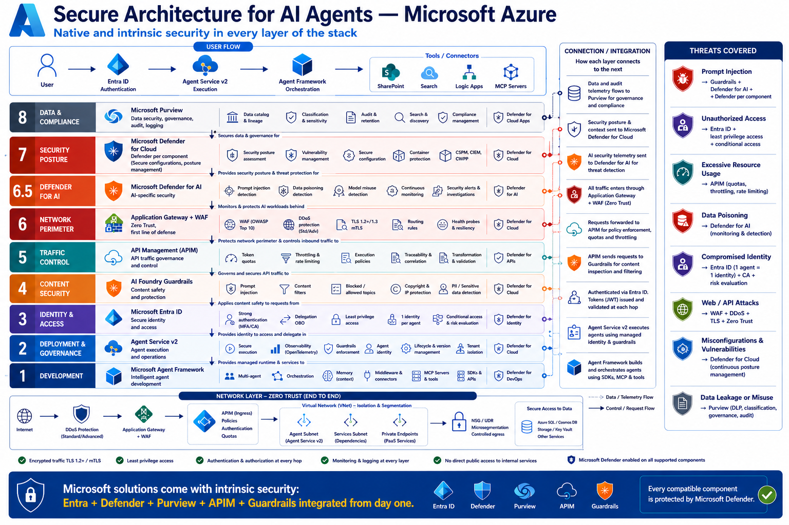

# Plan integrado: arquitectura segura para agentes de IA en Azure

*Ninja Training de Seguridad Microsoft · Edición 2026 · Plan transversal · Volver al [índice general](README.md) · Programa complementario: [Seguridad de agentes de IA en Microsoft Foundry](15_Seguridad_de_agentes_de_IA_en_Foundry/README.md)*

> **Qué responde este plan.** A partir de la infografía «Secure Architecture for AI Agents — Microsoft Azure», responde tres preguntas: (1) cómo usar los programas Ninja ya desarrollados para alcanzar el objetivo de la imagen, (2) qué entrenamientos faltaban y (3) qué cubre el programa complementario que cierra la diferencia. Las dos primeras se responden aquí con evidencia; la tercera, en resumen (sección 6) y en detalle en el programa 15: [Seguridad de agentes de IA en Microsoft Foundry](15_Seguridad_de_agentes_de_IA_en_Foundry/README.md). Para montar el laboratorio, usa el [Anexo de laboratorio en Azure](Anexo_Laboratorio_Azure_Defender_for_Cloud_y_Foundry.md).

*Infografía aportada por el usuario y analizada como material de estudio. Corte de las fuentes: 7 de noviembre de 2026.*

Este documento compara la infografía «Secure Architecture for AI Agents — Microsoft Azure» con lo que ya enseñan los 13 programas publicados de la serie y el programa 14, «Defender for Cloud», publicado junto con este plan. Identifica qué falta para cumplir el objetivo de la imagen y define cómo lo cierra el programa 15. El detalle elemento por elemento está en el [Anexo A](#anexo-a) de este documento y en la hoja «Cobertura por elemento» del libro de Excel del programa 15; la ruta de estudio, en la sección 7 y el [Anexo B](#anexo-b).

**Resumen.** Analicé 110 elementos: 56 capacidades de las capas, 14 flujos, 8 amenazas, 10 componentes de la banda de red, 7 principios y 15 elementos que la infografía omite. Los programas 01–14 cubren 35 de forma completa, 34 de forma parcial, 17 solo los mencionan y 24 no los cubren. Identidad, postura, protección de amenazas de IA y datos ya tienen programas con laboratorios. Las brechas se concentran en lo propio de Azure y de Foundry: control de tráfico con API Management, perímetro y red, seguridad de contenido y ejecución y desarrollo de agentes.

**Programas citados** (nombre corto y número): Sentinel (01), Defender XDR (02), Entra (03) = Entra: identidad y agentes, Security Copilot (04), Information Protection (05) = Purview Information Protection, Purview DLP (06), Ciclo de vida y registros (09) = Purview ciclo de vida y registros, eDiscovery y Audit (10) = Purview eDiscovery y Audit, Compliance Manager (11) = Purview Compliance Manager, Purview DSPM (12) = Purview DSPM y seguridad de datos para IA, Seguridad de Copilot (13) = Seguridad de Microsoft 365 Copilot, agentes y Copilot Studio, Defender for Cloud (14) y Foundry (15) = Seguridad de agentes de IA en Foundry, el complementario.

## 1. Objetivo de la infografía en una frase y criterios de éxito

**Objetivo:** diseñar, desplegar y operar agentes de IA en Azure con un control en cada capa —desarrollo, ejecución, identidad, contenido, tráfico, red, protección de amenazas, postura y datos— y con telemetría para detectar y responder, de modo que las ocho amenazas que nombra la imagen, y las que omite, queden prevenidas, detectadas o contenidas.

**Criterios de éxito.** Al terminar la ruta, tu organización puede demostrar diez resultados:

1. **Identidad sin secretos.** Cada agente publicado tiene su identidad de Entra Agent ID con sponsor; Foundry y los servicios de datos tienen deshabilitada la autenticación con claves; los roles de Azure son mínimos por persona.
2. **Ejecución gobernada.** Los agentes corren en Foundry Agent Service con configuración estándar, recursos propios y red privada; cada herramienta tiene su autenticación definida y las acciones sensibles exigen aprobación humana.
3. **Contenido protegido.** Cada agente tiene guardrails con Prompt Shields para el usuario y para documentos, material protegido y PII, probados también con ataques en español.
4. **Tráfico gobernado.** Todo consumo de modelos pasa por API Management con validación de tokens de Entra, límites de tokens por consumidor y registro.
5. **Sin exposición pública.** Hay una sola entrada por WAF con DDoS Protection; Foundry, AI Search, Storage, Cosmos DB y Key Vault solo aceptan private endpoints, y el egreso sale por Azure Firewall con una lista de destinos.
6. **Postura y amenazas.** Defender CSPM con AI-SPM y Defender for AI Services están activos y las alertas llevan el contexto del usuario final.
7. **Datos y cumplimiento.** Purview para Foundry funciona con contexto de usuario, el grounding está etiquetado y filtrado por permisos, y existe una evaluación con plantillas de IA.
8. **Evaluación continua.** El red teaming y las evaluaciones de seguridad corren en CI/CD con umbrales para publicar, y hay monitoreo continuo en producción.
9. **Detección y respuesta.** La telemetría de Foundry, APIM, WAF y Defender llega a Defender XDR y Sentinel, con reglas y playbooks de contención ensayados.
10. **Gobierno.** Hay inventario y ciclo de vida de agentes, un RACI entre plataforma, desarrollo, datos y seguridad, presupuesto y evidencia para el comité.

## 2. Lectura crítica de la infografía

Reutilizo los veredictos del análisis de fuentes públicas del 21 de octubre de 2026; la investigación posterior de la serie no los contradice y solo precisa dos puntos: los niveles de DDoS Protection y el estado de Defender for APIs.

**Lo que está bien:** la defensa en profundidad con Zero Trust de punta a punta, coherente con Zero Trust para IA (marzo de 2026); «un agente, una identidad», que coincide con Entra Agent ID; API Management para cuotas y límites contra el *denial of wallet*; guardrails con PII, material protegido y bloqueo de temas, y el aislamiento con VNet, private endpoints y egreso controlado de las arquitecturas *baseline* de Foundry.

**Lo que hay que corregir:**

| Elemento | Veredicto | Corrección o nombre vigente |
|---|---|---|
| «Agent Service v2» | Desactualizado | Foundry Agent Service; «v2» alude a los agentes de nueva generación sobre la Responses API. Los clásicos se retiran el 31-mar-2027. |
| «AI Foundry Guardrails», «Content filters» | Desactualizado | Guardrails de Microsoft Foundry. |
| «Microsoft Defender for AI» como capa 6.5 | Desactualizado | Defender for AI Services, plan de Defender for Cloud (capa 7). La detección por agente pasó a Defender XDR con Agent 365 el 1-jul-2026. |
| «Data poisoning detection» | Incorrecto | No existe; se mitiga con integridad del dato, Defender for Storage y evaluaciones. |
| «Model misuse detection» | Impreciso | Alertas reales: wallet attack, acceso anómalo, robo de credenciales, invocación anómala de herramientas. |
| «Defender for DevOps» | Desactualizado | DevOps security de Defender for Cloud con GitHub Advanced Security. |
| «Defender for Identity» (capa 3) | Impreciso | Protege a las personas; para agentes, ID Protection para agentes (requiere Agent 365). |
| «Defender for Cloud Apps» (capa 8) | Impreciso | Es para shadow AI; los datos de Foundry los protege Purview. |
| «Defender for Cloud» (capa 4) | Impreciso | Lo correcto es Defender for AI Services, alimentado por Prompt Shields. |
| «DDoS protection (Std/Adv)» | Desactualizado | DDoS Network Protection o IP Protection; no existe nivel «Advanced». |
| «APIM sends requests to Guardrails» | Impreciso | Los guardrails se aplican dentro de Foundry; APIM puede sumar llm-content-safety. |
| «Tenant isolation» | Impreciso | Aislamiento por proyecto y recursos propios; la autorización por usuario la implementa la app. |
| «1 identity per agent» | Correcto con matices | Las páginas de Microsoft se contradicen: la de identidad de agentes (28-oct-2026) da identidad propia a cada agente nuevo desde su creación; la de gobierno de Entra Agent ID dice que los agentes sin publicar comparten la identidad del proyecto. Verifícalo en tu entorno. |
| «Prompt Injection → Guardrails + Defender» | Correcto con matices | Prompt Shields para documentos viene desactivado; spotlighting en vista previa. |
| «Intrinsic security from day one», «Defender enabled on all» | Impreciso | Muchos controles se activan, se pagan o están en vista previa; no hay plan de Defender para Application Gateway. |

De los 95 elementos que muestra la imagen, 26 son correctos, 52 correctos con matices, 9 imprecisos, 6 desactualizados y 2 incorrectos. El problema mayor es lo que omite: sus ocho amenazas tocan solo 7 de los 14 dominios del catálogo. Por eso el plan suma 15 elementos faltantes (prefijo X), del shadow AI y el SOC a la cadena de suministro, el egreso y las evaluaciones.

## 3. Cobertura por capa

Por elemento: **completa** si un módulo la enseña con ejercicios; **parcial** si se enseña una parte, en otro producto o sin ejercicio; **mención** si solo se nombra. Por capa: completa si al menos dos tercios de sus capacidades son completas; parcial si al menos la mitad son completas o parciales; mención si al menos la mitad tiene alguna cobertura; si no, sin cobertura. Entre paréntesis va el conteo. Lo del programa 14 se contrastó con su contenido publicado.

| Capa | Qué pide la infografía | Programas y módulos que ya lo cubren | Cobertura | Delta |
|---|---|---|---|---|
| 8 · Datos y cumplimiento | Catálogo, clasificación, auditoría, eDiscovery, cumplimiento, Defender for Cloud Apps | Information Protection (05) · I2, I3, A1; Ciclo de vida y registros (09) · A1; eDiscovery y Audit (10) · A1; Compliance Manager (11) · M3; Purview DSPM (12) · M2, A4; Seguridad de Copilot (13) · M8 | Completa (5 completas, 1 parcial) | Purview para Foundry con contexto de usuario, etiquetas en AI Search, linaje (A4, M6) |
| 7 · Postura | Postura, vulnerabilidades, configuración, contenedores, CSPM, CIEM, CWPP | Defender for Cloud (14) · B1, B2, B5, M1–M5, A1; Defender XDR (02) · M6 | Completa, prevista en 14 (6 completas) | Recomendaciones y Azure Policy de Foundry (M7, A3) |
| 6.5 · Defender for AI | Detección de inyección, envenenamiento y mal uso; monitoreo; alertas | Purview DSPM (12) · A2; Security Copilot (04) · A7; Seguridad de Copilot (13) · A4; Defender for Cloud (14) · A2–A4 | Completa (5 completas, 1 mención) | Contexto del usuario, integridad del grounding, respuesta (A3, M6, A5) |
| 6 · Perímetro | WAF, DDoS, TLS y mTLS, enrutamiento, sondeos | Mención en Security Copilot (04) · I4; postura general en Defender for Cloud (14) · B2, M2 | Sin cobertura (1 parcial, 1 mención, 4 sin cobertura) | WAF, DDoS y TLS delante del agente (M5) |
| 5 · Tráfico | Cuotas de tokens, límites de tasa, políticas, trazabilidad, validación, Defender for APIs | Defender for Cloud (14) · M7 (solo Defender for APIs) | Sin cobertura (1 parcial, 5 sin cobertura) | API Management como AI gateway (M4) |
| 4 · Contenido | Inyección de prompts, filtros, temas bloqueados, material protegido, PII | Seguridad de Copilot (13) · A8, I4; Purview DSPM (12) · A2, A4 | Parcial (1 completa, 2 parciales, 2 menciones, 1 sin cobertura) | Guardrails de Foundry y su evaluación (M3, A1) |
| 3 · Identidad | MFA y acceso condicional, OBO, mínimo privilegio, identidad por agente, riesgo | Entra (03) · I3, I4, M1–M3, A1, X2, X3, X6; Defender XDR (02) · I5, M4, M5 | Parcial (3 completas, 3 parciales) | RBAC de Foundry, sin claves, OBO en herramientas (F4) |
| 2 · Ejecución y gobierno | Ejecución segura, observabilidad, guardrails, identidad, ciclo de vida, aislamiento | Entra (03) · X4, X6; Security Copilot (04) · A7; Seguridad de Copilot (13) · O3; Purview DSPM (12) · A2 | Mención (2 completas, 1 parcial, 2 menciones, 2 sin cobertura) | Configuración estándar, tracing, versiones, aislamiento (M2, A2, O2) |
| 1 · Desarrollo | Multiagente, orquestación, memoria, middleware, MCP, SDK, DevOps | Purview DSPM (12) · A4; Entra (03) · X3; Seguridad de Copilot (13) · A6; Defender for Cloud (14) · M8 | Mención (1 completa, 2 parciales, 2 menciones, 2 sin cobertura) | Desarrollo seguro, MCP gobernado, multiagente (M1, M2, A6, A7) |
| Banda de red | DDoS, WAF, APIM, VNet y subredes, private endpoints, NSG/UDR, acceso privado a datos | Sentinel (01) · X1; Defender for Cloud (14) · M4, M6, M7 | Mención (3 parciales, 3 menciones, 4 sin cobertura) | Red del Agent Service, DNS privado, egreso (M5, M6) |
| Principios | TLS, mínimo privilegio, autenticación por salto, monitoreo, sin acceso público, Defender en todo | Entra (03) · X3, X6; Seguridad de Copilot (13) · A5; Defender for Cloud (14) · B5 | Parcial (2 completas, 3 parciales, 2 sin cobertura) | TLS y CMK, autorización en la app, telemetría (M5, M6, A2, A5) |

Datos, postura y amenazas de IA tienen cobertura completa, e identidad una parcial pero sólida: Entra ya enseña identidades de agente y falta lo propio de Foundry. El delta está en la plataforma de Azure (tráfico, perímetro y red) y en el agente mismo (contenido, ejecución y desarrollo), justo lo que nadie «posee» por defecto.

## 4. Cobertura por amenaza

Las ocho primeras filas son las amenazas de la infografía; las demás, las que omite según el catálogo de 14 dominios del análisis previo.

| Amenaza | Controles correctos | Dónde se enseña hoy | Cobertura | Foundry (15) |
|---|---|---|---|---|
| Inyección de prompts | Prompt Shields, spotlighting, Defender for AI Services | Seguridad de Copilot (13) · I4, A8; Purview DSPM (12) · A2 | Parcial | M3, M1, A1, A5 |
| Acceso no autorizado | Entra, RBAC de Foundry, sin claves, red privada | Entra (03) · I4, X3, X6 | Parcial | F4, M5, M7 |
| Uso excesivo de recursos | Límites de tokens, cuotas, presupuestos, alertas | Seguridad de Copilot (13) · I4 | Mención | M4, O3, M7 |
| Envenenamiento de datos | Integridad del grounding y la memoria, evaluaciones | Seguridad de Copilot (13) · I4; Defender for Cloud (14) · M6 | Mención | M6, A1, A6 |
| Identidad comprometida | Agent ID sin secretos, ID Protection, respuesta | Entra (03) · X2, A1, A2; Defender XDR (02) · M5 | Completa | F4, A5 |
| Ataques web y a APIs | WAF, DDoS, TLS, Defender for APIs | Defender for Cloud (14) · M7 | Parcial | M5, M4 |
| Configuraciones erróneas y vulnerabilidades | Defender CSPM con AI-SPM, Azure Policy | Defender for Cloud (14) · M2, A1; Purview DSPM (12) · A2 | Completa | M7, A3 |
| Fuga o mal uso de datos | Purview para Foundry, seguridad por documento, egreso | Purview DSPM (12) · M2, A4; Purview DLP (06) · M3 | Completa | A4, M6, M5 |
| Inyección indirecta y secuestro del objetivo | Prompt Shields para documentos, task adherence | Seguridad de Copilot (13) · I4, A8; Security Copilot (04) · X3 | Parcial | M3, M1, A1 |
| Abuso de herramientas | Aprobación humana, mínimo privilegio por herramienta | Entra (03) · X3; Seguridad de Copilot (13) · A6 | Parcial | M1, M2, A7 |
| Cadena de suministro | Escaneo de modelos, registro privado de MCP | Seguridad de Copilot (13) · A6; Defender for Cloud (14) · M8 | Parcial | A6 |
| Sobreexposición en RAG | Filtros de permisos y etiquetas en AI Search | Seguridad de Copilot (13) · I5; Purview DSPM (12) · I3, M4 | Parcial | M6 |
| Claves robadas y LLMjacking | Sin claves, Key Vault, alertas | Entra (03) · A1; Defender XDR (02) · M5 | Parcial | F4, M6, O3 |
| Exfiltración por el egreso | Azure Firewall con FQDN, Network Security Perimeter | — | Sin cobertura | M5 |
| Alucinaciones y propiedad intelectual | Groundedness, Customer Copyright Commitment | Seguridad de Copilot (13) · I1 | Mención | M3, A1 |
| Shadow AI | Defender for Cloud Apps, DSPM para IA, AI-SPM | Seguridad de Copilot (13) · M8; Purview DSPM (12) · M3 | Completa | M7 |
| Ceguera del SOC | Telemetría de IA, detecciones, playbooks | Seguridad de Copilot (13) · A5, A8; Defender for Cloud (14) · A3–A5 | Parcial | A5, A2 |
| Agentes sin dueño ni ciclo de vida | Control Plane, sponsors, ciclo de vida | Entra (03) · X4; Seguridad de Copilot (13) · O3 | Parcial | M7, O2 |

De las ocho amenazas de la imagen, 3 tienen cobertura completa (identidad comprometida, configuraciones erróneas y la parte de Purview de la fuga de datos), 3 parcial y 2 solo mención: uso excesivo de recursos y envenenamiento, asignados a componentes que la serie no enseña o a una detección que no existe. Entre las omitidas, solo shadow AI está completa y el egreso no tiene cobertura.

## 5. Entrenamientos que faltan

**5.1 Plataforma y ejecución de agentes (capas 1 y 2).** Falta: configuración estándar del Agent Service, desarrollo seguro con Agent Framework (middleware, aprobación humana, memoria, secretos), versiones, multiagente y A2A. Importa porque ahí se decide qué puede hacer el agente y con qué datos; hoy la serie solo crea agentes de prueba sin endurecerlos (Security Copilot (04) · A7, Entra (03) · X6). Programa 15: lo cubre por completo con F1, M1, M2, A7 y O2.

**5.2 Seguridad de contenido y evaluación (capa 4).** Falta: guardrails de Foundry (Prompt Shields para documentos, spotlighting, task adherence, PII, material protegido, listas de bloqueo), groundedness y evaluaciones en CI/CD. Importa porque la inyección indirecta es el vector más confiable y su detección viene desactivada; sin evaluaciones no hay criterio para publicar. Programa 15: lo cubre con M3 y A1, sobre la base de red teaming de Seguridad de Copilot (13) · A8.

**5.3 Tráfico, perímetro y red (capas 5 y 6).** Falta: API Management como AI gateway, WAF, DDoS Protection, TLS, private endpoints, red del Agent Service y egreso por Azure Firewall. Importa porque es la zona menos cubierta de la imagen; sin ella el agente queda expuesto y sin control de costos. Programa 15: M4 y M5 cubren lo que necesita una arquitectura de agentes. Para profundidad de plataforma recomiendo dos programas futuros: «Seguridad de red de Azure» (Azure Firewall Premium, WAF a escala, Front Door, DDoS, Private Link y DNS a escala, Network Security Perimeter) y «API Management y AI gateway» (multirregión, workspaces, gateways autohospedados, API Center).

**5.4 Datos y conocimiento (capa 8 y acceso a datos).** Falta: seguridad por documento en Azure AI Search; Storage, Cosmos DB y Key Vault endurecidos; claves del cliente; integridad del grounding y de la memoria; catálogo y linaje. Importa porque la sobreexposición y el envenenamiento ocurren en el grounding, no en el modelo. Programa 15: M6 cierra la parte del agente; catálogo, linaje y calidad merecen un programa futuro «Purview Unified Catalog y gobierno de datos».

**5.5 Gobierno de plataforma, costos y responsabilidad compartida.** Falta: Azure Policy para Foundry, modelos aprobados, cuotas, Foundry Control Plane, FinOps de IA, LLMjacking, residencia y responsabilidad compartida en MCSA. Importa porque sin reglas aparecen recursos de IA sombra y costos sin dueño; además no hay una Data Zone de Latinoamérica documentada. Programa 15: lo cubre con F1, M7, O1 y O3.

**5.6 Observabilidad y operación de seguridad.** Falta: tracing con OpenTelemetry, telemetría de Foundry, APIM, WAF y Firewall en Sentinel, reglas y playbooks para agentes de Foundry. Importa porque la infografía termina en «alerts & investigations» y el SOC de la serie hoy ve Copilot, no Foundry. Programa 15: lo cubre con A2 y A5, sobre Sentinel (01), Defender XDR (02), Seguridad de Copilot (13) · A4, A5 y A8 y Defender for Cloud (14) · A3–A5.

**5.7 Cadena de suministro de IA.** Falta: procedencia y escaneo de modelos, registro privado de MCP, tool poisoning, rug pull y dependencias. Importa porque un servidor MCP o un modelo comprometido entra con los permisos del agente. Programa 15: lo cubre con A6, junto con DevOps security de Defender for Cloud (14) · M8; GitHub Advanced Security en profundidad queda como candidato a un programa futuro de DevSecOps.

**5.8 Integraciones con programas existentes.** Qué es: el punto de integración de Defender for AI Services y AI-SPM, Purview para Foundry, Entra Agent ID y la operación del SOC. Importa porque repetirlas duplica horas y desactualiza contenido en dos lugares. Programa 15: enseña solo el punto de integración (F4, A3, A4 y A5) y remite a Defender for Cloud (14) · A1–A2, Purview DSPM (12) · M2 y A4 y Entra (03) · X2–X6.

**5.9 Fuera de alcance: Agent 365 y Microsoft 365 E7.** Qué queda fuera: la postura, la detección y la protección en tiempo real de agentes de Foundry en Defender (desde el 1-jul-2026), el acceso condicional y ID Protection para agentes, y la observabilidad de IA y Risky Agents en Purview. Importa porque son fronteras de licencia que la serie decidió no cruzar. Programa 15: enseña la alternativa dentro del alcance (mínimo privilegio, sin claves, red, guardrails, Defender for AI Services a nivel de modelo, auditoría y Sentinel) y marca la dependencia. Un programa de Agent 365 solo tendría sentido si la serie cambia de alcance.

## 6. El programa complementario (15) en una tabla

Foundry (15) suma 151 horas en 28 módulos (145 sin la comunidad). El Anexo A indica, para cada elemento, qué módulos de este programa cierran el delta.

| Código | Título | Delta que cierra | Capas |
|---|---|---|---|
| P0 | Prerrequisitos (4 h) | Vocabulario de modelos, RAG, agentes y MCP; SDK seguro | 1 |
| F0 | Cómo usar este programa (2 h) | Ruta con 03, 12, 13 y 14 sin repetir contenido | Transversal |
| F1 | Microsoft Foundry por dentro (5 h) | Nombres vigentes, residencia y responsabilidad compartida | 2, transversal |
| F2 | La arquitectura segura por capas (5 h) | Infografía corregida: protectores, capa 6.5, seguridad «intrínseca» | 8, 6.5, 4 |
| F3 | Modelado de amenazas para agentes de IA (5 h) | Modelo de amenazas sobre la arquitectura de Azure | Transversal |
| F4 | Identidad y acceso en Foundry (5 h) | RBAC por persona, sin claves, identidad de agente, OBO | 3, 2 |
| F5 | Laboratorio de práctica (6 h) | Entorno seguro con créditos de Visual Studio | Todas |
| M1 | Desarrollo seguro con Microsoft Agent Framework (7 h) | Middleware, aprobación humana, memoria, secretos | 1, 4 |
| M2 | Foundry Agent Service (7 h) | Configuración estándar, red, herramientas, MCP, versiones | 2, 1, red |
| M3 | Guardrails y seguridad de contenido (7 h) | Prompt Shields para documentos, task adherence, PII, groundedness | 4, 2 |
| M4 | API Management como AI gateway (7 h) | Tokens, cuotas, validación, registro, gateway MCP | 5, red |
| M5 | Red Zero Trust para agentes (8 h) | WAF, DDoS, TLS, private endpoints, egreso | 6, red |
| M6 | Datos y conocimiento (6 h) | Seguridad por documento, CMK, integridad del grounding | 8, red, 1 |
| M7 | Gobierno de modelos y de la plataforma (6 h) | Modelos aprobados, cuotas, Control Plane, IA sombra | 7, 2 |
| A1 | Evaluaciones de seguridad y red teaming (7 h) | Evaluaciones y red teaming en CI/CD | 4, 6.5 |
| A2 | Observabilidad de agentes (6 h) | Tracing y monitoreo continuo | 2, 5 |
| A3 | Defender for Cloud aplicado a Foundry (6 h) | Contexto de usuario, AI-SPM aplicado, planes y costos | 7, 6.5, 1 |
| A4 | Purview para Foundry (6 h) | Purview con contexto de usuario, DLP, APIs | 8, 4 |
| A5 | Detección y respuesta a incidentes de agentes (8 h) | Telemetría en Sentinel y playbooks de agentes | 6.5, 6, 3 |
| A6 | Cadena de suministro de IA (6 h) | Modelos, MCP y dependencias confiables | 1, 7 |
| A7 | Sistemas multiagente y A2A (6 h) | Confianza entre agentes y límites de autoridad | 1, 3 |
| O1 | Marcos y gobierno de la IA en Azure (5 h) | Marcos de IA aplicados a Azure y a MCSA | 8, transversal |
| O2 | Modelo operativo y ciclo de vida de los agentes (5 h) | RACI y ciclo de vida de agentes | 2, transversal |
| O3 | Costos y abuso de recursos (4 h) | FinOps, denial of wallet, LLMjacking | 5, 6.5 |
| O4 | Proyecto integrador (6 h) | Infografía corregida implementada con evidencias | Todas |
| C1–C3 | Comunidad (6 h) | Referentes y recursos en español | — |

## 7. Ruta integrada recomendada

La ruta combina Foundry (15) con módulos de otros programas que ya enseñan lo necesario: **315 horas** en total (145 de Foundry y 170 de otros programas), aunque cada rol toma solo sus filas. Las horas salen de `plan.csv` (01–13) y de los temarios (14 y 15). Roles: Arq = arquitecto de IA, Plat = ingeniero de plataforma, Dev = desarrollador de agentes, Datos = seguridad de datos, SOC, Gob = gobierno/CISO. Los resultados esperados de cada fila están en el Anexo B.

| Fase | Programa · módulos | Horas | Roles |
|---|---|---|---|
| Fase 1 · Fundamentos y modelo de amenazas | Foundry (15) · P0, F0, F1, F2, F3 | 21 | Arq, Plat, Dev, Datos, SOC, Gob |
| Fase 2 · Identidad de agentes (capa 3) | Entra (03) · P0, A1, X2, X3, X6 | 31 | Arq, Plat, Dev |
| Fase 2 | Entra (03) · X1, X4 | 8 | Gob, Arq |
| Fase 2 | Foundry (15) · F4, F5 | 11 | Arq, Plat, Dev, Datos, SOC |
| Fase 3 · Construir y ejecutar agentes seguros (capas 1, 2 y 4) | Foundry (15) · M1, M2, M3 | 21 | Dev, Arq, Plat |
| Fase 4 · Tráfico, red y datos (capas 5, 6 y banda de red) | Foundry (15) · M4, M5 | 15 | Plat, Arq |
| Fase 4 | Foundry (15) · M6, M7 | 12 | Plat, Arq, Datos, Gob |
| Fase 5 · Postura y protección de cargas (capas 6.5 y 7) | Defender for Cloud (14) · B1, B2, M2, A1, A2 | 31 | Arq, Plat, SOC |
| Fase 5 | Defender for Cloud (14) · M6, M7, M8 | 17 | Plat, Dev, Datos |
| Fase 5 | Foundry (15) · A3 | 6 | Arq, Plat, Dev, SOC |
| Fase 6 · Datos y cumplimiento (capa 8) | Purview DSPM (12) · I2, M2, A2, A4 | 23 | Datos, Gob |
| Fase 6 | eDiscovery y Audit (10) · A1 | 4 | Datos, SOC |
| Fase 6 | Compliance Manager (11) · M3 | 4 | Gob, Datos |
| Fase 6 | Foundry (15) · A4 | 6 | Datos, Arq, Dev |
| Fase 7 · Ingeniería avanzada: evaluación, observabilidad, cadena de suministro y multiagente | Foundry (15) · A1, A2, A6, A7 | 25 | Dev, Plat, Arq |
| Fase 8 · Detección y respuesta (SOC) | Defender for Cloud (14) · A3, A4, A5 | 22 | SOC |
| Fase 8 | Seguridad de Copilot (13) · A4, A5, A8 | 21 | SOC |
| Fase 8 | Foundry (15) · A5 | 8 | SOC, Plat |
| Fase 9 · Gobierno, operación y proyecto integrador | Foundry (15) · O1, O2, O3, O4 | 20 | Gob, Arq, Plat |
| Fase 9 | Seguridad de Copilot (13) · O1, O6 | 9 | Gob, Datos |

| Rol | Ruta completa | Ruta mínima si tienes poco tiempo | Horas mínimas |
|---|---|---|---|
| arquitecto de IA | 207 h | Foundry (15) · F1, F2, F3, F4, M2, M4, M5, M6, A3, A4, O4; Defender for Cloud (14) · A1 | 73 h |
| ingeniero de plataforma | 218 h | Foundry (15) · F4, F5, M2, M4, M5, M6, M7, A2; Defender for Cloud (14) · A1, A2 | 65 h |
| desarrollador de agentes | 138 h | Foundry (15) · P0, F3, F4, M1, M2, M3, A1, A6; Entra (03) · X6 | 54 h |
| seguridad de datos | 107 h | Foundry (15) · F2, M6, A4; Purview DSPM (12) · M2, A4; Compliance Manager (11) · M3 | 35 h |
| SOC | 124 h | Foundry (15) · F3, A2, A5; Defender for Cloud (14) · A2, A4; Seguridad de Copilot (13) · A5, A8 | 47 h |
| gobierno/CISO | 97 h | Foundry (15) · F2, F3, O1, O2, O3; Entra (03) · X4; Compliance Manager (11) · M3; Seguridad de Copilot (13) · O6 | 37 h |

**No se cuentan** los prerrequisitos: el SOC llega con los niveles 1 y 2 de Sentinel (01) y Defender XDR (02); seguridad de datos, con la base de Information Protection (05) y Purview DLP (06); quien diseña identidad, con los niveles 1 y 2 de Entra (03). La comunidad de Foundry (C1–C3) es transversal.

## 8. Supuestos y límites del análisis

- **Método.** Leí los 318 módulos publicados de 01–13 (introducción y «Manos a la obra») y busqué palabras clave como Foundry, Prompt Shields, APIM, WAF, DDoS, private endpoint, Agent ID, OBO, MCP, AI-SPM, OpenTelemetry o AI Search. Los `Laboratorio parcial` cuentan como práctica.
- **Programa 14.** Se escribió en paralelo con este análisis: la cobertura se calculó con su temario y luego se contrastó con su contenido publicado (8-nov-2026). 30 filas lo citan y 13 dependen solo de él (6 completas, 6 parciales y 1 con mención); si su contenido cambia, hay que recalcularlas.
- **Programa 15.** Módulos y horas salen de su temario; su investigación al 7-nov-2026 confirmó estados, nombres y precios. Los estados citados (vista previa, valores por defecto) vienen del análisis previo y de la investigación de la serie al 7-nov-2026.
- **Veredictos.** Son los del análisis del 21-oct-2026; su tabla salta las letras e, k y n. Solo verifiqué en la web los niveles de DDoS Protection (Learn, 7-nov-2026); Defender for APIs, DevOps security y las alertas de Defender for AI Services los contrasté con la investigación en curso del programa 14.
- **Interpretación.** «Execution policies», «Tenant isolation» y «Search» son ambiguos: los leí como políticas de APIM, aislamiento de datos del Agent Service y Azure AI Search. Las herramientas del flujo del usuario se agrupan en conocimiento (SharePoint, Search) y acción (Logic Apps, MCP). En los «protectores» Defender de cada capa, la cobertura se mide sobre el control correcto.
- **Agent 365 y E7** quedan fuera por decisión de la serie: la cobertura mide la alternativa dentro del alcance.
- **Horas.** Son estimaciones; quien ya domina un programa puede saltar sus filas.
- **Región.** MCSA significa México, Centroamérica y Sudamérica, sin Brasil; la residencia y la disponibilidad de modelos se validan por país.

## Anexo A. Cobertura elemento por elemento

Cobertura medida sobre los programas 01 a 14. **Completa**: un módulo lo enseña con ejercicios; **Parcial**: se enseña una parte, en otro producto o sin ejercicio; **Mención**: solo se nombra; **Sin cobertura**: no aparece. La última columna indica qué módulos del programa 15 cierran el delta.

### Capa 8 · Datos y cumplimiento

| Id | Tipo | Elemento | Nombre vigente | Veredicto | Ya lo cubren | Cobertura | Delta | Programa 15 |
|---|---|---|---|---|---|---|---|---|
| C8-01 | capa | Data catalog & lineage | Microsoft Purview Unified Catalog y Data Map (escaneo, catálogo y linaje de los orígenes de datos) | Correcto con matices | Purview Information Protection (05) · M3 | Parcial | Catálogo, linaje y procedencia de los orígenes de grounding (Storage, bases de datos, índices de Azure AI Search). La serie no tiene un programa de gobierno de datos. | M6 |
| C8-02 | capa | Classification & sensitivity | Purview Information Protection: tipos de información confidencial, clasificadores y etiquetas de confidencialidad (etiquetas en Azure AI Search en vista previa) | Correcto | Purview Information Protection (05) · I2; Purview Information Protection (05) · I3; Purview Information Protection (05) · M1; Purview Information Protection (05) · A1; Purview DSPM y seguridad de datos para IA (12) · M2 | Completa | Llevar las etiquetas a los índices de Azure AI Search o Foundry IQ y respetarlas al recuperar (vista previa; sin cobertura de documentos sin etiqueta ni invitados). | M6; A4 |
| C8-03 | capa | Audit & retention | Purview Audit y Data Lifecycle Management (ubicación «Enterprise AI apps», que incluye Microsoft Foundry) | Correcto con matices | Purview eDiscovery y Audit (10) · I2; Purview eDiscovery y Audit (10) · A1; Purview ciclo de vida y registros (09) · A1; Purview DSPM y seguridad de datos para IA (12) · M2; Security Copilot (04) · A7 | Completa | Activar la integración desde Foundry Control Plane o Defender for Cloud, pasar el contexto del usuario de Entra (sin él la interacción se audita, pero las políticas no se aplican) y decidir la retención de las interacciones de Foundry. | A4 |
| C8-04 | capa | Search & discovery | Purview eDiscovery: búsqueda, retención legal y exportación de interacciones de IA | Correcto | Purview eDiscovery y Audit (10) · I3; Purview eDiscovery y Audit (10) · A1; Seguridad de Microsoft 365 Copilot, agentes y Copilot Studio (13) · A2 | Completa | Practicar la búsqueda sobre interacciones de un agente de Foundry: los laboratorios publicados usan Copilot. | A4 |
| C8-05 | capa | Compliance management | Purview Compliance Manager con plantillas de IA (EU AI Act, ISO/IEC 42001, ISO/IEC 23894, NIST AI RMF) y evaluaciones sincronizadas desde Foundry | Correcto con matices | Purview Compliance Manager (11) · M3; Purview Compliance Manager (11) · M2; Seguridad de Microsoft 365 Copilot, agentes y Copilot Studio (13) · O1; Purview DSPM y seguridad de datos para IA (12) · A3 | Completa | Relacionar los controles técnicos de Azure (MCSB de IA, CAF, Well-Architected y Zero Trust para IA) con la evidencia. | O1 |
| C8-06 | capa | Defender for Cloud Apps | Defender for Cloud Apps: descubrir, sancionar y bloquear apps de IA generativa (shadow AI) y app governance | Impreciso | Seguridad de Microsoft 365 Copilot, agentes y Copilot Studio (13) · M8; Seguridad de Microsoft 365 Copilot, agentes y Copilot Studio (13) · A4; Purview DSPM y seguridad de datos para IA (12) · M3 | Completa | Ninguno para su función real; la seguridad de los datos de Foundry corresponde a Purview (C8-03). | F2 |
| F-06 | flujo | 1. Data and audit telemetry flows to Purview for governance and compliance. | Integración de Purview con Microsoft Foundry (seguridad de datos para interacciones de IA), activada desde Defender for Cloud o Foundry Control Plane | Correcto con matices | Purview DSPM y seguridad de datos para IA (12) · M2; Purview DSPM y seguridad de datos para IA (12) · A4; Security Copilot (04) · A7 | Completa | No es automática: hay que activarla, pasar el token o el contexto del usuario y, en apps propias, usar las APIs o el SDK de Purview; aún no admite aislamiento de red. | A4 |
| T-08 | amenaza | Data Leakage or Misuse → Purview (DLP, classification, governance, audit) | Fuga de datos: Purview para Foundry (auditoría, DLP por SIT, etiquetas), seguridad por documento en AI Search y control de egreso | Correcto con matices | Purview DSPM y seguridad de datos para IA (12) · M2; Purview DSPM y seguridad de datos para IA (12) · A4; Purview DLP (06) · M3; Purview Information Protection (05) · A1 | Completa | Fuera de Purview: seguridad por documento en AI Search, canales de salida del agente y egreso de red. | A4; M6; M5 |
| X-01 | faltante | Shadow AI y uso no autorizado de IA (apps de terceros, agentes no sancionados y recursos de IA «sombra» en Azure) | Defender for Cloud Apps, Entra Internet Access, Purview DSPM para IA, AI-SPM y Azure Policy | No aplica | Seguridad de Microsoft 365 Copilot, agentes y Copilot Studio (13) · M8; Purview DSPM y seguridad de datos para IA (12) · M3; Purview DLP (06) · M3; Entra: identidad y agentes (03) · M8; Security Copilot (04) · X3 | Completa | Recursos de IA no autorizados en suscripciones de Azure: inventario con AI-SPM y Azure Policy de servicios y modelos permitidos. | M7 |
| X-10 | faltante | Sobreexposición en RAG y seguridad por documento | Azure AI Search con filtros de permisos de Entra y etiquetas de Purview (vista previa); Foundry IQ | No aplica | Seguridad de Microsoft 365 Copilot, agentes y Copilot Studio (13) · I5; Seguridad de Microsoft 365 Copilot, agentes y Copilot Studio (13) · M1; Purview DSPM y seguridad de datos para IA (12) · I3; Purview DSPM y seguridad de datos para IA (12) · M4 | Parcial | Recorte por permisos en los índices y control de lo que el agente puede recuperar. | M6 |

### Capa 7 · Postura de seguridad

| Id | Tipo | Elemento | Nombre vigente | Veredicto | Ya lo cubren | Cobertura | Delta | Programa 15 |
|---|---|---|---|---|---|---|---|---|
| C7-01 | capa | Security posture assessment | Foundational CSPM y Defender CSPM: MCSB, puntuación segura y recomendaciones | Correcto | Defender for Cloud (14) · B2; Defender for Cloud (14) · M2; Purview Compliance Manager (11) · M2 | Completa | Recomendaciones propias de Foundry (autenticación local, acceso público, red) aplicadas a la arquitectura. | A3; M7 |
| C7-02 | capa | Vulnerability management | Microsoft Defender Vulnerability Management y escaneo sin agente (Defender for Servers Plan 2 y Defender CSPM) | Correcto | Defender for Cloud (14) · M3; Defender XDR (02) · M6 | Completa | Vulnerabilidades de la pila de IA: imágenes con librerías de IA, repositorios que aprovisionan modelos y servidores MCP propios. | A6 |
| C7-03 | capa | Secure configuration | Recomendaciones de MCSB, Azure Policy e iniciativas de Defender for Cloud | Correcto | Defender for Cloud (14) · B2; Defender for Cloud (14) · M1; Defender for Cloud (14) · M4 | Completa | Línea base de configuración de Foundry, Agent Service, AI Search y APIM como código. | M7; F5 |
| C7-04 | capa | Container protection | Defender for Containers | Correcto con matices | Defender for Cloud (14) · M5 | Completa | Solo aplica a imágenes en tus registros y a clústeres propios (AKS u otros) donde corran agentes de Agent Framework. | — |
| C7-05 | capa | CSPM, CIEM, CWPP | Defender CSPM (incluye AI-SPM y CIEM) y planes de protección de cargas (CWPP) | Correcto | Defender for Cloud (14) · B5; Defender for Cloud (14) · M2; Defender for Cloud (14) · A1 | Completa | Rutas de ataque hacia los datos de grounding y permisos de las identidades de agentes en la arquitectura de Foundry. | A3 |
| C7-06 | capa | Defender for Cloud (protector de la capa 7) | Microsoft Defender for Cloud (CNAPP) | Correcto | Defender for Cloud (14) · B1; Defender for Cloud (14) · B5 | Completa | Qué planes activar para una arquitectura de agentes de Foundry y cuánto cuestan. | A3; O3 |
| F-07 | flujo | 2. Security posture & context sent to Microsoft Defender for Cloud. | Defender CSPM con AI-SPM (descubrimiento sin agente desde el plano de control de Azure) | Correcto con matices | Purview DSPM y seguridad de datos para IA (12) · A2; Defender for Cloud (14) · A1; Defender for Cloud (14) · M2 | Completa | Activar Defender CSPM; la postura por agente pasó a Agent 365. | A3 |
| T-07 | amenaza | Misconfigurations & Vulnerabilities → Defender for Cloud (continuous posture management) | Defender CSPM con AI-SPM, Azure Policy y gestión de vulnerabilidades | Correcto | Defender for Cloud (14) · B2; Defender for Cloud (14) · M2; Defender for Cloud (14) · A1; Purview DSPM y seguridad de datos para IA (12) · A2; Defender XDR (02) · M6 | Completa | Azure Policy específicas de Foundry y modelos aprobados. | M7; A3 |

### Capa 6.5 · Defender for AI

| Id | Tipo | Elemento | Nombre vigente | Veredicto | Ya lo cubren | Cobertura | Delta | Programa 15 |
|---|---|---|---|---|---|---|---|---|
| C6.5-01 | capa | Prompt injection detection | Alertas de jailbreak de Defender for AI Services (detectado o bloqueado por Prompt Shields) y de ASCII smuggling | Correcto con matices | Purview DSPM y seguridad de datos para IA (12) · A2; Security Copilot (04) · A7; Seguridad de Microsoft 365 Copilot, agentes y Copilot Studio (13) · A4; Defender for Cloud (14) · A2 | Completa | Enviar el contexto de seguridad del usuario final (UserSecurityContext) para que la alerta identifique usuario y aplicación. La detección de XPIA a nivel de agente pasó a Defender XDR con Agent 365. | A3; A5 |
| C6.5-02 | capa | Data poisoning detection | No existe como detección. Se mitiga con integridad y gobierno del dato (Purview, Defender for Storage, pipelines controlados), evaluaciones y groundedness | Incorrecto | Seguridad de Microsoft 365 Copilot, agentes y Copilot Studio (13) · I4; Defender for Cloud (14) · M6 | Mención | Controles de integridad de los datos de grounding y de la memoria (quién escribe en los índices, versiones, aprobación de fuentes), escaneo de malware en cargas y evaluaciones de groundedness y de regresión. | M6; A1; A6 |
| C6.5-03 | capa | Model misuse detection | Alertas de Defender for AI Services: wallet attack, acceso anómalo, robo de credenciales, phishing, invocación anómala de herramientas y reconocimiento de LLM (vista previa) | Impreciso | Defender for Cloud (14) · A2; Purview DSPM y seguridad de datos para IA (12) · A2 | Completa | Responder a las alertas de abuso: bloquear al consumidor en APIM, rotar o deshabilitar claves y pasar a autenticación con Entra. | A5; O3 |
| C6.5-04 | capa | Continuous monitoring | Protección contra amenazas de IA en tiempo de ejecución (Defender for AI Services) y tablero de datos e IA de Defender for Cloud | Correcto con matices | Defender for Cloud (14) · A2; Purview DSPM y seguridad de datos para IA (12) · A2; Seguridad de Microsoft 365 Copilot, agentes y Copilot Studio (13) · A4 | Completa | Monitoreo del comportamiento del agente (trazas, métricas de seguridad y evaluación continua), que Defender no cubre por sí solo. | A2; A1 |
| C6.5-05 | capa | Security alerts & investigations | Alertas de IA de Defender for Cloud correlacionadas en incidentes de Defender XDR, con evidencia de prompts | Correcto | Defender for Cloud (14) · A2; Defender for Cloud (14) · A3; Defender for Cloud (14) · A4; Defender XDR (02) · M1; Seguridad de Microsoft 365 Copilot, agentes y Copilot Studio (13) · A4 | Completa | Playbooks de investigación y contención para incidentes de agentes de Foundry. | A5 |
| C6.5-06 | capa | Defender for AI (protector de la capa 6.5) | Defender for AI Services (plan de Defender for Cloud); a nivel de agente, Defender XDR con Agent 365 | Desactualizado | Defender for Cloud (14) · A2; Purview DSPM y seguridad de datos para IA (12) · A2; Security Copilot (04) · A7 | Completa | Ubicarlo dentro de la capa 7 y separar modelo (Defender for AI Services) de agente (Agent 365, fuera de alcance). | F2; A3 |
| F-08 | flujo | 3. AI security telemetry sent to Defender for AI for threat detection. | Defender for AI Services analiza prompts y respuestas de las implementaciones de modelos; el contexto del usuario viaja en UserSecurityContext | Impreciso | Purview DSPM y seguridad de datos para IA (12) · A2; Security Copilot (04) · A7; Defender for Cloud (14) · A2 | Completa | Incluir el contexto del usuario en las llamadas; la detección a nivel de agente pasó a Defender XDR con Agent 365. | A3 |
| T-04 | amenaza | Data Poisoning → Defender for AI (monitoring & detection) | Envenenamiento de datos, memoria y RAG: integridad y gobierno del dato, Defender for Storage y evaluaciones | Incorrecto | Seguridad de Microsoft 365 Copilot, agentes y Copilot Studio (13) · I4; Security Copilot (04) · X3; Defender for Cloud (14) · M6 | Mención | Ver C6.5-02: integridad del grounding y de la memoria, procedencia y evaluaciones. | M6; A1; A6 |

### Capa 6 · Perímetro de red

| Id | Tipo | Elemento | Nombre vigente | Veredicto | Ya lo cubren | Cobertura | Delta | Programa 15 |
|---|---|---|---|---|---|---|---|---|
| C6-01 | capa | WAF (OWASP Top 10) | Azure Web Application Firewall en Application Gateway WAF v2 (o en Azure Front Door Premium) con conjuntos de reglas administrados | Correcto con matices | Security Copilot (04) · I4 | Mención | WAF delante del agente: modo detección antes que prevención, reglas personalizadas y de límite de tasa, exclusiones para cuerpos JSON con prompts y registros hacia Sentinel. | M5 |
| C6-02 | capa | DDoS protection (Std/Adv) | Azure DDoS Protection: Network Protection o IP Protection (la protección de infraestructura es gratuita y automática) | Desactualizado | — | Sin cobertura | Elegir nivel (por plan o por IP), qué IP públicas proteger (Application Gateway, Front Door) y sus límites: no cubre API Management fuera del modo con red virtual. | M5 |
| C6-03 | capa | TLS 1.2+/1.3 mTLS | Directivas TLS y autenticación mutua (mTLS) de Application Gateway; TLS de extremo a extremo hasta APIM y los backends | Correcto con matices | — | Sin cobertura | Política TLS mínima, certificados en Key Vault, mTLS con clientes de confianza y TLS de extremo a extremo. | M5 |
| C6-04 | capa | Routing rules | Agentes de escucha, reglas de enrutamiento y reescritura de Application Gateway | Correcto | — | Sin cobertura | Publicar solo las rutas necesarias hacia APIM y la aplicación y reescribir encabezados. | M5 |
| C6-05 | capa | Health probes & resiliency | Sondeos de estado de Application Gateway; resiliencia de los backends de modelos con grupos de backends, balanceo y circuit breaker de APIM | Correcto con matices | — | Sin cobertura | Disponibilidad ante saturación o ataque (denegación de servicio de IA): cuotas del modelo, balanceo entre implementaciones y circuit breaker. | M4; M5 |
| C6-06 | capa | Defender for Cloud (protector de la capa 6) | Recomendaciones de red de Defender for Cloud (MCSB) y rutas de ataque; no hay un plan de protección de cargas para Application Gateway | Correcto con matices | Defender for Cloud (14) · B2; Defender for Cloud (14) · M2 | Parcial | Recomendaciones de exposición de red de Foundry, AI Search y APIM, y telemetría de WAF y Firewall hacia el SOC. | M5; A3; A5 |
| F-09 | flujo | 4. All traffic enters through Application Gateway + WAF (Zero Trust). | Entrada única desde Internet por Application Gateway WAF v2 o Front Door Premium con WAF | Correcto con matices | — | Sin cobertura | Vale para la entrada desde Internet; no cubre el egreso del agente, el tráfico interno ni el acceso de empleados a IA de terceros (Entra Internet Access). | M5 |
| T-06 | amenaza | Web / API Attacks → WAF + DDoS + TLS + Zero Trust | Ataques web y a APIs: WAF, DDoS Protection, TLS, Defender for APIs y validación en APIM | Correcto con matices | Defender for Cloud (14) · M7 | Parcial | WAF, DDoS, TLS y validación de APIs en la arquitectura del agente. | M5; M4 |

### Capa 5 · Control de tráfico

| Id | Tipo | Elemento | Nombre vigente | Veredicto | Ya lo cubren | Cobertura | Delta | Programa 15 |
|---|---|---|---|---|---|---|---|---|
| C5-01 | capa | Token quotas | Políticas llm-token-limit / azure-openai-token-limit de API Management (AI gateway) | Correcto | — | Sin cobertura | Límites de tokens por consumidor, cuotas por suscripción o clave y respuesta 429. | M4; O3 |
| C5-02 | capa | Throttling & rate limiting | Políticas rate-limit-by-key y quota-by-key de API Management | Correcto | — | Sin cobertura | Límites de tasa por clave, por IP o por identidad del consumidor. | M4 |
| C5-03 | capa | Execution policies | Políticas de API Management: validate-jwt / validate-azure-ad-token, llm-content-safety y enrutamiento a backends | Correcto con matices | — | Sin cobertura | Validar tokens de Entra en el gateway, usar identidad administrada hacia Foundry, seguridad de contenido para modelos fuera de Foundry y gateway MCP. | M4 |
| C5-04 | capa | Traceability & correlation | llm-emit-token-metric, registro de solicitudes de LLM en Azure Monitor y Application Insights e identificadores de correlación | Correcto con matices | — | Sin cobertura | Métricas de tokens por consumidor, registro de prompts solo con aprobación de privacidad y correlación con las trazas del agente. | M4; A2 |
| C5-05 | capa | Transformation & validation | Políticas de validación y transformación de API Management (validate-content, set-body, set-header) | Correcto | — | Sin cobertura | Validar esquemas y tamaños de solicitud y quitar encabezados o datos internos de las respuestas. | M4 |
| C5-06 | capa | Defender for APIs | Defender for APIs (plan de Defender for Cloud) y postura de APIs en Defender CSPM | Correcto con matices | Defender for Cloud (14) · M7 | Parcial | Aplicarlo a las APIs del AI gateway, sabiendo que no inspecciona los prompts de forma semántica. | M4 |
| F-10 | flujo | 5. Requests forwarded to APIM for policy enforcement, quotas and throttling. | API Management como AI gateway | Correcto | — | Sin cobertura | Diseño del AI gateway: identidad, cuotas, límites y registro. | M4 |
| T-03 | amenaza | Excessive Resource Usage → APIM (quotas, throttling, rate limiting) | Consumo ilimitado y denial of wallet: límites de tokens en APIM, cuotas del modelo, presupuestos y alertas de wallet attack de Defender for AI Services | Correcto con matices | Seguridad de Microsoft 365 Copilot, agentes y Copilot Studio (13) · I4 | Mención | Cuotas y límites de tokens, presupuestos, alertas y LLMjacking. | M4; O3; M7 |

### Capa 4 · Seguridad de contenido

| Id | Tipo | Elemento | Nombre vigente | Veredicto | Ya lo cubren | Cobertura | Delta | Programa 15 |
|---|---|---|---|---|---|---|---|---|
| C4-01 | capa | Prompt injection | Prompt Shields de los guardrails de Microsoft Foundry: ataques en el prompt del usuario (activo por defecto) y en documentos (desactivado por defecto); spotlighting en vista previa | Correcto con matices | Seguridad de Microsoft 365 Copilot, agentes y Copilot Studio (13) · A8; Seguridad de Microsoft 365 Copilot, agentes y Copilot Studio (13) · I4; Seguridad de Microsoft 365 Copilot, agentes y Copilot Studio (13) · P0; Purview DSPM y seguridad de datos para IA (12) · A2 | Parcial | Configurar Prompt Shields para documentos, spotlighting, task adherence y los puntos de intervención en llamadas y respuestas de herramientas; probar ataques en español. | M3; A1 |
| C4-02 | capa | Content filters | Guardrails de Microsoft Foundry (antes «content filters»): categorías de daño y umbrales de severidad | Desactualizado | Security Copilot (04) · A7 | Mención | Política de guardrails por implementación y por agente, anotar antes de bloquear y comportamiento en streaming. | M3 |
| C4-03 | capa | Blocked / allowed topics | Listas de bloqueo y categorías personalizadas de los guardrails; task adherence (vista previa) para mantener al agente en su tarea | Correcto con matices | — | Sin cobertura | Listas de bloqueo, mensaje de sistema de seguridad y adherencia a la tarea. | M3 |
| C4-04 | capa | Copyright & IP protection | Detección de material protegido (texto y código) de los guardrails y Customer Copyright Commitment | Correcto con matices | Seguridad de Microsoft 365 Copilot, agentes y Copilot Studio (13) · A3; Seguridad de Microsoft 365 Copilot, agentes y Copilot Studio (13) · I1 | Mención | Activar material protegido en Foundry y cumplir las mitigaciones que exige el Customer Copyright Commitment. | M3 |
| C4-05 | capa | PII / Sensitive data detection | Filtro de PII de los guardrails (vista previa) y DLP de Purview para Foundry por tipos de información confidencial | Correcto con matices | Purview DSPM y seguridad de datos para IA (12) · A4; Purview DLP (06) · M3 | Parcial | Filtro de PII de los guardrails y criterio para elegir entre guardrail, middleware y DLP de Purview. | M3; M1; A4 |
| C4-06 | capa | Defender for Cloud (protector de la capa 4) | Defender for AI Services, alimentado por Prompt Shields | Impreciso | Purview DSPM y seguridad de datos para IA (12) · A2; Security Copilot (04) · A7; Defender for Cloud (14) · A2 | Completa | Ninguno de producto; falta explicar la relación guardrail → alerta. | F2; M3 |
| F-11 | flujo | 6. APIM sends requests to Guardrails for content inspection and filtering. | Guardrails aplicados dentro de Foundry a la implementación o al agente; opcionalmente, política llm-content-safety de APIM con Azure AI Content Safety | Impreciso | — | Sin cobertura | Saber dónde se evalúa el contenido para no duplicar controles ni dejar huecos. | M3; M4 |
| T-01 | amenaza | Prompt Injection → Guardrails + Defender for AI + Defender per component | Inyección directa e indirecta (UPIA y XPIA): Prompt Shields, spotlighting y Defender for AI Services; a nivel de agente, Defender XDR con Agent 365 | Correcto con matices | Seguridad de Microsoft 365 Copilot, agentes y Copilot Studio (13) · I4; Seguridad de Microsoft 365 Copilot, agentes y Copilot Studio (13) · A8; Seguridad de Microsoft 365 Copilot, agentes y Copilot Studio (13) · A6; Security Copilot (04) · X3; Purview DSPM y seguridad de datos para IA (12) · A2 | Parcial | Prompt Shields para documentos, spotlighting, task adherence, aprobación de herramientas y evaluación con ataques indirectos en Foundry. | M3; M1; A1; A5 |
| X-09 | faltante | Inyección indirecta (XPIA) y secuestro del objetivo del agente | Prompt Shields para documentos, spotlighting, task adherence y guardrails en llamadas y respuestas de herramientas | No aplica | Seguridad de Microsoft 365 Copilot, agentes y Copilot Studio (13) · I4; Seguridad de Microsoft 365 Copilot, agentes y Copilot Studio (13) · A8; Seguridad de Microsoft 365 Copilot, agentes y Copilot Studio (13) · A6; Security Copilot (04) · X3 | Parcial | Controles de Foundry contra XPIA y su evaluación. | M3; M1; A1 |
| X-12 | faltante | Alucinaciones, groundedness y protección legal del contenido generado | Detección de groundedness (vista previa, solo inglés), evaluadores de calidad y seguridad y Customer Copyright Commitment | No aplica | Seguridad de Microsoft 365 Copilot, agentes y Copilot Studio (13) · I1 | Mención | Groundedness y evaluaciones; obligaciones del Customer Copyright Commitment. | M3; A1 |

### Capa 3 · Identidad y acceso

| Id | Tipo | Elemento | Nombre vigente | Veredicto | Ya lo cubren | Cobertura | Delta | Programa 15 |
|---|---|---|---|---|---|---|---|---|
| C3-01 | capa | Strong authentication (MFA/CA) | MFA resistente al phishing y acceso condicional de Microsoft Entra ID | Correcto | Entra: identidad y agentes (03) · I3; Entra: identidad y agentes (03) · I4; Entra: identidad y agentes (03) · M1 | Completa | Proteger el acceso de administradores y desarrolladores al portal y a las API de Foundry. | F4 |
| C3-02 | capa | Delegation OBO | Flujo on-behalf-of (OBO) e identity passthrough de Entra hacia herramientas como SharePoint o MCP con OAuth | Correcto con matices | Entra: identidad y agentes (03) · P0; Entra: identidad y agentes (03) · X3 | Parcial | Implementar OBO en herramientas de Foundry y de Agent Framework y acotar la delegación entre agentes. | F4; M2; A7 |
| C3-03 | capa | Least privilege access | Azure RBAC con roles de Foundry (Azure AI User, Azure AI Project Manager, Azure AI Account Owner), permisos mínimos de Entra y PIM | Correcto | Entra: identidad y agentes (03) · X3; Entra: identidad y agentes (03) · X6; Entra: identidad y agentes (03) · M3; Entra: identidad y agentes (03) · A1 | Completa | Roles de Foundry por persona (plataforma, desarrollo, operación) y alcance por proyecto. | F4 |
| C3-04 | capa | 1 identity per agent | Microsoft Entra Agent ID: blueprint e identidad propia por agente publicado | Correcto con matices | Entra: identidad y agentes (03) · X2; Entra: identidad y agentes (03) · X6; Seguridad de Microsoft 365 Copilot, agentes y Copilot Studio (13) · A7 | Completa | Particularidades de Foundry: identidad compartida del proyecto en desarrollo, identidad propia al publicar y agentes clásicos que no se migran en el lugar. | F4; M2 |
| C3-05 | capa | Conditional access & risk evaluation | Acceso condicional e ID Protection para personas y workload identities; para identidades de agente requieren Agent 365 o Microsoft 365 E7 | Correcto con matices | Entra: identidad y agentes (03) · M1; Entra: identidad y agentes (03) · M2; Entra: identidad y agentes (03) · X3; Entra: identidad y agentes (03) · A1; Defender XDR (02) · M5 | Parcial | Sin Agent 365, la alternativa es mínimo privilegio, autenticación sin claves y red privada; el acceso condicional no protege recursos accedidos con claves de API. | F4 |
| C3-06 | capa | Defender for Identity (protector de la capa 3) | Defender for Identity protege AD y Entra de las personas; para agentes: ID Protection para agentes (Agent 365) y riesgo de workload identities (Workload ID Premium) | Impreciso | Defender XDR (02) · I5; Defender XDR (02) · M4; Entra: identidad y agentes (03) · X3; Entra: identidad y agentes (03) · A1 | Parcial | Detectar identidades de agente comprometidas dentro del alcance: inicios de sesión de service principals y búsqueda avanzada. | A5 |
| F-01 | flujo | User → Entra ID Authentication | Autenticación del usuario con Microsoft Entra ID y propagación de su identidad o contexto hacia el agente | Correcto con matices | Entra: identidad y agentes (03) · I3; Entra: identidad y agentes (03) · I4; Entra: identidad y agentes (03) · M1 | Completa | Que la aplicación propague la identidad (OBO) o el contexto del usuario: lo exigen las políticas de Purview para Foundry y las alertas de Defender for AI Services. | F4; A3; A4 |
| F-12 | flujo | 7. Authenticated via Entra ID. Tokens (JWT) issued and validated at each hop. | Tokens de Entra validados en APIM (validate-jwt / validate-azure-ad-token), identidad administrada hacia Foundry y OBO hacia las herramientas | Correcto con matices | Entra: identidad y agentes (03) · P0; Entra: identidad y agentes (03) · X3 | Parcial | Deshabilitar las claves de API de Foundry y de los servicios de datos y validar tokens en el gateway. | F4; M4 |
| T-02 | amenaza | Unauthorized Access → Entra ID + least privilege access + conditional access | Entra ID con RBAC de Foundry, autenticación sin claves y aislamiento de red | Correcto con matices | Entra: identidad y agentes (03) · I4; Entra: identidad y agentes (03) · M1; Entra: identidad y agentes (03) · X3; Entra: identidad y agentes (03) · X6 | Parcial | Deshabilitar la autenticación local con claves, roles de Foundry por persona y acceso privado. | F4; M5; M7 |
| T-05 | amenaza | Compromised Identity → Entra ID (1 agent = 1 identity) + CA + risk evaluation | Identidad de agente comprometida: Entra Agent ID sin secretos, ID Protection (personas y workload identities; agentes con Agent 365) y respuesta | Correcto con matices | Entra: identidad y agentes (03) · X2; Entra: identidad y agentes (03) · X3; Entra: identidad y agentes (03) · A1; Entra: identidad y agentes (03) · A2; Defender XDR (02) · M5 | Completa | Playbook para deshabilitar o rotar la identidad de un agente de Foundry y revisar sus acciones. | F4; A5 |
| X-11 | faltante | Secretos, claves de API y LLMjacking (robo de capacidad de IA) | Autenticación sin claves con Entra, autenticación local deshabilitada, Key Vault y alertas de Defender for AI Services | No aplica | Entra: identidad y agentes (03) · A1; Defender XDR (02) · M5 | Parcial | Deshabilitar las claves de Foundry y de los servicios de datos, rotarlas y responder a claves robadas. | F4; M6; O3 |

### Capa 2 · Despliegue y gobierno

| Id | Tipo | Elemento | Nombre vigente | Veredicto | Ya lo cubren | Cobertura | Delta | Programa 15 |
|---|---|---|---|---|---|---|---|---|
| C2-01 | capa | Secure execution | Foundry Agent Service: configuración estándar con recursos propios, inyección de red, sandbox de Code Interpreter y agentes alojados | Correcto con matices | Security Copilot (04) · A7 | Mención | Configuración básica frente a estándar, recursos propios, red privada y riesgo de cada herramienta. | M2; M5 |
| C2-02 | capa | Observability (OpenTelemetry) | Tracing de Foundry con OpenTelemetry y Application Insights; monitoreo del agente | Correcto | — | Sin cobertura | Instrumentar agentes, registrar llamadas a herramientas, decidir si se graba el contenido de los prompts y llevar la telemetría al SOC. | A2 |
| C2-03 | capa | Guardrails enforcement | Guardrails asignados al agente (reemplazan los del modelo) y puntos de intervención en la entrada, las llamadas y respuestas de herramientas y la salida (vista previa) | Correcto con matices | Security Copilot (04) · A7 | Mención | Asignar guardrails por agente y probarlos. | M3 |
| C2-04 | capa | Agent identity | Entra Agent ID para agentes de Foundry | Correcto con matices | Entra: identidad y agentes (03) · X6; Entra: identidad y agentes (03) · X2 | Completa | Ver C3-04. | F4 |
| C2-05 | capa | Lifecycle & version management | Versiones y publicación de agentes en Foundry Agent Service, Foundry Control Plane y retiro de los agentes clásicos (31-mar-2027) | Correcto con matices | Security Copilot (04) · A7; Seguridad de Microsoft 365 Copilot, agentes y Copilot Studio (13) · O3; Entra: identidad y agentes (03) · X4 | Parcial | Versionado, aprobación, publicación y retiro de agentes de Foundry como código. | M2; M7; O2 |
| C2-06 | capa | Tenant isolation | Aislamiento por proyecto y configuración estándar con Storage, Cosmos DB y AI Search propios; la autorización por usuario sobre las conversaciones la implementa la aplicación | Impreciso | — | Sin cobertura | Separación de datos entre proyectos, usuarios y sesiones (D2-06) y autorización por usuario en la aplicación. | M2; M6 |
| C2-07 | capa | Defender for Cloud (protector de la capa 2) | AI-SPM de Defender CSPM (descubre cuentas y proyectos de Foundry); la postura por agente requiere Agent 365 desde el 1-jul-2026 | Correcto con matices | Purview DSPM y seguridad de datos para IA (12) · A2; Seguridad de Microsoft 365 Copilot, agentes y Copilot Studio (13) · A4; Defender for Cloud (14) · A1 | Completa | Interpretar recomendaciones y rutas de ataque de la arquitectura de Foundry. | A3 |
| F-02 | flujo | Agent Service v2 Execution | Foundry Agent Service (agentes de nueva generación sobre la Responses API) | Desactualizado | Security Copilot (04) · A7; Entra: identidad y agentes (03) · X6 | Parcial | Configuración segura del Agent Service: configuración estándar, red, herramientas e identidad. | F1; M2 |
| F-13 | flujo | 8. Agent Service v2 executes agents using managed identity & guardrails. | Foundry Agent Service con identidades de agente (Entra Agent ID) y guardrails asignados | Correcto con matices | Entra: identidad y agentes (03) · X6; Security Copilot (04) · A7 | Parcial | Identidad del proyecto en desarrollo frente a identidad propia al publicar; guardrail del agente. | F4; M2; M3 |
| X-14 | faltante | Gobierno de modelos y de la plataforma (modelos aprobados, cuotas, Azure Policy y landing zone de IA) | Azure Policy para Foundry, catálogo de modelos gobernado, Foundry Control Plane y AI landing zone | No aplica | Defender for Cloud (14) · M1 | Parcial | Políticas de modelos aprobados, autenticación local, red y cuotas para Foundry. | M7 |

### Capa 1 · Desarrollo

| Id | Tipo | Elemento | Nombre vigente | Veredicto | Ya lo cubren | Cobertura | Delta | Programa 15 |
|---|---|---|---|---|---|---|---|---|
| C1-01 | capa | Multi-agent | Flujos multiagente de Microsoft Agent Framework y Foundry; protocolo A2A | Correcto | Security Copilot (04) · A7 | Mención | Confianza entre agentes, delegación acotada, límites de autoridad y fallas en cascada. | A7 |
| C1-02 | capa | Orchestration | Orquestación y workflows de Microsoft Agent Framework (sucesor de Semantic Kernel y AutoGen) | Correcto | Security Copilot (04) · A7 | Mención | Flujos deterministas para la lógica crítica, aprobaciones humanas y manejo de errores. | M1 |
| C1-03 | capa | Memory (context) | Memoria y estado de conversación del agente (threads y archivos en los recursos de la configuración estándar) | Correcto con matices | — | Sin cobertura | Dónde vive la memoria, quién la lee, cómo se purga y cómo se evita la contaminación entre sesiones. | M1; M2; M6 |
| C1-04 | capa | Middleware & connectors | Middleware de agentes y de funciones de Microsoft Agent Framework (incluido el middleware de Purview) | Correcto | Purview DSPM y seguridad de datos para IA (12) · A4 | Parcial | Middleware propio para validar entradas y salidas, aprobar herramientas y registrar. | M1 |
| C1-05 | capa | MCP Servers & tools | Herramientas MCP con aprobación y lista de herramientas permitidas en Foundry; autorización OAuth con Entra; registro privado en Azure API Center | Correcto con matices | Entra: identidad y agentes (03) · X3; Seguridad de Microsoft 365 Copilot, agentes y Copilot Studio (13) · A6; Security Copilot (04) · A5; Microsoft Sentinel (01) · X6 | Parcial | Aprobación de herramientas MCP en Foundry, gateway MCP en APIM, registro privado y defensa contra tool poisoning. | M2; M4; A6 |
| C1-06 | capa | SDKs & APIs | SDK de Microsoft Agent Framework (.NET y Python) y SDK y API de Foundry (Responses API) | Correcto | — | Sin cobertura | Uso seguro del SDK: autenticación sin claves, secretos en Key Vault y validación de salidas. | P0; M1 |
| C1-07 | capa | Defender for DevOps (protector de la capa 1) | DevOps security de Defender for Cloud, integrado con GitHub Advanced Security; escaneo de modelos de IA en vista previa | Desactualizado | Defender for Cloud (14) · M8 | Completa | Aplicarlo al código de agentes: secretos, dependencias de IA, AI BOM desde el código y escaneo de modelos. | A3; A6 |
| F-03 | flujo | Agent Framework Orchestration | Microsoft Agent Framework | Correcto con matices | Purview DSPM y seguridad de datos para IA (12) · A4 | Mención | Desarrollo seguro con Agent Framework. | M1 |
| F-14 | flujo | 9. Agent Framework builds and orchestrates agents using SDKs, MCP & tools. | Microsoft Agent Framework con herramientas y clientes MCP | Correcto | Purview DSPM y seguridad de datos para IA (12) · A4 | Mención | Desarrollo seguro y herramientas MCP. | M1; M2 |
| X-04 | faltante | Cadena de suministro de IA (modelos, servidores MCP, dependencias y paquetes «alucinados») | Escaneo de modelos (vista previa), catálogo de modelos, Azure API Center como registro privado, GitHub Advanced Security y DevOps security | No aplica | Seguridad de Microsoft 365 Copilot, agentes y Copilot Studio (13) · A6; Seguridad de Microsoft 365 Copilot, agentes y Copilot Studio (13) · I4; Defender for Cloud (14) · M8 | Parcial | Procedencia y escaneo de modelos, registro privado de MCP y defensa contra tool poisoning y rug pull. | A6 |
| X-05 | faltante | Abuso de herramientas, agencia excesiva y aprobación humana de acciones | Aprobación de herramientas en Foundry Agent Service y Agent Framework, mínimo privilegio por herramienta y sandbox de código | No aplica | Entra: identidad y agentes (03) · X3; Seguridad de Microsoft 365 Copilot, agentes y Copilot Studio (13) · A6; Microsoft Sentinel (01) · X1 | Parcial | Aprobación humana y límites de autoridad en agentes de Foundry, acciones irreversibles y Code Interpreter. | M1; M2; A7 |

### Banda de red Zero Trust

| Id | Tipo | Elemento | Nombre vigente | Veredicto | Ya lo cubren | Cobertura | Delta | Programa 15 |
|---|---|---|---|---|---|---|---|---|
| R-01 | red | Internet → DDoS Protection (Standard/Advanced) | Azure DDoS Protection (Network Protection o IP Protection) sobre las IP públicas de entrada | Desactualizado | — | Sin cobertura | Ver C6-02. | M5 |
| R-02 | red | Application Gateway + WAF | Application Gateway WAF v2 (alternativa global: Front Door Premium con WAF) | Correcto | Security Copilot (04) · I4 | Mención | Ver C6-01: despliegue, reglas y registros. | M5 |
| R-03 | red | APIM (Ingress: Policies, Authentication, Quotas) | API Management como AI gateway en modo con red virtual (interno, detrás de Application Gateway) | Correcto con matices | — | Sin cobertura | Elegir un nivel de APIM compatible con red virtual y con las políticas de IA; DDoS Protection no cubre APIM fuera del modo con red virtual. | M4; M5 |
| R-04 | red | Virtual Network (VNet) – Isolation & Segmentation | Red virtual de la carga de IA (hub-spoke o landing zone de IA) | Correcto | Seguridad de Microsoft 365 Copilot, agentes y Copilot Studio (13) · M6 | Mención | Topología, segmentación y DNS privado de la carga de agentes. | M5 |
| R-05 | red | Agent Subnet (Agent Service v2) | Subred delegada para la inyección de red de Foundry Agent Service (configuración estándar con red privada) | Correcto con matices | — | Sin cobertura | Inyección de red del Agent Service y qué herramientas funcionan dentro de la red privada. | M2; M5 |
| R-06 | red | Services Subnet (Dependencies) | Subred de private endpoints de las dependencias (AI Search, Storage, Cosmos DB y Key Vault) | Correcto con matices | — | Sin cobertura | Private endpoints y DNS privado de las dependencias del agente. | M5; M6 |
| R-07 | red | Private Endpoints (PaaS Services) | Private Link y private endpoints con zonas DNS privadas; acceso público deshabilitado | Correcto | Microsoft Sentinel (01) · X1; Microsoft Sentinel (01) · M3 | Parcial | Private endpoints de Foundry y de sus dependencias, DNS privado y acceso público deshabilitado. | M5 |
| R-08 | red | NSG / UDR (Microsegmentation, Controlled egress) | NSG y ASG para microsegmentar; UDR hacia Azure Firewall (filtrado por FQDN) para el egreso; Network Security Perimeter donde aplique | Correcto con matices | Defender for Cloud (14) · M4 | Mención | Egreso controlado del agente y segmentación por subred. | M5 |
| R-09 | red | Secure Access to Data: Azure SQL / Cosmos DB | Azure SQL y Azure Cosmos DB con autenticación de Entra, autenticación local deshabilitada, private endpoints y Defender for Databases | Correcto con matices | Defender for Cloud (14) · M6 | Parcial | Endurecer Cosmos DB, donde la configuración estándar guarda las conversaciones del agente, y Azure SQL como fuente de grounding. | M6 |
| R-10 | red | Secure Access to Data: Storage / Key Vault / Other Services | Storage sin clave compartida y Key Vault con RBAC y protección de purga, ambos con private endpoints; Defender for Storage y Defender for Key Vault | Correcto con matices | Defender for Cloud (14) · M6; Defender for Cloud (14) · M7 | Parcial | Endurecer Storage, Key Vault y AI Search para agentes. | M6 |
| X-07 | faltante | Control del egreso del agente (canales de exfiltración y C2) | Azure Firewall con filtrado por FQDN, NAT Gateway, UDR y Network Security Perimeter | No aplica | — | Sin cobertura | Diseño del egreso controlado y de sus registros. | M5 |

### Transversal: flujos, amenazas, principios y elementos que la infografía omite

| Id | Tipo | Elemento | Nombre vigente | Veredicto | Ya lo cubren | Cobertura | Delta | Programa 15 |
|---|---|---|---|---|---|---|---|---|
| F-04 | flujo | Tools / Connectors: SharePoint, Search | Herramientas de conocimiento de Foundry Agent Service: SharePoint (con la identidad del usuario) y Azure AI Search / Foundry IQ | Correcto con matices | Seguridad de Microsoft 365 Copilot, agentes y Copilot Studio (13) · I5; Seguridad de Microsoft 365 Copilot, agentes y Copilot Studio (13) · M1; Seguridad de Microsoft 365 Copilot, agentes y Copilot Studio (13) · A6; Purview DSPM y seguridad de datos para IA (12) · I3; Purview DSPM y seguridad de datos para IA (12) · M4 | Parcial | Seguridad por documento en AI Search, etiquetas en los índices y herramienta de SharePoint con OBO. | M2; M6 |
| F-05 | flujo | Tools / Connectors: Logic Apps, MCP Servers | Herramientas de acción: Azure Logic Apps con identidad administrada y servidores MCP remotos con aprobación | Correcto con matices | Microsoft Sentinel (01) · X1; Entra: identidad y agentes (03) · X3; Seguridad de Microsoft 365 Copilot, agentes y Copilot Studio (13) · A6 | Parcial | Logic Apps y OpenAPI como herramientas del agente, aprobación humana de acciones y servidores MCP gobernados. | M2; M4; A6 |
| P-01 | principio | Encrypted traffic TLS 1.2+ / mTLS | TLS 1.2 o superior en tránsito, mTLS donde el servicio lo admite y cifrado en reposo con claves del cliente (CMK) opcional | Correcto con matices | — | Sin cobertura | Política TLS y CMK para Foundry y los servicios de datos. | M5; M6 |
| P-02 | principio | Least privilege access | Mínimo privilegio con Azure RBAC, Entra Agent ID y PIM | Correcto | Entra: identidad y agentes (03) · X3; Entra: identidad y agentes (03) · X6; Entra: identidad y agentes (03) · M3 | Completa | Roles de Foundry por persona. | F4 |
| P-03 | principio | Authentication & authorization at every hop | Autenticación con Entra en cada salto y autorización por usuario en la aplicación | Correcto con matices | Entra: identidad y agentes (03) · P0; Entra: identidad y agentes (03) · X3 | Parcial | El Agent Service no aplica autorización por usuario sobre las conversaciones: la aplicación debe hacerlo. | F4; M4; A7 |
| P-04 | principio | Monitoring & logging at every layer | Diagnósticos de Azure Monitor, tracing de agentes, registros de WAF, APIM y Firewall y auditoría de Purview hacia Sentinel | Correcto con matices | Seguridad de Microsoft 365 Copilot, agentes y Copilot Studio (13) · A5; Entra: identidad y agentes (03) · M6; Microsoft Sentinel (01) · M2 | Parcial | Telemetría de Foundry, Agent Service, APIM, WAF y Firewall, y qué registros contienen prompts. | A2; A5 |
| P-05 | principio | No direct public access to internal services | Acceso público deshabilitado y private endpoints; portal de Foundry restringido en producción | Correcto con matices | — | Sin cobertura | Los proyectos creados desde el portal no heredan los controles de red y algunas herramientas (por ejemplo, Bing) salen a Internet. | M5; M7 |
| P-06 | principio | Microsoft Defender enabled on all supported components («Every compatible component is protected by Microsoft Defender») | Planes de Defender for Cloud por recurso (CSPM, AI Services, Storage, Key Vault, APIs, bases de datos, Containers), cada uno con costo | Impreciso | Defender for Cloud (14) · B3; Defender for Cloud (14) · B5; Defender for Cloud (14) · A8 | Completa | Mapa de planes para la arquitectura de agentes y su costo. | A3; O3 |
| P-07 | principio | Microsoft solutions come with intrinsic security: Entra + Defender + Purview + APIM + Guardrails integrated from day one. | Seguridad integrada que hay que configurar: varios controles son opcionales, de pago, están en vista previa o vienen desactivados | Impreciso | Seguridad de Microsoft 365 Copilot, agentes y Copilot Studio (13) · I4; Purview DSPM y seguridad de datos para IA (12) · A2 | Parcial | Integrar los cinco frentes en una arquitectura con evidencias. | F2; O4 |
| X-02 | faltante | Detección y respuesta del SOC para agentes (Defender XDR, Sentinel, Security Copilot y playbooks) | Defender XDR, Microsoft Sentinel, Security Copilot y Azure Logic Apps | No aplica | Seguridad de Microsoft 365 Copilot, agentes y Copilot Studio (13) · A4; Seguridad de Microsoft 365 Copilot, agentes y Copilot Studio (13) · A5; Seguridad de Microsoft 365 Copilot, agentes y Copilot Studio (13) · A8; Security Copilot (04) · X3; Defender for Cloud (14) · A3; Defender for Cloud (14) · A4; Defender for Cloud (14) · A5; Microsoft Sentinel (01) · X1 | Parcial | Telemetría de Foundry, APIM, WAF y trazas en Sentinel; reglas para LLMjacking y abuso; playbooks de contención de agentes de Foundry. | A5; A2 |
| X-03 | faltante | Plano de control, ciclo de vida y modelo operativo de los agentes (registro, dueño, aprobación, versiones, retiro y RACI) | Foundry Control Plane y Entra Agent ID (sponsors); Microsoft Agent 365 fuera de alcance | No aplica | Entra: identidad y agentes (03) · X4; Seguridad de Microsoft 365 Copilot, agentes y Copilot Studio (13) · O3; Seguridad de Microsoft 365 Copilot, agentes y Copilot Studio (13) · O2; Security Copilot (04) · X4; Defender for Cloud (14) · O1 | Parcial | Ciclo de vida de agentes de Foundry como código, Control Plane y RACI entre plataforma, desarrollo, datos y seguridad. | M7; O2 |
| X-06 | faltante | Evaluaciones de seguridad y red teaming antes y después de publicar | AI Red Teaming Agent, PyRIT y evaluadores de riesgo y de agentes de Foundry en CI/CD | No aplica | Seguridad de Microsoft 365 Copilot, agentes y Copilot Studio (13) · A8; Purview Compliance Manager (11) · M3 | Parcial | Evaluadores de agentes (adherencia a la tarea, precisión de herramientas), evaluación en CI/CD y continua, y umbrales para publicar. | A1 |
| X-08 | faltante | Evidencia de cumplimiento y marcos de IA (EU AI Act, ISO/IEC 42001, NIST AI RMF y regulación en MCSA) | Compliance Manager, CAF y Well-Architected para IA, Zero Trust para IA y MCSB | No aplica | Purview Compliance Manager (11) · M3; Seguridad de Microsoft 365 Copilot, agentes y Copilot Studio (13) · O1; Seguridad de Microsoft 365 Copilot, agentes y Copilot Studio (13) · O6; Purview DSPM y seguridad de datos para IA (12) · A3 | Completa | Mapear los controles de Azure de la arquitectura a los marcos (CAF, Well-Architected y Zero Trust para IA). | O1 |
| X-13 | faltante | Modelado de amenazas de agentes (OWASP LLM y agéntico, MITRE ATLAS y taxonomía de Microsoft) | OWASP Top 10 for LLM Applications 2025, OWASP Top 10 for Agentic Applications 2026, MITRE ATLAS y taxonomía de modos de fallo de sistemas agénticos v2 | No aplica | Seguridad de Microsoft 365 Copilot, agentes y Copilot Studio (13) · I4; Security Copilot (04) · X3 | Completa | Aplicarlo a la arquitectura de Azure de la infografía (red, APIM, datos y Agent Service). | F3 |
| X-15 | faltante | Responsabilidad compartida, residencia de datos y tratamiento de datos por el proveedor del modelo | Modelo de responsabilidad compartida para IA, tipos de implementación (Global, Data Zone, Regional) y compromisos de privacidad de Foundry Models | No aplica | Seguridad de Microsoft 365 Copilot, agentes y Copilot Studio (13) · I1; Seguridad de Microsoft 365 Copilot, agentes y Copilot Studio (13) · O6; Purview ciclo de vida y registros (09) · A4 | Mención | Qué hace Microsoft y qué hace el cliente en Foundry, y cómo elegir región y tipo de implementación en MCSA (sin una Data Zone de Latinoamérica documentada). | F1; O1 |

## Anexo B. Ruta integrada, fila por fila

| Fase | Objetivo | Programa | Módulos | Horas | Roles | Resultado |
|---|---|---|---|---|---|---|
| Fase 1 · Fundamentos y modelo de amenazas | Entender Foundry, la arquitectura por capas corregida y el modelo de amenazas de los agentes | Seguridad de agentes de IA en Foundry (15) | P0; F0; F1; F2; F3 | 21 | arquitecto de IA; ingeniero de plataforma; desarrollador de agentes; seguridad de datos; SOC; gobierno/CISO | Arquitectura de referencia corregida y modelo de amenazas del agente piloto |
| Fase 2 · Identidad de agentes (capa 3) | Dominar tokens y OBO, workload identities, Entra Agent ID, permisos efectivos y MCP protegido con Entra | Entra: identidad y agentes (03) | P0; A1; X2; X3; X6 | 31 | arquitecto de IA; ingeniero de plataforma; desarrollador de agentes | Identidades de agente con sponsor, permisos mínimos verificados y un servidor MCP protegido con Entra |
| Fase 2 · Identidad de agentes (capa 3) | Gobernar el ciclo de vida de las identidades de agente y conocer la frontera de Agent 365 | Entra: identidad y agentes (03) | X1; X4 | 8 | gobierno/CISO; arquitecto de IA | Reglas de ciclo de vida de agentes y matriz de licencias |
| Fase 2 · Identidad de agentes (capa 3) | Aplicar la identidad a Foundry: Azure RBAC por persona, autenticación sin claves y laboratorio seguro | Seguridad de agentes de IA en Foundry (15) | F4; F5 | 11 | arquitecto de IA; ingeniero de plataforma; desarrollador de agentes; seguridad de datos; SOC | Laboratorio de Foundry sin claves locales, con roles mínimos y presupuesto controlado |
| Fase 3 · Construir y ejecutar agentes seguros (capas 1, 2 y 4) | Desarrollar con Agent Framework, configurar el Agent Service y aplicar guardrails | Seguridad de agentes de IA en Foundry (15) | M1; M2; M3 | 21 | desarrollador de agentes; arquitecto de IA; ingeniero de plataforma | Agente con aprobación de herramientas, MCP gobernado y guardrails con Prompt Shields para documentos |
| Fase 4 · Tráfico, red y datos (capas 5, 6 y banda de red) | Poner el AI gateway y la red Zero Trust delante y alrededor del agente | Seguridad de agentes de IA en Foundry (15) | M4; M5 | 15 | ingeniero de plataforma; arquitecto de IA | APIM con límites de tokens y validación de tokens; WAF, DDoS, private endpoints y egreso controlado |
| Fase 4 · Tráfico, red y datos (capas 5, 6 y banda de red) | Endurecer los datos y el conocimiento del agente y gobernar modelos y plataforma | Seguridad de agentes de IA en Foundry (15) | M6; M7 | 12 | ingeniero de plataforma; arquitecto de IA; seguridad de datos; gobierno/CISO | AI Search, Storage, Cosmos DB y Key Vault endurecidos; Azure Policy de modelos aprobados y cuotas |
| Fase 5 · Postura y protección de cargas (capas 6.5 y 7) | Operar la postura y la protección de amenazas de las cargas de IA | Defender for Cloud (14) | B1; B2; M2; A1; A2 | 31 | arquitecto de IA; ingeniero de plataforma; SOC | Defender CSPM con AI-SPM y Defender for AI Services funcionando, con alertas revisadas |
| Fase 5 · Postura y protección de cargas (capas 6.5 y 7) | Proteger datos, APIs, Key Vault y el código de los agentes | Defender for Cloud (14) | M6; M7; M8 | 17 | ingeniero de plataforma; desarrollador de agentes; seguridad de datos | Defender for Storage, Key Vault y APIs habilitados y DevOps security en los repositorios de agentes |
| Fase 5 · Postura y protección de cargas (capas 6.5 y 7) | Conectar Defender for Cloud con la arquitectura de Foundry | Seguridad de agentes de IA en Foundry (15) | A3 | 6 | arquitecto de IA; ingeniero de plataforma; desarrollador de agentes; SOC | Contexto de usuario en las alertas y planes de Defender elegidos para la arquitectura |
| Fase 6 · Datos y cumplimiento (capa 8) | Proteger los datos que usan los agentes con DSPM, Purview para Foundry y las APIs de Purview | Purview DSPM y seguridad de datos para IA (12) | I2; M2; A2; A4 | 23 | seguridad de datos; gobierno/CISO | DSPM para IA, Purview para Foundry activado y una app propia integrada con las APIs de Purview |
| Fase 6 · Datos y cumplimiento (capa 8) | Investigar interacciones de IA con Audit y eDiscovery | Purview eDiscovery y Audit (10) | A1 | 4 | seguridad de datos; SOC | Búsquedas de auditoría y de eDiscovery sobre interacciones de IA documentadas |
| Fase 6 · Datos y cumplimiento (capa 8) | Evidenciar el cumplimiento con plantillas de IA | Purview Compliance Manager (11) | M3 | 4 | gobierno/CISO; seguridad de datos | Evaluación EU AI Act o ISO/IEC 42001 con evidencias de Foundry |
| Fase 6 · Datos y cumplimiento (capa 8) | Integrar Purview con Foundry de punta a punta | Seguridad de agentes de IA en Foundry (15) | A4 | 6 | seguridad de datos; arquitecto de IA; desarrollador de agentes | Políticas de Purview aplicadas con contexto de usuario y auditoría verificada |
| Fase 7 · Ingeniería avanzada: evaluación, observabilidad, cadena de suministro y multiagente | Evaluar y probar antes de publicar, observar en producción, asegurar la cadena de suministro y acotar el multiagente | Seguridad de agentes de IA en Foundry (15) | A1; A2; A6; A7 | 25 | desarrollador de agentes; ingeniero de plataforma; arquitecto de IA | Red teaming y evaluaciones en CI/CD, trazas con OpenTelemetry, registro privado de MCP y límites de autoridad entre agentes |
| Fase 8 · Detección y respuesta (SOC) | Responder a alertas de cargas en la nube con Defender XDR, Sentinel y automatización | Defender for Cloud (14) | A3; A4; A5 | 22 | SOC | Alertas de Defender for Cloud en Defender XDR y Sentinel con playbooks de remediación |
| Fase 8 · Detección y respuesta (SOC) | Detectar y responder a incidentes de IA dentro del alcance de licencias | Seguridad de Microsoft 365 Copilot, agentes y Copilot Studio (13) | A4; A5; A8 | 21 | SOC | Reglas de Sentinel para IA, frontera de Agent 365 documentada y respuesta a incidentes de IA ensayada |
| Fase 8 · Detección y respuesta (SOC) | Contener incidentes de agentes de Foundry | Seguridad de agentes de IA en Foundry (15) | A5 | 8 | SOC; ingeniero de plataforma | Playbooks de contención con telemetría de APIM, WAF, trazas y Defender for AI Services |
| Fase 9 · Gobierno, operación y proyecto integrador | Gobernar la IA en Azure, operar el ciclo de vida, controlar costos y cerrar con el proyecto integrador | Seguridad de agentes de IA en Foundry (15) | O1; O2; O3; O4 | 20 | gobierno/CISO; arquitecto de IA; ingeniero de plataforma | Marco de gobierno, RACI, controles de costo y arquitectura de punta a punta con evidencias |
| Fase 9 · Gobierno, operación y proyecto integrador | Ubicar los marcos de IA y la regulación de MCSA | Seguridad de Microsoft 365 Copilot, agentes y Copilot Studio (13) | O1; O6 | 9 | gobierno/CISO; seguridad de datos | Mapa de marcos y de regulación de IA y privacidad en MCSA |

**Total de la ruta completa:** 315 horas (cada rol recorre solo sus filas).

---

*Curaduría: @SCavanna · Principal CSA Security · Microsoft MCSA · Noviembre 2026. Análisis independiente basado en material público; no es una publicación oficial de Microsoft.*
