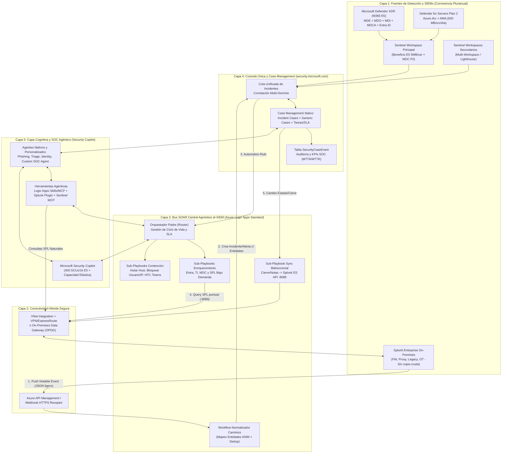

# Guía de Arquitectura, Mejores Prácticas y Assessment: Azure Logic Apps como SOAR Central Multi-SIEM rumbo a un SOC Agéntico

> **Estrategia para clientes Microsoft 365 E5 + Defender for Servers Plan 2 en convivencia plurianual con Splunk On-Premises**  
> **ID Documento:** `MS-SECOPS-SOAR-AGENTIC-2026-V1` | **Versión:** `1.0` | **Fecha:** `2026-11-11`  
> **Ecosistema de Artefactos Sincronizados:** Este documento Markdown (`.md`), la base estructurada (`.json`), el libro interactivo de Guía/Assessment/Plan (`.xlsx`) y el Portal Dinámico (`.html`) contienen exactamente el mismo modelo maestro y funcionan de forma complementaria y actualizable.

---

## 1. Resumen Ejecutivo y Respuesta Arquitectónica Central

### Pregunta Estratégica del Cliente
*¿Es viable utilizar Case Management, la Consola Unificada de Microsoft Defender, Azure Logic Apps y Microsoft Security Copilot para construir un SOAR centralizado que priorice el ecosistema Microsoft independientemente de cuántos SIEM estén en uso (múltiples instancias de Sentinel, Splunk On-Prem, etc.), evolucionando hacia un SOC Agéntico durante varios años de convivencia?*

### Respuesta Directa y Patrón Recomendado
Sí, es totalmente viable y constituye el patrón de referencia recomendado por Microsoft para arquitecturas híbridas multi-SIEM ('SIEM-Agnostic Central SOAR & Unified Case Management Hub'). En lugar de duplicar terabytes de logs crudos desde Splunk On-Prem hacia Sentinel (lo cual generaría costos innecesarios fuera de los beneficios E5 y Defender for Servers P2), se establece el Portal Unificado de Microsoft Defender (con Sentinel integrado y Case Management nativo) como la única consola operativa y de gobierno del analista, mientras que Azure Logic Apps actúa como el bus central de orquestación, enriquecimiento federado bajo demanda ('Zero-Copy Context') y remediación, habilitando a Microsoft Security Copilot y sus Agentes para investigar y actuar transversalmente sobre todos los SIEM conectados.

### Los 4 Pilares de la Estrategia

- **PIL-01 — Consola Única y Case Management Centralizado:** Adopción del Portal Unificado de Microsoft Defender (security.microsoft.com) y Case Management (Incident Cases + Generic Cases + auditoría en SecurityCaseEvent) como sistema maestro de registro del SOC, absorbiendo alertas correlacionadas de M365 XDR, múltiples Workspaces de Sentinel y Notable Events de Splunk On-Prem.
- **PIL-02 — Protección Estricta del Alcance Financiero (FinOps E5 + MDC P2):** Maximización de la ingesta gratuita de hasta 5 MB/usuario/día por M365 E5, fuentes siempre gratuitas (OfficeActivity, AzureActivity, alertas XDR) y 500 MB/servidor/día por Defender for Servers Plan 2 (bajo medidores simplificados/unificados), manteniendo logs voluminosos de terceros/red en Splunk On-Prem sin re-ingesta masiva.
- **PIL-03 — Logic Apps como Bus SOAR Modular y Agnóstico al SIEM:** Diseño de playbooks desacoplados ('Padre-Hijo') en Azure Logic Apps Standard con conectividad híbrida (VNet Integration / On-Premises Data Gateway) capaces de normalizar alertas entrantes de cualquier SIEM, consultar Splunk vía API REST bajo demanda y ejecutar contenciones gobernadas (Human-in-the-Loop en Teams).
- **PIL-04 — Evolución Progresiva hacia el SOC Agéntico:** Activación del beneficio incluido de Security Copilot en M365 E5 (400 SCUs/mes por cada 1.000 usuarios), uso del Plugin nativo de Splunk, exposición de Logic Apps como Skills/Servidores MCP (Model Context Protocol) y ejecución de sesiones agénticas autónomas supervisadas directamente desde los Incident Cases.

### Resultados Clave Esperados

- Eliminación del 'swivel-chair' (cambio constante entre consolas de Splunk y portales de Microsoft) mediante sincronización bidireccional automatizada.
- Ahorro del 100% en costos de doble ingesta SIEM al federar únicamente alertas priorizadas y consultar logs crudos de Splunk bajo demanda vía Logic Apps.
- Reutilización total de playbooks de contención (Entra ID, MDE, MDC P2, Firewalls On-Prem) sin importar si la detección se originó en Sentinel #1, Sentinel #2 o Splunk On-Prem.
- Transición sin fricción hacia un SOC Agéntico: cuando en el futuro se retiren o migren cargas de Splunk (p. ej. a Sentinel Data Lake), la capa SOAR, los casos y los agentes de IA no requieren rediseño.

---

## 2. Modelo Financiero y Optimización de Beneficios (FinOps SecOps)

Para que la arquitectura sea financieramente sostenible durante varios años de convivencia con Splunk On-Prem, el diseño separa rigurosamente el 'Plano de Almacenamiento de Logs Crudos' del 'Plano de Gestión de Casos, Orquestación SOAR y Razonamiento Agéntico'.

### 2.1 Escenario Base de Referencia (Parametrizable en Excel y Portal HTML)

| Parámetro del Cliente | Valor de Referencia | Impacto / Concesión Calculada |
| :--- | :---: | :--- |
| **Licencias Microsoft 365 E5** | `3,500` usuarios | **17.09 GB/día** gratuitos en Sentinel (`5 MB/usuario/día`) + fuentes gratuitas |
| **Servidores con Defender for Servers Plan 2** | `250` servidores | **122.07 GB/día** gratuitos en Sentinel unificado (`500 MB/servidor/día` agrupados) |
| **Bolsa Total Diaria sin Costo en Sentinel** | **139.16 GB/día** | Ahorro directo estimado de **~$17,952 USD/mes** (a `$4.30/GB`) |
| **Capacidad Security Copilot incluida en M365 E5** | **1,400 SCUs/mes** | `400 SCUs/mes` cada `1.000` usuarios E5 (tope `10.000 SCUs/mes`) sin costo extra |
| **Volumen Actual en Splunk On-Premises** | `850` GB/día | Costo evitado de doble ingesta en Sentinel: **~$109,650 USD/mes** usando *Zero-Copy* |
| **Horizonte de Convivencia Multi-SIEM** | `3` años | `2` instancias Sentinel + `1` instancia Splunk On-Prem operando bajo un único SOAR |

### 2.2 Detalle de Beneficios y Guardarraíles Críticos de Facturación

| ID | Beneficio / Licencia | Fórmula de Concesión | Tablas y Fuentes Elegibles | Guardarraíl Crítico de Configuración |
| :--- | :--- | :--- | :--- | :--- |
| `BEN-01` | **Microsoft 365 E5 - Concesión de Datos en Sentinel** | Hasta 5 MB por licencia de usuario M365 E5 por día (calculado y descontado automáticamente en medidores Azure). | Entra ID (SigninLogs, AuditLogs), Tablas de Advanced Hunting de Microsoft Defender XDR (DeviceEvents, DeviceProcessEvents, DeviceNetworkEvents, DeviceFileEvents, DeviceLogonEvents, DeviceRegistryEvents, DeviceImageLoadEvents, EmailEvents, EmailAttachmentInfo, EmailUrlInfo, EmailPostDeliveryEvents, IdentityLogonEvents, IdentityQueryEvents, IdentityDirectoryEvents, CloudAppEvents, AlertEvidence), Microsoft Purview Information Protection y Defender for Cloud Apps Shadow IT Discovery. | Verificar en Cost Analysis agrupando por Meter ('M365') que el cargo sea $0. Seleccionar únicamente las tablas de Advanced Hunting necesarias para reglas analíticas o enriquecimiento que no cubran ya las Custom Detections gratuitas en Defender XDR. |
| `BEN-02` | **Fuentes Siempre Gratuitas en Microsoft Sentinel** | Ilimitado ($0 USD por ingesta y 90 días de retención estándar en Sentinel). | Azure Activity Logs (AzureActivity), Office 365 Audit Logs (OfficeActivity: Exchange, SharePoint, Teams), Alertas e Incidentes sincronizados bidireccionalmente desde Microsoft Defender XDR (MDE, MDO, MDI, MDCA) y alertas de Microsoft Defender for Cloud (SecurityAlert, SecurityIncident). | Priorizar Custom Detections en el portal de Microsoft Defender XDR sobre datos nativos de Defender antes de copiar tablas crudas masivas de Advanced Hunting al workspace de Sentinel. |
| `BEN-03` | **Defender for Cloud - Defender for Servers Plan 2** | 500 MB por servidor protegido por día (bolsa diaria compartida 'pooled' entre todos los servidores con Plan 2 reportando al mismo Log Analytics Workspace). | SecurityEvent, WindowsEvent (EXCLUSIVAMENTE eventos del stream Microsoft-SecurityEvent), SecurityAlert, SecurityBaseline, SecurityBaselineSummary, SecurityDetection, WindowsFirewall, ProtectionStatus, Update, UpdateSummary, MDCFileIntegrityMonitoringEvents (FIM sin agente), DeviceCustomFileEvents, DeviceCustomRegistryEvents. | CRÍTICO: El Workspace DEBE estar en 'Medidores Simplificados/Unificados de Microsoft Sentinel' (Simplified/Unified pricing tiers) para que los 500 MB/día cubran tanto Log Analytics como Sentinel (en medidores clásicos solo cubre Log Analytics). Los canales Windows System/Application, Syslog Linux genérico, IIS o CEF de firewalls NO están cubiertos por este beneficio. |
| `BEN-04` | **Microsoft Security Copilot incluido en Microsoft 365 E5** | 400 Security Compute Units (SCUs) por mes por cada 1.000 licencias de usuario M365 E5 (prorrateado, hasta un tope de 10.000 SCUs/mes sin costo adicional). | Agentes integrados de Security Copilot en Microsoft Defender (Phishing Triage, Alert Triage / Security Analyst), Microsoft Entra (Conditional Access Optimization), Microsoft Purview (Data Security Triage) e Intune, más sesiones interactivas y promptbooks según cuota mensual. | Monitorear consumo mensual de SCUs. Reservar SCUs incluidas para triaje de incidentes de severidad Media/Alta y agentes nativos; en flujos SOAR de muy alto volumen (>miles/día), aplicar pre-filtrado determinista en Logic Apps antes de invocar prompts de IA, o habilitar SCUs aprovisionadas/overage controlado. |
| `BEN-05` | **Splunk Enterprise On-Premises (Capacidad Instalada Existente)** | Licencia On-Premises vigente (por GB/día de indexación o por carga de trabajo SVC). | Logs de red de alto volumen (Firewalls NGFW, Proxies, DNS, Balanceadores, VPN), telemetría OT/IoT industrial, aplicaciones legadas on-premises, bases de datos locales y Syslog no cubierto por MDC Servers P2. | NO reenviar estos índices crudos a Sentinel. Mantener la indexación y búsquedas de correlación locales en Splunk; enviar a Logic Apps únicamente los 'Notable Events / Fired Alerts' (pocos KB por alerta) y usar consultas SPL bajo demanda desde Logic Apps / Security Copilot. |

### 2.3 Matriz de Ubicación Óptima de Datos (Regla de Cero Duplicación)

| Categoría de Fuente | Destino del Log Crudo | Motor de Detección Primaria | Plano de Casos, SOAR e IA |
| :--- | :--- | :--- | :--- |
| **Identidad, Productividad, Endpoints Corporativos y Correo (M365 E5)** | Defender XDR + Microsoft Sentinel (Cubierto por 5 MB/usr/día + Fuentes Gratuitas) | Defender XDR Custom Detections + Sentinel Analytics | Defender Unified Case Management + Logic Apps + Security Copilot |
| ** Eventos de Seguridad Windows Server / FIM / Baselines (Servidores Híbridos con Azure Arc + MDC P2)** | Microsoft Sentinel con Medidores Unificados (Cubierto por 500 MB/srv/día de MDC P2 vía AMA) | Defender for Servers P2 + MDE + Sentinel Analytics | Defender Unified Case Management + Logic Apps + Security Copilot |
| **Firewalls, Proxies, Red On-Prem, Apps Legadas, Syslog No-Seguridad y OT** | Splunk Enterprise On-Premises (Sin ingesta cruda en Sentinel) | Splunk Correlation Searches / Splunk ES Notable Events | Webhook -> Logic Apps Normalizer -> Defender Unified Case Management + Enriquecimiento SPL bajo demanda |
| **Múltiples Instancias / Workspaces Adicionales de Microsoft Sentinel (Filiales, M&A, Regiones)** | Workspace Regional de Sentinel correspondiente | Sentinel Analytics local / Multi-Workspace | Multi-Workspace Defender Portal / Azure Lighthouse + Automation Rules hacia el Hub Central de Logic Apps |

---

## 3. Arquitectura de Referencia: Hub SOAR Central y Agnóstico al SIEM

### 3.1 Diagrama de Arquitectura Lógica e Híbrida

### 3.2 Los 5 Patrones de Integración Multi-SIEM Priorizando Logic Apps, Case Management y Security Copilot

#### PAT-01: Federación y Normalización Canónica de Alertas Multi-SIEM (Inbound Alert Broker)
- **Problema que resuelve:** Cómo consolidar incidentes de Splunk On-Prem y múltiples instancias de Sentinel en una sola cola sin duplicar la ingesta de logs crudos.
- **Mecanismo técnico:** En Splunk On-Premises, las Correlation Searches o Notable Events ejecutan una Alert Action (Webhook HTTPS autenticado vía Entra OAuth2 / mTLS tras Azure API Management) hacia un workflow 'SOAR-Inbound-Normalizer' en Azure Logic Apps Standard. Este flujo transforma los campos propietarios de Splunk (src_ip, dest_nt_host, user, rule_name, sid, urgency) a un esquema canónico alineado con ASIM y crea el incidente mediante Microsoft Sentinel REST API ('Microsoft.SecurityInsights/incidents') o Microsoft Graph Security API, poblando entidades estructuradas (Account, Host, IP, Malware, URL), etiquetas ('SourceSIEM:SplunkOnPrem') y un Deep Link directo a la búsqueda en Splunk.
- **Tecnologías priorizadas:** `Azure Logic Apps Standard + Azure API Management + Sentinel/Defender Unified Incident Queue`

#### PAT-02: Enriquecimiento Federado 'Zero-Copy' hacia Splunk On-Prem (Query-on-Demand)
- **Problema que resuelve:** Cómo dar al analista y a Security Copilot visibilidad sobre firewalls, proxies o apps legadas alojadas en Splunk sin pagar ingesta en Sentinel.
- **Mecanismo técnico:** Cuando se abre un incidente en la consola unificada (provenga de Defender XDR, Sentinel o del propio Splunk), un sub-playbook de Logic Apps invoca la API REST de Splunk On-Premises ('https://<splunk>:8089/services/search/jobs/export') a través de VNet Integration (ExpressRoute/VPN) o del On-Premises Data Gateway (OPDG). Ejecuta una consulta SPL parametrizada y acotada en tiempo (ej. ±15 minutos sobre las entidades IP/Usuario del incidente, limitada a top 50 eventos resumidos) y publica el resultado como tabla Markdown en los comentarios/evidencia del Incident Case.
- **Tecnologías priorizadas:** `Logic Apps Standard + VNet Integration / On-Premises Data Gateway + Splunk REST API (:8089)`

#### PAT-03: Arquitectura Desacoplada de Playbooks 'Padre-Hijo' (SIEM-Agnostic Micro-Playbooks)
- **Problema que resuelve:** Evitar reescribir o duplicar playbooks para cada SIEM (Sentinel #1, Sentinel #2, Defender XDR, Splunk) y permitir invocación desde agentes de IA.
- **Mecanismo técnico:** Los playbooks se dividen en dos capas: (1) 'Trigger Adapters' muy livianos (uno para Automation Rules de Sentinel/Defender, otro para Webhooks de Splunk, otro para invocación directa desde Security Copilot), que extraen las entidades a un contrato JSON común; y (2) 'Child Action Workflows' reutilizables invocados por HTTP interno/Workflow Call (ej. 'Child-Isolate-MDE-Machine', 'Child-Disable-Entra-User', 'Child-Block-Firewall-IP', 'Child-Query-Splunk-Context'). Así, cualquier SIEM o Agente reutiliza exactamente los mismos bloques de respuesta.
- **Tecnologías priorizadas:** `Azure Logic Apps Standard (Stateful para orquestación/HITL + Stateless para enriquecimiento rápido)`

#### PAT-04: Case Management Unificado con Human-in-the-Loop (HITL) y Sincronización Bidireccional
- **Problema que resuelve:** Evitar que un analista cierre un caso en Microsoft y quede abierto en Splunk ES (o viceversa), y controlar acciones críticas en servidores productivos.
- **Mecanismo técnico:** El SOC adopta Case Management en el Portal de Microsoft Defender (Incident Cases para incidentes operativos y Generic Cases para cacerías o investigaciones mayores, con plantillas de SLA y tareas). Antes de ejecutar acciones disruptivas (ej. aislar un servidor Windows/Linux con Defender for Servers P2 o revocar acceso VIP), Logic Apps envía una Adaptive Card en Microsoft Teams solicitando aprobación; la decisión se registra en el Caso. Al actualizarse o cerrarse el incidente/caso (auditado en 'SecurityCaseEvent'), una Automation Rule dispara 'Child-Sync-Splunk-Notable' que invoca '/services/notable_update' en Splunk ES o escribe el evento de cierre vía HEC (:8088).
- **Tecnologías priorizadas:** `Defender Portal Case Management + SecurityCaseEvent + Teams Adaptive Cards + Logic Apps`

#### PAT-05: Orquestación Cognitiva y Agéntica (Security Copilot + Logic Apps Plugins / MCP + Splunk Plugin)
- **Problema que resuelve:** Transicionar del SOAR estático basado en árboles rígidos if/else hacia un SOC Agéntico capaz de razonar sobre señales híbridas.
- **Mecanismo técnico:** Doble integración: (A) Inbound (SOAR llama a IA): Logic Apps usa el conector nativo de Microsoft Security Copilot para enviar el dossier consolidado (alertas M365 E5 + MDC P2 + extracto SPL de Splunk) a un Promptbook que redacta la hipótesis del ataque, severidad real y plan de remediación en el Caso. (B) Outbound/Agéntico (IA llama a SOAR y SIEMs): Se habilita el Plugin oficial de Splunk en Security Copilot y se publican los Child Workflows de Logic Apps como Skills (manifiesto YAML) o Servidores MCP (Model Context Protocol). Los analistas y los Agentes ejecutan sesiones agénticas directamente dentro del Incident Case.
- **Tecnologías priorizadas:** `Microsoft Security Copilot (SCUs E5) + Logic Apps Plugin/MCP + Splunk Plugin + Sentinel MCP`

### 3.3 Mejores Prácticas de Ingeniería para Azure Logic Apps como SOAR Enterprise

| ID | Categoría | Mejor Práctica | Recomendación Arquitectónica Detallada |
| :--- | :--- | :--- | :--- |
| `BP-01` | **Elección de Plan (SKU)** | **Priorizar Logic Apps Standard para el Hub Central y Conectividad Híbrida** | Utilizar Azure Logic Apps Standard (Plan Workflow Standard WS1/WS2) para el motor central SOAR porque incluye integración nativa con VNet privada (acceso directo a Splunk On-Prem por VPN/ExpressRoute sin exponer endpoints públicos), soporte conjunto de flujos Stateful (auditoría completa y esperas HITL de días) y Stateless (enriquecimiento sub-segundo), muchos flujos en un solo plan de costo predecible y despliegue CI/CD empaquetado. Reservar Logic Apps Consumption únicamente para conectores disparadores simples o pruebas rápidas. |
| `BP-02` | **Identidad y Secretos** | **Zero Trust en Automatización: Managed Identities y Azure Key Vault** | Prohibir cuentas de servicio con usuario/contraseña en conectores Microsoft. Asignar System-Assigned o User-Assigned Managed Identity a las Logic Apps con roles mínimos: 'Microsoft Sentinel Responder', permisos de aplicación Microsoft Graph ('SecurityIncident.ReadWrite.All', 'SecurityAlert.ReadWrite.All', 'Machine.Isolate', 'User.RevokeSessions.All') y RBAC en Defender. Para los tokens REST/HEC de Splunk On-Premises, almacenarlos exclusivamente en Azure Key Vault accedidos por Managed Identity con rotación trimestral. |
| `BP-03` | **Resiliencia Híbrida** | **Desacoplamiento con Cola, Idempotencia y Control de Concurrencia** | Si el enlace WAN hacia Splunk On-Prem sufre microcortes o una regla en Splunk genera una tormenta de alertas, colocar Azure Service Bus (o Event Grid) delante de flujos pesados, activar 'Concurrency Control' (ej. grado 10-25) en el trigger de Logic Apps, configurar políticas de reintento exponencial (4 reintentos, base 15s) e implementar llave de idempotencia usando 'SplunkSID + EventHash' en una Watchlist o tabla auxiliar para jamás duplicar incidentes en el Portal Unificado. |
| `BP-04` | **Gobernanza y Auditoría** | **SOAR-as-Code, Telemetría de Salud y Etiquetado Estándar** | Versionar todos los workflows JSON, manifiestos YAML de Security Copilot y plantillas Bicep/Terraform en Git (GitHub o Azure DevOps) con promoción Dev -> Prod. Enviar 'WorkflowRuntime' diagnostics de todas las Logic Apps al workspace de Log Analytics (o tabla operativa) para alertar automáticamente si un playbook crítico falla, y auditar las acciones de casos mediante la tabla 'SecurityCaseEvent'. |
| `BP-05` | **Protección de SCUs de IA** | **Compuertas Deterministas antes de Invocar Security Copilot** | No invocar prompts de Security Copilot de forma indiscriminada en alertas informativas o repetitivas conocidas. Usar Logic Apps primero para deduplicar, enriquecer con listas blancas/Watchlists y calcular un umbral de riesgo; invocar Security Copilot automáticamente solo en incidentes de severidad Alta/Crítica o alertas multi-dominio novedosas, maximizando el rendimiento de las SCUs incluidas en M365 E5. |

---

## 4. Catálogo Priorizado de Playbooks Logic Apps y Capacidades Agénticas

| ID | Nombre del Componente | Tipo | Disparador (Trigger) | Sistemas Involucrados | Descripción Funcional | Fase |
| :--- | :--- | :--- | :--- | :--- | :--- | :---: |
| `PB-01` | **SOAR-Core-Inbound-Alert-Normalizer** | Logic App Standard (Stateful) | HTTPS Webhook (vía APIM desde Splunk On-Prem / SIEM externo) | Splunk On-Prem -> Sentinel / Defender Unified Incidents | Recibe Notable Events de Splunk o alertas de terceros, valida firma/token, verifica idempotencia, mapea entidades (UPN, Host, IP, Hash, MITRE) y crea/agrega al incidente unificado con enlace profundo a Splunk. | `Fase 1` |
| `PB-02` | **SOAR-Enrich-Splunk-ZeroCopy-Context** | Logic App Standard (Stateless/Stateful) | Child Workflow HTTP / Automation Rule / Security Copilot Skill | Splunk REST API (:8089) vía VNet/OPDG -> Incident Case | Ejecuta búsquedas SPL acotadas bajo demanda sobre índices de Firewall, Proxy, VPN o Apps legadas en Splunk On-Prem para las entidades del incidente y publica el resumen forense en el Caso sin ingerir logs crudos en Sentinel. | `Fase 2` |
| `PB-03` | **SOAR-Enrich-Unified-Entity360** | Logic App Standard (Child Workflow) | Creación de Incidente (Sentinel #1, Sentinel #N o Splunk) | Entra ID P2 + MDE + MDC Servers P2 + Defender TI + Watchlists | Consulta riesgo del usuario en Entra ID Protection, criticidad del activo/servidor en Defender for Cloud P2 (etiquetas, vulnerabilidades abiertas, exposición a Internet), reputación TI de IPs/Hashes y actualiza prioridad/tags del Caso. | `Fase 1` |
| `PB-04` | **SOAR-Contain-Compromised-Identity** | Logic App Standard (con HITL Teams) | Incidente de Identidad / Invocación desde Caso o Agente | Microsoft Entra ID P2 + Active Directory On-Prem (vía MDI/Hybrid Worker) | Revoca tokens de actualización, fuerza restablecimiento de contraseña, marca usuario como 'Confirm Compromised' en Entra ID (activando Acceso Condicional) y solicita aprobación por Adaptive Card si es cuenta VIP/Admin. | `Fase 2` |
| `PB-05` | **SOAR-Contain-Hybrid-Server-MDC-P2** | Logic App Standard (con HITL Teams) | Alerta en Servidor Protegido (MDC Servers P2 / MDE / Splunk) | Defender for Endpoint / Defender for Servers P2 / Azure Arc | Solicita aprobación rápida del propietario del servidor en Teams y ejecuta aislamiento de red selectivo MDE, captura paquete de investigación forense (Collect Investigation Package), escaneo antimalware y restricción de ejecución de apps. | `Fase 2` |
| `PB-06` | **SOAR-Contain-Network-Block-Hybrid** | Logic App Standard (Child Workflow) | IOC Malicioso Confirmado / Invocación Agéntica | Defender Custom TI Indicators + Firewall On-Prem (Palo Alto/Fortinet/Cisco vía OPDG/VNet) | Publica IPs, dominios o hashes maliciosos en los indicadores de bloqueo de Defender for Endpoint y simultáneamente actualiza el External Dynamic List (EDL) o grupo de bloqueo en el firewall on-premises. | `Fase 2` |
| `PB-07` | **SOAR-Sync-Bidirectional-Case-SplunkES** | Logic App Standard (Stateful) | Sentinel Incident Updated Trigger / SecurityCaseEvent | Defender Case Management <-> Splunk ES (/services/notable_update & HEC :8088) | Sincroniza cambios de estado (En Curso, Cerrado), clasificación (TP/FP/BP), analista asignado y resumen de resolución desde la consola unificada de Microsoft hacia el Notable Event original en Splunk On-Prem. | `Fase 1` |
| `PB-08` | **SOAR-Case-Lifecycle-SLA-Orchestrator** | Logic App Standard + Case Templates | Creación de Incidente Alto/Crítico o Alerta de Vulnerabilidad Explotada MDC P2 | Defender Portal Case Management + Microsoft Teams + Correo Ejecutivo | Aplica plantilla de Caso según tipología (Ransomware, Exfiltración, BEC, Compromiso Servidor Crítico), crea tareas obligatorias con SLA, abre canal de sala de guerra en Teams si es Crítico y escala incumplimientos de MTTA. | `Fase 2` |
| `PB-09` | **AI-Triage-MultiSIEM-Copilot-Assessor** | Logic App + Conector Microsoft Security Copilot | Post-enriquecimiento de Incidente Media/Alta/Crítica | Microsoft Security Copilot -> Comentario estructurado en Incident Case | Envía a un Promptbook de Security Copilot el contexto unificado (Entra + MDE + MDC P2 + extracto SPL de Splunk) para obtener narrativa del ataque en español, mapeo MITRE, veredicto preliminar de severidad y acciones sugeridas. | `Fase 3` |
| `PB-10` | **Agent-Native-E5-Triage-Suite** | Agentes Integrados de Security Copilot (Beneficio M365 E5) | Autónomo / Basado en Cola de Alertas y Sesiones en Incident Cases | Defender Phishing Triage, Alert Triage, Entra Conditional Access, Purview Triage | Agentes nativos incluidos con M365 E5 que clasifican autónomamente reportes de phishing y alertas repetitivas, descartando falsos positivos documentados y escalando solo amenazas reales a los Incident Cases del SOC. | `Fase 3` |
| `PB-11` | **Agent-Plugin-Splunk-Natural-Investigator** | Plugin Splunk + Custom Agent en Security Copilot | Sesión Agéntica desde Incident Case o Prompt del Analista | Security Copilot <-> Splunk Enterprise On-Premises + Sentinel MCP | Permite que un Agente de Investigación o un analista N1/N2 consulte Splunk sin escribir SPL manual complejo, correlacionando en lenguaje natural hallazgos de red/legacy en Splunk con el grafo de ataque en Microsoft Sentinel y Defender. | `Fase 3` |
| `PB-12` | **Agent-MCP-Autonomous-SOAR-Responder** | Agente Personalizado Security Copilot + Logic Apps MCP Server | Evento de Caso Crítico / Invocación desde Incident Case (Agentic Session) | Security Copilot Agent -> Logic Apps MCP Tools (PB-02, PB-03, PB-04, PB-05, PB-06) | Agente autónomo supervisado por objetivos que razona dinámicamente qué herramientas de Logic Apps invocar vía MCP para investigar entre múltiples SIEMs, ensamblar toda la evidencia en el Caso y preparar la contención lista para aprobación humana. | `Fase 4` |

---

## 5. Hoja de Ruta Plurianual hacia un SOC Agéntico (Convivencia con Splunk On-Prem)

### Fase 0 (Semanas 1 - 4): Descubrimiento, Línea Base FinOps y Validación de Cimientos
- **Objetivo:** Auditar lo que el cliente ya tiene operando en M365 E5, Defender for Servers P2, Sentinel y Splunk On-Premises, corrigiendo brechas de facturación e ingesta antes de escalar automatizaciones.
- **Estado de Convivencia con Splunk On-Prem:** Splunk opera de forma independiente; se inventarían sus Correlation Searches críticas y conectividad de red hacia Azure.
- **Entregables Clave:**
  - Verificación de medidores simplificados/unificados en Sentinel para activar los 500 MB/servidor/día de MDC P2.
  - Validación de concesión gratuita M365 E5 (5 MB/usuario/día) y Data Collection Rules (AMA) filtradas solo a tablas elegibles.
  - Onboarding verificado al Portal Unificado de Microsoft Defender y RBAC Unificado.

### Fase 1 (Meses 1 - 3): Consola Unificada, Case Management y Puente de Alertas Multi-SIEM
- **Objetivo:** Centralizar la operación diaria del SOC en Case Management de Defender y desplegar el bus inicial en Logic Apps Standard para recibir Notable Events de Splunk y sincronizar cierres.
- **Estado de Convivencia con Splunk On-Prem:** Splunk conserva el 100% de sus logs e índices actuales, pero sus alertas accionables fluyen automáticamente como Incidentes/Casos hacia Microsoft con sincronización bidireccional.
- **Entregables Clave:**
  - Plantillas de Incident Cases y Generic Cases configuradas con SLAs y auditoría en SecurityCaseEvent.
  - Despliegue de Azure Logic Apps Standard con Managed Identity, Key Vault y conectividad híbrida (VNet/OPDG) hacia Splunk.
  - En producción PB-01 (Normalizador Multi-SIEM), PB-03 (Entity 360) y PB-07 (Sync Bidireccional con Splunk ES).

### Fase 2 (Meses 4 - 9): SOAR Modular Centralizado, Enriquecimiento Zero-Copy y Contención HITL
- **Objetivo:** Eliminar las consultas manuales a Splunk durante el triaje y automatizar las acciones de contención en identidad, servidores híbridos y red bajo aprobación en Teams.
- **Estado de Convivencia con Splunk On-Prem:** Los analistas N1/N2 operan 90%+ desde la consola unificada de Microsoft; Logic Apps extrae bajo demanda el contexto crudo desde Splunk (:8089) y lo deposita en el Caso.
- **Entregables Clave:**
  - En producción PB-02 (Query SPL Zero-Copy), PB-04 (Identidad Entra), PB-05 (Servidores MDC P2) y PB-06 (Bloqueo de Red Híbrido).
  - Flujos de aprobación Human-in-the-Loop mediante Adaptive Cards en Microsoft Teams.
  - Repositorio Git SOAR-as-Code y tablero ejecutivo de métricas MTTA/MTTR y salud de playbooks.

### Fase 3 (Meses 10 - 18): SOC Asistido por IA: Security Copilot en E5, Plugins Híbridos y Agentes de Triaje
- **Objetivo:** Incorporar razonamiento generativo y agentes nativos sobre la capa SOAR ya estandarizada, aprovechando las SCUs incluidas en M365 E5.
- **Estado de Convivencia con Splunk On-Prem:** Security Copilot consulta tanto Sentinel/Defender como Splunk On-Premises (vía Splunk Plugin y Logic Apps Skills), correlacionando hallazgos entre ambos mundos en segundos.
- **Entregables Clave:**
  - Activación y gobierno de SCUs incluidas en M365 E5 (400 SCUs/1.000 usuarios/mes).
  - Despliegue de Agentes nativos (Phishing Triage, Alert Triage, Conditional Access) y PB-09 (Triaje Cognitivo Multi-SIEM).
  - Publicación de Child Workflows de Logic Apps como Skills invocables desde Security Copilot y habilitación del Plugin de Splunk.

### Fase 4 (Meses 18 - 36+): SOC Agéntico Autónomo y Racionalización Gradual de Datos (Data Lake + MCP)
- **Objetivo:** Operar con sesiones agénticas autónomas supervisadas por objetivos dentro de los Incident Cases y optimizar el TCO de largo plazo conforme venzan contratos o hardware on-prem de Splunk.
- **Estado de Convivencia con Splunk On-Prem:** Convivencia selectiva o migración gradual de fuentes históricas de alto volumen hacia Microsoft Sentinel Data Lake (bajo costo), sin tocar los casos, playbooks ni agentes ya construidos.
- **Entregables Clave:**
  - Exposición de Logic Apps Standard como Servidores MCP (Model Context Protocol) consumidos por Agentes personalizados en Incident Cases.
  - Integración con Microsoft Sentinel Graph y Sentinel Data Lake para hunting multi-año económico.
  - Operación consolidada de SOC Agéntico donde los analistas actúan como supervisores estratégicos y cazadores de amenazas.

---

## 6. Matriz de Assessment de Madurez SOAR y Preparación para SOC Agéntico

### Escala de Calificación (0 a 4)

| Puntaje | Nivel de Madurez | Criterio de Evaluación |
| :---: | :--- | :--- |
| **0** | **0 - Inexistente** | Capacidad no implementada ni diseñada; operación manual o en silos desconectados. |
| **1** | **1 - Inicial / Ad-hoc** | Implementación parcial o experimental sin estandarización; alta dependencia de tareas manuales y cambios de consola. |
| **2** | **2 - Definido / Básico** | Componentes principales habilitados en producción con flujos básicos unidireccionales y controles esenciales. |
| **3** | **3 - Gestionado / Integrado** | Arquitectura modular multi-SIEM operativa, sincronización bidireccional, gobernanza Zero Trust y métricas medidas. |
| **4** | **4 - Optimizado / SOC Agéntico** | Orquestación cognitiva con Security Copilot/Agentes/MCP, sesiones agénticas en casos, mejora continua como código y FinOps óptimo. |

### Controles de Evaluación (24 Criterios en 6 Dominios)

| ID | Dominio | Control a Evaluar | Qué Validar en el Cliente (Evidencia) | Nivel 0 | Nivel 2 | Nivel 4 (Meta Agéntica) | Peso | Base | Meta | Acción Recomendada |
| :--- | :--- | :--- | :--- | :--- | :--- | :--- | :---: | :---: | :---: | :--- |
| `ASM-01` | Gobernanza SecOps y Consola Unificada | **Integración del Workspace en el Portal Unificado de Microsoft Defender** | Verificar en security.microsoft.com > System > Settings > Microsoft Sentinel que el workspace principal (y secundarios si aplica) esté conectado con sincronización bidireccional de incidentes y alertas activa. | Sentinel se opera aisladamente en el portal legado de Azure sin conexión a Defender XDR. | Workspace principal conectado a security.microsoft.com; analistas aún alternan portales ocasionalmente. | 100% de la operación SecOps centralizada en security.microsoft.com con soporte Multi-Workspace / Multitenant. | 1.2 | 2 | 4 | Completar el onboarding de todos los workspaces de Sentinel al portal Defender y retirar accesos operativos rutinarios a la vista clásica. |
| `ASM-02` | Gobernanza SecOps y Consola Unificada | **Modelo RBAC Unificado (Microsoft Defender Unified RBAC)** | Comprobar en Permissions > Microsoft Defender XDR > Roles si el modelo Unified RBAC está activado cubriendo cargas XDR, Sentinel y permisos de Case Management (Security Data Read/Manage). | Permisos dispersos con roles excesivos (Global Admin / Security Admin permanentes). | Roles separados en Azure RBAC (Sentinel Responder) y roles básicos en Defender. | Unified RBAC activo por niveles (Tier 1, Tier 2, Threat Hunter, SOAR Admin) integrado con Entra ID PIM Just-in-Time. | 1.0 | 1 | 4 | Diseñar y activar roles personalizados en Defender Unified RBAC alineados a funciones del SOC y Case Management. |
| `ASM-03` | Gobernanza SecOps y Consola Unificada | **Estrategia de Detecciones: Custom Detections XDR vs. Sentinel Analytics** | Revisar si las detecciones sobre telemetría nativa de M365 E5 (MDE, MDO, MDI) usan Custom Detections de Defender XDR para ahorrar ingesta de Advanced Hunting en Sentinel. | No hay catálogo formal de reglas o se duplican alertas entre XDR y Sentinel. | Reglas out-of-the-box activas en Sentinel, con cierto solapamiento con alertas XDR. | Matriz clara: detecciones XDR en tiempo real sobre telemetría E5, Sentinel para correlación multi-dominio y Splunk para red/legacy. | 1.0 | 1 | 3 | Migrar reglas puramente de endpoint/identidad/email a Custom Detections en Defender XDR para preservar la bolsa gratuita de 5 MB/usuario/día. |
| `ASM-04` | Gobernanza SecOps y Consola Unificada | **Visibilidad Multi-Instancia (Múltiples Sentinel / Tenants / Regiones)** | Validar si existen múltiples instancias de Sentinel o múltiples tenants y si están federados con Azure Lighthouse y Multi-Workspace Incident View. | Instancias de Sentinel aisladas revisadas manualmente una por una. | Acceso delegado básico con Azure Lighthouse pero sin automatización SOAR compartida. | Vista centralizada multi-workspace/multitenant y enrutamiento único de incidentes hacia el Hub SOAR de Logic Apps. | 0.8 | 1 | 3 | Habilitar Azure Lighthouse y conectar Automation Rules de workspaces secundarios hacia el endpoint central de Logic Apps. |
| `ASM-05` | FinOps y Beneficios M365 E5 / MDC Servers P2 | **Aprovechamiento y Verificación del Beneficio M365 E5 (5 MB/usuario/día)** | Auditar en Azure Cost Analysis (agrupado por Meter filtrando 'M365') y en el Workbook 'Microsoft Sentinel Cost' que la concesión de 5 MB/usuario/día se aplique correctamente sin sobrecostos imprevistos. | Conectores M365 desconectados o ingiriendo tablas no elegibles con alto costo PAYG. | Beneficio activo, pero sin monitoreo continuo del umbral diario de 5 MB/usuario. | Consumo E5 monitoreado con alertas de presupuesto, ingiriendo 100% fuentes gratuitas y tablas elegibles de alto valor. | 1.3 | 2 | 4 | Desplegar el Workbook de Costos y configurar alertas automáticas al 80% del umbral diario del beneficio M365 E5. |
| `ASM-06` | FinOps y Beneficios M365 E5 / MDC Servers P2 | **Activación Efectiva de los 500 MB/servidor/día de Defender for Servers Plan 2** | Confirmar que: (1) Defender for Servers Plan 2 está activo en el mismo Workspace de Sentinel, (2) el Workspace usa Medidores Simplificados/Unificados de Sentinel (NO clásicos), y (3) los servidores on-prem reportan vía Azure Arc + AMA. | Plan 2 activo solo a nivel suscripción o el Workspace usa medidores clásicos (no descuenta Sentinel) o usa agente MMA legado. | Plan 2 activo en el workspace con AMA, pero con cobertura incompleta de servidores on-prem (Azure Arc). | 100% de servidores protegidos reportando al workspace en medidores unificados, aprovechando el pool de 500 MB/srv/día a costo $0. | 1.4 | 1 | 4 | Validar inmediatamente el modelo de facturación unificado de Sentinel en el workspace y estandarizar onboarding vía Azure Arc + AMA. |
| `ASM-07` | FinOps y Beneficios M365 E5 / MDC Servers P2 | **Higiene de Data Collection Rules (DCR) para Tablas Elegibles de Servidores** | Inspeccionar las DCR de Azure Monitor Agent (AMA) para asegurar que envían SecurityEvent / Microsoft-SecurityEvent stream y FIM elegible, sin mezclar canales System/Application ni Syslog ruidoso facturable. | DCR enviando todos los Event Logs (System, Application, Verbose) generando facturación inesperada en Sentinel. | DCR separadas por tipo de servidor pero sin XPath filtering ni transformación de ingesta. | DCR quirúrgicas con XPath/KQL DCR Transformations ceñidas estrictamente a tablas cubiertas por MDC P2; resto permanece en Splunk. | 1.2 | 1 | 4 | Auditar cada DCR conectada al workspace de Sentinel y separar telemetría operativa no cubierta por el beneficio P2. |
| `ASM-08` | FinOps y Beneficios M365 E5 / MDC Servers P2 | **Política de Cero Duplicación de Logs Crudos entre Splunk y Sentinel** | Ejecutar consulta KQL de volumen por tabla ('Usage | where IsBillable == true') para verificar que no se estén reenviando logs crudos de Firewalls/Proxies desde Splunk hacia tablas Analytics de Sentinel. | Doble ingesta activa de logs de red/terceros en ambos SIEMs pagando doble licenciamiento. | Duplicación reducida pero aún existen conectores CEF/Syslog redundantes en Sentinel. | Cero duplicación de logs crudos: terceros viven en Splunk (o Data Lake futuro) y solo se federan alertas + contexto bajo demanda. | 1.3 | 2 | 4 | Implementar política formal de ubicación de datos y reemplazar reenvío de logs por el patrón Query-on-Demand en Logic Apps. |
| `ASM-09` | Arquitectura e Ingeniería SOAR en Logic Apps | **Adopción de Azure Logic Apps Standard y Arquitectura Padre-Hijo** | Revisar si los playbooks actuales son flujos monolíticos aislados en Consumption o si existe un Hub en Logic Apps Standard con workflows modulares reutilizables (Trigger Adapters + Child Action Workflows). | Sin playbooks o únicamente pruebas manuales aisladas. | Playbooks individuales en Logic Apps Consumption acoplados fuertemente al trigger de un solo workspace de Sentinel. | Hub en Logic Apps Standard (Stateful + Stateless) con arquitectura Padre-Hijo 100% reutilizable por cualquier SIEM y por Agentes IA. | 1.3 | 1 | 4 | Provisionar Azure Logic Apps Standard como motor central SOAR y refactorizar acciones comunes en Child Workflows desacoplados. |
| `ASM-10` | Arquitectura e Ingeniería SOAR en Logic Apps | **Seguridad Zero Trust en Playbooks (Managed Identity y Key Vault)** | Auditar todas las API Connections de Logic Apps para detectar credenciales de usuarios humanos, Client Secrets expirables en texto plano o permisos excesivos. | Conexiones autenticadas con cuentas nominales de administradores o secretos hardcodeados en el workflow. | Uso parcial de Managed Identity para Sentinel, pero secretos estáticos en parámetros para herramientas externas. | 100% Managed Identities con permisos Graph/RBAC de mínimo privilegio + Azure Key Vault con rotación para tokens de Splunk/Firewalls. | 1.2 | 1 | 4 | Migrar todas las conexiones Microsoft a Managed Identity y centralizar tokens de Splunk (:8089/:8088) en Azure Key Vault. |
| `ASM-11` | Arquitectura e Ingeniería SOAR en Logic Apps | **Resiliencia, Idempotencia, Manejo de Errores y Monitoreo SOAR** | Comprobar si los workflows implementan bloques 'Scope (Try/Catch/Finally)', políticas de reintento exponencial, control de concurrencia, deduplicación por llave única y alertas ante fallo de ejecución. | Si un playbook falla o Splunk se desconecta temporalmente, el error pasa inadvertido y se pierden alertas. | Reintentos por defecto de Logic Apps y revisión manual esporádica del historial de ejecuciones. | Patrón Try/Catch estandarizado, cola intermedia para picos, idempotencia garantizada y alertas automáticas sobre WorkflowRuntime. | 1.1 | 0 | 4 | Crear plantilla base de workflow con Scope Try/Catch, control de concurrencia y enviar diagnósticos a Log Analytics. |
| `ASM-12` | Arquitectura e Ingeniería SOAR en Logic Apps | **Gobierno SOAR-as-Code (Control de Versiones y CI/CD)** | Verificar si los playbooks, Automation Rules y plantillas de casos están respaldados en Git (GitHub / Azure DevOps) y se despliegan mediante Bicep/Terraform. | Edición directa en producción desde el diseñador web sin respaldo ni control de cambios. | Exportación manual ocasional de plantillas ARM a un repositorio documental. | Pipeline CI/CD automatizado (Dev -> Prod) en GitHub/Azure DevOps para Logic Apps Standard, conexiones y manifiestos de agentes. | 0.9 | 0 | 3 | Integrar el proyecto de Logic Apps Standard en un repositorio Git corporativo con despliegue parametrizado. |
| `ASM-13` | Integración Multi-SIEM y Convivencia Splunk On-Prem | **Conectividad Híbrida Segura y Alta Disponibilidad entre Azure y Splunk On-Prem** | Evaluar cómo se comunican bidireccionalmente Azure Logic Apps y Splunk On-Premises (VNet Integration sobre ExpressRoute/VPN S2S, Private Link, o clúster de On-Premises Data Gateway). | Sin conectividad entre Azure y la red de gestión de Splunk On-Premises. | Webhook unidireccional saliente desde Splunk hacia Internet, pero Azure no puede consultar la API interna de Splunk (:8089). | Conectividad privada bidireccional HA (VNet Integration + ExpressRoute/VPN o clúster OPDG) con TLS 1.2+ y filtrado estricto en firewall. | 1.4 | 1 | 4 | Habilitar VNet Integration en Logic Apps Standard hacia el túnel híbrido (o instalar clúster OPDG) con acceso controlado a Splunk :8089 y :8088. |
| `ASM-14` | Integración Multi-SIEM y Convivencia Splunk On-Prem | **Ingesta y Mapeo Canónico de Entidades desde Alertas de Splunk** | Comprobar si cuando Splunk envía un Notable Event a Sentinel/Defender se mapean entidades reales (Account, Host, IP, FileHash) que permitan correlación automática en el grafo de incidentes, o si solo llega texto plano. | Las alertas de Splunk se revisan únicamente en Splunk o llegan por correo electrónico. | Se crean incidentes básicos vía API, pero toda la información queda en la descripción textual sin entidades estructuradas. | Normalizador en Logic Apps mapea entidades fuertes (UPN, Entra ObjectId, FQDN, IP, SHA256), tácticas MITRE y Deep Link a Splunk. | 1.3 | 0 | 4 | Implementar PB-01 con transformación canónica para que Defender correlacione automáticamente alertas de Splunk con incidentes XDR existentes. |
| `ASM-15` | Integración Multi-SIEM y Convivencia Splunk On-Prem | **Enriquecimiento Federado Bajo Demanda (SPL Query-on-Demand)** | Verificar si ante un incidente originado en Microsoft (ej. usuario comprometido o alerta en servidor MDC P2) Logic Apps consulta automáticamente en Splunk la actividad de red/firewall relacionada. | El analista debe copiar la IP/usuario, abrir Splunk manualmente y ejecutar búsquedas SPL desde cero. | Existen consultas SPL documentadas en una wiki para que el analista las ejecute manualmente. | Sub-playbooks en Logic Apps ejecutan búsquedas SPL parametrizadas vía REST API (:8089) en segundos y adjuntan la tabla de evidencia al Caso. | 1.3 | 0 | 4 | Desplegar PB-02 con catálogo de 5 a 8 consultas SPL preaprobadas (Firewall, Proxy, DNS, VPN, App Legada). |
| `ASM-16` | Integración Multi-SIEM y Convivencia Splunk On-Prem | **Sincronización Bidireccional de Estado, Asignación y Cierre** | Validar qué ocurre en Splunk Enterprise Security cuando un analista cierra o clasifica un incidente originado en Splunk desde el Portal de Microsoft Defender. | Sin sincronización; los analistas deben cerrar incidentes manualmente en ambas consolas. | Notificación por correo o webhook simple sin actualizar formalmente el estado del Notable Event en Splunk. | Sincronización bidireccional completa (estado, severidad, dueño, clasificación TP/FP y comentario de cierre) auditada de extremo a extremo. | 1.1 | 0 | 4 | Configurar Automation Rule en 'Incident Updated' que ejecute PB-07 contra el endpoint '/services/notable_update' de Splunk ES. |
| `ASM-17` | Case Management Unificado y Procesos SOC | **Adopción de Incident Cases y Generic Cases en el Portal de Defender** | Revisar en security.microsoft.com > Investigation & response > Cases el uso activo de Incident Cases (respuesta a incidentes) y Generic Cases (threat hunting, investigaciones forenses o gestión de vulnerabilidades críticas). | El seguimiento de casos se lleva en hojas de cálculo, correo o un ITSM genérico sin contexto de seguridad. | Se usa la cola básica de incidentes, pero sin tareas estructuradas, evidencias adjuntas ni casos genéricos. | Case Management en Defender opera como centro único del SOC (Incident + Generic Cases), sincronizado si se requiere con ITSM corporativo (ServiceNow/Jira). | 1.2 | 1 | 4 | Habilitar y operativizar la vista de Cases en el Portal de Defender como mesa de trabajo estándar de N1, N2 y N3. |
| `ASM-18` | Case Management Unificado y Procesos SOC | **Estandarización con Plantillas de Casos (Case Templates), Tareas y SLAs** | Comprobar si existen Case Templates configurados con campos personalizados (ej. 'SIEM Origen', 'Impacto Negocio', 'ID Splunk'), listas de tareas obligatorias por playbook y políticas de SLA. | Cada analista documenta e investiga con criterios propios sin pasos estandarizados. | Procedimientos operativos (SOPs) en documentos PDF/Word externos a la consola. | Case Templates dinámicos aplicados automáticamente según categoría MITRE/incidente con SLAs medidos en tiempo real. | 1.0 | 0 | 4 | Crear plantillas de casos para los 5 escenarios top (Phishing/BEC, Identidad, Malware/Ransomware en Servidor, Exfiltración, Alerta Crítica Red/Splunk). |
| `ASM-19` | Case Management Unificado y Procesos SOC | **Contención Automatizada con Aprobación Human-in-the-Loop (HITL)** | Evaluar si el SOC ejecuta acciones de contención desde playbooks y cómo se gobierna la autorización para activos críticos (ej. servidores productivos protegidos con MDC P2 o cuentas ejecutivas). | 100% de las contenciones se solicitan por ticket manual a los equipos de IT/Infraestructura/Redes. | Contención manual desde botones de MDE/Entra para casos puntuales, sin orquestación transversal. | Contención automática inmediata para riesgo confirmado en endpoints estándar y flujo HITL vía Adaptive Cards en Teams (<2 min) para servidores/VIPs. | 1.2 | 1 | 4 | Implementar PB-04, PB-05 y PB-06 diferenciando matriz de auto-contención vs. aprobación interactiva en Microsoft Teams. |
| `ASM-20` | Case Management Unificado y Procesos SOC | **Auditoría y Analítica Operativa del SOC (SecurityCaseEvent y KPIs)** | Verificar el uso de la tabla 'SecurityCaseEvent' y 'SecurityIncident' en Log Analytics / Workbooks para medir MTTD, MTTA, MTTR, tasa de falsos positivos por SIEM y porcentaje de incidentes automatizados. | Sin métricas confiables o reportes armados manualmente a fin de mes. | Métricas básicas de volumen de incidentes de Sentinel, excluyendo carga proveniente de Splunk o tareas de casos. | Tablero ejecutivo unificado en tiempo real combinando SecurityIncident + SecurityCaseEvent + ejecuciones SOAR y ROI de automatización. | 1.0 | 1 | 4 | Construir Workbook ejecutivo del SOC consultando SecurityCaseEvent y métricas por etiqueta 'SourceSIEM'. |
| `ASM-21` | Microsoft Security Copilot y Preparación Agéntica | **Activación y Gobierno de Capacidad Security Copilot (Beneficio M365 E5 / SCUs)** | Confirmar si el cliente ya activó su asignación incluida en M365 E5 (400 SCUs/mes por cada 1.000 usuarios, hasta 10.000 SCUs/mes), definió roles de acceso y presupuesto de SCUs adicionales si requiere operación 24x7 intensiva. | Security Copilot no habilitado; el cliente desconoce o aún no activa el beneficio incluido en su licenciamiento M365 E5. | Acceso habilitado para un grupo piloto reducido en modo chat manual sin integración con flujos SOAR. | Capacidad E5 activa, gobernanza de consumo SCU instrumentada y políticas de uso integradas al flujo diario del SOC. | 1.3 | 0 | 4 | Activar el workspace de Security Copilot con el beneficio M365 E5 y configurar monitoreo de consumo de SCUs. |
| `ASM-22` | Microsoft Security Copilot y Preparación Agéntica | **Adopción de Agentes Nativos (Defender, Entra, Purview) y Sesiones en Incident Cases** | Evaluar si están configurados los agentes integrados (Phishing Triage Agent, Alert Triage, Conditional Access Agent) y si los analistas ejecutan sesiones agénticas vinculadas directamente a los Incident Cases. | Ningún agente habilitado; triaje de phishing y alertas repetitivas 100% manual. | Uso manual de resúmenes de incidentes con Copilot en Defender, sin agentes autónomos activos. | Agentes nativos operando en producción con revisión supervisada y sesiones agénticas trazables dentro de cada Incident Case. | 1.2 | 0 | 4 | Activar gradualmente Phishing Triage Agent y Alert Triage Agent en modo supervisado sobre la cola unificada. |
| `ASM-23` | Microsoft Security Copilot y Preparación Agéntica | **Habilitación del Plugin de Splunk y Promptbooks Multi-SIEM** | Verificar si Security Copilot cuenta con el Plugin de Splunk configurado (búsquedas ad-hoc, saved searches y fired alerts) y Promptbooks estandarizados que correlacionen hallazgos entre Sentinel/Defender y Splunk. | Security Copilot no tiene visibilidad alguna sobre los datos ni alertas alojadas en Splunk On-Premises. | El analista pega manualmente texto exportado de Splunk en el prompt de Security Copilot. | Plugin de Splunk y sub-playbooks Zero-Copy integrados con Promptbooks bilingües que correlacionan automáticamente ambos entornos. | 1.2 | 0 | 4 | Configurar el Plugin de Splunk en Security Copilot con cuenta de servicio de solo lectura acotada a índices de seguridad. |
| `ASM-24` | Microsoft Security Copilot y Preparación Agéntica | **Exposición de Logic Apps como Herramientas Agénticas (Skills YAML y Servidores MCP)** | Revisar si los workflows modulares de Logic Apps cuentan con descripciones semánticas claras, esquemas JSON tipados y están publicados como Plugins YAML o Servidores MCP para ser invocados por Agentes de Security Copilot. | Los playbooks solo pueden dispararse por reglas rígidas de alerta, sin interfaz invocable por agentes de IA. | Integración unidireccional básica (Logic Apps llama a un prompt de Security Copilot). | Integración bidireccional completa: Agentes personalizados descubren e invocan Child Workflows de Logic Apps vía Skills/MCP con controles HITL. | 1.3 | 0 | 4 | Documentar contratos JSON de los Child Workflows de Logic Apps y publicarlos como Skills/MCP Server para Security Copilot. |

---

## 7. Plan Paso a Paso para Validar lo Existente y Construir la Solución (30 Pasos)

| ID | Orden | Fase | Acción | Dominio | Actividad | Procedimiento Técnico Paso a Paso | Criterio de Aceptación | Rol Responsable | Horas | Prioridad | Estado Inicial |
| :--- | :---: | :--- | :--- | :--- | :--- | :--- | :--- | :--- | :---: | :---: | :---: |
| `STEP-01` | 1 | Fase 0: Descubrimiento y FinOps | **Validar Existente** | Consola Unificada | **Auditar conexión de Workspaces de Sentinel al Portal de Microsoft Defender** | Ingresar a security.microsoft.com > System > Settings > Microsoft Sentinel. Verificar el workspace primario conectado y listar cualquier workspace secundario o en otros tenants. | Inventario confirmado de workspaces y sincronización bidireccional de incidentes XDR <-> Sentinel operativa. | Arquitecto SecOps | 4 | `Crítica` | Pendiente |
| `STEP-02` | 2 | Fase 0: Descubrimiento y FinOps | **Validar y Ajustar** | FinOps MDC P2 | **Verificar Medidores Simplificados/Unificados de Sentinel y Defender for Servers P2** | En Microsoft Defender for Cloud > Environment Settings, seleccionar el Log Analytics Workspace de Sentinel: confirmar que 'Defender for Servers Plan 2' esté ON en ese workspace y en Sentinel > Settings > Pricing confirmar tier 'Simplified/Unified' para que los 500 MB/srv/día cubran Sentinel. | Evidencia en Cost Analysis de descuento automático por medidor Defender for Servers P2 sobre tablas SecurityEvent/SecurityAlert. | Arquitecto Cloud / FinOps | 6 | `Crítica` | Pendiente |
| `STEP-03` | 3 | Fase 0: Descubrimiento y FinOps | **Validar y Ajustar** | FinOps M365 E5 | **Auditar Concesión de 5 MB/usuario/día de M365 E5 y DCRs de Servidores** | Ejecutar KQL 'Usage | where TimeGenerated > ago(30d) | summarize GB=sum(Quantity)/1000 by DataType, IsBillable'. Verificar DCRs de AMA para asegurar que WindowsEvent solo recolecte el stream Microsoft-SecurityEvent y no System/Application no cubiertos. | Cero ingesta accidental no elegible; Workbook 'Microsoft Sentinel Cost' instalado con alerta de presupuesto al 80%. | Ingeniero Sentinel | 8 | `Crítica` | Pendiente |
| `STEP-04` | 4 | Fase 0: Descubrimiento y FinOps | **Validar Existente** | Splunk On-Prem | **Inventariar Fuentes de Datos, Correlation Searches y Notable Events en Splunk** | Exportar desde Splunk On-Premises (:8000 / :8089) el listado de índices por volumen GB/día y las Correlation Searches / Alertas activas. Clasificar cuáles deben federar alertas al Hub SOAR central (Alta/Media confianza) vs. cuáles requieren tuning previo. | Matriz aprobada de ubicación de datos (Zero-Copy) y top 15-25 alertas de Splunk seleccionadas para federación inicial. | Especialista Splunk + Líder SOC | 12 | `Alta` | Pendiente |
| `STEP-05` | 5 | Fase 0: Descubrimiento y FinOps | **Validar Existente** | SOAR Existente | **Evaluar Playbooks, Scripts y Automatizaciones Existentes en Sentinel y Splunk** | Revisar Automation Rules y Logic Apps actuales en Azure, así como Adaptive Response Actions o scripts Python/SOAR en Splunk. Identificar credenciales legadas, dependencias de red y lógica reutilizable. | Catálogo de automatizaciones actuales clasificado en: Mantener/Refactorizar, Migrar a Logic Apps Standard o Retirar. | Ingeniero SOAR | 8 | `Alta` | Pendiente |
| `STEP-06` | 6 | Fase 0: Descubrimiento y FinOps | **Validar y Ajustar** | Red Híbrida | **Validar Ruta de Red Bidireccional entre Azure y Splunk On-Premises** | Verificar subred delegable para Logic Apps Standard con conectividad vía ExpressRoute o VPN Site-to-Site hacia Splunk Search Head API (:8089) y HEC (:8088). Si no hay ruta privada directa de entrada, dimensionar clúster de On-Premises Data Gateway (OPDG). | Diseño de red aprobado por Seguridad de Red con pruebas de conectividad TLS 1.2+ hacia :8089 y :8088. | Arquitecto de Red / Cloud | 8 | `Crítica` | Pendiente |
| `STEP-07` | 7 | Fase 1: Consola Única y Federación | **Construir Nuevo** | Consola Unificada | **Configurar Microsoft Defender Unified RBAC para Roles del SOC y Case Management** | Crear roles en Defender Unified RBAC otorgando 'Security Data Read' / 'Security Data Manage' para Incident Cases y permisos de Generic Cases/Templates según perfil (Analista N1, N2, Líder SOC, Ingeniero SOAR). | Analistas acceden a Incidentes y Cases en security.microsoft.com bajo principio de mínimo privilegio. | Admin Seguridad Entra/Defender | 6 | `Alta` | Pendiente |
| `STEP-08` | 8 | Fase 1: Consola Única y Federación | **Construir Nuevo** | Case Management | **Habilitar Case Management y Crear Plantillas de Casos (Case Templates) y SLAs** | En security.microsoft.com > Cases, configurar Case Templates con campos personalizados ('SourceSIEM', 'SplunkEventID', 'BusinessUnit'), políticas de SLA por severidad y listas de tareas estándar para los 5 escenarios principales. | Creación exitosa de Incident Cases y Generic Cases de prueba verificando registros de auditoría en la tabla 'SecurityCaseEvent'. | Líder SOC + Ingeniero SecOps | 10 | `Alta` | Pendiente |
| `STEP-09` | 9 | Fase 1: Consola Única y Federación | **Construir Nuevo** | Infraestructura SOAR | **Desplegar Hub Central en Azure Logic Apps Standard con VNet, Managed Identity y Key Vault** | Provisionar recurso Azure Logic Apps Standard (WS1), integrar a VNet híbrida, habilitar System/User-Assigned Managed Identity, crear Azure Key Vault para resguardar tokens de Splunk y asignar roles RBAC/Graph mínimos. | Recurso Logic Apps Standard operativo, sin secretos en código y con conectividad verificada hacia Microsoft Graph, Sentinel y Key Vault. | Ingeniero SOAR / Cloud | 12 | `Crítica` | Pendiente |
| `STEP-10` | 10 | Fase 1: Consola Única y Federación | **Construir Nuevo** | Integración Splunk | **Establecer Canal Seguro con Splunk On-Premises (Cuentas de Servicio API :8089 y HEC :8088)** | En Splunk On-Premises, crear rol de mínimo privilegio con cuenta de servicio para consultas REST API (:8089) y token HTTP Event Collector (:8088) para auditoría/cierres. Guardar tokens en Azure Key Vault y probar llamada desde Logic Apps Standard. | Respuesta HTTP 200 desde un workflow de prueba en Logic Apps consultando '/services/server/info' en Splunk On-Prem. | Especialista Splunk + Ingeniero SOAR | 8 | `Crítica` | Pendiente |
| `STEP-11` | 11 | Fase 1: Consola Única y Federación | **Construir Nuevo** | Ingesta Multi-SIEM | **Construir Playbook Normalizador Canónico de Alertas Multi-SIEM (PB-01)** | Desarrollar 'SOAR-Core-Inbound-Alert-Normalizer' expuesto tras API Management (o Function/HTTPS con Entra Auth). Mapear campos de Splunk Notable Events a entidades fuertes de Sentinel/Defender, controlar idempotencia por 'sid' y configurar Webhook en las Correlation Searches de Splunk. | Una alerta disparada en Splunk crea en <30s un incidente en security.microsoft.com con entidades clicables (IP, Host, Usuario) y Deep Link a Splunk. | Ingeniero SOAR | 16 | `Crítica` | Pendiente |
| `STEP-12` | 12 | Fase 1: Consola Única y Federación | **Construir Nuevo** | Multi-SIEM Sentinel | **Federar Workspaces Secundarios de Sentinel hacia el Hub Central de Logic Apps** | Si existen múltiples workspaces de Sentinel, configurar Azure Lighthouse / Multi-Workspace en el Portal de Defender y crear Automation Rules que apunten al mismo Orquestador Padre en Logic Apps Standard. | Incidentes de cualquier workspace de Sentinel invocan exactamente el mismo catálogo central de playbooks sin duplicar código. | Arquitecto SecOps | 8 | `Media` | Pendiente |
| `STEP-13` | 13 | Fase 1: Consola Única y Federación | **Construir Nuevo** | Sincronización | **Implementar Sincronización Bidireccional de Incidentes/Casos hacia Splunk ES (PB-07)** | Configurar Automation Rule con trigger 'When incident is updated' filtrando etiqueta 'SourceSIEM:SplunkOnPrem' que ejecute 'SOAR-Sync-Bidirectional-Case-SplunkES' invocando '/services/notable_update' (estado, dueño, comentario y resolución). | Cerrar o reasignar el caso en el Portal de Defender actualiza automáticamente el Notable Event en Splunk sin bucles infinitos. | Ingeniero SOAR + Especialista Splunk | 12 | `Alta` | Pendiente |
| `STEP-14` | 14 | Fase 2: SOAR Modular y Zero-Copy | **Construir Nuevo** | Arquitectura SOAR | **Estructurar Orquestador Padre y Plantilla Estándar de Child Workflows** | Crear el workflow enrutador principal ('SOAR-Parent-Orchestrator') con manejo de errores Try/Catch, telemetría de ejecución y contrato JSON estándar de entrada/salida para invocar sub-playbooks modulares. | Arquitectura Padre-Hijo documentada y probada con registro centralizado de fallos en Log Analytics. | Ingeniero SOAR | 12 | `Alta` | Pendiente |
| `STEP-15` | 15 | Fase 2: SOAR Modular y Zero-Copy | **Construir Nuevo** | Enriquecimiento 360 | **Desarrollar Child Workflow de Enriquecimiento Microsoft Entity 360 (PB-03)** | Construir sub-playbook que consulte Entra ID (riesgo usuario, MFA, cargo/VIP), MDE (exposición y alertas recientes), Defender for Cloud P2 (etiquetas del servidor, vulnerabilidades críticas CVE) y Defender TI, publicando resumen en el Caso. | 100% de incidentes nuevos reciben tabla de contexto Entity 360 en <45 segundos. | Ingeniero SOAR | 14 | `Alta` | Pendiente |
| `STEP-16` | 16 | Fase 2: SOAR Modular y Zero-Copy | **Construir Nuevo** | Zero-Copy Splunk | **Desarrollar Child Workflow de Enriquecimiento Federado SPL Bajo Demanda (PB-02)** | Construir 'SOAR-Enrich-Splunk-ZeroCopy-Context' que reciba IP/Host/Usuario y ventana de tiempo, ejecute búsqueda one-shot/export en Splunk (:8089) sobre índices de Firewall/Proxy/VPN/Apps y anexe las filas clave como evidencia en el Caso. | Incidentes de Defender/Sentinel se enriquecen automáticamente con trazas de red de Splunk con 0 MB de ingesta facturada en Sentinel. | Ingeniero SOAR + Especialista Splunk | 16 | `Crítica` | Pendiente |
| `STEP-17` | 17 | Fase 2: SOAR Modular y Zero-Copy | **Construir Nuevo** | Contención Identidad | **Implementar Playbook de Contención de Identidad con HITL en Teams (PB-04)** | Construir sub-playbook que valide en Watchlist si el usuario es VIP/Crítico; envíe Adaptive Card interactiva al canal SOC en Teams y, tras aprobación (o automático en alto riesgo confirmado), revoque sesiones y marque usuario comprometido en Entra ID. | Tiempo de contención de cuenta comprometida reducido a <2 minutos con trazabilidad del aprobador en el Caso. | Ingeniero SOAR + Admin Entra | 12 | `Alta` | Pendiente |
| `STEP-18` | 18 | Fase 2: SOAR Modular y Zero-Copy | **Construir Nuevo** | Contención Servidores | **Implementar Playbook de Contención de Servidores Híbridos MDC P2 / MDE (PB-05)** | Construir sub-playbook para servidores protegidos con Defender for Servers P2: recolectar paquete forense automáticamente y enviar Adaptive Card de aprobación (SOC + Dueño del Servidor) para aislamiento de red MDE o ejecución de respuesta en vivo. | Prueba controlada en servidor no productivo validando recolección de evidencia y aislamiento tras clic en Teams. | Ingeniero SOAR + Admin Infraestructura | 14 | `Alta` | Pendiente |
| `STEP-19` | 19 | Fase 2: SOAR Modular y Zero-Copy | **Construir Nuevo** | Contención Red | **Implementar Playbook de Bloqueo de IOCs en Endpoint y Firewall On-Prem (PB-06)** | Construir sub-playbook que publique IPs/URLs/Hashes en la API de Indicadores de Defender for Endpoint y actualice la lista dinámica externa (EDL) o API del firewall perimetral vía VNet/OPDG, registrando expiración (TTL). | IOC malicioso bloqueado simultáneamente en flota MDE y perímetro on-premises con opción de rollback en un clic. | Ingeniero SOAR + Ing. Seguridad Red | 14 | `Media` | Pendiente |
| `STEP-20` | 20 | Fase 2: SOAR Modular y Zero-Copy | **Construir Nuevo** | DevSecOps / KPIs | **Establecer Repositorio Git SOAR-as-Code y Workbook Ejecutivo de Casos/SOAR** | Subir workflows de Logic Apps Standard y plantillas Bicep a GitHub/Azure DevOps. Crear Workbook en Sentinel combinando 'SecurityIncident', 'SecurityCaseEvent' y 'WorkflowRuntime' desglosado por SIEM de origen. | Pipeline CI/CD operativo y dashboard visible para el CISO con MTTA, MTTR, ahorro de horas analista y salud de playbooks. | Ingeniero SOAR | 12 | `Media` | Pendiente |
| `STEP-21` | 21 | Fase 3: Security Copilot y SOC Asistido | **Validar y Ajustar** | Security Copilot E5 | **Activar Beneficio Security Copilot en M365 E5 y Configurar Gobierno de SCUs** | En securitycopilot.microsoft.com, validar elegibilidad y cuota incluida de M365 E5 (400 SCUs / 1.000 usuarios / mes), configurar workspace, permisos RBAC de contribuidores/operadores y alertas de consumo mensual de SCUs. | Security Copilot activo en el tenant e integrado en el Portal de Microsoft Defender con cuota SCU monitoreada. | Admin Seguridad Global / Arquitecto | 6 | `Crítica` | Pendiente |
| `STEP-22` | 22 | Fase 3: Security Copilot y SOC Asistido | **Construir Nuevo** | Agentes Nativos E5 | **Habilitar y Calibrar Agentes Integrados de Security Copilot (Phishing y Alert Triage)** | En el Portal de Defender, activar en modo supervisado el Phishing Triage Agent y los agentes de triaje de alertas/identidad incluidos en E5. Revisar precisión de veredictos junto con analistas N2 durante 2 semanas. | Reducción demostrable de tiempo de triaje manual en cola de phishing y alertas repetitivas con precisión validada >90%. | Líder SOC + Analistas N2 | 10 | `Alta` | Pendiente |
| `STEP-23` | 23 | Fase 3: Security Copilot y SOC Asistido | **Construir Nuevo** | Plugin Splunk IA | **Configurar el Plugin Oficial de Splunk en Microsoft Security Copilot (PB-11)** | Configurar conectividad y credenciales seguras del Plugin de Splunk en Security Copilot apuntando a la instancia de Splunk. Probar skills de búsquedas one-shot, saved searches e inspección de fired alerts desde sesiones interactivas. | Analistas consultan eventos de Splunk desde Security Copilot usando lenguaje natural en español sin cambiar de consola. | Especialista Splunk + Arquitecto IA | 10 | `Alta` | Pendiente |
| `STEP-24` | 24 | Fase 3: Security Copilot y SOC Asistido | **Construir Nuevo** | Triaje Cognitivo | **Construir Playbook de Triaje Multi-SIEM con Conector Security Copilot (PB-09)** | Agregar compuerta en el Orquestador Padre (solo severidad Media/Alta tras deduplicación) que invoque el conector de Security Copilot en Logic Apps pasándole el Entity 360 + el resultado SPL Zero-Copy (PB-02), publicando el análisis ejecutivo en el Caso. | Cada Incident Case prioritario amanece con hipótesis de ataque correlacionada (Microsoft + Splunk) y plan de acción en español. | Ingeniero SOAR | 12 | `Alta` | Pendiente |
| `STEP-25` | 25 | Fase 3: Security Copilot y SOC Asistido | **Construir Nuevo** | Logic Apps Plugins | **Publicar Child Workflows de Logic Apps como Skills Invocables (YAML) en Security Copilot** | Crear manifiestos YAML de skillset para los Child Workflows (PB-02, PB-03, PB-04, PB-05, PB-06) con descripciones precisas de parámetros, cargarlos como Custom Plugins en Security Copilot y restringir acceso RBAC. | Desde Security Copilot, un prompt o Promptbook invoca exitosamente un workflow de Logic Apps para traer evidencia o lanzar aprobación HITL. | Ingeniero SOAR + Arquitecto IA | 14 | `Alta` | Pendiente |
| `STEP-26` | 26 | Fase 4: SOC Agéntico y Evolución | **Construir Nuevo** | MCP Server SOAR | **Exponer el Hub de Logic Apps Standard como Servidor MCP (Model Context Protocol)** | Habilitar capacidades de servidor MCP sobre los flujos de trabajo estándar de Logic Apps y conectar el servidor MCP de Microsoft Sentinel / Defender para que los agentes descubran herramientas con tipado estricto y trazabilidad. | Catálogo de herramientas SOAR disponible vía protocolo estándar MCP para agentes de seguridad. | Arquitecto SecOps / IA | 16 | `Media` | Pendiente |
| `STEP-27` | 27 | Fase 4: SOC Agéntico y Evolución | **Construir Nuevo** | Agentes Personalizados | **Desarrollar Agente Personalizado de Investigación Híbrida Multi-SIEM (PB-12)** | En el espacio de creación de agentes de Security Copilot, definir instrucciones de sistema, objetivos, límites de seguridad y herramientas conectadas (Sentinel, Defender XDR, Splunk Plugin y Logic Apps MCP) para investigar incidentes multi-dominio de punta a punta. | El agente ejecuta autónomamente iteraciones de consulta entre Sentinel y Splunk, documenta evidencias y propone remediación con cero alucinaciones sobre datos ausentes. | Arquitecto IA + Líder Threat Hunting | 20 | `Alta` | Pendiente |
| `STEP-28` | 28 | Fase 4: SOC Agéntico y Evolución | **Construir Nuevo** | Case Management Agéntico | **Operativizar Sesiones Agénticas Directamente desde Incident Cases en Defender** | Integrar la ejecución de playbooks agénticos soportados dentro de la vista de Incident Cases en el Portal de Defender, capacitando a los analistas para supervisar el estado de la sesión agéntica, auditar sus salidas y autorizar cierres o contenciones. | Trazabilidad completa de sesiones agénticas vinculadas al ciclo de vida del caso y auditadas en SecurityCaseEvent. | Líder SOC + Analistas N2/N3 | 12 | `Alta` | Pendiente |
| `STEP-29` | 29 | Fase 4: SOC Agéntico y Evolución | **Validar y Ajustar** | Evolución Data Lake | **Evaluar Microsoft Sentinel Data Lake y Sentinel Graph frente a Renovaciones de Splunk** | Seis meses antes de cualquier renovación de hardware o licencias de Splunk On-Premises, modelar el TCO de mover logs de red/firewall de baja frecuencia hacia niveles económicos de Microsoft Sentinel Data Lake, manteniendo intacta la capa SOAR y Agéntica. | Caso de negocio FinOps comparativo aprobado por el CISO para decidir qué cargas permanecen on-prem y cuáles migran sin impacto operativo en el SOC. | CISO + Arquitecto SecOps / FinOps | 16 | `Media` | Pendiente |
| `STEP-30` | 30 | Fase 4: SOC Agéntico y Evolución | **Validar Existente** | Mejora Continua | **Ejecutar Simulacros Purple Team Multi-SIEM (Ataque Cruzado On-Prem + Cloud)** | Simular un escenario donde la intrusión inicial genera rastros en un firewall/app monitoreado por Splunk On-Prem, pivota a un servidor híbrido con MDC P2 y compromete una identidad M365 E5, midiendo la respuesta integral de Logic Apps + Case Management + Agentes. | Detección correlacionada en un único Incident Case, enriquecimiento automático desde ambos SIEMs y contención HITL validada en <15 minutos. | Purple Team + SOC Completo | 16 | `Alta` | Pendiente |

---

## 8. Instrucciones de Uso Complementario (Excel <-> JSON <-> HTML)

1. **Taller con el Cliente en Excel (`Guia_Assessment_SOAR_LogicApps_SOC_Agentico.xlsx`):** Modifique en la pestaña `02_Parametros_y_FinOps` las cantidades reales de licencias M365 E5, servidores con Defender for Servers Plan 2 y volumen diario de Splunk; califique cada control de `0` a `4` en `05_Assessment_Madurez` y actualice el estado de cada tarea en `06_Plan_Paso_a_Paso`. Todas las fórmulas recalculan automáticamente las brechas, ahorros y porcentajes de avance.

2. **Actualización Dinámica del Portal Web (`Portal_SOAR_LogicApps_SOC_Agentico.html`):** Abra el archivo HTML en cualquier navegador moderno (Edge, Chrome, Firefox) incluso sin conexión a Internet. Use el botón **"Cargar Base (.xlsx / .json)"** en la barra superior y seleccione el archivo Excel guardado (o el archivo JSON): el portal leerá directamente las hojas del Excel, recalculará en vivo los gráficos de madurez por dominio, la calculadora FinOps/SCU y el progreso del plan paso a paso, permitiendo además exportar el JSON actualizado.
