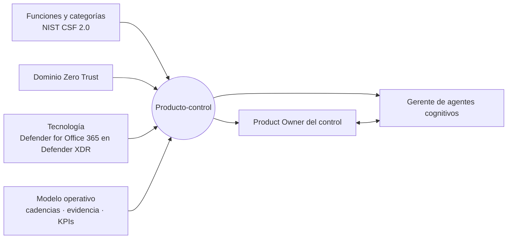
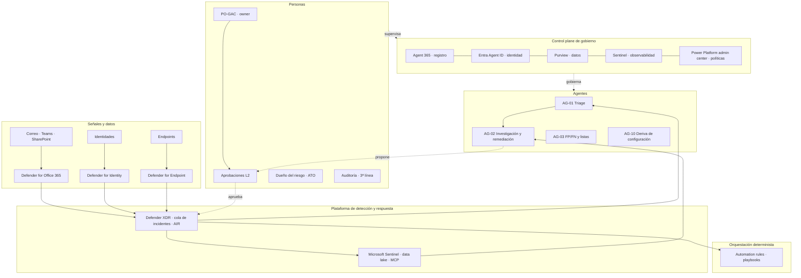
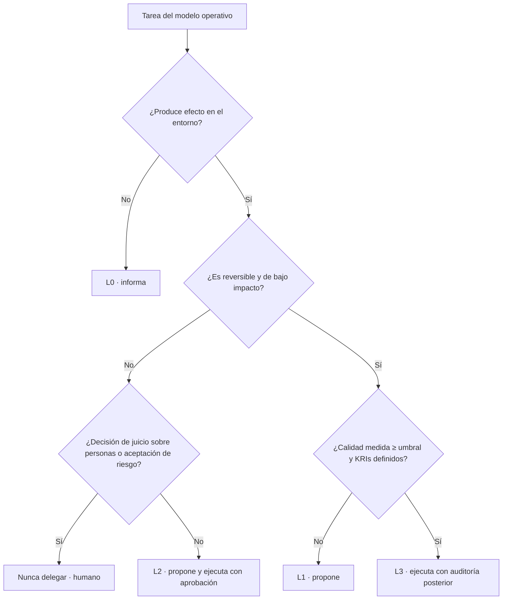
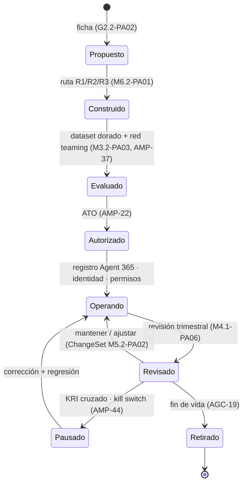
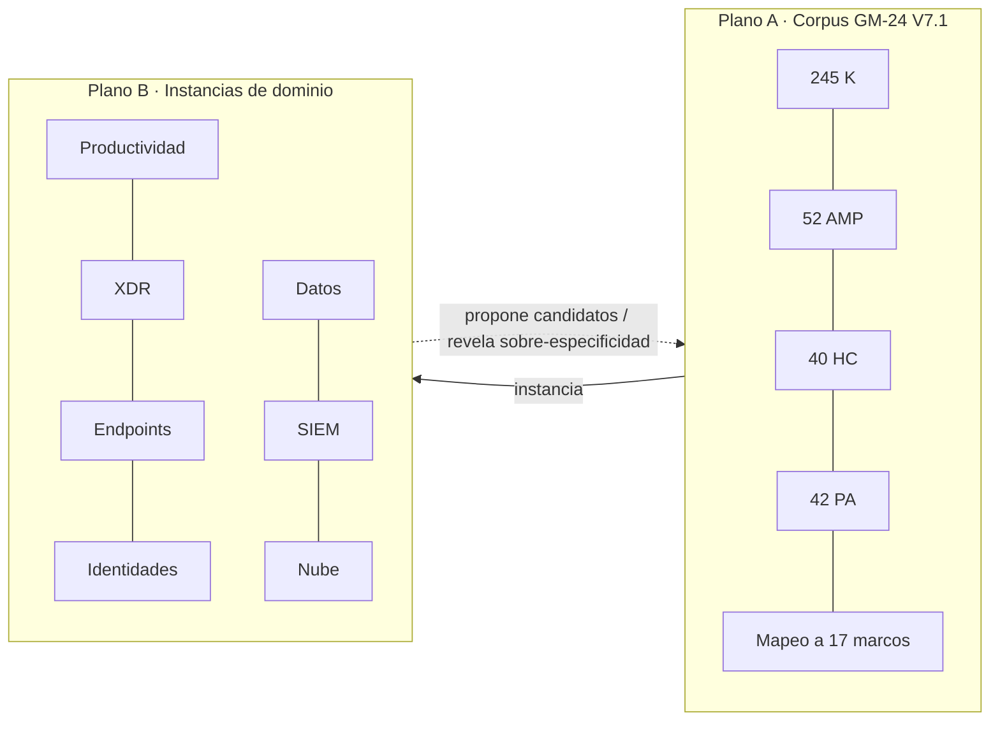

# 07 · Diagramas y flujos

> **GM-24 V7.1 · Sub-plan PO-GAC** · 2026-11-14. Diagramas Mermaid (el HTML los renderiza vía CDN; sin red se muestra el código).

## 1. El rol PO-GAC como cruce de coordenadas



## 2. Arquitectura del SOC agéntico con control plane



## 3. Flujo de una tarea L2 (proponer → aprobar → ejecutar → registrar)

```mermaid
sequenceDiagram
  participant X as Defender XDR
  participant A as Agente (L2)
  participant H as Humano (PO-GAC / analista)
  participant E as Evidencia (SharePoint/Dataverse + Sentinel)
  X->>A: Incidente nuevo
  A->>A: Analiza (contenido = dato, nunca instrucción)
  A->>H: Propuesta con justificación y fuentes (Approvals)
  H->>H: Verifica (checklist AMP-02; condiciones AMP-26)
  alt Aprobada
    H->>A: Aprobación registrada
    A->>X: Ejecuta con límite de lote
    A->>E: Registra entrada, decisión, aprobador, resultado, versión
  else Rechazada / escalada
    H->>E: Registra motivo
    H->>X: Acción manual o escalamiento
  end
```

## 4. Árbol de decisión de autonomía (L0–L4)



## 5. Ciclo de vida de un agente



## 6. Dos planos: corpus académico y marco de gobierno de capacidades


