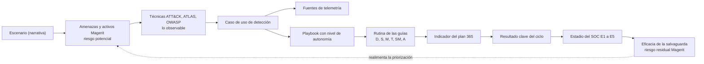
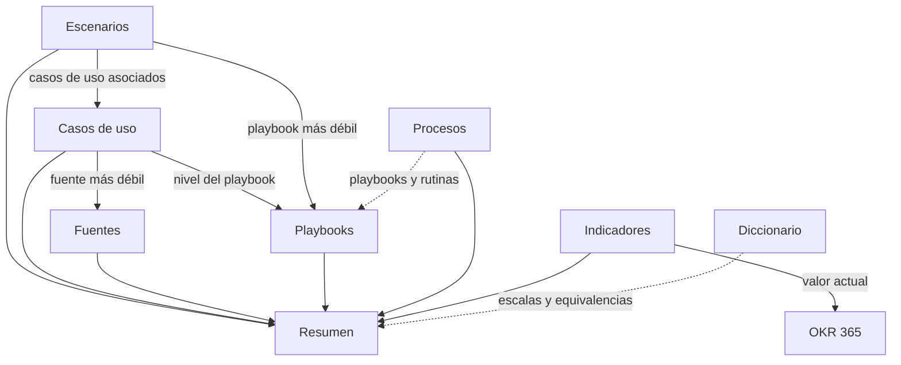

# Frontier CISO Atlas · Madurez SecOps por escenarios de ataque

## Marco de referencia, artefactos, playbooks y guía de uso · v0.1

| Campo | Valor |
|---|---|
| Documento | Guía del kit de evaluación de madurez SecOps por escenarios |
| Versión | 0.1 (propuesta, sin validación del autor) |
| Fecha | 24 de noviembre de 2026 |
| Libro asociado | `Frontier_CISO_Atlas_Madurez_SecOps_Escenarios_v0.1.xlsx` (diez hojas) |
| Proyecto | AI CISO Atlas |
| Autor | @SCavanna · Principal CSA Security · Microsoft MCSA |
| Audiencia | CISO, gerente del SOC, ingeniería de detección y de plataforma, líder de respuesta a incidentes, GRC, CSA y CSAM que acompañan la evaluación |
| Fuentes de base | Compilación de la sesión «Del SOC de alertas al SOC agéntico» (24-nov-2026); nota «Incidente» (definición de Microsoft frente a la política del cliente); marco Magerit + CCN-STIC 817 + Microsoft del autor; guías de excelencia operacional del autor para Microsoft Sentinel y Defender XDR (validadas el 11-nov-2026); catálogo del Modelo Operativo CISO 365 v2.0 del Frontier CISO Atlas |

> **Cómo está marcada la evidencia.** Entre corchetes se indica de dónde sale cada afirmación o paso: **[B.x]** remite a la Parte B de la compilación de la sesión; **[SEN …]** y **[XDR …]** a las guías de excelencia operacional del autor (código de la rutina o del playbook ad hoc); **[Magerit]**, **[817]** y **[NIST]** a las publicaciones oficiales; **[Incidente]** a la nota sobre la definición de incidente; **[Plan 365]** al catálogo del Frontier CISO Atlas. **[Propuesta]** marca lo que agrega este documento y todavía no validó nadie: umbrales, rúbricas, correspondencias y pasos nuevos.

---

### Cómo leer este documento

| Si usted es… | Lea primero | Para… |
|---|---|---|
| CISO o dueño del riesgo | Parte I y capítulos 26 y 27 | Entender cómo encajan las piezas y qué decisiones se le piden |
| Gerente del SOC | Partes II y IV | Preparar y conducir la evaluación |
| Líder de respuesta a incidentes | Parte III | Revisar, adoptar y probar los playbooks |
| Ingeniería de detección y de plataforma | Capítulos 13, 14 y 24 | Puntuar casos de uso y fuentes con evidencia |
| CSA o CSAM que acompaña | Todo, en orden | Facilitar la evaluación y el plan de acción |

### Índice

**Parte I. Marco de referencia: cómo encajan las piezas**

1. La respuesta corta
2. Qué responde cada pieza y qué le falta
3. La cadena de vinculación
4. Dónde se tocan las piezas
5. El set de artefactos
6. Un ejemplo recorrido de punta a punta: la cadena Zava
7. Cómo se usa a lo largo del año
8. Advertencias y límites

**Parte II. Los artefactos, uno por uno**

9. Mapa de los artefactos y sus relaciones
10. Léeme
11. Resumen
12. Escenarios
13. Casos de uso
14. Fuentes
15. Playbooks (registro de evaluación)
16. Procesos
17. Indicadores
18. OKR 365
19. Diccionario

**Parte III. Biblioteca de playbooks**

20. Estructura común y reglas que valen para todos
21. PB-01 a PB-14

**Parte IV. Guía de uso**

22. Antes de empezar
23. Paso a paso de la evaluación
24. Rúbricas de puntuación
25. Del resultado al plan de acción
26. Del estadio al riesgo residual de Magerit
27. El informe para el CISO
28. Cadencia anual
29. Mantenimiento del libro
30. Errores frecuentes

**Anexos**

- A. Glosario
- B. Catálogos completos del libro
- C. Códigos y claves
- D. Referencias
- E. Pendientes y control de versiones

---

# Parte I. Marco de referencia: cómo encajan las piezas

> Esta parte recoge, revisado y ampliado, el contenido de la primera respuesta del 24-nov-2026 a la pregunta: *¿de qué forma encajan las narrativas de ataque con los casos de uso del modelado de amenazas de Magerit, las guías de excelencia operacional y el plan de 365 días del CISO con sus KPI y OKR, y cómo se construye un set de artefactos para evaluar el estadio de madurez SecOps del SOC en procesos, fuentes de información, playbooks y respuesta a incidentes?*

## 1. La respuesta corta

Las cuatro piezas responden preguntas distintas y ninguna alcanza sola para medir la madurez del SOC:

- la **narrativa de ataque** dice *qué le puede pasar* a la organización y qué cambió con la IA;
- **Magerit** (con la CCN-STIC 817 para clasificar) dice *cuánto importa*, sobre qué activos y con qué amenazas;
- las **guías de excelencia operacional** dicen *qué rutinas mantienen viva la defensa* en la plataforma;
- el **plan de 365 días** dice *qué se mide, con qué meta y en qué ciclo*.

Encajan si se toma el **escenario de ataque** como unidad común. Cada escenario se traduce a amenazas y activos de Magerit, se vuelve observable en técnicas de ATT&CK, ATLAS u OWASP, se detecta con casos de uso que dependen de fuentes de telemetría, se responde con playbooks que tienen un nivel de autonomía, se sostiene con las rutinas de las guías y se mide con los indicadores del plan. La madurez del SOC deja de ser una opinión sobre «qué tan bueno es el SOC» y pasa a ser una respuesta verificable a *«¿qué escenarios prioritarios podemos ver, unir, contener y probar hoy?»*.

El kit tiene dos piezas: el libro de Excel, que registra la evaluación y calcula el estadio, y este documento, que explica cada artefacto, trae los playbooks y guía el uso.

## 2. Qué responde cada pieza y qué le falta

| Pieza | Pregunta que responde | Qué aporta al kit | Qué le falta para medir madurez |
|---|---|---|---|
| **Narrativas de ataque** (sesión del 24-nov-2026) | ¿Qué nos puede pasar y qué cambió con la IA? | 24 narrativas: 13 previas enriquecidas y 11 presentadas como nuevas, de las que solo 3 no tienen antecedente [B.7.3]; fuentes necesarias y cuáles exigen tiempo de máquina; 16 procesos del SOC (P1 a P16) y 10 nuevos (N1 a N10) [B.4, B.5]; flujo de respuesta de 8 etapas [B.6.3]; escala de autonomía A0 a A4 [B.12.3]; caso Zava de 75 minutos [B.9] | No dice cuán probable ni cuán dañino es cada escenario *para esta organización*; no prioriza ni mide |
| **Magerit v3 y CCN-STIC 817** (marco del autor) | ¿Cuánto importa, sobre qué activos y con qué amenazas? ¿Cómo se clasifica el incidente? | Catálogo de activos y amenazas (Libro II); riesgo potencial y residual; eficacia de las salvaguardas con la escala de madurez L0 a L5 (Libro I, Tabla 4); cinco niveles de peligrosidad y tipos de incidente de la 817; cinco casos de uso por vertical, modelo de Cyber Fusion Center y SLA por peligrosidad del marco del autor | No dice cómo se detecta ni cómo se responde; no tiene un tipo de activo «agente»; la 817 no tipifica incidentes sobre agentes; los factores intermedios de eficacia los define la organización |
| **Guías de excelencia operacional** (Sentinel y Defender XDR) | ¿Qué rutinas mantienen viva la operación? | Tareas por cadencia (D diaria, S semanal, M mensual, T trimestral, SM semestral, A anual) y playbooks ad hoc (AH); KPI con fórmula y meta; modelos de madurez propios (Sentinel N1 a N5, Defender XDR N1 a N4) | Están organizadas por producto, no por escenario; no cubren agentes del negocio, OT ni materialidad |
| **Plan de 365 días del CISO** (Frontier CISO Atlas, Modelo Operativo CISO 365 v2.0) | ¿Qué se mide, con qué meta y en qué ciclo? | Funciones del CISO, catálogo de indicadores con umbrales por estadio (E2 a E5), resultados clave por ciclo (frente F4 de resiliencia y F6 de IA), hitos H60 a H365 | Varios indicadores (K32, K43, K89, K124, K126, K145) necesitan un denominador de escenarios que el plan no define |
| **Definición de incidente** (nota «Incidente») | ¿Qué cuenta como incidente? | Equivalencia entre el objeto de Defender o Sentinel y el término de la política del cliente, de la alerta al incidente declarado | Sin ella, los indicadores mezclan alertas, casos e incidentes y no se pueden comparar |

## 3. La cadena de vinculación

| # | Eslabón | Pregunta que responde | Dónde vive en el libro |
|---|---|---|---|
| 1 | Escenario (narrativa) | ¿Qué historia de ataque nos preocupa? | Hoja Escenarios, columnas A a F |
| 2 | Amenazas y activos de Magerit | ¿Qué amenazas del catálogo, sobre qué activos? ¿Cuál es el riesgo potencial? | Escenarios, columnas H, I, Q, R y S |
| 3 | Técnicas | ¿Qué deja rastro observable? | Escenarios, columna J |
| 4 | Caso de uso de detección | ¿Con qué lógica lo vemos y lo unimos? | Hoja Casos de uso |
| 5 | Fuentes | ¿Llega la telemetría, completa y con la retención necesaria? | Hoja Fuentes |
| 6 | Playbook | ¿Qué hacemos, quién decide y con qué autonomía? | Hoja Playbooks y Parte III de este documento |
| 7 | Rutina de las guías | ¿Qué tarea periódica lo mantiene vivo y lo prueba? | Columnas de rutinas en Casos de uso, Fuentes y Procesos |
| 8 | Indicador | ¿Cómo sabemos que funciona? | Hoja Indicadores |
| 9 | Resultado clave | ¿Qué meta del ciclo mueve? | Hoja OKR 365 |
| 10 | Estadio | ¿En qué estadio está el SOC? | Hoja Resumen, sección 3 |
| 11 | Eficacia de la salvaguarda | ¿Cuánto baja el riesgo? | Capítulo 26 de este documento |

## 4. Dónde se tocan las piezas

**1. La narrativa se vuelve escenario de riesgo cuando se expresa en el idioma de Magerit.** Cada narrativa se traduce a amenazas del Libro II ([A.30] ingeniería social, [A.5] suplantación de la identidad, [A.11] acceso no autorizado, [E.20] vulnerabilidades de los programas, etc.) sobre tipos de activo ([P] personal, [S] servicios, [D] datos, [SW] aplicaciones, [HW] equipos, [K] claves). Con probabilidad e impacto se obtiene el riesgo potencial y, con él, la prioridad. Los agentes no existen como tipo de activo en Magerit; la propuesta es tratarlos como [SW] más [S], con identidad propia [Propuesta].

**2. La cobertura se mide por el eslabón más débil, no por promedio.** En el caso Zava hubo señal en las cinco etapas y la cadena falló por la correlación: nada unió las señales [B.9.4]. Un promedio habría dado «4 de 5» y ocultado la falla. Por eso el libro calcula la cobertura de un caso de uso, el nivel de un proceso y la cobertura de un escenario con el mínimo de sus partes.

**3. La madurez de la capacidad es la eficacia de la salvaguarda en Magerit.** Magerit mide la eficacia de una salvaguarda con una escala de madurez de L0 (inexistente, 0 %) a L5 (optimizado, 100 %) y solo fija los extremos [Magerit, Libro I, Tabla 4]. El nivel 0 a 4 que el libro asigna a un caso de uso o a un playbook es esa madurez. Sube la eficacia, baja el riesgo residual. Así, el estadio del SOC se puede contar al comité de riesgos en su propio idioma.

**4. Los indicadores del plan necesitan un denominador de escenarios.** «Escenarios críticos con playbook probado» (K32), «técnicas priorizadas con detección validada» (K43), «escenarios prioritarios cuantificados» (K89), «casos de uso con dueño, prueba y revisión» (K124), «servicios críticos con modelo de amenazas vigente» (K126) y «escenarios prioritarios validados con simulación» (K145) suponen una lista de escenarios priorizados que el plan no trae. La hoja Escenarios la provee, y el Resumen aproxima varios de esos indicadores con fórmulas.

**5. Las guías aportan las rutinas que sostienen el nivel y las pruebas que lo suben.** Una detección que nadie revisa decae: la revisión diaria de salud de reglas y conectores ([SEN D-03, D-04], [XDR D-05]) sostiene el nivel 2; el ejercicio trimestral de purple team o de mesa ([SEN T-01], [XDR T-01]) y la evaluación semestral de cobertura ATT&CK ([SEN SM-01], [XDR SM-01]) son las pruebas que habilitan el nivel 3. Sin prueba en los últimos 12 meses, el máximo es 2.

**6. La definición de incidente es la unidad de medida.** Para Microsoft un incidente es un contenedor de alertas correlacionadas, no una declaración de daño [Incidente]. Si el MTTD o el MTTC se calculan sobre todo lo que el producto llama incidente, el indicador mide volumen de casos. El libro fija la equivalencia en el Diccionario: los tiempos de detección y contención del plan se miden sobre incidentes declarados, y un ataque bloqueado es un verdadero positivo sin impacto, no un falso positivo.

## 5. El set de artefactos

| Artefacto | Qué evalúa o aporta | Pregunta que responde | Entrada principal | Salida |
|---|---|---|---|---|
| **Escenarios** (25) | Riesgo y cobertura por escenario | ¿Qué escenarios importan y cuáles están cubiertos? | Probabilidad e impacto según Magerit | Prioridad, cobertura por eslabón más débil, playbook más débil, estado |
| **Casos de uso** (22) | Capacidad de detección y respuesta | ¿Vemos, detectamos, unimos, respondemos y probamos? | Cinco puntuaciones de 0 a 4 y dueño | Cobertura, fuente más débil, nivel del playbook |
| **Fuentes** (22) | Información disponible | ¿Llega la telemetría, completa, con retención y en uso? | Crítica, conectada, íntegra, retención, uso | Nivel 0 a 4 de cada fuente |
| **Playbooks** (14) | Respuesta a incidentes | ¿Está escrito, se usa, se probó y se mejoró? | Estado documental, uso, prueba, resultado | Nivel 0 a 4 con la regla de los 12 meses |
| **Procesos** (26) | Procesos del SOC | ¿Cada proceso tiene gobierno, personas, tecnología, automatización y medición? | Cinco dimensiones de 0 a 4 | Nivel por eslabón más débil y dimensión a mejorar |
| **Indicadores** (70) | Medición | ¿Cuánto medimos y en qué estadio está cada indicador? | Valor medido y fecha | Estadio E1 a E5 por indicador |
| **OKR 365** (24 KR y 5 hitos) | Avance del plan | ¿Se cumplen los resultados clave del ciclo? | Valor del indicador (se toma de Indicadores) | Cumple o no cumple |
| **Resumen** | Estadio del SOC | ¿En qué estadio estamos y qué puerta falta? | Parámetros (fecha, objetivo, umbrales) | Resultados por artefacto, puertas E2 a E5, estadio, indicadores aproximados |
| **Diccionario** | Lenguaje común | ¿Qué significa cada término y cada nivel? | — | Equivalencias de clasificación, escalas, autonomía, flujo, peligrosidad |
| **Biblioteca de playbooks** (Parte III) | Respuesta documentada | ¿Qué se hace, en qué orden, quién decide? | — | 14 playbooks con pasos, evidencia y prueba |
| **Análisis Magerit del cliente** | Insumo externo | ¿Cuál es el riesgo potencial por activo y amenaza? | Inventario de activos, valoración | Probabilidad e impacto por escenario; riesgo residual |
| **Registro de evidencias** | Respaldo de cada puntuación | ¿Qué prueba que el nivel es el declarado? | Capturas, consultas, actas, informes | Columna de evidencia de cada hoja |
| **Calendario de ejercicios** | Pruebas | ¿Cuándo se prueba cada playbook y escenario? | Rutinas T-01, SM-01 y A-01 | Fechas de última prueba |

**Estadios del SOC.** El libro usa cinco estadios con puertas acumulativas (cada estadio exige el anterior). Los umbrales de las puertas son propuestas y se ajustan en el Resumen.

| Estadio | Nombre | Puerta (propuesta) |
|---|---|---|
| E1 | Reactivo | Punto de partida |
| E2 | Gestionado | 80 % de los procesos y 80 % de las fuentes críticas con nivel 2 o más |
| E3 | Correlacionado y medido | E2, y 50 % de procesos, casos de uso y playbooks en el nivel objetivo |
| E4 | Proactivo y probado | E3, 80 % de procesos, casos de uso y playbooks en el objetivo y 75 % de los escenarios prioritarios cubiertos |
| E5 | Agéntico gobernado | E4 y 70 % de los procesos nuevos (N1 a N10) en el objetivo |

## 6. Un ejemplo recorrido de punta a punta: la cadena Zava

El escenario ESC-25 encadena las narrativas de robo de sesión, envenenamiento de la base de conocimiento, secuestro del agente por inyección y secuestro de capacidad de IA, y termina en un equipo con PowerShell codificado [B.9.1]. Los valores de probabilidad, impacto y niveles de este ejemplo son **ilustrativos**.

| Eslabón | En el ejemplo |
|---|---|
| Escenario | ESC-25, cadena Zava: identidad → base de conocimiento → agente → inferencia → equipo |
| Magerit | Amenazas [A.30], [A.5], [A.15], [A.7] y [A.8]; activos [P], [D], [SW] agente, [S] y [HW]. Probabilidad 4 × impacto 4 = 16, sobre el umbral de 12: **prioritario** |
| Técnicas | T1557, T1539, inyección indirecta (AML.T0051), envenenamiento de RAG, T1496, T1059.001, T1027 |
| Casos de uso | UC-01 (AiTM), UC-12 (identidad de carga de trabajo e inferencia), UC-13 (escritura en la fuente desde identidad en riesgo), UC-14 (inyección contra el agente), UC-18 (correlación entre capas) |
| Fuentes | FT-01, FT-02, FT-03, FT-05, FT-06, FT-07, FT-09, FT-10, FT-12, FT-16 y FT-18 |
| Playbooks | PB-02 (identidad) y PB-10 (agentes del negocio); PB-13 para el ejercicio |
| Rutinas | [XDR D-03] usuarios en riesgo; [XDR S-04] aplicaciones e identidades de agentes; [SEN S-04] mapeo de entidades; [XDR T-01] y [SEN T-01] ejercicio |
| Indicadores | PROP-01 (tiempo hasta correlacionar capas), K53 (observabilidad de agentes), K45 (MTTC), K42 (MTTD), PROP-02 (agentes con dependencias mapeadas) |
| Resultado clave | C2-F6-KR3 (K53 ≥ 60 %), C2-F4-KR1 (K43 ≥ 50 %), C3-F4-KR1 (ejercicio de adversario de extremo a extremo) y el hito H270 |
| Evaluación | Señal 3, detección 3, **correlación 1**, respuesta 2, prueba 1 en UC-18 → cobertura de UC-18 = 1 → cobertura de ESC-25 = 1 → **brecha** |
| Estadio | Con ESC-25 en brecha, cuesta llegar al 75 % de escenarios prioritarios cubiertos: la puerta de E4 no se cumple |
| Magerit | La salvaguarda «correlación entre capas» queda en L1: casi no reduce el riesgo, y el riesgo residual de ESC-25 queda cerca del potencial |
| Acción | Mapa de dependencias agente-fuente-identidad, severidad ajustada por activo y regla de correlación (UC-18); ejercicio sobre la cadena en el ciclo 3 |

Con el control de la etapa 1, la cadena se corta en T+0; sin él, pero con correlación, el primer momento en que dos señales comparten una entidad es T+16 y la ventana del atacante baja de unos 75 minutos a 16 como máximo [B.9.5]. Esa es la mejora que PROP-01 debe mostrar.

## 7. Cómo se usa a lo largo del año

| Hito del plan | Momento | Qué se hace con el kit | Qué se entrega |
|---|---|---|---|
| H60 | Días 1 a 60 | Primera evaluación completa: escenarios priorizados con Magerit, fuentes, casos de uso, playbooks, procesos y línea base de indicadores | Libro cargado con evidencia |
| H90 | Día 90 | Lectura del Resumen; brechas por escenario prioritario; decisiones pedidas al CISO (autonomía, materialidad, OT) | Informe de los 90 días |
| H180 | Día 180 | Reevaluación: fuentes nuevas incorporadas, detección validada de escenarios prioritarios, PB-08 y PB-10 escritos | Libro actualizado y avance de los KR del ciclo 2 |
| H270 | Día 270 | Ejercicio de adversario de extremo a extremo sobre la cadena Zava y los escenarios prioritarios; la prueba sube niveles a 3 | Informe del ejercicio y niveles actualizados |
| H365 | Día 365 | Autoevaluación anual con evidencia ([XDR A-01], [SEN A-01]); estadio final y riesgo residual | Rendición de cuentas anual |

La hoja de ruta de la sesión para 2027 (ciclo 0 en diciembre de 2026 y ciclos 1 a 4 trimestrales) se alinea con estos hitos: decidir y medir, unificar la plataforma, agentificar lo de bajo riesgo, cerrar el ciclo y gobernar la autonomía [B.12.4].

## 8. Advertencias y límites

- **Todo es propuesta v0.1.** Las correspondencias de cada escenario con Magerit, la 817 y ATT&CK, los umbrales de las puertas de estadio, el umbral de riesgo prioritario, las rúbricas y los playbooks nuevos no tienen validación del autor ni del cliente.
- **Identificadores a verificar.** Los IDs de técnicas nuevas de ATT&CK v20 y de ATLAS marcados «a verificar» vienen de fuentes secundarias, salvo AML.T0051. La compilación registra dos referencias oficiales que conviene llevar al libro: T1696 *Anti-Automation Evasion* para ESC-12 y T1496.004 *Cloud Service Hijacking* para ESC-23 [B, Parte C, MITRE-06 y MITRE-07].
- **Estado de producto.** GA o Preview se tomó de los anuncios del 17 al 19-nov-2026, sin verificar uno por uno en Learn [B.14].
- **CCN-STIC 817.** Es una guía del Esquema Nacional de Seguridad de España para el sector público. Para clientes de MCSA sirve como referencia de clasificación; los plazos de notificación salen de la regulación local, que este kit no investigó.
- **Magerit y los agentes.** Magerit no tiene tipo de activo «agente» y la 817 no tipifica incidentes sobre agentes: la extensión es propuesta.
- **Autonomía A4.** El plan 365 no prevé el nivel L4 y la sesión usa A4 para enriquecer e investigar. La propuesta es limitar A4 a acciones de solo lectura hasta que el CISO resuelva la diferencia.
- **Huecos de las guías.** No hay guía del autor para OT ni para nube; PB-08, PB-10, PB-11, PB-12 y PB-14 no existen en las guías, y PB-09 está cubierto solo en parte.
- **Material interno.** Las claves INT remiten a material interno de Microsoft: depurar antes de compartir con un cliente.
- **Caso de laboratorio.** Los tiempos del caso Zava son del guion del laboratorio, no de un incidente real [B.9.3].

---

# Parte II. Los artefactos, uno por uno

Cada capítulo sigue el mismo orden: para qué sirve, de dónde sale, cómo está armada la hoja, qué se carga, qué calcula, cómo se conecta con el resto y qué errores evitar. Los catálogos completos están en el Anexo B.

**Convención de celdas del libro.** Amarillo: entradas editables. Celeste: fórmulas (no editar). Rojo, ámbar y verde en las columnas de nivel: menor que 2, igual a 2, y 3 o más.

## 9. Mapa de los artefactos y sus relaciones

| Artefacto | Recibe de | Entrega a | Cálculo clave |
|---|---|---|---|
| Escenarios | Casos de uso (cobertura), Playbooks (nivel) | Resumen (escenarios prioritarios), indicadores K32 y K145 | Riesgo = P × I; prioritario si riesgo ≥ umbral; cobertura = mínimo de sus casos de uso |
| Casos de uso | Fuentes (nivel), Playbooks (nivel) | Escenarios, Resumen, K124 | Cobertura = mínimo de cinco dimensiones |
| Fuentes | — | Casos de uso, Resumen, K41, K173, K174 | Nivel según conectada, íntegra, retención y uso |
| Playbooks | — | Escenarios, Casos de uso, Resumen | Nivel según documentado, uso, prueba en 12 meses y mejora |
| Procesos | — | Resumen (puertas E2 a E5) | Nivel = mínimo de cinco dimensiones |
| Indicadores | — | OKR 365, Resumen | Estadio = 1 + umbrales alcanzados según polaridad |
| OKR 365 | Indicadores | Lectura del avance del plan | Cumple si el valor alcanza la meta según polaridad |
| Resumen | Todas | Estadio del SOC | Puertas acumulativas E2 a E5 |
| Diccionario | — | Referencia de todas | — |

**Cómo se enlazan las hojas.** Las relaciones entre hojas se hacen por texto: una celda de Casos de uso lista «ESC-01; ESC-18; ESC-25» y la hoja Escenarios busca su propio ID dentro de esa lista. Por eso los IDs tienen dos dígitos (ESC-01, no ESC-1): con un dígito, «ESC-1» aparecería dentro de «ESC-18». Ver el capítulo 29 antes de agregar filas.

## 10. Léeme

**Para qué sirve.** Es la portada del libro: qué es, estado, cadena de vinculación, orden de llenado, reglas, convención de celdas, lista de hojas, códigos de las guías, claves de fuente, alcance de Magerit y de la 817, silencios y límites.

**Qué hacer con ella.** Leerla antes de cargar nada y actualizar la fila «Estado» con la fecha, el cliente y quién evaluó cuando se hace una copia por cliente.

## 11. Resumen

**Para qué sirve.** Es la única hoja que lee el CISO. Junta parámetros, resultados de cada hoja, el estadio del SOC, la correspondencia con los modelos de madurez de las guías y de Microsoft, y una aproximación de seis indicadores del plan.

**Sección 1. Parámetros (filas 5 a 15).**

| Celda | Parámetro | Valor inicial | Comentario |
|---|---|---|---|
| B5 | Fecha de la evaluación | 24-nov-2026 | Referencia de la regla de los 12 meses del nivel 3 |
| B6 | Nivel objetivo (0 a 4) | 3 | 3 = Probado; coincide con el nivel objetivo del plan 365 |
| B7 | Umbral de riesgo para escenario prioritario (P × I, 1 a 25) | 12 | Propuesta; ajustar con el análisis Magerit del cliente |
| B8 | Puerta E2: procesos con nivel ≥ 2 | 80 % | Propuesta |
| B9 | Puerta E2: fuentes críticas con nivel ≥ 2 | 80 % | Propuesta |
| B10 | Puerta E3: procesos con nivel ≥ objetivo | 50 % | Propuesta |
| B11 | Puerta E3: casos de uso con cobertura ≥ objetivo | 50 % | Propuesta |
| B12 | Puerta E3: playbooks con nivel ≥ objetivo | 50 % | Propuesta; el resultado clave C2-F4-KR3 (K32) pide 60 % |
| B13 | Puerta E4: procesos, casos de uso y playbooks ≥ objetivo | 80 % | Propuesta |
| B14 | Puerta E4: escenarios prioritarios cubiertos | 75 % | Propuesta |
| B15 | Puerta E5: procesos nuevos (N1 a N10) ≥ objetivo | 70 % | Propuesta |

Las puertas se cargan como porcentaje (80 %, que Excel guarda como 0,8).

**Sección 2. Resultados (filas 19 a 25).** Para procesos, procesos nuevos, fuentes críticas, casos de uso, playbooks, escenarios prioritarios e indicadores, muestra cuántos están evaluados, el total, el porcentaje con nivel 2 o más y el porcentaje en el nivel objetivo. Mientras no haya datos, muestra «Sin dato». En indicadores, la columna «nivel ≥ 2» se interpreta como estadio E3 o más (cumple el mínimo) y la columna «objetivo» como E4 o más (meta).

**Sección 3. Estadio del SOC (filas 29 a 33).** Evalúa las puertas E2 a E5 en orden; cada una exige la anterior. El estadio resultante (B33) es el último estadio cuya puerta se cumple; si no se cumple E2, es E1. Si no hay evaluación cargada, dice «Sin evaluar».

**Sección 4. Correspondencia con otros modelos (filas 38 a 42).** Propuesta de equivalencia entre los estadios del libro, el modelo de la guía de Sentinel (N1 a N5), el de la guía de Defender XDR (N1 a N4) y las tres etapas del SOC agéntico de Microsoft (unificar la plataforma, acelerar con IA generativa y agentes de tarea, desplegar automatización agéntica) [B.6.1].

| Estadio | Guía de Sentinel | Guía de Defender XDR | SOC agéntico de Microsoft |
|---|---|---|---|
| E1 Reactivo | N1 Reactivo, en portal heredado | N1 Reactivo (silos de alertas) | Antes de unificar la plataforma |
| E2 Gestionado | N2 Unificado y estandarizado | N2 Gestionado y correlacionado | Etapa 1: unificar la plataforma |
| E3 Correlacionado y medido | N3 Gobernado y medido | Entre N2 y N3 | Etapa 1 completa |
| E4 Proactivo y probado | N4 Proactivo, como código y optimizado | N3 Proactivo y orientado a la exposición | Etapa 2: acelerar con IA generativa y agentes de tarea |
| E5 Agéntico gobernado | N5 SOC agéntico y federado | N4 Optimizado y agéntico supervisado | Etapa 3: automatización agéntica |

**Sección 5. Indicadores del plan que el libro aproxima (filas 46 a 51).**

| Indicador | Cómo lo aproxima el libro |
|---|---|
| K124 Casos de uso con dueño, prueba y revisión vigentes | Casos de uso con dueño y puntuación de Prueba ≥ objetivo, sobre el total de casos de uso |
| K145 Escenarios prioritarios validados con simulación | Escenarios prioritarios con cobertura ≥ objetivo (la cobertura incluye la dimensión Prueba) |
| K32 Escenarios críticos con playbook probado | Escenarios prioritarios cuyo playbook más débil está ≥ objetivo |
| K41 Cobertura de telemetría de activos críticos | Fuentes críticas conectadas sobre fuentes críticas (por fuente, no por activo) |
| K173 Fuentes críticas íntegras y con retención conforme | Fuentes críticas íntegras y con retención conforme sobre fuentes críticas |
| K174 Registros sin uso en detección | Fuentes conectadas sin uso sobre fuentes conectadas (el indicador real mide volumen) |

Son aproximaciones: el valor oficial del indicador se carga en la hoja Indicadores con su fuente de medición.

## 12. Escenarios

**Para qué sirve.** Es la puerta de entrada del modelo: convierte las narrativas de la sesión en escenarios de riesgo y calcula si cada uno está cubierto.

**De dónde sale.** De la compilación de la sesión: 13 narrativas previas con lo que les agregó la IA [B.7.2], 3 sin antecedente (inyección indirecta, envenenamiento de memoria y abuso de identidad del agente), 8 variantes de narrativas previas [B.7.3] y un escenario compuesto, ESC-25, que reproduce la cadena Zava para ejercicios [B.9].

**Estructura.** Columnas A a P, descriptivas: ID, escenario, clasificación (previa, sin antecedente, previa enriquecida, previa con blanco nuevo, compuesto), variante de, qué agregó la IA con su clave de fuente, grado de IA, actor típico, amenazas y activos de Magerit, técnicas, clase y peligrosidad sugerida de la 817, si exige tiempo de máquina, si necesita un SOC agéntico, casos de uso y fuente en la compilación. Columnas Q y R, entradas: probabilidad e impacto de 1 a 5. Columnas S a Y, fórmulas.

**Qué calcula.**

| Columna | Cálculo |
|---|---|
| S Riesgo | Probabilidad × impacto (1 a 25) |
| T Prioritario | «Sí» si el riesgo alcanza el umbral del Resumen (B7) |
| U Casos de uso asociados | Cuántos casos de uso nombran a este escenario |
| V Casos de uso evaluados | Cuántos de esos tienen cobertura calculada |
| W Cobertura | Mínimo de la cobertura de sus casos de uso, solo si todos están evaluados |
| X Playbook más débil | Mínimo del nivel de los playbooks que nombran al escenario |
| Y Estado | «Sin caso de uso», «Sin evaluar», «Evaluación parcial», «Cubierto» (cobertura ≥ objetivo) o «Brecha» |

**Cómo se conecta.** La cobertura viene de Casos de uso; el playbook más débil, de Playbooks. El Resumen cuenta los escenarios prioritarios cubiertos (puerta E4) y aproxima K32 y K145.

**Resumen del catálogo.**

| ID | Escenario | Clasificación | Grado de IA | Peligrosidad sugerida (817) | Tiempo de máquina | Casos de uso |
|---|---|---|---|---|---|---|
| ESC-01 | Phishing y robo de credenciales o de sesión | Previa | Alto | Alta | Ver ESC-18 | UC-01; UC-18 |
| ESC-02 | Fraude por correo y de pagos (BEC) | Previa | Alto | Alta | Ver ESC-18 | UC-02 |
| ESC-03 | Ingeniería social por voz y mesa de ayuda | Previa | Alto | Alta | No evaluado en la sesión | UC-03 |
| ESC-04 | Ransomware y extorsión de datos | Previa | Medio a alto | Muy alta / Crítica | No evaluado en la sesión | UC-04; UC-05; UC-07 |
| ESC-05 | Explotación de servicios expuestos y dispositivos de borde | Previa | Alto | Alta / Muy alta | Ver ESC-19 | UC-06 |
| ESC-06 | Malware común, infostealers y ejecución por el usuario | Previa | Medio | Media / Alta | Ver ESC-20 | UC-07 |
| ESC-07 | Espionaje de actores estatales | Previa | Alto | Muy alta | Ver ESC-17 | UC-05; UC-09; UC-11 |
| ESC-08 | Cadena de suministro de software y SaaS | Previa | Medio | Muy alta / Crítica | Ver ESC-22 | UC-10; UC-11 |
| ESC-09 | Amenaza interna | Previa | Alto, solo en contratación fraudulenta | Media / Alta | Ver ESC-21 | UC-09; UC-19 |
| ESC-10 | Compromiso de nube e identidades de carga de trabajo | Previa | Medio | Alta | Ver ESC-23 | UC-10; UC-11; UC-12 |
| ESC-11 | OT e infraestructura crítica | Previa | Bajo | Crítica | No evaluado en la sesión | UC-05; UC-08 |
| ESC-12 | Abuso automatizado de aplicaciones web | Previa | Bajo a medio | Media | No evaluado en la sesión | UC-21 |
| ESC-13 | Denegación de servicio | Previa | Sin evidencia sólida | Media / Alta | No evaluado en la sesión | UC-21 |
| ESC-14 | Secuestro del agente por inyección indirecta | Sin antecedente | — | Alta (propuesta) | Sí | UC-14; UC-15; UC-18 |
| ESC-15 | Envenenamiento de memoria, contexto o base de conocimiento | Sin antecedente | — | Alta (propuesta) | No para detectar; sí para contener | UC-13; UC-16; UC-18 |
| ESC-16 | Abuso de identidad del agente y fallas en cascada | Sin antecedente | — | Alta (propuesta) | Sí | UC-15; UC-17 |
| ESC-17 | Intrusión orquestada por agentes | Previa enriquecida | Alto | Muy alta / Crítica | Sí | UC-08; UC-18 |
| ESC-18 | Robo de sesión y fraude por correo industrializados | Previa enriquecida | Alto | Alta | Sí | UC-01; UC-02; UC-18 |
| ESC-19 | Explotación en menos de un día | Previa enriquecida | Alto | Muy alta | Sí, como protección previa al parche | UC-06 |
| ESC-20 | Malware que consulta un modelo | Previa enriquecida | Medio | Alta | En parte | UC-07 |
| ESC-21 | Suplantación sintética | Previa enriquecida | Alto | Alta | No: verificación fuera de banda y doble control | UC-02; UC-03; UC-19 |
| ESC-22 | Cadena de suministro agéntica | Previa con blanco nuevo | Medio | Alta | En parte | UC-17 |
| ESC-23 | Secuestro de capacidad de IA | Previa con blanco nuevo | Medio | Media / Alta | En parte | UC-12; UC-18 |
| ESC-24 | Cegar o desviar la defensa autónoma | Previa con blanco nuevo | — | Alta (propuesta) | No: evaluación continua | UC-20; UC-22 |
| ESC-25 | Cadena Zava: identidad → base de conocimiento → agente → inferencia → equipo (compuesto) | Escenario compuesto para ejercicios | Alto | Alta (cadena de severidad media entre señuelos según el laboratorio) | Sí | UC-01; UC-12; UC-13; UC-14; UC-18 |

**Errores a evitar.** Cargar probabilidad e impacto «a ojo» en lugar de tomarlos del análisis Magerit; leer «Cubierto» como «sin riesgo» (cubierto significa que todos sus casos de uso alcanzan el objetivo, no que el riesgo residual sea aceptable); borrar escenarios que no aplican en lugar de dejar en blanco su probabilidad e impacto.

## 13. Casos de uso

**Para qué sirve.** Es la unidad de capacidad del SOC: una lógica de detección con sus fuentes, su correlación, su playbook y su prueba. Aquí se mide si el SOC *ve, detecta, une, responde y prueba* cada patrón de ataque.

**De dónde sale.** De los cinco casos de uso del marco Magerit del autor (§7.1 a §7.5: movimiento lateral de TI a OT, exfiltración lenta, robo de identidad financiera, cifrado o borrado rápido y abuso de credenciales de proveedores), de los playbooks ad hoc de las guías, de las etapas del caso Zava [B.9] y de las fuentes nuevas de la sesión [B.8].

**Estructura.** Columnas A a N, descriptivas: ID, caso de uso, escenarios, origen, lógica de detección, correlación de técnicas, fuentes requeridas, tecnología Microsoft, peligrosidad sugerida, playbook, autonomía máxima sugerida, rutinas que lo mantienen, indicadores y procesos. Columnas O a T, entradas: dueño y cinco puntuaciones de 0 a 4. Columnas U a X, fórmulas. Columnas Y y Z, entradas: fecha del último ejercicio y evidencia.

**Las cinco dimensiones.**

| Dimensión | Pregunta | Ejemplo de evidencia |
|---|---|---|
| Señal | ¿Llega la telemetría que muestra el patrón? | Consulta que devuelve los eventos esperados en las tablas indicadas |
| Detección | ¿Hay una regla activa que lo convierte en alerta? | Regla en producción, mapeo de entidades, historial de ejecuciones |
| Correlación | ¿La plataforma une las señales del patrón en un caso, con severidad ajustada por activo? | Incidente de prueba con todas las alertas unidas |
| Respuesta | ¿Hay un playbook vigente con autonomía definida? | Nivel del playbook en la hoja Playbooks |
| Prueba | ¿Se probó de punta a punta en los últimos 12 meses? | Informe de emulación, purple team o ejercicio |

Las rúbricas de 0 a 4 de cada dimensión están en el capítulo 24.

**Qué calcula.** U, cobertura: el mínimo de las cinco dimensiones, solo cuando las cinco tienen valor. V, estado: «Cubierto» si la cobertura alcanza el objetivo, «Brecha» si no, «Sin evaluar» si falta alguna. W, fuente más débil: el nivel más bajo entre las fuentes que nombran al caso de uso. X, playbook: el nivel más bajo entre los playbooks que lo nombran.

**Cómo se conecta.** W y X son controles de coherencia: si la fuente más débil está en 1, la Señal no debería puntuarse 3; si el playbook está en 2, la Respuesta no debería pasar de 2.

**Resumen del catálogo.**

| ID | Caso de uso | Escenarios | Fuentes | Playbook | Autonomía máxima sugerida |
|---|---|---|---|---|---|
| UC-01 | Robo de token por AiTM y persistencia en el buzón | ESC-01; ESC-18; ESC-25 | FT-01; FT-02; FT-05; FT-06 | PB-02 | A3 (revocar sesiones); A2 en la unidad financiera |
| UC-02 | Fraude por correo y desvío de pagos (BEC) | ESC-02; ESC-18; ESC-21 | FT-05; FT-06; FT-20 | PB-03 | A2 (purga definitiva: irreversible); A3 (bloquear remitente) |
| UC-03 | Vishing a la mesa de ayuda y restablecimiento de MFA | ESC-03; ESC-21 | FT-01; FT-20 | PB-02 | A2 |
| UC-04 | Ransomware operado por humanos | ESC-04 | FT-01; FT-03; FT-04; FT-22 | PB-01 | A3 (aislar equipo de usuario); A2 (servidores y cuentas privilegiadas) |
| UC-05 | Borrado destructivo (wiper) de origen geopolítico | ESC-04; ESC-07; ESC-11 | FT-03; FT-15 | PB-01; PB-13 | A2 (aislar sitio o VLAN); A3 (bloquear equipo) |
| UC-06 | Explotación de un servicio expuesto y retro-caza ante día cero | ESC-05; ESC-19 | FT-03; FT-11; FT-13; FT-14 | PB-05 | A2 (protección temporal previa al parche y parche) |
| UC-07 | Infostealer o malware que consulta un modelo | ESC-04; ESC-06; ESC-20 | FT-03; FT-14; FT-17 | PB-01 | A3 (aislar equipo de usuario) |
| UC-08 | Movimiento lateral de TI a OT | ESC-11; ESC-17 | FT-03; FT-04; FT-15 | PB-11 | A1 en OT (solo recomendación) |
| UC-09 | Exfiltración lenta de propiedad intelectual | ESC-07; ESC-09 | FT-06; FT-07; FT-08 | PB-09 | A3 (endurecer DLP de forma adaptativa) |
| UC-10 | Abuso de credenciales de proveedores | ESC-08; ESC-10 | FT-01; FT-06; FT-13 | PB-02 | A2 |
| UC-11 | Consentimiento OAuth ilícito y aplicación comprometida | ESC-07; ESC-08; ESC-10 | FT-01; FT-06 | PB-04 | A2 (deshabilitar la entidad de servicio sin borrarla) |
| UC-12 | Identidad de carga de trabajo comprometida y secuestro de capacidad de IA | ESC-10; ESC-23; ESC-25 | FT-01; FT-09; FT-10 | PB-02; PB-10 | A2 (deshabilitar entidad de servicio; restringir el despliegue) |
| UC-13 | Escritura en una fuente de conocimiento desde una identidad en riesgo | ESC-15; ESC-25 | FT-01; FT-07; FT-16; FT-18 | PB-10 | A3 (cuarentena del documento y congelamiento de escrituras) |
| UC-14 | Inyección o jailbreak contra un agente del negocio | ESC-14; ESC-25 | FT-09; FT-12 | PB-10 | Automático: unir al caso y subir la severidad |
| UC-15 | Secuencia anómala de herramientas o límite de permisos del agente | ESC-14; ESC-16 | FT-01; FT-12; FT-16 | PB-10 | A2 (suspender el agente) |
| UC-16 | Integridad de la memoria y de la base de conocimiento | ESC-15 | FT-12; FT-18; FT-19 | PB-10 | A3 (contener) |
| UC-17 | Agentes no autorizados y cadena de suministro agéntica | ESC-16; ESC-22 | FT-07; FT-16; FT-17 | PB-10 | A2 |
| UC-18 | Correlación entre capas (cadena Zava) | ESC-01; ESC-14; ESC-15; ESC-17; ESC-18; ESC-23; ESC-25 | FT-01; FT-02; FT-03; FT-09; FT-18 | PB-10; PB-02 | Automático (unir y subir severidad) |
| UC-19 | Suplantación sintética en pagos, mesa de ayuda y contratación | ESC-09; ESC-21 | FT-20 | PB-12 | No automatizar: control de proceso |
| UC-20 | Defensa autónoma cegada o desviada | ESC-24 | FT-21; FT-22 | PB-14 | Solo personas (evaluación continua) |
| UC-21 | Abuso automatizado de aplicaciones web y denegación de servicio | ESC-12; ESC-13 | FT-14 | — | — |
| UC-22 | Integridad de la plataforma de detección | ESC-24 | FT-22 | PB-07 | A2 |

**Errores a evitar.** Puntuar Correlación por la existencia de alertas sueltas (la correlación se prueba con un caso unificado); dejar el dueño en blanco (K124 lo exige); puntuar Prueba con 3 cuando la última prueba tiene más de 12 meses.

## 14. Fuentes

**Para qué sirve.** Evalúa la información disponible para detectar e investigar. La IA no compensa la telemetría que falta [B.6.3].

**De dónde sale.** De las seis fuentes nuevas y las tradicionales que hay que ampliar [B.8.1, B.8.2], de las señales sin fuente identificada [B.8.3] y de las fuentes de las guías.

**Estructura.** Columnas A a K, descriptivas: ID, fuente, tipo (tradicional, tradicional ampliada, nueva, sin fuente identificada), qué registra, tablas o punto de acceso, escenarios, casos de uso, habilitación requerida, estado de producto según la sesión, rutinas de salud de las guías e indicadores. Columnas L a P y R, entradas: crítica para el SOC, conectada, íntegra sin cortes, retención actual y requerida (días), usada en detección o investigación. Q y S, fórmulas.

**Qué calcula.** Q, retención conforme: «Sí» si la retención actual alcanza la requerida. S, nivel: 0 si no está conectada; si está conectada, 1 más un punto por cada «Sí» en íntegra, retención conforme y uso (máximo 4).

| Nivel | Significado |
|---|---|
| 0 | No conectada |
| 1 | Conectada, sin más garantías |
| 2 | Conectada y cumple una de tres: íntegra, retención conforme, en uso |
| 3 | Cumple dos de tres |
| 4 | Conectada, íntegra, con retención conforme y en uso |

**Cómo se conecta.** Alimenta la columna «fuente más débil» de Casos de uso, la puerta E2 del Resumen (solo las fuentes marcadas como críticas) y las aproximaciones de K41, K173 y K174.

**Resumen del catálogo.**

| ID | Fuente | Tipo | Estado de producto (según la sesión) | Casos de uso |
|---|---|---|---|---|
| FT-01 | Entra ID: inicios de sesión, auditoría y riesgo (usuarios, cargas de trabajo y agentes) | Tradicional ampliada | GA; el riesgo de cargas no cubre identidades administradas (MS-38) | UC-01; UC-03; UC-04; UC-10; UC-11; UC-12; UC-13; UC-15; UC-18 |
| FT-02 | Defender XDR: incidentes y alertas unificados | Tradicional | GA | UC-01; UC-18 |
| FT-03 | Defender for Endpoint | Tradicional | GA | UC-04; UC-05; UC-06; UC-07; UC-08; UC-18 |
| FT-04 | Defender for Identity | Tradicional | GA | UC-04; UC-08 |
| FT-05 | Defender for Office 365 | Tradicional | GA | UC-01; UC-02 |
| FT-06 | Defender for Cloud Apps | Tradicional | GA | UC-01; UC-02; UC-09; UC-10; UC-11 |
| FT-07 | Purview: auditoría unificada (incluye Copilot y aplicaciones de IA) | Tradicional ampliada | GA la auditoría; el texto de las instrucciones no está en el registro (EXT-25) | UC-09; UC-13; UC-17 |
| FT-08 | Purview DLP e Insider Risk Management | Tradicional | GA | UC-09 |
| FT-09 | Defender for Cloud: protección contra amenazas para servicios de IA | Nueva | GA (MS-29) | UC-12; UC-14; UC-18 |
| FT-10 | Diagnóstico del servicio de modelos (Foundry) | Nueva | Configuración del cliente | UC-12 |
| FT-11 | Exposición y vulnerabilidades | Tradicional | GA | UC-06 |
| FT-12 | Ejecución del agente (Agent 365) | Nueva | Preview (anuncio de mayo de 2026, MS-55); requiere licencias de Agent 365 (INT-11) | UC-14; UC-15; UC-16 |
| FT-13 | Inteligencia de amenazas | Tradicional | GA | UC-06; UC-10 |
| FT-14 | Red, borde y salida a internet | Tradicional ampliada | GA | UC-06; UC-07; UC-21 |
| FT-15 | OT e IoT (Defender for IoT) | Tradicional | GA; sin evidencia de cobertura de agentes en OT (B.10.3) | UC-05; UC-08 |
| FT-16 | Inventario y configuración de agentes | Nueva | Preview | UC-13; UC-15; UC-17 |
| FT-17 | Agentes locales en equipos | Nueva | Verificar en Learn | UC-07; UC-17 |
| FT-18 | Escrituras en fuentes de conocimiento | Tradicional ampliada | Configuración del cliente | UC-13; UC-16; UC-18 |
| FT-19 | Memoria del agente | Sin fuente identificada | — | UC-16 |
| FT-20 | Fuera del SOC: pagos, mesa de ayuda y contratación | Tradicional ampliada | Configuración del cliente | UC-02; UC-03; UC-19 |
| FT-21 | Traza de los agentes del SOC | Nueva | Security Copilot: GA en auditoría; Perception: sin verificar | UC-20 |
| FT-22 | Salud de la plataforma de detección | Tradicional | GA | UC-04; UC-20; UC-22 |

**Errores a evitar.** Marcar todas las fuentes como críticas (la puerta E2 pierde sentido); dar por «íntegra» una fuente sin revisar caídas de ingesta ([SEN D-04]: eventos por segundo en cero o caídas mayores al 30 %); olvidar que FT-19 (memoria del agente) no tiene fuente: es un silencio que se declara, no un cero que se oculta.

## 15. Playbooks (registro de evaluación)

**Para qué sirve.** Registra el estado de cada playbook de respuesta. El contenido de cada playbook está en la Parte III de este documento.

**De dónde sale.** Siete playbooks consolidan los playbooks ad hoc de las guías ([SEN AH-01 a AH-05], [XDR AH-01 a AH-05]) y sus revisiones posteriores al incidente. Siete cubren lo que las guías no tienen: materialidad y notificación (PB-08), riesgo interno (PB-09, parcial), agentes del negocio (PB-10), OT (PB-11), suplantación sintética (PB-12), gestión de crisis (PB-13, que las guías tratan como ejercicio) y aseguramiento de los agentes del SOC (PB-14).

**Estructura.** Columnas A a M, descriptivas: ID, playbook, origen, estado en las guías, disparador, escenarios, casos de uso, etapas del flujo, acciones con nivel de autonomía, reversibilidad, responsable o aprobador, evidencia e indicadores. Columnas N a R, entradas: documentado, en uso con registro, fecha de la última prueba, resultado (exitosa, con hallazgos, fallida) y mejora aplicada tras la prueba. S, fórmula. T, notas.

**Qué calcula.** Nivel del playbook:

| Condición | Nivel |
|---|---|
| No documentado | 0 |
| Documentado, sin uso registrado | 1 |
| En uso, pero sin prueba, con prueba fallida o con prueba de más de 365 días respecto de la fecha de evaluación | 2 |
| Probado en los últimos 365 días (exitosa o con hallazgos) | 3 |
| Probado y con la mejora aplicada | 4 |

**Resumen del catálogo.**

| ID | Playbook | Estado en las guías | Escenarios | Etapas | Indicadores |
|---|---|---|---|---|---|
| PB-01 | Ransomware operado por humanos e interrupción automática | Existe | ESC-04; ESC-06; ESC-07; ESC-11; ESC-20 | 3, 5, 6, 7 | K45; K55; K179 |
| PB-02 | Compromiso de identidad: AiTM, identidad híbrida y de carga de trabajo | Existe | ESC-01; ESC-03; ESC-07; ESC-08; ESC-10; ESC-14; ESC-15; ESC-17; ESC-18; ESC-21; ESC-23; ESC-25 | 3, 5, 6, 7 | K42; K45; K55 |
| PB-03 | Fraude por correo (BEC) y campaña masiva de phishing | Existe | ESC-02; ESC-18; ESC-21 | 3, 5, 6 | K45; K191 |
| PB-04 | Consentimiento OAuth ilícito y aplicación comprometida | Existe | ESC-07; ESC-08; ESC-10 | 3, 5, 6 | K45; K148 |
| PB-05 | Vulnerabilidad crítica emergente y caza de emergencia | Existe | ESC-05; ESC-19 | 1, 2, 3, 5 | K46; K138 |
| PB-06 | Revisión posterior al incidente y lecciones aprendidas | Existe | Todos | 8 | K48; K178; K182; K184 |
| PB-07 | Interrupción de ingesta o pico de facturación del SIEM | Existe | ESC-24 | 1, 2 | K173; K174 |
| PB-08 | Incidente mayor, materialidad y notificación | Brecha: no está en las guías del autor | Todos | Transversal | K61; K05; K190; K191; PROP-05; PROP-06 |
| PB-09 | Exfiltración lenta de propiedad intelectual y riesgo interno | Brecha parcial | ESC-07; ESC-09 | 3, 5, 6 | K52 |
| PB-10 | Respuesta sobre agentes del negocio y sus fuentes de conocimiento (N10) | Brecha: no está en las guías del autor | ESC-01; ESC-10; ESC-14; ESC-15; ESC-16; ESC-17; ESC-18; ESC-22; ESC-23; ESC-25 | 3, 5, 6, 7 | K53; K167; K175; PROP-01 |
| PB-11 | Movimiento lateral de TI a OT | Brecha: sin guía del autor para OT | ESC-11; ESC-17 | 3, 5, 7 | K45 |
| PB-12 | Suplantación sintética y fraude fuera del SOC | Brecha: es un control de proceso | ESC-09; ESC-21 | 1, 3 | K191 |
| PB-13 | Gestión de crisis y ejercicio de mesa | Existe como ejercicio | ESC-04; ESC-07; ESC-11; ESC-17; ESC-25 | Transversal | K05; K15; K32 |
| PB-14 | Aseguramiento de los agentes del SOC | Brecha: no está en las guías del autor | ESC-24 | 8 | K175; K167; K98; PROP-03 |

**Errores a evitar.** Considerar «en uso» un playbook que existe en una herramienta pero no deja registro de ejecución; contar como prueba un incidente real sin revisión posterior (sí cuenta si pasó por PB-06 y el informe evalúa la ejecución del playbook).

## 16. Procesos

**Para qué sirve.** Evalúa los procesos del SOC con cinco dimensiones. Es la vista de «capacidad organizacional» que complementa la vista por escenario.

**De dónde sale.** Del catálogo de 16 procesos de la sesión (P1 a P16, en cinco grupos: dirigir, anticipar, detectar, responder, mejorar) con el cambio que les trae la IA [B.4], y de los 10 procesos nuevos (N1 a N10) [B.5]. Cada proceso se vincula con las funciones del plan 365, sus indicadores, las rutinas de las guías y los playbooks.

**Las cinco dimensiones.**

| Dimensión | Pregunta |
|---|---|
| Gobierno y roles | ¿Tiene dueño, responsabilidades (RACI) y política aprobada? |
| Personas y habilidades | ¿Hay personas suficientes, entrenadas y con relevo? |
| Fuentes y tecnología | ¿Tiene la telemetría y las herramientas que necesita? |
| Playbooks y automatización | ¿Está procedimentado y automatizado donde corresponde? |
| Medición y mejora | ¿Se mide con indicadores y se mejora con los resultados? |

**Qué calcula.** P, nivel: el mínimo de las cinco dimensiones. Q, cuántas dimensiones alcanzan el objetivo. R, el nombre de la dimensión más débil, que es por donde empieza la mejora.

**Cómo se conecta.** Alimenta las puertas E2, E3 y E4 (todos los procesos) y E5 (N1 a N10) del Resumen.

**Resumen del catálogo.**

| ID | Grupo | Proceso | Cambio por la IA | Funciones del plan 365 | Playbooks |
|---|---|---|---|---|---|
| P1 | Dirigir | Gobierno, métricas y reporte del SOC | Transformado | GES-M4.1 | PB-06 |
| P2 | Dirigir | Gestión de incidentes mayores y notificación | Acelerado | OPE-RS-04; OPE-RS-05 | PB-08; PB-13 |
| P3 | Anticipar | Inteligencia de amenazas | Acelerado y transformado | OPE-DE-04 | PB-05 |
| P4 | Anticipar | Gestión de exposición y vulnerabilidades | Transformado y fusionado | OPE-ID-02 | PB-05 |
| P5 | Anticipar | Validación ofensiva | Transformado | OPE-ID-05 | PB-13 |
| P6 | Detectar | Gestión de datos y telemetría | Transformado | OPE-DE-05 | PB-07 |
| P7 | Detectar | Ingeniería de detección | Transformado | OPE-DE-02; GES-M4.1 | PB-06 |
| P8 | Detectar | Monitoreo y triage de alertas | Transformado | OPE-DE-01 | PB-02 |
| P9 | Responder | Investigación de incidentes | Transformado | OPE-RS-01; OPE-RS-02 | PB-01; PB-02 |
| P10 | Responder | Threat hunting | Acelerado | OPE-DE-03 | PB-05 |
| P11 | Responder | Contención, erradicación y remediación | Acelerado | OPE-RS-03 | PB-01; PB-02; PB-03; PB-04 |
| P12 | Responder | Forense y análisis de malware | Acelerado | OPE-RS-02 | PB-01 |
| P13 | Responder | Automatización y orquestación | Transformado | OPE-RS-03 | PB-07 |
| P14 | Mejorar | Recuperación y coordinación con TI y negocio | Acelerado | OPE-RC-01; OPE-RC-02; OPE-RC-03 | PB-01 |
| P15 | Mejorar | Lecciones aprendidas | Acelerado | OPE-RC-05; GES-M5.2 | PB-06 |
| P16 | Mejorar | Talento, conocimiento y turnos | Transformado | GES-M1.2; GES-M5.1 | — |
| N1 | Nuevo (IA en el ataque) | Detección y respuesta sobre sistemas de IA y agentes | Nuevo | OPE-DE-06 | PB-10 |
| N2 | Nuevo (IA en el ataque) | Inventario y postura de agentes | Nuevo | OPE-ID-07 | PB-10 |
| N3 | Nuevo (IA en el ataque) | Protección previa al parche a velocidad de máquina | Nuevo | OPE-ID-02 | PB-05 |
| N4 | Nuevo (IA en el ataque) | Defensa del propio SOC agéntico | Nuevo | OPE-PR-11 | PB-14 |
| N5 | Nuevo (IA en la defensa) | Gobierno y supervisión de agentes defensivos | Nuevo | GOB-G4.2; GOB-G6.2 | PB-14 |
| N6 | Nuevo (IA en la defensa) | Evaluación y aseguramiento de agentes | Nuevo | OPE-PR-11 | PB-14 |
| N7 | Nuevo (IA en la defensa) | Ingeniería de contexto | Nuevo | OPE-ID-01; GES-M5.1 | PB-10 |
| N8 | Nuevo (IA en la defensa) | Gestión económica del SOC agéntico | Nuevo | GES-M1.2 | PB-07 |
| N9 | Nuevo (IA en la defensa) | Seguridad de código asistida por agentes | Nuevo | OPE-PR-07 | — |
| N10 | Nuevo (caso Zava) | Respuesta sobre agentes del negocio y sus fuentes de conocimiento | Nuevo | OPE-RS-03; OPE-DE-06 | PB-10 |

**Errores a evitar.** Evaluar los procesos nuevos con la vara de los clásicos: N1 a N10 suelen empezar en 0 o 1 y eso es un hallazgo, no un error; puntuar «Gobierno» con 3 sin una revisión independiente en 12 meses.

## 17. Indicadores

**Para qué sirve.** Es la capa de medición. Trae del catálogo 2.0 del plan 365 los 63 indicadores que tocan las operaciones de seguridad, la resiliencia y la IA, y agrega siete propuestos en la sesión (PROP-01 a PROP-07) [B.12.4].

**Estructura.** Columnas A a O, descriptivas: ID, indicador, función del plan, tipo según NIST SP 800-55 (implementación, efectividad, eficiencia, impacto), unidad, polaridad (mayor o menor es mejor), umbrales E2 a E5, frecuencia, fuente de medición, equivalente en las guías del autor, vínculo con escenarios y casos de uso, y origen. P y Q, entradas: valor actual y fecha de medición. R y S, fórmulas.

**Qué calcula.** R, estadio del indicador: 1 más la cantidad de umbrales alcanzados (si mayor es mejor, valor ≥ umbral; si menor es mejor, valor ≤ umbral). S, estado: «Referente» (E5), «Meta alcanzada» (E4), «Cumple el mínimo» (E3), «No cumple» (E1 o E2), «Sin dato» o «Sin umbral».

**Cómo cargar valores.** Los porcentajes se cargan como número: 50 significa 50 %. Las horas, minutos, días y USD, en su unidad. Los indicadores PROP no tienen umbrales: muestran «Sin umbral» hasta que el CISO los fije con la línea base.

**Indicadores que exigen el denominador de escenarios.** K32, K43, K89, K124, K126 y K145: usar los escenarios prioritarios de la hoja Escenarios como denominador.

**Cómo se conecta.** OKR 365 toma de aquí el valor actual de cada resultado clave. El Resumen cuenta cuántos indicadores alcanzan E3 y E4.

El catálogo completo con umbrales está en el Anexo B.4.

## 18. OKR 365

**Para qué sirve.** Muestra el avance del plan de 365 días en los frentes que este kit mide: F4 (resiliencia: ver, contener y recuperar) y F6 (IA y agentes), con sus 24 resultados clave y los cinco hitos.

**Qué calcula.** L, valor actual: lo toma de la hoja Indicadores. M, estado: «Cumple» o «No cumple» según la meta y la polaridad. Los hitos no tienen estado; su columna «Evaluación a ejecutar» dice qué hacer en cada uno.

| Ciclo | Días | Frente | ID | Resultado clave o hito | Meta | Evidencia en el libro |
|---|---|---|---|---|---|---|
| C1 | 1-60 | — | H60 | Diagnóstico base | — | Todas las hojas |
| C1 | 90 | — | H90 | Informe de los 90 días | — | Resumen; Escenarios |
| C1 | 1-90 | F4 | C1-F4-KR1 | Los activos críticos tienen telemetría y protección. | K41 ≥ 70% | Fuentes (críticas y nivel) |
| C1 | 1-90 | F4 | C1-F4-KR2 | Los acuerdos y los contactos de respuesta están vigentes y verificados. | K130 ≥ 90% | Playbooks (responsable o aprobador) |
| C1 | 1-90 | F4 | C1-F4-KR3 | Los sistemas críticos tienen respaldos inalterables y una restauración probada. | K28 ≥ 50% | Fuera de este libro (respaldo) |
| C1 | 1-90 | F6 | C1-F6-KR1 | Los sistemas de IA y los agentes están inventariados, con dueño y propósito. | K49 ≥ 70% | Fuentes FT-16; Procesos N2 |
| C1 | 1-90 | F6 | C1-F6-KR2 | Los casos de uso nuevos de IA tienen una evaluación de riesgo e impacto antes de ponerse en marcha. | K51 ≥ 60% | Fuera de este libro |
| C1 | 1-90 | F6 | C1-F6-KR3 | Cada agente tiene un dueño humano y una autoridad delegada acotada. | K50 ≥ 60% | Procesos N5; Diccionario (autonomía) |
| C2 | 91-180 | F4 | C2-F4-KR1 | Las técnicas de ataque priorizadas tienen detección validada. | K43 ≥ 50% | Escenarios (prioritarios); Casos de uso |
| C2 | 91-180 | F4 | C2-F4-KR2 | El tiempo medio de detección está dentro del objetivo. | K42 ≤ 24 horas | Indicadores; Casos de uso |
| C2 | 91-180 | F4 | C2-F4-KR3 | Los escenarios críticos tienen una guía de actuación probada. | K32 ≥ 60% | Playbooks; Escenarios (playbook más débil) |
| C2 | 91-180 | F6 | C2-F6-KR1 | Los agentes en producción tienen identidad propia y permisos por herramienta revisados. | K165 ≥ 65% | Procesos N5 y N6 |
| C2 | 91-180 | F6 | C2-F6-KR2 | Las interacciones con IA están protegidas contra la fuga de datos. | K52 ≥ 60% | Casos de uso UC-09; Fuentes FT-08 |
| C2 | 91-180 | F6 | C2-F6-KR3 | La actividad de los agentes está integrada a la vigilancia. | K53 ≥ 60% | Fuentes FT-09, FT-12, FT-16; Casos de uso UC-12 a UC-17 |
| C2 | 180 | — | H180 | Sistema de gobierno operando | — | Casos de uso; Fuentes; Playbooks |
| C3 | 181-270 | F4 | C3-F4-KR1 | Se realizó un ejercicio de adversario de extremo a extremo y sus hallazgos críticos se corrigieron y se revalidaron. | K144 ≥ 60% | Escenarios ESC-25; Playbooks |
| C3 | 181-270 | F4 | C3-F4-KR2 | Las pruebas de recuperación cumplen los objetivos de tiempo y de punto de recuperación. | K30 ≥ 60% | Procesos P14 |
| C3 | 181-270 | F4 | C3-F4-KR3 | La recuperación de la identidad y de la plataforma de control está probada en un entorno aislado. | K181 ≥ 50% | Procesos P14; Playbooks PB-02 |
| C3 | 181-270 | F6 | C3-F6-KR1 | Los agentes en producción tienen una evaluación adversarial vigente. | K166 ≥ 55% | Procesos N6; Playbooks PB-14 |
| C3 | 181-270 | F6 | C3-F6-KR2 | La detención de emergencia de los agentes con autonomía de ejecución está probada. | K167 ≥ 70% | Playbooks PB-10 y PB-14 |
| C3 | 181-270 | F6 | C3-F6-KR3 | Los procesos críticos que usan IA pueden operar sin ella. | K56 ≥ 50% | Procesos N6 |
| C3 | 270 | — | H270 | Capacidades probadas | — | Escenarios (ESC-25); Playbooks |
| C4 | 271-365 | F4 | C4-F4-KR1 | Las acciones correctivas posteriores a los incidentes se cierran en plazo. | K48 ≥ 70% | Playbooks PB-06 |
| C4 | 271-365 | F4 | C4-F4-KR2 | El tiempo de restauración de los servicios críticos queda dentro del objetivo. | K47 ≤ 100% del RTO | Procesos P14 |
| C4 | 271-365 | F4 | C4-F4-KR3 | Los falsos positivos de las detecciones prioritarias bajan al nivel objetivo. | K170 ≤ 40% | Casos de uso; Indicadores |
| C4 | 271-365 | F6 | C4-F6-KR1 | Cada tipo de acción de los agentes en producción tiene un nivel de autonomía aprobado por el dueño del riesgo. | K88 ≥ 80% | Playbooks (acciones y autonomía); Diccionario |
| C4 | 271-365 | F6 | C4-F6-KR2 | Las acciones de agentes que deben revertirse se mantienen por debajo del límite. | K175 ≤ 2% | Casos de uso UC-20; Playbooks PB-14 |
| C4 | 271-365 | F6 | C4-F6-KR3 | Las decisiones automatizadas de alto impacto tienen supervisión humana verificada. | K98 ≥ 80% | Playbooks PB-08 y PB-14 |
| C4 | 365 | — | H365 | Rendición de cuentas anual | — | Resumen; Indicadores |

## 19. Diccionario

**Para qué sirve.** Fija el lenguaje común. Sin él, cada área lee distinto «incidente», «nivel 3» o «autonomía».

### 19.1 Equivalencia de clasificación (de la alerta al incidente declarado)

Se basa en la nota «Incidente»: no discutir la palabra del producto y fijar la equivalencia en la política del cliente. No hay en la clasificación nativa un valor para «verdadero positivo sin impacto»: marcarlo con etiquetas o campos personalizados de los casos [Incidente].

| Objeto en Defender o Sentinel | Término en la política del cliente | ¿Cuenta en los indicadores de incidentes? | Qué alimenta | ¿Dispara notificación? |
|---|---|---|---|---|
| Alerta | Evento de seguridad | No: es una señal | Casos de uso (Señal y Detección); K170 si se cierra como errónea | No |
| Incidente o caso abierto | Caso en investigación | Cuenta para MTTA y MTTR de casos (K168, K177); no como incidente declarado | Investigación (P9) y playbooks | No |
| Cerrado como falso positivo | Detección errónea | No; alimenta los falsos positivos (K170) | Ajuste de reglas (P7) | No |
| Cerrado como actividad esperada o positivo benigno | Actividad autorizada | No; revisar exclusiones con vencimiento (K172) | Ajuste de reglas y excepciones | No |
| Verdadero positivo sin impacto | Ataque fallido o contenido | Sí como ataque contenido (K45, K55); no como incidente declarado | Cobertura del escenario; no es un falso positivo | Normalmente no; verificar la regulación local |
| Verdadero positivo con compromiso | Incidente declarado | Sí (K42, K45, K177, K178, K190) | PB-08: severidad, evidencia, materialidad | Sí: evaluar materialidad y plazos regulatorios (K61) |

### 19.2 Escala del Atlas frente a Magerit

| Nivel del Atlas | Nombre | Criterio | Magerit v3, Libro I, Tabla 4 (correspondencia aproximada) | Estadio de los indicadores |
|---|---|---|---|---|
| 0 | No definido | No existe, o depende de la memoria de las personas | L0 inexistente (factor 0 %) | E1 |
| 1 | Documentado | Está definido por escrito y aprobado; no hay evidencia de que opere | L1 inicial / ad hoc | E2 |
| 2 | Implementado | Opera de forma regular y deja evidencia | L2 reproducible, pero intuitivo | E3 (mínimo) |
| 3 | Probado | Su efectividad se verificó con pruebas, ejercicios o revisión independiente en los últimos 12 meses | L3 proceso definido | E4 (meta) |
| 4 | Adaptativo | Se mide, se mejora con los resultados y se ajusta ante cambios del contexto | L4 gestionado y medible; L5 optimizado (factor 100 %) | E5 |

### 19.3 Autonomía de la sesión frente al plan 365

| Nivel de la sesión | Nombre | El agente | La persona | Nivel del plan 365 | Nota |
|---|---|---|---|---|---|
| A0 | Informar | Resume y recomienda | Decide y ejecuta | L0 Solo informa | — |
| A1 | Proponer | Prepara la acción | Ejecuta | L1 Propone; la persona ejecuta | Nivel máximo en OT durante 2027 (recomendación de la sesión) |
| A2 | Ejecutar con aprobación | Ejecuta después de una aprobación explícita | Aprueba cada acción | L2 Ejecuta tras aprobación registrada | Techo de toda acción irreversible |
| A3 | Ejecutar e informar | Ejecuta acciones reversibles dentro de límites | Revisa después; puede revertir | L3 Acciones reversibles con auditoría por muestreo | Subir a A3 exige período de comparación y tasa de reversión bajo el umbral (PROP-03) |
| A4 | Ciclo cerrado | Ejecuta el flujo completo | Audita por muestreo | L4 No previsto en el plan | Discrepancia a resolver: la sesión usa A4 para enriquecer e investigar; limitarlo a acciones de solo lectura |

### 19.4 Flujo de respuesta de ocho etapas

| Etapa | Qué incluye | Procesos | Qué corrige del flujo de mesa de ayuda |
|---|---|---|---|
| 1. Preparar (continuo) | Inventario y criticidad de activos y agentes, telemetría, playbooks, política de autonomía | N2; N7; P6 | El tablero no tenía preparación |
| 2. Detectar y correlacionar | Señales convertidas en un caso unificado; severidad ajustada por activo | P6; P7 | Los casos nacen de señales, no de un reporte |
| 3. Interrumpir y contener | Acciones reversibles a velocidad de máquina, en paralelo a la investigación | P11 | Etapa ausente en el tablero |
| 4. Triage en dos modos | Resuelto por agentes con revisión, o asistido para una persona | P8 | Separa los dos modos |
| 5. Investigar y hacer hunting | Alcance, otras entidades afectadas, persistencia | P9; P10 | La investigación venía después del escalamiento |
| 6. Expulsar y remediar | Rotar credenciales, retirar persistencia, restaurar fuentes | P11; N10 | Lo envenenado es la base de conocimiento |
| 7. Recuperar y validar | Restaurar la confianza en identidad, equipo y agente; deshacer acciones automáticas | P14 | Etapa ausente en el tablero |
| 8. Mejorar y gobernar | Detecciones nuevas, revisión de eficacia de agentes, ajuste de la política | P7; P15; N5; N6 | Amplía el cierre |
| Transversal | Escalamiento, evidencia (incluida la traza del agente) y comunicación al negocio | P2; P12 | El escalamiento pasa de etapa a decisión |

### 19.5 Peligrosidad (CCN-STIC 817) y tiempos del marco del autor

Los niveles de peligrosidad son de la 817; los ejemplos, los tiempos de triaje y contención y el modo de resolución son propuesta del marco Magerit del autor.

| Peligrosidad (CCN-STIC 817) | Ejemplos (marco del autor) | Triaje (propuesta del marco del autor) | Contención (propuesta del marco del autor) | Modo de resolución (marco del autor) |
|---|---|---|---|---|
| Crítica | Wiper en OT; APT en infraestructura crítica | Menos de 15 minutos | Menos de 1 hora | Comité de crisis activado; coordinación regulatoria |
| Muy alta | Exfiltración masiva de PI; compromiso de identidades privilegiadas | Menos de 30 minutos | Menos de 4 horas | Nivel 2 y escalamiento a nivel 3 si hace falta |
| Alta | Ransomware contenido; phishing exitoso con acceso a datos sensibles | Menos de 2 horas | Menos de 12 horas | Nivel 2 con asistencia de IA |
| Media | Error de configuración en nube; malware en un equipo aislado | Menos de 8 horas | Menos de 24 horas | Nivel 1 con validación de nivel 2 |
| Baja | Phishing bloqueado; escaneo de puertos externo | Menos de 24 horas | No aplica (resolución automática) | Nivel 1 automatizado |

---

# Parte III. Biblioteca de playbooks

## 20. Estructura común y reglas que valen para todos

### 20.1 Cómo está escrito cada playbook

| Sección | Contenido |
|---|---|
| Ficha | Datos del libro: origen, estado en las guías, escenarios, casos de uso, etapas, responsable, indicadores |
| Objetivo | Resultado que el playbook debe lograr |
| Disparadores | Señales o hechos que lo activan |
| Requisitos previos | Lo que tiene que existir antes del incidente (etapa 1, Preparar) |
| Secuencia | Pasos ordenados por etapa del flujo de ocho etapas, con quién actúa, nivel de autonomía, reversibilidad y fuente |
| Decisiones que no se delegan | Lo que solo deciden personas |
| Evidencia mínima | Lo que debe quedar en el expediente |
| Cierre | Criterios para cerrar y cómo clasificar según el Diccionario |
| Cómo probarlo | Ejercicio, criterio de éxito y frecuencia |
| Notas y brechas | Límites, silencios, decisiones pendientes |

En las secuencias, **Etapa** remite al flujo de ocho etapas [B.6.3]: 1 Preparar, 2 Detectar y correlacionar, 3 Interrumpir y contener, 4 Triage en dos modos, 5 Investigar y hacer hunting, 6 Expulsar y remediar, 7 Recuperar y validar, 8 Mejorar y gobernar; T es transversal (escalamiento, evidencia y comunicación). **Autonomía** usa la escala A0 a A4 [B.12.3]; «Plataforma» indica una acción automática del producto (por ejemplo, la interrupción automática de ataques) y «Persona» una decisión o acción exclusivamente humana. Los niveles de autonomía son los de la matriz de la sesión para la unidad corporativa salvo que se indique otra unidad; cada organización los ajusta y aprueba (K88).

### 20.2 Reglas comunes

1. **Preservar evidencia volátil y confirmar el mecanismo de reversión** antes de cualquier contención disruptiva masiva [XDR, regla crítica de los playbooks].
2. **Lo irreversible no pasa de A2** [B.12.3]: purga definitiva, borrado, rotación de credenciales de dominio, restauración sobre producción.
3. **OT, como máximo A1 durante 2027**: el agente recomienda y Operaciones ejecuta [B.12.5, decisión 5].
4. **Materialidad y divulgación son solo de personas** [B.12.2]; los agentes pueden preparar la evidencia.
5. **La contención va en paralelo a la investigación**, no después [B.6.3].
6. **Escalar por correlación entre capas**, no por la severidad de cada alerta [B.6.3, fila transversal].
7. **«Bloqueado» no es «resuelto»** [B.9.4]: un bloqueo en una capa no dice nada de lo que ya ocurrió en otra.
8. **Clasificar el cierre según el Diccionario**: un ataque bloqueado es un verdadero positivo sin impacto, no un falso positivo [Incidente].
9. **La traza del agente es parte del expediente**, y un error del agente también puede ser un incidente [B.12.2].
10. **Cada acción es atribuible** a una identidad con permisos acotados a la unidad y a un responsable humano; el SOC puede ser compartido, pero el dueño del riesgo es cada unidad [B.12.1].
11. **Liberar una contención o restituir un acceso** exige validación de la limpieza, no solo el paso del tiempo [XDR AH-01, AH-02].
12. **Todo incidente alto o crítico termina en PB-06**, y todo verdadero positivo con compromiso pasa por PB-08.

### 20.3 Mapa de activación

| Si el caso muestra… | Playbook principal | Se encadena con |
|---|---|---|
| Interrupción automática de ataques, cifrado o movimiento lateral | PB-01 | PB-02, PB-08, PB-13, PB-06 |
| Token anómalo, AiTM, cuenta privilegiada o entidad de servicio comprometida | PB-02 | PB-03, PB-04, PB-10, PB-08 |
| Reglas de reenvío, envío masivo, desvío de pagos | PB-03 | PB-02, PB-12, PB-08 |
| Consentimiento OAuth ilícito o aplicación de riesgo | PB-04 | PB-02, PB-08 |
| Vulnerabilidad explotada activamente | PB-05 | PB-01, PB-02 |
| Cierre de incidente alto o crítico | PB-06 | — |
| Caída de ingesta o pico de costo | PB-07 | PB-14 si hay indicios de manipulación |
| Verdadero positivo con compromiso | PB-08 | PB-13 |
| Riesgo interno con exfiltración | PB-09 | PB-12, PB-08 |
| Alerta de IA, escritura en una fuente de conocimiento desde identidad en riesgo, agente anómalo | PB-10 | PB-02, PB-08 |
| Identidad de TI usando protocolos industriales | PB-11 | PB-13, PB-08 |
| Pedido de pago, restablecimiento o alta con señales de suplantación | PB-12 | PB-02, PB-03 |
| Peligrosidad crítica | PB-13 | PB-08 |
| Reversiones de agentes sobre el umbral, cambio no autorizado en un agente del SOC | PB-14 | — |

## 21. Los playbooks

### PB-01 · Ransomware operado por humanos e interrupción automática

| Campo | Valor |
|---|---|
| Origen | Guías SEN AH-01 y XDR AH-01 (consolidar en uno) |
| Estado en las guías | Existe |
| Escenarios | ESC-04; ESC-06; ESC-07; ESC-11; ESC-20 |
| Casos de uso | UC-04; UC-05; UC-07 |
| Procesos | P9, P11, P12, P14 |
| Etapas del flujo | 3, 5, 6, 7 |
| Reversibilidad | Sí, salvo restauraciones y rotación de krbtgt |
| Responsable o aprobador | Comandante del incidente y SOC nivel 3 |
| Indicadores | K45; K55; K179 |

**Objetivo.** Frenar el movimiento lateral y el cifrado masivo en minutos, preservar la evidencia forense y recuperar los activos de forma segura [XDR AH-01].

**Disparadores.** Incidente crítico con la etiqueta de interrupción automática de ataques; alertas de volcado de credenciales, desactivación de controles (*tampering*), movimiento lateral por SMB, WMI o RDP, o cifrado incipiente [XDR AH-01].

**Requisitos previos.** Interrupción automática y AIR activos; activos críticos y exclusiones revisados ([XDR M-02]); respaldos inmutables con restauración probada (K28); contactos del comandante del incidente y de TI vigentes (K130); acceso de emergencia a Active Directory y Entra ID fuera del dominio comprometido.

**Secuencia.**

| # | Etapa | Acción | Quién | Autonomía | Reversible | Fuente |
|---|---|---|---|---|---|---|
| 1 | 3 | Abrir el incidente y verificar en el grafo qué equipos e identidades ya aisló o suspendió la interrupción automática (0 a 15 minutos) | SOC nivel 2 | Plataforma; verificación A0 | Sí | [XDR AH-01] |
| 2 | 3 | Aislar otros equipos de usuario identificados en la historia del ataque, **sin apagarlos** para no perder la memoria | SOC nivel 2 | A3 | Sí | [XDR AH-01]; [B.12.3] |
| 3 | 3 | Aislar servidores puente; restringir la ejecución de aplicaciones en segmentos en riesgo; contener IP puente | SOC nivel 3 | A2 | Sí | [XDR AH-01] |
| 4 | 3 | Verificar desconexión e inmutabilidad de los respaldos | TI (respaldo) | Persona | — | [XDR AH-01] |
| 5 | 3 | Suspender cuentas administrativas comprometidas en Active Directory y Entra ID y revocar tokens | SOC nivel 3 con IAM | A2 | Sí | [XDR AH-01]; [B.12.3] |
| 6 | 5 | Cazar en retrospectiva en el lago de datos para encontrar el paciente cero y medir el alcance | Cazador de amenazas | A4 (solo lectura) | — | [SEN AH-01] |
| 7 | 6 | Definir con el comandante la estrategia de erradicación: progresiva (*clean-as-you-go*) o simultánea (*big-bang*), según el alcance de la persistencia | Comandante del incidente | Persona | — | [SEN AH-01] |
| 8 | 6 | Rotar credenciales afectadas; evaluar doble rotación de krbtgt si hubo compromiso de dominio (DCSync, Golden Ticket) | IAM con SOC nivel 3 | Persona (irreversible) | No | [XDR AH-01] |
| 9 | 6 | Retirar persistencia (tareas programadas, servicios, WMI, GPO) con respuesta en vivo y búsqueda avanzada; parchar el vector inicial | SOC nivel 3 y TI | A2 | Parcial | [XDR AH-01] |
| 10 | 7 | Liberar la contención solo tras validación forense completa, con monitoreo reforzado de 72 horas | Comandante del incidente | Persona | — | [XDR AH-01] |
| 11 | 7 | Restaurar servicios desde respaldos verificados y emitir la autorización formal de retorno a operación | TI y dueño del servicio | Persona | — | [SEN AH-01] |
| T | T | Si hay compromiso confirmado, activar PB-08; si la peligrosidad es crítica, PB-13 | Comandante del incidente | Persona | — | [Propuesta] |
| 12 | 8 | Revisión posterior (PB-06) | Gerente del SOC | Persona | — | [SEN AH-05] |

**Decisiones que no se delegan.** Liberar la contención; rotar krbtgt; restaurar sobre producción; cualquier decisión sobre la extorsión (corresponde al comité de crisis, nunca al SOC).

**Evidencia mínima.** Expediente completo del caso; registros de ejecución de playbooks y de la interrupción automática; línea de tiempo forense; acta de liberación controlada y autorización de retorno a operación [XDR AH-01; SEN AH-01].

**Cierre.** Verdadero positivo con compromiso → incidente declarado (PB-08). Intento contenido por la interrupción automática sin cifrado ni exfiltración → verdadero positivo sin impacto (ataque contenido).

**Cómo probarlo.** Ejercicio trimestral de mesa con SOC, TI, Legal y negocio, y emulación en laboratorio de T1003, T1562, T1021 y T1490 [XDR T-01; SEN T-01]. Criterio de éxito: el incidente se genera y se une, la contención (automática o manual) entra en la meta de MTTC, la reversión funciona y la restauración de prueba cumple el RTO.

**Notas.** Consolida [SEN AH-01] y [XDR AH-01] en un solo playbook para evitar dos versiones del mismo procedimiento.

### PB-02 · Compromiso de identidad: AiTM, identidad híbrida y de carga de trabajo

| Campo | Valor |
|---|---|
| Origen | Guías XDR AH-02 y SEN AH-02 |
| Estado en las guías | Existe |
| Escenarios | ESC-01; ESC-03; ESC-07; ESC-08; ESC-10; ESC-14; ESC-15; ESC-17; ESC-18; ESC-21; ESC-23; ESC-25 |
| Casos de uso | UC-01; UC-03; UC-10; UC-12; UC-18 |
| Procesos | P8, P9, P11 |
| Etapas del flujo | 3, 5, 6, 7 |
| Reversibilidad | Sí |
| Responsable o aprobador | SOC nivel 2 y dueño de la identidad |
| Indicadores | K42; K45; K55 |

**Objetivo.** Revocar el acceso activo, erradicar la persistencia en Entra ID y Azure, y auditar lo que hizo el atacante [SEN AH-02; XDR AH-02].

**Disparadores.** Alertas de token anómalo o de propiedades de inicio de sesión desconocidas; acceso sospechoso al *Primary Refresh Token*; clic permitido seguido de un inicio de sesión desde infraestructura proxy [XDR AH-02]; compromiso de una cuenta administrativa o de una entidad de servicio [SEN AH-02]; solicitudes anómalas de una entidad de servicio hacia la inferencia (UC-12).

**Requisitos previos.** Acceso condicional basado en riesgo; registros de inicio de sesión de usuarios, entidades de servicio y agentes conectados (FT-01); un único espacio de trabajo principal sincronizado con Defender (FT-02); playbook de revocación probado; inventario de identidades no humanas con dueño (K148).

**Secuencia.**

| # | Etapa | Acción | Quién | Autonomía | Reversible | Fuente |
|---|---|---|---|---|---|---|
| 1 | 2 | Bloquear o exigir reautenticación en el momento del inicio de sesión riesgoso | Acceso condicional | Política automática | Sí | [B.9.5] |
| 2 | 3 | Marcar al usuario como comprometido y revocar sus sesiones; cambiar solo la contraseña **no** invalida tokens robados | SOC nivel 2 | A3 (A2 en la unidad financiera) | Sí | [XDR AH-02]; [B.12.3] |
| 3 | 3 | Deshabilitar la cuenta de usuario | SOC nivel 2 | A3 corporativo y retail; A2 financiera e industria | Sí | [B.12.3] |
| 4 | 3 | Deshabilitar la cuenta privilegiada o la entidad de servicio, sin borrarla, y rotar sus credenciales | SOC nivel 3 con IAM | A2 | Parcial | [SEN AH-02]; [B.9.5] |
| 5 | 5 | Correlacionar SigninLogs, AADServicePrincipalSignInLogs, AuditLogs, CloudAppEvents y AzureActivity para encontrar puertas traseras OAuth o cambios de RBAC | SOC nivel 3 | A4 (solo lectura) | — | [SEN AH-02] |
| 6 | 5 | Auditar la persistencia: métodos MFA nuevos, dispositivos registrados, reglas de bandeja ocultas, consentimientos OAuth | SOC nivel 2 | A4 (solo lectura) | — | [XDR AH-02] |
| 7 | 5 | Si la identidad puede escribir en una fuente de conocimiento de un agente, revisar sus escrituras desde el primer evento y activar PB-10 | SOC nivel 2 | A0 | — | [B.9.5] |
| 8 | 6 | Eliminar métodos MFA fraudulentos, dispositivos y reglas de reenvío o borrado | IAM | A2 | Sí, si se exportan antes | [XDR AH-02] |
| 9 | 6 | Aislar el equipo si hubo robo local del PRT | SOC nivel 2 | A3 | Sí | [XDR AH-02] |
| 10 | 7 | Restituir el acceso solo con credenciales limpias y MFA resistente al phishing (passkey o FIDO2), con política basada en riesgo | IAM y dueño de la identidad | Persona | — | [XDR AH-02]; [SEN AH-02] |
| T | T | Si hubo acceso a datos o fraude, activar PB-03, PB-04 o PB-08 según corresponda | SOC nivel 2 | A0 | — | [Propuesta] |
| 11 | 8 | Revisión posterior (PB-06) si la severidad fue alta o crítica | Gerente del SOC | Persona | — | [SEN AH-05] |

**Decisiones que no se delegan.** Restituir el acceso de una cuenta privilegiada; deshabilitar cuentas de servicio que sostienen procesos de negocio.

**Evidencia mínima.** Registros de revocación en AuditLogs; ejecuciones de los playbooks; línea de tiempo; constancia de limpieza de la persistencia [SEN AH-02; XDR AH-02].

**Cierre.** Revocación verificada, persistencia retirada y acceso restituido con MFA resistente al phishing. Si el atacante no llegó a usar la sesión, verdadero positivo sin impacto.

**Cómo probarlo.** Simulación de AiTM en laboratorio o con una cuenta de prueba: medir el tiempo desde el inicio de sesión riesgoso hasta la revocación (K45), verificar que la interrupción automática actúa en AiTM (deshabilita la cuenta y revoca la cookie de sesión [B.9.5]) y que el playbook cubre entidades de servicio. Tener presente que la evaluación continua de acceso admite hasta 15 minutos de latencia [B.9.5].

**Notas.** El riesgo de identidades de carga de trabajo no cubre identidades administradas [B.8, FT-01].

### PB-03 · Fraude por correo (BEC) y campaña masiva de phishing

| Campo | Valor |
|---|---|
| Origen | Guía XDR AH-03 |
| Estado en las guías | Existe |
| Escenarios | ESC-02; ESC-18; ESC-21 |
| Casos de uso | UC-02 |
| Procesos | P11 |
| Etapas del flujo | 3, 5, 6 |
| Reversibilidad | Parcial: la purga definitiva no se revierte |
| Responsable o aprobador | SOC nivel 2; Tesorería y Legal |
| Indicadores | K45; K191 |

**Objetivo.** Interrumpir el fraude financiero en curso, limpiar los buzones afectados y retirar la persistencia en el correo [XDR AH-03].

**Disparadores.** Creación de reglas sospechosas de reenvío u ocultamiento; envío masivo desde un buzón interno (usuario restringido para enviar); campaña activa en varios buzones [XDR AH-03].

**Requisitos previos.** Registro de clics de Safe Links (FT-05); contactos de Tesorería, Finanzas y Legal vigentes (K130); procedimiento antifraude acordado con Finanzas.

**Secuencia.**

| # | Etapa | Acción | Quién | Autonomía | Reversible | Fuente |
|---|---|---|---|---|---|---|
| 1 | 3 | Deshabilitar temporalmente la cuenta y revocar sus sesiones | SOC nivel 2 | A3 | Sí | [XDR AH-03] |
| 2 | 3 | Revisar delegaciones de buzón y conectores de transporte; quitar reglas de reenvío externo, ocultamiento y delegaciones ilícitas (exportarlas antes) | SOC nivel 2 | A3 | Sí | [XDR AH-03] |
| T | T | Avisar de inmediato a Tesorería, Finanzas y Legal si el hilo incluyó cambios de cuentas bancarias o facturas | SOC nivel 2 | Persona | — | [XDR AH-03] |
| 3 | 5 | Buscar 30 días hacia atrás en el explorador de amenazas y en EmailEvents y EmailUrlInfo todos los mensajes de la campaña; cruzar con UrlClickEvents para ver quién hizo clic | SOC nivel 2 | A4 (solo lectura) | — | [XDR AH-03]; [XDR D-04] |
| 4 | 6 | Purga definitiva de los mensajes de la campaña | SOC nivel 3 | A2 | **No** | [XDR AH-03]; [B.12.3] |
| 5 | 6 | Bloquear remitentes, dominios y URL en la lista de permitidos y bloqueados del inquilino | SOC nivel 2 | A3 | Sí | [XDR AH-03] |
| 6 | 5 | Tratar como compromiso de identidad a quienes hicieron clic o entregaron credenciales (PB-02) | SOC nivel 2 | A0 | — | [Propuesta] |
| T | T | Si hubo pago desviado o datos de clientes expuestos, activar PB-08 | Comandante del incidente | Persona | — | [Propuesta] |

**Decisiones que no se delegan.** Gestiones de recupero de pagos y avisos a clientes o socios (Finanzas y Legal).

**Evidencia mínima.** Historial de purga en el centro de acciones; reglas eliminadas; búsqueda retrospectiva; aviso a Finanzas con hora [XDR AH-03].

**Cierre.** Campaña purgada, cuenta limpia y aviso a Finanzas registrado. Phishing bloqueado sin interacción → verdadero positivo sin impacto. Pago desviado → incidente declarado.

**Cómo probarlo.** Simulación de phishing con la herramienta de entrenamiento y ejercicio de mesa de BEC con Finanzas; medir el tiempo hasta el aviso a Tesorería y el tiempo hasta la purga.

**Notas.** Las variantes de suplantación por voz o video se tratan con PB-12.

### PB-04 · Consentimiento OAuth ilícito y aplicación comprometida

| Campo | Valor |
|---|---|
| Origen | Guía XDR AH-04 |
| Estado en las guías | Existe |
| Escenarios | ESC-07; ESC-08; ESC-10 |
| Casos de uso | UC-11 |
| Procesos | P11 |
| Etapas del flujo | 3, 5, 6 |
| Reversibilidad | Sí |
| Responsable o aprobador | SOC nivel 2 y dueño de la aplicación |
| Indicadores | K45; K148 |

**Objetivo.** Cortar el acceso no autorizado por API de la aplicación maliciosa preservando la evidencia forense en Entra ID y Graph [XDR AH-04].

**Disparadores.** Consentimiento de administrador no autorizado; alerta de aplicación de riesgo; actividad anómala de una entidad de servicio en EntraIdSpnSignInEvents o GraphAPIAuditEvents [XDR AH-04].

**Requisitos previos.** Flujo de aprobación de consentimiento de administrador; gobierno de aplicaciones activo; auditoría semanal de aplicaciones OAuth e identidades de agentes ([XDR S-04]).

**Secuencia.**

| # | Etapa | Acción | Quién | Autonomía | Reversible | Fuente |
|---|---|---|---|---|---|---|
| 1 | 3 | Deshabilitar la entidad de servicio (*accountEnabled = false*) **sin borrar el objeto**, para preservar la trazabilidad | SOC nivel 2 con IAM | A2 | Sí | [XDR AH-04] |
| 2 | 6 | Revocar concesiones delegadas y permisos de aplicación; eliminar secretos y certificados agregados por el atacante; bloquear la aplicación en Defender for Cloud Apps | IAM | A2 | Parcial | [XDR AH-04] |
| 3 | 5 | Medir el alcance: buzones, archivos y directorios leídos por el AppId en GraphAPIAuditEvents y CloudAppEvents | SOC nivel 3 | A4 (solo lectura) | — | [XDR AH-04] |
| 4 | 5 | Identificar quién consintió y cómo; si la cuenta fue engañada o comprometida, activar PB-02 | SOC nivel 2 | A0 | — | [Propuesta] |
| T | T | Si se leyeron datos personales o regulados, evaluar notificación con PB-08 | Comandante del incidente | Persona | — | [XDR AH-04] |
| 5 | 8 | Ajustar la política de consentimiento y revisar identidades no humanas (K148) | IAM y GRC | Persona | — | [Propuesta] |

**Evidencia mínima.** Eventos de auditoría de la deshabilitación; alcance forense en GraphAPIAuditEvents [XDR AH-04].

**Cierre.** Aplicación deshabilitada, permisos revocados, alcance documentado y decisión de notificación registrada.

**Cómo probarlo.** Aplicación de prueba con consentimiento en un inquilino de laboratorio: verificar detección, deshabilitación sin borrado y consulta de alcance.

### PB-05 · Vulnerabilidad crítica emergente y caza de emergencia

| Campo | Valor |
|---|---|
| Origen | Guías XDR AH-05 y SEN AH-03 |
| Estado en las guías | Existe |
| Escenarios | ESC-05; ESC-19 |
| Casos de uso | UC-06 |
| Procesos | P3, P4, P10, N3 |
| Etapas del flujo | 1, 2, 3, 5 |
| Reversibilidad | Sí |
| Responsable o aprobador | SOC nivel 3, TI y dueño del activo |
| Indicadores | K46; K138 |

**Objetivo.** Saber en minutos qué está expuesto, protegerlo antes del parche y determinar si alguien ya explotó la vulnerabilidad, usando meses de historia [XDR AH-05; SEN AH-03].

**Disparadores.** Publicación urgente en Threat Analytics, en el catálogo KEV de CISA o en MSRC con CVSS de 9,0 o más o con explotación activa [XDR AH-05].

**Requisitos previos.** Gestión de exposición con inventario de activos expuestos (FT-11); inteligencia de amenazas conectada (FT-13); retención suficiente en el lago de datos para la retro-búsqueda; acuerdo con TI para parches de emergencia. La ventana entre divulgación y explotación ronda un día (proceso N3) [B.5].

**Secuencia.**

| # | Etapa | Acción | Quién | Autonomía | Reversible | Fuente |
|---|---|---|---|---|---|---|
| 1 | 1 | Dimensionar en minutos: informe de Threat Analytics y consulta del grafo de exposición (ExposureGraphNodes, ExposureGraphEdges y DeviceTvmSoftwareVulnerabilities) para listar activos expuestos o con ruta a activos críticos | SOC nivel 2 | A4 (solo lectura) | — | [XDR AH-05] |
| 2 | 5 | Cargar los indicadores en ThreatIntelIndicators y abrir una campaña de caza | Cazador de amenazas | A4 (solo lectura) | — | [SEN AH-03] |
| 3 | 5 | Ejecutar consultas normalizadas con ASIM en el nivel de análisis (90 días) y en el lago de datos (12 meses o más) | Cazador de amenazas | A4 (solo lectura) | — | [SEN AH-03] |
| 4 | 3 | Aplicar controles compensatorios: indicadores de bloqueo, reglas de reducción de superficie de ataque, protección temporal previa al parche | SOC nivel 3 | A2 (A3 con evidencia en corporativo y retail; A1 en OT) | Sí | [XDR AH-05]; [B.12.3] |
| 5 | 2 | Desplegar una regla de detección (casi en tiempo real o programada) para vigilancia continua | Ingeniería de detección | A2 | Sí | [SEN AH-03] |
| 6 | 6 | Desplegar el parche de emergencia (meta editorial de menos de 48 horas para activos expuestos) | TI y dueño del activo | A2 | Parcial | [XDR AH-05] |
| T | T | Si la caza da positivo, promover el hallazgo a incidente crítico y activar el playbook del escenario (PB-01 o PB-02) | Cazador de amenazas | A0 | — | [SEN AH-03] |

**Evidencia mínima.** Campaña cerrada, resultados de la búsqueda sobre el lago de datos, regla desplegada, solicitudes de mitigación a TI [SEN AH-03; XDR D-07].

**Cierre.** Exposición reducida a cero o con excepción aprobada; caza cerrada con resultado; regla en producción.

**Cómo probarlo.** Ejercicio sobre una CVE ya publicada: medir el tiempo desde la publicación hasta tener la lista de activos expuestos y el control compensatorio aplicado (K46, K138).

### PB-06 · Revisión posterior al incidente y lecciones aprendidas

| Campo | Valor |
|---|---|
| Origen | Guías SEN AH-05 y XDR S-06 |
| Estado en las guías | Existe |
| Escenarios | Todos |
| Casos de uso | — |
| Procesos | P1, P7, P15 |
| Etapas del flujo | 8 |
| Reversibilidad | No aplica |
| Responsable o aprobador | Gerente del SOC |
| Indicadores | K48; K178; K182; K184 |

**Objetivo.** Convertir cada incidente grave y cada ejercicio en una reducción permanente del riesgo: detecciones, playbooks y telemetría nuevos [SEN AH-05].

**Disparadores.** Cierre de un incidente crítico o alto, o con impacto regulatorio; fin de un ejercicio. Revisión semanal de todos los incidentes altos y críticos cerrados [XDR S-06].

**Secuencia.**

| # | Acción | Quién | Fuente |
|---|---|---|---|
| 1 | Reconstruir la cronología exacta con marcas de tiempo de origen y calcular MTTA, MTTC y MTTR desde SecurityIncident y la gestión de casos | SOC nivel 3 | [SEN AH-05]; [B.9.3] |
| 2 | Documentar la causa raíz y las brechas de visibilidad, de cobertura ATT&CK, de correlación y de tiempos de respuesta manual, ordenadas por las cinco dimensiones de los casos de uso | SOC nivel 3 y GRC | [SEN AH-05]; [Propuesta] |
| 3 | Revisar los veredictos y las acciones de los agentes en el incidente, incluidas las reversiones | Supervisor de agentes | [B.5, N6] |
| 4 | Registrar acciones correctivas con dueño y fecha | Gerente del SOC | [XDR T-01] |
| 5 | Desplegar como código las reglas, listas de seguimiento y ajustes de playbooks, y verificar su cierre | Ingeniería de detección | [SEN AH-05] |
| 6 | Actualizar el libro: niveles de casos de uso y playbooks; registrar el incidente como prueba si la ejecución del playbook fue evaluada | Gerente del SOC | [Propuesta] |
| 7 | Llevar las conclusiones a la revisión semanal y al reporte mensual al CISO | Gerente del SOC | [XDR S-06]; [SEN M-06] |

**Evidencia mínima.** Informe posterior al incidente vinculado al caso; registro de cambios desplegados [SEN AH-05].

**Cierre.** Todas las acciones correctivas con dueño y fecha; las de detección, desplegadas y verificadas.

**Cómo probarlo.** No se prueba con un ejercicio: se audita con K184 (incidentes significativos con revisión en plazo), K48 (acciones correctivas cerradas en plazo) y K182 (lecciones incorporadas).

### PB-07 · Interrupción de ingesta o pico de facturación del SIEM

| Campo | Valor |
|---|---|
| Origen | Guía SEN AH-04 |
| Estado en las guías | Existe |
| Escenarios | ESC-24 |
| Casos de uso | UC-22 |
| Procesos | P6, P13, N8 |
| Etapas del flujo | 1, 2 |
| Reversibilidad | Sí |
| Responsable o aprobador | Ingeniería de plataforma |
| Indicadores | K173; K174 |

**Objetivo.** Restaurar la visibilidad en minutos o contener una tormenta de registros sin cegar al SIEM [SEN AH-04].

**Disparadores.** Caída de eventos en conectores críticos; alerta de costo o de volumen anómalo [SEN AH-04].

**Secuencia.**

| # | Etapa | Acción | Quién | Autonomía | Reversible | Fuente |
|---|---|---|---|---|---|---|
| 1 | 1 | Validar el estado del servicio y diagnosticar la causa en SentinelHealth y en el workbook de salud de recolección | Ingeniería de plataforma | A4 (solo lectura) | — | [SEN AH-04]; [SEN D-04] |
| 2 | 1 | Restablecer credenciales o reenviadores del agente de Azure Monitor y registrar la ventana sin visibilidad | Ingeniería de plataforma | A2 | Sí | [SEN AH-04] |
| 3 | 5 | Al restablecerse, marcar los casos de uso afectados por la ventana y ejecutar una caza sobre ese período si los datos se recuperan | Cazador de amenazas | A4 (solo lectura) | — | [Propuesta] |
| 4 | 1 | Ante tormenta de registros: identificar tabla y fuente emisora en Usage o CommonSecurityLog y aplicar filtro o división en la regla de recolección hacia el lago de datos | Ingeniería de plataforma | A2 | Sí | [SEN AH-04] |
| 5 | 1 | No usar un tope diario abrupto que detenga toda la ingesta de seguridad | Ingeniería de plataforma | — | — | [SEN AH-04] |
| T | T | Si hay indicios de manipulación (reglas o conectores cambiados sin autorización, agentes sin latido), tratar como incidente del escenario ESC-24 y activar PB-14 | SOC nivel 3 | A0 | — | [Propuesta] |

**Evidencia mínima.** Diagnóstico en SentinelHealth y Usage; cambio controlado en la regla de recolección; registro de la ventana afectada [SEN AH-04].

**Cierre.** Ingesta normal verificada y ventana sin visibilidad documentada con sus casos de uso afectados.

**Cómo probarlo.** Simular, en ventana acordada, la caída de un conector no crítico y medir el tiempo hasta la alerta de salud (K173).

### PB-08 · Incidente mayor, materialidad y notificación

| Campo | Valor |
|---|---|
| Origen | Compilación B.12.2 y proceso P2 |
| Estado en las guías | Brecha: no está en las guías del autor |
| Escenarios | Todos |
| Casos de uso | — |
| Procesos | P2 |
| Etapas del flujo | Transversal |
| Reversibilidad | No aplica |
| Responsable o aprobador | Comité: CISO, Legal, Finanzas y la unidad afectada |
| Indicadores | K61; K05; K190; K191; PROP-05; PROP-06 |

**Objetivo.** Pasar del caso técnico a la decisión de negocio con evidencia confiable y a tiempo: severidad única, impacto por unidad, determinación de materialidad y notificaciones dentro de plazo. Es una brecha de las guías: este playbook sale del proceso P2 y de la secuencia de seis pasos de la sesión [B.12.2].

**Disparadores.** Verdadero positivo con compromiso en cualquier unidad, es decir, un *incidente declarado* según el Diccionario. También, la sospecha razonable de compromiso cuando el impacto todavía no se conoce: el impacto no se conoce al abrir el caso, y la definición de NIST incluye lo que pone en riesgo la información de forma real o inminente [Incidente].

**Requisitos previos.** Política que formaliza que la determinación de materialidad y la decisión de divulgar son humanas, aprobada antes de activar agentes de investigación [B.12.5, decisión 3]; comité con integrantes y suplentes nombrados; inventario de obligaciones de notificación por unidad y por jurisdicción (este kit no investigó el régimen aplicable [B.12.2]); plantilla del paquete de evidencia; retención de la traza de los agentes.

**Secuencia.**

| # | Paso | Quién | Apoyo de agentes | Fuente |
|---|---|---|---|---|
| 1 | Declarar el incidente: pasar el caso a «incidente declarado», registrar fecha y hora (inicia el reloj de los plazos) y asignar un comandante | Comandante del incidente | No | [Incidente]; [Propuesta] |
| 2 | Asignar la severidad única del holding | SOC | Sí | [B.12.2, paso 1] |
| 3 | Armar el paquete de evidencia: cronología, alcance, entidades afectadas, traza de los agentes; cadena de custodia | SOC | Sí, con revisión humana | [B.12.2, paso 2] |
| 4 | Estimar el impacto por unidad, incluido el efecto económico de las respuestas emitidas por agentes del negocio | Unidad de negocio con el SOC | Parcial | [B.12.2, paso 3] |
| 5 | Determinar la materialidad y registrar el acta | Comité: CISO, Legal, Finanzas y la unidad afectada | **No** | [B.12.2, paso 4] |
| 6 | Divulgar y notificar a reguladores, accionistas, clientes y socios según corresponda | Legal y relación con inversores | **No** | [B.12.2, paso 5] |
| 7 | Conservar el expediente, incluida la traza de los agentes | SOC y Legal | Parcial | [B.12.2, paso 6] |
| 8 | Revisar la materialidad cada vez que cambie el alcance, hasta el cierre | Comité | No | [Propuesta] |

**Decisiones que no se delegan.** Materialidad, divulgación y declaración de crisis [B.6.4].

**Evidencia mínima.** Acta de materialidad; constancia de notificaciones con fecha y hora; expediente con cadena de custodia (K190).

**Cierre.** Notificaciones emitidas o decisión fundada de no notificar; expediente conservado; PB-06 programado.

**Cómo probarlo.** Simulacro de materialidad con evidencia generada por agentes (ciclo 3 de la hoja de ruta 2027) [B.12.4]. Medir el tiempo hasta el paquete de evidencia (PROP-05), hasta la determinación de materialidad (PROP-06) y hasta la decisión ejecutiva (K05).

**Notas.** Un error de un agente también puede ser un incidente [B.12.2]. En el caso Zava, las respuestas que el agente de reembolsos emitió en la ventana pueden traducirse en pagos aunque no haya exfiltración [B.12.2].

### PB-09 · Exfiltración lenta de propiedad intelectual y riesgo interno

| Campo | Valor |
|---|---|
| Origen | Marco Magerit del autor §7.2; guía IRM del autor |
| Estado en las guías | Brecha parcial |
| Escenarios | ESC-07; ESC-09 |
| Casos de uso | UC-09 |
| Procesos | — |
| Etapas del flujo | 3, 5, 6 |
| Reversibilidad | Sí |
| Responsable o aprobador | SOC nivel 2, Legal y RR. HH. |
| Indicadores | K52 |

**Objetivo.** Detectar y frenar la fuga sostenida de información sensible por una persona interna o por una identidad fabricada, con respeto de la privacidad y con Legal y Recursos Humanos desde el inicio.

**Disparadores.** Riesgo interno elevado con señales de exfiltración: búsquedas inusuales de documentos etiquetados y aumento sostenido de tráfico hacia nubes no sancionadas o dominios nuevos (UC-09; marco Magerit del autor, §7.2).

**Requisitos previos.** Políticas de Insider Risk Management y DLP activas con protección adaptativa (FT-08); etiquetas de sensibilidad aplicadas; acuerdo con Legal y Recursos Humanos sobre el tratamiento de casos; seudonimización de usuarios en las herramientas de riesgo interno.

**Secuencia.**

| # | Etapa | Acción | Quién | Autonomía | Reversible | Fuente |
|---|---|---|---|---|---|---|
| 1 | 2 | Unir la señal de riesgo interno con las coincidencias de DLP y la actividad en aplicaciones SaaS | Plataforma | Automático | — | [Propuesta] |
| 2 | 3 | Escalar a nivel 2 | Plataforma | Automático | — | [Libro, PB-09] |
| 3 | 3 | Endurecer DLP de forma adaptativa para la persona en riesgo | Plataforma | A3 | Sí | [Libro, PB-09] |
| 4 | 5 | Medir el alcance (qué datos, qué etiquetas, qué destinos), sin acciones sobre la persona | SOC nivel 2 | A4 (solo lectura) | — | [Propuesta] |
| 5 | 5 | Revisión legal y de Recursos Humanos antes de cualquier acción que identifique o afecte a la persona | Legal y Recursos Humanos | Persona | — | [Libro, PB-09] |
| 6 | 6 | Revocar accesos, bloquear destinos no sancionados y preservar el equipo | SOC nivel 2 con TI | A2 | Parcial | [Propuesta] |
| T | T | Si la identidad resulta fabricada (contratación fraudulenta), activar PB-12; si hubo fuga material, PB-08 | Comandante del incidente | Persona | — | [Propuesta] |

**Decisiones que no se delegan.** Cualquier medida laboral o legal sobre la persona.

**Evidencia mínima.** Caso de riesgo interno con decisiones registradas; alcance de los datos; acta de Legal.

**Cierre.** Fuga detenida, alcance documentado y decisión de Legal y Recursos Humanos registrada.

**Cómo probarlo.** Ejercicio de mesa con Legal y Recursos Humanos, y simulación de exfiltración con una cuenta de prueba autorizada.

**Notas.** Brecha parcial: hay guías del autor para Insider Risk Management y DLP, pero no un playbook de respuesta consolidado.

### PB-10 · Respuesta sobre agentes del negocio y sus fuentes de conocimiento (N10)

| Campo | Valor |
|---|---|
| Origen | Compilación B.5 (N10) y B.9.5 |
| Estado en las guías | Brecha: no está en las guías del autor |
| Escenarios | ESC-01; ESC-10; ESC-14; ESC-15; ESC-16; ESC-17; ESC-18; ESC-22; ESC-23; ESC-25 |
| Casos de uso | UC-12; UC-13; UC-14; UC-15; UC-16; UC-17; UC-18 |
| Procesos | N1, N2, N7, N10 |
| Etapas del flujo | 3, 5, 6, 7 |
| Reversibilidad | Parcial: suspender detiene al agente; lo emitido en la ventana no se revierte |
| Responsable o aprobador | SOC, dueño del agente y dueño del negocio |
| Indicadores | K53; K167; K175; PROP-01 |

**Objetivo.** Suspender, preservar, restaurar a una versión conocida, revisar las respuestas emitidas y revalidar antes de reactivar un agente del negocio comprometido o manipulado [B.5, N10]. Es el playbook que el caso Zava mostró que faltaba [B.13].

**Disparadores.**

- Alerta de protección de IA (tipos `AI.Azure_*` en SecurityAlert, por ejemplo un jailbreak bloqueado por Prompt Shields) [B.9.3].
- Escritura o carga en una fuente de conocimiento de un agente hecha por una identidad en riesgo (UC-13) [B.9.5].
- Secuencia anómala de herramientas, evento de límite de permisos o comunicación anómala entre agentes (UC-15).
- Solicitudes anómalas de la entidad de servicio del agente hacia la inferencia, o pico de consumo (UC-12) [B.9.1].

**Requisitos previos (etapa 1).**

- Inventario de agentes del negocio con dueño, fuentes de conocimiento e identidad (N2, PROP-02, FT-16).
- Mapa de dependencias agente–fuente–identidad cargado como lista de seguimiento: hoy no existe en ningún registro y es la causa de fondo de la falla del caso Zava [B.9.4].
- Versionado e instantáneas de las fuentes de conocimiento y vencimiento de la memoria no verificada [B.9.6].
- Detección de ataques en documentos activada en Foundry (viene desactivada por defecto) [B.9.4].
- Alertas de protección de IA llegando al espacio de trabajo principal (FT-09) y diagnóstico del servicio de modelos (FT-10).
- Agentes con efecto económico tratados como activos críticos [B.12.1].

**Secuencia (basada en la respuesta que debió dispararse en el caso Zava).**

| # | Etapa | Acción | Quién | Autonomía | Reversible | Fuente |
|---|---|---|---|---|---|---|
| 1 | 2 | Unir la alerta de IA al caso de la identidad y de la fuente, subir la severidad por el activo y abrir la revisión de respuestas del agente desde la primera escritura | Plataforma | Automático | — | [B.9.5, T+34] |
| 2 | 3 | Poner en cuarentena el documento de la fuente de conocimiento | SOC nivel 2 | A3 | Sí | [B.9.5, T+16]; [B.12.3] |
| 3 | 3 | Congelar nuevas escrituras en la fuente de conocimiento | SOC nivel 2 | A3 | Sí | [B.9.5, T+16]; [B.12.3] |
| 4 | 3 | Revocar las sesiones de la identidad que escribió (PB-02) | SOC nivel 2 | A3 | Sí | [B.9.5, T+0] |
| 5 | 3 | Suspender el agente del negocio | SOC con el dueño del agente | A2 | Parcial: lo emitido no se revierte | [B.12.3] |
| 6 | 3 | Deshabilitar la entidad de servicio del agente y rotar sus credenciales | SOC nivel 3 con IAM | A2 | Parcial | [B.9.5, T+52] |
| 7 | 3 | Restringir el recurso o despliegue de IA (interrumpe un servicio en producción) | SOC con aprobación del dueño | A2 | Sí, con interrupción | [B.9.5, T+52]; [B.12.3] |
| 8 | 5 | Preservar la traza del agente: instrucciones, sesiones, invocaciones de herramientas y MCP, respuestas | SOC nivel 3 | A4 (solo lectura) | — | [B.8.1]; [B.12.2] |
| 9 | 5 | Cazar persistencia: métodos MFA, consentimientos y tokens nuevos; accesos al contenedor; posible exfiltración | Cazador de amenazas | A4 (solo lectura) | — | [B.9.6] |
| 10 | 6 | Restaurar la fuente a una versión conocida y vencer la memoria no verificada | Dueño del agente con SOC | A2 | Sí | [B.9.6] |
| 11 | 6 | Revisar las respuestas emitidas desde la primera escritura maliciosa; el dueño del negocio decide si se revierten operaciones (por ejemplo, reembolsos) | Dueño del negocio | Persona | — | [B.9.5]; [B.9.6] |
| 12 | 7 | Revalidar antes de reactivar: prueba adversarial del agente (K166), protecciones de entrada y de documentos activas, permisos mínimos de la entidad de servicio | Dueño del agente y SOC | Persona | — | [B.5, N10]; [B.9.4] |
| T | T | Evaluar si es incidente declarado por el efecto de las respuestas emitidas (PB-08) | Comandante del incidente | Persona | — | [B.12.2] |
| 13 | 8 | Lecciones: mapa de dependencias, severidad por activo, regla de correlación entre capas (UC-18), PROP-01 | Ingeniería de detección | Persona | — | [B.9.4] |

**Decisiones que no se delegan.** Revertir operaciones de negocio originadas en respuestas del agente; reactivar el agente.

**Evidencia mínima.** Traza del agente; versión restaurada de la fuente; informe de revisión de respuestas; decisiones del dueño del negocio.

**Cierre.** Fuente restaurada, identidad y entidad de servicio limpias, respuestas revisadas, agente revalidado y reactivado (o retirado) con decisión registrada.

**Cómo probarlo.** Ejercicio sobre ESC-25 con el laboratorio del módulo 3 del TechWorkshop L400 «Using AI to Secure the Modern SOC» [B.9]. Medir PROP-01 (el contrafactual de la sesión es una ventana de 16 minutos como máximo, más la latencia de ejecución [B.9.5]), el tiempo hasta la cuarentena y la detención de emergencia del agente (K167).

**Notas y silencios.** No hay fuente de seguridad nativa para la memoria del agente (FT-19) [B.8.3]; el texto de las instrucciones no está en el registro de auditoría de Purview (FT-07); la ejecución del agente depende de Agent 365, en Preview (FT-12). La 817 no tipifica incidentes sobre agentes y Magerit no tiene tipo de activo «agente».

### PB-11 · Movimiento lateral de TI a OT

| Campo | Valor |
|---|---|
| Origen | Marco Magerit del autor §7.1 |
| Estado en las guías | Brecha: sin guía del autor para OT |
| Escenarios | ESC-11; ESC-17 |
| Casos de uso | UC-08 |
| Procesos | — |
| Etapas del flujo | 3, 5, 7 |
| Reversibilidad | Depende de la planta |
| Responsable o aprobador | Squad OT y responsable de Operaciones |
| Indicadores | K45 |

**Objetivo.** Cortar en TI y proteger la planta sin poner en riesgo la seguridad física ni la disponibilidad del proceso industrial.

**Disparadores.** Identidad de la red corporativa que intenta usar protocolos industriales en la red de planta o de puerto (UC-08; marco Magerit del autor, §7.1); alertas de Defender for IoT.

**Requisitos previos.** Sensores en la red de planta (FT-15); inventario de activos OT; contactos de Operaciones y del fabricante del sistema de control; política de OT limitada a recomendación durante 2027 [B.12.5].

**Secuencia.**

| # | Etapa | Acción | Quién | Autonomía | Reversible | Fuente |
|---|---|---|---|---|---|---|
| 1 | 2 | Correlacionar la señal de OT con la identidad y el equipo de TI de origen | SOC nivel 2 | Automático | — | [Propuesta] |
| 2 | 3 | Contener del lado de TI: aislar el equipo de origen y deshabilitar la cuenta (matriz de Industria TI) | SOC nivel 2 | A3 equipo; A2 cuenta | Sí | [B.12.3] |
| 3 | 3 | Recomendar el aislamiento del segmento OT | SOC | A1 | Depende de la planta | [Libro, PB-11]; [B.12.3] |
| 4 | 3 | Ejecutar el aislamiento solo con aprobación del responsable de Operaciones, que evalúa la parada segura | Operaciones | Persona | Depende de la planta | [B.12.1] |
| 5 | 5 | Investigar sobre datos, sin interacción activa con los equipos industriales | SOC nivel 3 | A4 sobre datos | — | [B.12.3] |
| T | T | Peligrosidad crítica: activar PB-13 y PB-08 | Comandante del incidente | Persona | — | [Propuesta] |

**Decisiones que no se delegan.** Toda acción sobre equipos industriales.

**Evidencia mínima.** Decisión de Operaciones; registro del aislamiento; línea de tiempo TI–OT.

**Cómo probarlo.** Ejercicio de mesa con Operaciones. No emular ataques activos sobre OT en producción.

**Notas.** No hay guía del autor para OT y la sesión no encontró evidencia de cobertura de agentes en OT [B.10.3].

### PB-12 · Suplantación sintética y fraude fuera del SOC

| Campo | Valor |
|---|---|
| Origen | Compilación B.7.3 #5 |
| Estado en las guías | Brecha: es un control de proceso |
| Escenarios | ESC-09; ESC-21 |
| Casos de uso | UC-19 |
| Procesos | — |
| Etapas del flujo | 1, 3 |
| Reversibilidad | No aplica |
| Responsable o aprobador | Dueños de los procesos de pago, mesa de ayuda y contratación |
| Indicadores | K191 |

**Objetivo.** Evitar que una voz, un video o una identidad fabricada obtenga un pago, un restablecimiento de credenciales o un alta de personal. Es un control de proceso del negocio, no una detección del SOC [B.7.3].

**Disparadores.** Pedido de pago, cambio de datos bancarios, restablecimiento de MFA o alta de personal con urgencia, canal inusual o señales de suplantación.

**Secuencia.**

| # | Acción | Quién | Fuente |
|---|---|---|---|
| 1 | Definir en cada proceso los disparadores de verificación: pagos sobre un umbral, cambios de cuenta bancaria, restablecimientos de cuentas privilegiadas, altas de trabajo remoto | Dueños de los procesos | [Propuesta] |
| 2 | Verificar fuera de banda: devolver el llamado a un contacto registrado previamente, nunca al que figura en el pedido | Quien recibe el pedido | [B.7.3] |
| 3 | Aplicar doble control: una segunda persona aprueba | Dueño del proceso | [B.7.3] |
| 4 | Registrar la verificación (FT-20) | Dueño del proceso | [Libro, PB-12] |
| 5 | Si hay sospecha, abrir un caso en el SOC y activar PB-02 o PB-03 | Dueño del proceso y SOC | [Propuesta] |

**Decisiones que no se delegan.** Todas: no automatizar.

**Evidencia mínima.** Registro de las verificaciones y de los casos derivados al SOC.

**Cómo probarlo.** Simulación autorizada de suplantación por voz a la mesa de ayuda; auditoría por muestreo de verificaciones de pagos.

### PB-13 · Gestión de crisis y ejercicio de mesa

| Campo | Valor |
|---|---|
| Origen | Guías XDR T-01 y SEN T-01 |
| Estado en las guías | Existe como ejercicio |
| Escenarios | ESC-04; ESC-07; ESC-11; ESC-17; ESC-25 |
| Casos de uso | UC-05 |
| Procesos | P2, P5 |
| Etapas del flujo | Transversal |
| Reversibilidad | No aplica |
| Responsable o aprobador | CISO y comité de crisis |
| Indicadores | K05; K15; K32 |

**Objetivo.** Tomar decisiones ejecutivas rápidas y registradas ante un incidente de peligrosidad crítica, y ensayarlas cada trimestre [XDR T-01; SEN T-01].

**Disparadores.** Incidente de peligrosidad crítica; ejercicio trimestral programado.

**Secuencia en crisis.**

| # | Acción | Quién | Fuente |
|---|---|---|---|
| 1 | Activar el comité de crisis: CISO, comandante del incidente, Legal, Comunicación, unidad de negocio y TI | CISO | [Libro, PB-13] |
| 2 | Fijar la cadencia de reuniones y una bitácora única de decisiones con hora | Comandante del incidente | [Propuesta] |
| 3 | Decidir desconexiones, activación de continuidad y comunicación externa (solo personas) | Comité de crisis | [B.6.4] |
| 4 | Coordinar con PB-08 la materialidad y las notificaciones | Comité de crisis | [B.12.2] |
| 5 | Declarar el fin de la crisis y pasar a PB-06 | CISO | [Propuesta] |

**Secuencia del ejercicio trimestral.**

| # | Acción | Fuente |
|---|---|---|
| 1 | Elegir el escenario rotando entre ransomware operado por humanos, robo de token por AiTM, BEC y aplicación OAuth maliciosa; agregar ESC-25 y los escenarios sin antecedente | [XDR T-01]; [Propuesta] |
| 2 | Convocar a SOC, TI, Legal y negocio | [XDR T-01] |
| 3 | Emular en laboratorio las técnicas ATT&CK prioritarias y validar que se generan incidentes y que funcionan las reversiones | [XDR T-01] |
| 4 | Evaluar visibilidad, correlación, disparo de playbooks y criterio de erradicación | [SEN T-01] |
| 5 | Registrar brechas con dueño y fecha; convertir cada brecha en reglas o mejoras de playbooks | [XDR T-01]; [SEN T-01] |
| 6 | Emitir el informe posterior al ejercicio y actualizar las fechas de prueba en el libro | [XDR T-01] |

**Evidencia mínima.** Bitácora de crisis; informe del ejercicio; brechas con dueño y fecha.

**Cómo probarlo.** Es la prueba en sí. Indicadores: K05 (tiempo hasta la decisión ejecutiva), K15 (ejercicios con participación ejecutiva), K32, K131 y K144.

### PB-14 · Aseguramiento de los agentes del SOC

| Campo | Valor |
|---|---|
| Origen | Compilación B.5 (N4 y N6) |
| Estado en las guías | Brecha: no está en las guías del autor |
| Escenarios | ESC-24 |
| Casos de uso | UC-20 |
| Procesos | N4, N5, N6 |
| Etapas del flujo | 8 |
| Reversibilidad | Sí |
| Responsable o aprobador | Supervisor de agentes y gerente del SOC |
| Indicadores | K175; K167; K98; PROP-03 |

**Objetivo.** Saber si los agentes del SOC deciden bien, detectar si alguien los cegó o los desvió, y dar evidencia para subir o bajar su autonomía (procesos N4, N5 y N6) [B.5].

**Disparadores.** Muestreo periódico; tasa de reversión de veredictos sobre el umbral; cambio no autorizado en un agente o una automatización; indicios del escenario ESC-24 (cegar o desviar la defensa autónoma).

**Secuencia.**

| # | Acción | Quién | Autonomía | Fuente |
|---|---|---|---|---|
| 1 | Muestrear cada mes 20 decisiones del agente de triage y medir precisión y acuerdo con los analistas | Supervisor de agentes | Persona | [XDR M-04] |
| 2 | Calcular la tasa de reversión de veredictos (PROP-03) y de acciones de agentes (K175) | Supervisor de agentes | Persona | [B.12.3] |
| 3 | Revisar el consumo de unidades de cómputo de seguridad frente al presupuesto (N8, PROP-07) | Gerente del SOC | Persona | [XDR M-04] |
| 4 | Revisar la traza de los agentes en la auditoría de Purview y los cambios en SentinelAudit (UC-20) | SOC nivel 3 | A4 (solo lectura) | [Libro, UC-20] |
| 5 | Si la reversión supera el umbral o hay comportamiento anómalo, bajar el nivel de autonomía o detener el agente | Supervisor de agentes y gerente del SOC | Persona | [B.12.3] |
| 6 | Si hay indicios de inyección por alertas, alertas falsas o envenenamiento de memoria, tratarlo como incidente | SOC nivel 3 | Persona | [B.5, N4] |
| 7 | Revisar la política de autonomía cada trimestre: subir de nivel solo con un período de comparación agente–analista y tasa de reversión bajo el umbral; aprobar por tipo de acción (K88) | CISO y dueño del riesgo | Persona | [B.12.3]; [B.12.5] |
| 8 | Mantener vigente la evaluación adversarial de los agentes (K166) y probar la operación sin IA (K56) | Supervisor de agentes | Persona | [Plan 365] |

**Decisiones que no se delegan.** Detener un agente; cambiar su nivel de autonomía.

**Evidencia mínima.** Informe de muestreo; tasa de reversión; decisiones de autonomía con fecha.

**Cómo probarlo.** Ejercicio de detención de emergencia; inyección controlada en laboratorio sobre un agente del SOC.

**Notas.** La traza de Perception no está verificada [B.8, FT-21]. N4 y N6 son los procesos que menos aparecen en el mensaje de producto y los que más importan para un regulador financiero [B.5].

---

# Parte IV. Guía de uso

## 22. Antes de empezar

### 22.1 Roles de la evaluación

| Rol | Qué aporta | Hojas que carga o valida |
|---|---|---|
| Facilitador (CSA, CSAM o consultor) | Conduce las sesiones, aplica las rúbricas de forma pareja y cuida la evidencia | Todas |
| Dueño del riesgo (CISO o GRC) | Análisis Magerit, umbrales y decisiones | Resumen (parámetros), Escenarios |
| Gerente del SOC | Procesos, personas, indicadores | Procesos, Indicadores |
| Ingeniería de detección | Reglas, correlación, pruebas | Casos de uso |
| Ingeniería de plataforma | Conectores, salud, retención, costos | Fuentes |
| Líder de respuesta a incidentes | Playbooks, ejercicios | Playbooks |
| Dueños de agentes del negocio | Inventario, fuentes de conocimiento, identidades | Escenarios sin antecedente, Casos de uso UC-12 a UC-18 |

### 22.2 Insumos

- Análisis de riesgos con Magerit (o equivalente) vigente: activos, amenazas, probabilidad e impacto.
- Inventario de activos críticos y de agentes del negocio con sus dueños.
- Exportaciones de la plataforma: conectores y salud de ingesta, reglas activas, ejecuciones de playbooks, incidentes cerrados con clasificación, centro de acciones.
- Informes de ejercicios, purple team y pruebas de los últimos 12 meses.
- Valores de los indicadores con su fuente de medición.

### 22.3 Preparar la copia del libro

1. Hacer una copia por cliente o por evaluación, con nombre `<Cliente>_Madurez_SecOps_<AAAAMMDD>.xlsx`. No trabajar sobre la plantilla.
2. Actualizar la fila «Estado» del Léeme con fecha, cliente, alcance y evaluadores.
3. En el Resumen, cargar la fecha de la evaluación (B5), confirmar el nivel objetivo (B6) y el umbral de riesgo (B7), y revisar las puertas (B8 a B15) con el dueño del riesgo.
4. Si se va a compartir con el cliente, depurar las claves INT (material interno de Microsoft).

**Duración orientativa [Propuesta].** Entre tres y cinco sesiones de dos horas: una de escenarios y riesgo, una de fuentes, una o dos de casos de uso y playbooks, y una de procesos e indicadores.

## 23. Paso a paso de la evaluación

### Paso 1. Escenarios: probabilidad e impacto

1. Revisar con el dueño del riesgo qué escenarios aplican. Los que no aplican se dejan con probabilidad e impacto en blanco: no cuentan como prioritarios.
2. Para cada escenario que aplica, tomar del análisis Magerit las amenazas y activos de las columnas H e I y usar el valor más alto de probabilidad y de impacto entre ellos.
3. Traducir la escala cualitativa de Magerit a la escala del libro [Propuesta]:

| Magerit | Probabilidad (columna Q) | Impacto (columna R) |
|---|---|---|
| MA (muy alto) | 5 | 5 |
| A (alto) | 4 | 4 |
| M (medio) | 3 | 3 |
| B (bajo) | 2 | 2 |
| MB (muy bajo) | 1 | 1 |

4. Revisar la columna «Prioritario». Con el umbral de 12, un escenario es prioritario si su riesgo es, por ejemplo, 3 × 4 o 4 × 3. Ajustar el umbral si quedan menos de cinco o más de quince prioritarios [Propuesta].
5. Usar la clase y la peligrosidad sugeridas de la 817 como punto de partida para la clasificación del cliente, validándolas con su política.

### Paso 2. Fuentes

1. Marcar como «crítica» solo la fuente sin la cual un escenario prioritario queda ciego.
2. Para cada fuente, cargar con evidencia: conectada (recibe datos en las últimas 24 horas), íntegra sin cortes (sin caídas relevantes en 30 días según [SEN D-04] o [XDR D-05]), retención actual y requerida en días, usada en detección o investigación (al menos una regla activa o una consulta de caza la usa).
3. La retención requerida es la mayor entre la exigencia regulatoria y la ventana de caza que necesita el escenario (por ejemplo, 12 meses en el lago de datos para la retro-búsqueda de PB-05) [Propuesta].
4. FT-19 (memoria del agente) no tiene fuente: dejarla sin cargar y declararla como silencio en el informe.

### Paso 3. Casos de uso

1. Asignar un dueño a cada caso de uso (columna O).
2. Puntuar las cinco dimensiones con las rúbricas del capítulo 24, siempre con evidencia en la columna Z.
3. Contrastar con las columnas de control: Señal no debería superar la fuente más débil (W) y Respuesta no debería superar el nivel del playbook (X).
4. Cargar la fecha del último ejercicio (Y).

### Paso 4. Playbooks

1. Para cada playbook: documentado (Sí o No), en uso con registro (Sí o No), fecha de la última prueba, resultado (exitosa, con hallazgos o fallida) y mejora aplicada tras la prueba (Sí o No).
2. Si el cliente tiene su propio playbook equivalente, evaluarlo a él y anotar el nombre en Notas. Si no tiene, usar la Parte III como base para escribirlo.
3. Un incidente real cuenta como prueba si pasó por PB-06 y el informe evaluó la ejecución del playbook.

### Paso 5. Procesos

1. Puntuar las cinco dimensiones de cada proceso con la rúbrica del capítulo 24.
2. Anotar la evidencia en la columna S.
3. Los procesos nuevos (N1 a N10) suelen empezar en 0 o 1: es el hallazgo esperado.

### Paso 6. Indicadores

1. Cargar el valor actual y la fecha de medición de cada indicador que se mida hoy. Porcentajes como número (50 = 50 %).
2. Para K32, K43, K89, K124, K126 y K145, usar los escenarios prioritarios como denominador. El Resumen ofrece aproximaciones de K32, K41, K124, K145, K173 y K174 que sirven para contrastar.
3. Los tiempos (K42, K45, K177) se miden sobre incidentes declarados según el Diccionario.
4. Los indicadores PROP no tienen umbrales: cargar la línea base y pedir al CISO que fije las metas.

### Paso 7. Leer el Resumen y OKR 365

1. Revisar la sección 2: cuántos elementos están evaluados (si faltan, el estadio no es confiable).
2. Leer las puertas de la sección 3 de arriba hacia abajo: la primera que no se cumple dice qué falta para el siguiente estadio.
3. Revisar en OKR 365 qué resultados clave del ciclo se cumplen.
4. Pasar al capítulo 25 para armar el plan de acción.

## 24. Rúbricas de puntuación

Todas siguen la escala del Atlas: **0** no definido, **1** documentado, **2** implementado con evidencia, **3** probado en los últimos 12 meses, **4** adaptativo (medido y mejorado). Las rúbricas son propuesta de este documento.

### 24.1 Casos de uso

| Nivel | Señal | Detección | Correlación | Respuesta | Prueba |
|---|---|---|---|---|---|
| 0 | La fuente no existe o no está conectada | No hay regla | Las alertas del patrón quedan aisladas | No hay playbook | Nunca se probó |
| 1 | Fuente identificada y habilitación planificada | Lógica escrita (consulta o hipótesis) sin desplegar | Correlación manual documentada: el analista sabe qué buscar | Playbook escrito | Prueba planificada con criterio de éxito |
| 2 | Fuente conectada y en uso, con posibles cortes o retención insuficiente | Regla activa en producción con mapeo de entidades | La plataforma une las alertas en un caso por entidad común | Playbook en uso con registro y autonomía definida | Prueba parcial (alerta simulada o ejercicio de mesa sin emulación) o de más de 12 meses |
| 3 | Fuente íntegra, con retención conforme, y una prueba mostró el evento del escenario | Validada por emulación o purple team en 12 meses, con falsos positivos medidos | Probado que une todas las capas del escenario, incluidos eventos sin alerta y dependencias mapeadas, con severidad ajustada por activo | Playbook probado en 12 meses | Emulación o ejercicio de punta a punta en 12 meses con resultado exitoso o con hallazgos |
| 4 | Además, salud monitoreada con alerta de caída y revisión de cobertura tras cada cambio | Además, gestionada como código y ajustada con métricas | Además, se mide el tiempo hasta correlacionar (PROP-01) y se mejora | Además, autonomía ajustada por evidencia (tasa de reversión) y mejora aplicada | Pruebas periódicas (al menos semestrales) con hallazgos corregidos y revalidados |

### 24.2 Procesos

| Nivel | Gobierno y roles | Personas y habilidades | Fuentes y tecnología | Playbooks y automatización | Medición y mejora |
|---|---|---|---|---|---|
| 0 | Sin dueño | Sin personas asignadas | Sin herramientas ni datos | Sin procedimiento | Sin medición |
| 1 | Dueño y RACI escritos | Roles definidos, sin entrenamiento | Herramientas identificadas | Procedimiento escrito | Indicadores definidos |
| 2 | Política aprobada y en operación | Personas entrenadas con relevo | Herramientas en operación con los datos necesarios | Procedimiento en uso; automatización parcial con registro | Indicadores medidos con línea base |
| 3 | Revisión independiente o auditoría en 12 meses | Ejercicio o certificación en 12 meses | Cobertura verificada por una prueba | Automatización probada, con reversión verificada | Metas alcanzadas y revisadas por la dirección |
| 4 | Ajuste por cambios de contexto (por ejemplo, IA) | Plan de carrera y reconversión (por ejemplo, a supervisión de agentes) | Optimización continua de cobertura y costo | Autonomía gobernada y ajustada por evidencia | Mejora continua con resultados medibles |

### 24.3 Fuentes y playbooks

No requieren rúbrica: su nivel lo calcula el libro con las respuestas Sí o No y las fechas (capítulos 14 y 15).

## 25. Del resultado al plan de acción

1. **Listar las brechas** de los escenarios prioritarios: Escenarios con estado «Brecha», «Evaluación parcial» o «Sin caso de uso».
2. **Bajar al eslabón más débil**: en Casos de uso, la dimensión con menor puntuación; si es Señal, ir a Fuentes; si es Respuesta, ir a Playbooks.
3. **Ordenar por impacto en el estadio**: primero lo que destraba la próxima puerta del Resumen, después lo que mueve un resultado clave del ciclo y, por último, lo que reduce más riesgo residual.
4. **Asignar dueño, ciclo y resultado clave** a cada acción.

Plantilla del plan [Propuesta]:

| Brecha | Escenario | Eslabón más débil | Acción | Dueño | Ciclo | Resultado clave | Puerta que destraba |
|---|---|---|---|---|---|---|---|
| Ejemplo: sin correlación entre capas | ESC-25 | UC-18, Correlación = 1 | Mapa de dependencias agente–fuente–identidad y regla de correlación | Ingeniería de detección | C2 | C2-F6-KR3 | E4 |

## 26. Del estadio al riesgo residual de Magerit

Magerit calcula el riesgo residual a partir del riesgo potencial y de la eficacia de las salvaguardas; la eficacia se expresa con la madurez L0 a L5, y Magerit solo fija los extremos: L0 = 0 % y L5 = 100 % [Magerit, Libro I, Tabla 4]. Los valores intermedios los define la organización.

**Correspondencia propuesta.**

| Nivel del libro | Madurez Magerit | Factor de eficacia [Propuesta] |
|---|---|---|
| 0 No definido | L0 inexistente | 0 % (fijo en Magerit) |
| 1 Documentado | L1 inicial o ad hoc | 10 % |
| 2 Implementado | L2 reproducible, pero intuitivo | 50 % |
| 3 Probado | L3 proceso definido | 90 % |
| 4 Adaptativo | L4 gestionado y medible | 95 % |
| — | L5 optimizado | 100 % (fijo en Magerit) |

**Cómo aplicarla [Propuesta].**

1. Para cada escenario prioritario, tomar como salvaguarda de detección y respuesta la cobertura del escenario (columna W de Escenarios), que ya es el eslabón más débil.
2. Aplicar el factor de eficacia correspondiente.
3. Aproximar: **riesgo residual ≈ riesgo potencial × (1 − eficacia)**. Es una simplificación: Magerit trata por separado la reducción de la degradación y de la probabilidad, y otras salvaguardas (preventivas, de recuperación) también cuentan. Para el informe formal, cargar el nivel en la herramienta de análisis de riesgos que use el cliente.
4. Comparar el riesgo residual con el apetito (K26) y llevar la diferencia al comité de riesgos.

## 27. El informe para el CISO

Estructura sugerida para el informe de los 90 días [Propuesta]:

1. **Estadio actual** y qué puerta falta para el siguiente (una línea cada uno).
2. **Escenarios prioritarios**: cuántos, cuántos cubiertos, cuáles en brecha y por qué eslabón.
3. **Tres brechas que más riesgo reducen**, con acción, dueño y ciclo.
4. **Resultados clave del ciclo**: cumple o no cumple.
5. **Decisiones que se piden al CISO**: política de autonomía (incluidas las acciones sobre agentes), formalización de que la materialidad es humana, OT limitado a recomendación, segregación entre unidades, presupuesto y talento [B.12.5].
6. **Silencios y límites** declarados: memoria del agente sin fuente, identificadores por verificar, estado de producto sin verificar en Learn.
7. **Anexo**: el libro con la evidencia.

## 28. Cadencia anual

| Frecuencia | Qué se actualiza | Rutinas de las guías que lo alimentan |
|---|---|---|
| Mensual | Valores de los indicadores mensuales; nivel de las fuentes; muestreo de agentes (PB-14) | [SEN M-06], [XDR M-04], [XDR M-06] |
| Trimestral | Puntuación de casos de uso y playbooks probados en el ejercicio; política de autonomía | [SEN T-01], [XDR T-01] |
| Semestral | Cobertura ATT&CK validada; reevaluación completa de casos de uso | [SEN SM-01], [XDR SM-01] |
| Anual | Evaluación completa, estadio final y riesgo residual | [SEN A-01], [XDR A-01] |
| Por evento | Revisión posterior; playbooks y casos de uso afectados | [SEN AH-05], [XDR S-06] |

Los hitos del plan 365 (H60, H90, H180, H270 y H365) marcan las evaluaciones formales (capítulo 7).

## 29. Mantenimiento del libro

- **IDs de dos dígitos.** Las relaciones entre hojas buscan el ID dentro de una lista de texto. Mantener el formato ESC-xx, UC-xx, FT-xx y PB-xx hasta 99; un ID de tres dígitos (ESC-100) daría coincidencias falsas con ESC-10.
- **Rangos de las fórmulas.** Escenarios, Casos de uso y Fuentes se leen hasta la fila 60; Playbooks, hasta la 40; Indicadores, hasta la 120. **Procesos tiene rangos fijos de las filas 3 a 28** (N1 a N10 en las filas 19 a 28): para agregar procesos hay que extender las fórmulas del Resumen.
- **Validaciones de datos.** Cubren las filas actuales (por ejemplo, Escenarios Q3:R27). Al agregar filas, copiar la fila anterior completa para heredar validaciones, formatos y fórmulas.
- **Nuevas relaciones.** Al agregar un caso de uso, cargar sus escenarios en la columna C de Casos de uso y agregar su ID en la columna G de las fuentes que usa y en la columna G de su playbook.
- **Versionado.** Guardar una copia fechada en cada hito y registrar los cambios de estructura en el Anexo E.

## 30. Errores frecuentes

| Error | Por qué importa | Qué hacer |
|---|---|---|
| Promediar dimensiones | Oculta la falla, como en el caso Zava | Usar el mínimo, como hace el libro |
| Puntuar 3 sin prueba en 12 meses | Infla el estadio | Máximo 2 sin prueba vigente |
| Contar alertas o casos como incidentes | El MTTD y el MTTC miden volumen | Usar la equivalencia del Diccionario |
| Cerrar un ataque bloqueado como falso positivo | Distorsiona el ajuste de las detecciones | Verdadero positivo sin impacto |
| Marcar todas las fuentes como críticas | La puerta E2 deja de discriminar | Solo las que dejan ciego a un escenario prioritario |
| Dejar escenarios sin probabilidad e impacto | El Resumen muestra «Sin dato» en escenarios prioritarios | Cargarlos o declararlos fuera de alcance |
| Cargar porcentajes como fracción en Indicadores | 0,5 se lee como 0,5 % | Cargar 50 |
| Cargar porcentajes como número en las puertas | 80 se lee como 8000 % | Cargar 80 % |
| Leer «Cubierto» como «sin riesgo» | Cubierto es capacidad, no riesgo aceptado | Pasar por el capítulo 26 |

---

# Anexos

## A. Glosario

| Término | Definición en este kit |
|---|---|
| Alerta | Señal de un evento malicioso o sospechoso. En la política del cliente, «evento de seguridad» [Incidente] |
| Incidente (producto) | Para Defender XDR, contenedor de alertas relacionadas que cuenta la historia de un ataque; para Sentinel, archivo que agrega la evidencia de una investigación. Es un objeto de investigación, no una declaración de daño [Incidente] |
| Caso | Elemento de trabajo de la gestión de casos; es la experiencia que Microsoft recomienda [Incidente] |
| Incidente declarado | Verdadero positivo con compromiso: activa la respuesta y la evaluación de materialidad (PB-08) |
| Ataque contenido | Verdadero positivo sin impacto; no es un falso positivo |
| Narrativa de ataque | Relato de cómo opera una amenaza y qué le agregó la IA, según la sesión del 24-nov-2026 |
| Escenario | Narrativa expresada como riesgo: amenazas y activos de Magerit, técnicas, probabilidad e impacto |
| Caso de uso | Lógica de detección con sus fuentes, su correlación, su playbook y su prueba |
| Playbook | Procedimiento de respuesta con pasos, responsables, autonomía, evidencia y criterio de cierre |
| Rutina | Tarea periódica de las guías de excelencia operacional (D, S, M, T, SM, A) |
| Salvaguarda | En Magerit, medida que reduce el riesgo; su eficacia se expresa con la madurez L0 a L5 |
| Riesgo potencial | Riesgo sin considerar las salvaguardas |
| Riesgo residual | Riesgo que queda con las salvaguardas en su nivel de eficacia actual |
| Eslabón más débil | Regla de cálculo: el nivel de un conjunto es el mínimo de sus partes |
| Estadio | Nivel de madurez del SOC (E1 a E5) que resulta de las puertas del Resumen |
| Puerta | Condición mínima, en porcentaje, para pasar de un estadio al siguiente |
| Nivel objetivo | Nivel que se exige a procesos, casos de uso y playbooks (por defecto, 3 = Probado) |
| Autonomía | Grado en que un agente actúa sin aprobación humana, de A0 (informar) a A4 (ciclo cerrado) |
| Tiempo de máquina | Escenario cuya velocidad exige que la detección o la contención sean automáticas |
| Peligrosidad | Nivel de la CCN-STIC 817 (crítica, muy alta, alta, media, baja) usado como referencia de clasificación |
| Materialidad | Determinación, siempre humana, de si un incidente debe divulgarse según la regulación aplicable |
| Silencio | Algo que se buscó y no se encontró (por ejemplo, una fuente para la memoria del agente); se declara como hallazgo |

## B. Catálogos completos del libro

### B.1 Escenarios: amenazas, activos y técnicas

| ID | Qué agregó la IA (clave de fuente) | Actor típico | Amenazas Magerit | Activos Magerit | Técnicas | Clase 817 (a validar) | SOC agéntico necesario | Compilación |
|---|---|---|---|---|---|---|---|---|
| ESC-01 | Señuelos personalizados a escala; el 44,6 % de las técnicas de phishing ya son AiTM (INT-16) | Cibercrimen (phishing como servicio) | [A.30] Ingeniería social; [A.5] Suplantación de la identidad del usuario; [A.11] Acceso no autorizado | [P] Personal; [S] Servicios (identidad); [D] Datos | T1566 Phishing; T1557 Adversary-in-the-Middle; T1539 Steal Web Session Cookie; T1078 Valid Accounts | Fraude (phishing); Intrusión (compromiso de cuenta) | Ver ESC-18 | B.7.2 #1 |
| ESC-02 | Análisis del buzón robado para elegir a quién suplantar (MS-41); más de 46 millones de ataques de suplantación detectados (MS-46) | Cibercrimen (fraude) | [A.30] Ingeniería social; [A.5] Suplantación de la identidad del usuario; [A.15] Modificación deliberada de la información | [D] Datos; [S] Servicios (correo, pagos); [P] Personal | T1566 Phishing; T1114 Email Collection; T1564.008 Email Hiding Rules; T1534 Internal Spearphishing | Fraude | Ver ESC-18 | B.7.2 #2 |
| ESC-03 | Servicios criminales con agentes de voz que hacen vishing y roban códigos de un solo uso (EXT-19) | Cibercrimen | [A.30] Ingeniería social; [A.5] Suplantación de la identidad del usuario; [A.6] Abuso de privilegios de acceso | [P] Personal; [S] Servicios (mesa de ayuda, identidad) | T1566.004 Spearphishing Voice; T1621 MFA Request Generation; T1078 Valid Accounts | Fraude; Intrusión | No evaluado en la sesión | B.7.2 #3 |
| ESC-04 | Acelerador, no reemplazo; 275 % más de datos robados (EXT-20); primer caso de extorsión automatizada (INT-16) | Cibercrimen (ransomware como servicio) | [A.8] Difusión de software dañino; [A.29] Extorsión; [A.19] Divulgación de información; [A.18] Destrucción de información; [A.24] Denegación de servicio | [D] Datos; [S] Servicios; [HW] Equipos; [SW] Aplicaciones | T1003 OS Credential Dumping; T1562 Impair Defenses; T1021 Remote Services; T1490 Inhibit System Recovery; T1486 Data Encrypted for Impact | Contenido dañino; Compromiso de la información; Disponibilidad | No evaluado en la sesión | B.7.2 #4 |
| ESC-05 | Casi 40.000 CVE en el primer semestre de 2026 (MS-44); cargas expuestas atacadas en 5,3 horas (MS-46) | Cibercrimen y estados | [E.20] Vulnerabilidades de los programas; [E.21] Errores de mantenimiento de programas; [A.11] Acceso no autorizado; [A.22] Manipulación de programas | [SW] Aplicaciones; [HW] Equipos de borde; [COM] Redes | T1190 Exploit Public-Facing Application; T1133 External Remote Services | Intento de intrusión; Intrusión; Vulnerable | Ver ESC-19 | B.7.2 #5 |
| ESC-06 | Malware a medida generado con IA (INT-14); marco ofensivo de 88.000 líneas en menos de una semana (EXT-19); no se encontró IA en ClickFix | Cibercrimen | [A.8] Difusión de software dañino; [E.1] Errores de los usuarios; [A.19] Divulgación de información | [SW] Aplicaciones; [HW] Equipos; [D] Datos (credenciales) | T1204 User Execution; T1059 Command and Scripting Interpreter; T1555 Credentials from Password Stores | Contenido dañino | Ver ESC-20 | B.7.2 #6 |
| ESC-07 | Agentes que ejecutan la intrusión; el resto sigue sin IA: abuso de OAuth y repetición de tokens (INT-15) | Estado-nación (APT) | [A.11] Acceso no autorizado; [A.6] Abuso de privilegios de acceso; [A.14] Interceptación de información; [A.19] Divulgación de información | [D] Datos; [S] Servicios; [K] Claves | T1078 Valid Accounts; T1528 Steal Application Access Token; T1550 Use Alternate Authentication Material; T1114 Email Collection | Intrusión; Compromiso de la información; Otros (APT) | Ver ESC-17 | B.7.2 #7 |
| ESC-08 | Herramientas de IA para desarrolladores secuestradas: unos 2.000 secretos de 225 víctimas (INT-16); 19,7 % de paquetes recomendados por modelos no existía (EXT-23) | Estado-nación y cibercrimen | [A.22] Manipulación de programas; [A.8] Difusión de software dañino; [A.11] Acceso no autorizado | [SW] Aplicaciones; [S] Servicios de terceros | T1195 Supply Chain Compromise; T1199 Trusted Relationship | Intrusión; Contenido dañino | Ver ESC-22 | B.7.2 #8 |
| ESC-09 | Identidades fabricadas para ser contratado y sostener el acceso (EXT-18, INT-11) | Insider malicioso o negligente; contratación fraudulenta | [A.6] Abuso de privilegios de acceso; [A.7] Uso no previsto; [A.19] Divulgación de información; [E.19] Fugas de información | [P] Personal; [D] Datos | T1078 Valid Accounts; T1213 Data from Information Repositories; T1567 Exfiltration Over Web Service | Compromiso de la información; Fraude | Ver ESC-21 | B.7.2 #9 |
| ESC-10 | El recurso robado ahora es capacidad de IA (MS-45) | Cibercrimen | [A.11] Acceso no autorizado; [A.6] Abuso de privilegios de acceso; [A.4] Manipulación de la configuración; [E.4] Errores de configuración | [S] Servicios de nube; [SW] Aplicaciones; [K] Claves y secretos | T1078.004 Cloud Accounts; T1098 Account Manipulation; T1496 Resource Hijacking | Intrusión; Fraude (uso no autorizado de recursos) | Ver ESC-23 | B.7.2 #10 |
| ESC-11 | Un caso asistido por IA llegó a una empresa de agua (EXT-13); el ataque destructivo al sector eléctrico polaco entró por dispositivos de borde, sin IA mencionada (INT-15) | Estado-nación; hacktivistas | [A.11] Acceso no autorizado; [A.23] Manipulación de los equipos; [A.26] Ataque destructivo; [A.24] Denegación de servicio | [HW] Equipos industriales; [AUX] Equipamiento auxiliar; [L] Instalaciones; [S] Servicios esenciales | T1021 Remote Services; T1190 Exploit Public-Facing Application; ATT&CK for ICS (a mapear) | Intrusión; Disponibilidad | No evaluado en la sesión | B.7.2 #11 |
| ESC-12 | Resolución de CAPTCHA con IA, técnica nueva de ATT&CK v20 (MITRE-07); sin campaña documentada leída | Cibercrimen (bots) | [A.7] Uso no previsto; [A.5] Suplantación de la identidad del usuario; [A.24] Denegación de servicio | [S] Servicios web; [SW] Aplicaciones | T1110.004 Credential Stuffing; resolución de CAPTCHA con IA (ATT&CK v20, ID a verificar) | Fraude; Intento de intrusión | No evaluado en la sesión | B.7.2 #12 |
| ESC-13 | Solo lo afirma un blog universitario (EXT-24) | Hacktivistas; cibercrimen | [A.24] Denegación de servicio; [E.24] Caída del sistema por agotamiento de recursos | [S] Servicios; [COM] Redes | T1498 Network Denial of Service; T1499 Endpoint Denial of Service | Disponibilidad | No evaluado en la sesión | B.7.2 #13 |
| ESC-14 | Caso de ATLAS en Copilot Studio (MITRE-02); escenario del agente de tesorería (INT-11) | Cualquiera que pueda escribir contenido que el agente lee | [A.15] Modificación deliberada de la información; [A.7] Uso no previsto; [A.6] Abuso de privilegios de acceso; [A.19] Divulgación de información | [SW] Agente (extensión propuesta: Magerit no tiene tipo «agente»); [S] Servicio que el agente presta; [D] Datos | ATLAS AML.T0051 LLM Prompt Injection (indirecta); ATT&CK v20 inyección indirecta (ID a verificar); OWASP ASI01 | Intrusión; Compromiso de la información (a validar: la 817 no tipifica agentes) | Sí (cumple las tres condiciones) | B.7.3 #6 |
| ESC-15 | OWASP ASI06 (EXT-10); módulo 3 del workshop (INT-11) | Cualquiera con permiso de escritura en la fuente del agente | [A.15] Modificación deliberada de la información; [A.11] Acceso no autorizado; [E.15] Alteración accidental de la información | [D] Fuente de conocimiento y memoria; [SW] Agente | Envenenamiento de RAG y de memoria del agente (ATLAS, ID a verificar); OWASP ASI06 | Compromiso de la información (modificación no autorizada) | Requiere vigilancia de integridad | B.7.3 #7 |
| ESC-16 | OWASP ASI03, ASI07 y ASI08 (EXT-10); sin campaña pública, es un escenario (INT-11) | Actor que controla un agente o su identidad | [A.5] Suplantación de la identidad (del agente); [A.6] Abuso de privilegios de acceso; [A.10] Alteración de secuencia; [E.10] Errores de secuencia | [SW] Agentes; [S] Servicios encadenados; [K] Credenciales del agente | Comunicación entre agentes (ATLAS, ago-2026, ID a verificar); OWASP ASI03, ASI07, ASI08 | Intrusión (a validar) | Sí (cumple las tres condiciones) | B.7.3 #9 |
| ESC-17 | GTG-1002: unas 30 entidades (MITRE-05), 80 a 90 % de la operación táctica por IA (EXT-11); México: cruzó de TI a OT (EXT-13) | Estado-nación | [A.11] Acceso no autorizado; [A.6] Abuso de privilegios de acceso; [A.19] Divulgación de información; [A.26] Ataque destructivo (si llega a OT) | Múltiples (TI y OT) | Reconocimiento y orquestación autónomos (ATLAS, ago-2026, IDs a verificar) + técnicas de la intrusión | Intrusión; Otros (APT) | Sí (cumple las tres condiciones) | B.7.3 #1 |
| ESC-18 | EvilTokens: más de 12.000 buzones en más de 10.000 organizaciones (MS-41); campaña de 14 días a 85 minutos (MS-02) | Cibercrimen (phishing como servicio) | [A.30] Ingeniería social; [A.5] Suplantación de la identidad del usuario; [A.11] Acceso no autorizado; [A.15] Modificación deliberada de la información | [P] Personal; [S] Identidad y correo; [D] Datos | T1557 Adversary-in-the-Middle; T1539 Steal Web Session Cookie; T1564.008 Email Hiding Rules; T1098.005 Device Registration; T1087 Account Discovery | Fraude; Intrusión | Sí (cumple las tres condiciones) | B.7.3 #2 |
| ESC-19 | Mediana entre descubrimiento y uso como arma muy por debajo de 24 horas (MS-44); exploit en alrededor de un día (MS-01) | Cibercrimen y estados | [E.20] Vulnerabilidades de los programas; [A.11] Acceso no autorizado; [A.22] Manipulación de programas | [SW] Aplicaciones expuestas; [HW] Equipos de borde | T1190 Exploit Public-Facing Application; T1133 External Remote Services | Intento de intrusión; Intrusión | Sí (cumple las tres condiciones) | B.7.3 #3 |
| ESC-20 | PROMPTSTEAL y PROMPTFLUX según el módulo 3; fuente original sin verificar (INT-11) | Cibercrimen y estados | [A.8] Difusión de software dañino; [A.7] Uso no previsto (de servicios de modelos) | [SW] Aplicaciones; [HW] Equipos | T1059 Command and Scripting Interpreter; T1071 Application Layer Protocol | Contenido dañino | No evaluado en la sesión | B.7.3 #4 |
| ESC-21 | Trabajadores remotos con identidades fabricadas (MS-42); fraude por videollamada de USD 25 millones (EXT-17, secundaria) | Cibercrimen; contratación fraudulenta | [A.5] Suplantación de la identidad del usuario; [A.30] Ingeniería social | [P] Personal; [S] Procesos de pago, mesa de ayuda y contratación | T1656 Impersonation; T1566.004 Spearphishing Voice | Fraude | Pide control de proceso, no agentes | B.7.3 #5 |
| ESC-22 | OWASP ASI04 (EXT-10); extensiones que extraen conversaciones (INT-11) | Cibercrimen y estados | [A.22] Manipulación de programas; [A.8] Difusión de software dañino; [A.19] Divulgación de información | [SW] Componentes, herramientas y extensiones de agentes | T1195 Supply Chain Compromise; OWASP ASI04 | Intrusión; Compromiso de la información | No evaluado en la sesión | B.7.3 #8 |
| ESC-23 | LLMJacking en ATT&CK (MITRE-06); caso de estudio de ATLAS (EXT-16) | Cibercrimen | [A.7] Uso no previsto; [A.11] Acceso no autorizado; [E.24] Caída del sistema por agotamiento de recursos | [S] Servicio de modelos; [K] Claves y credenciales | T1496 Resource Hijacking (LLMJacking); T1078.004 Cloud Accounts | Fraude (uso no autorizado de recursos) | No evaluado en la sesión | B.7.3 #10 |
| ESC-24 | Subtécnica nueva de ATT&CK v20 dentro de «deshabilitar o modificar herramientas» (EXT-14, EXT-15); sin campaña documentada | Actor avanzado | [A.3] Manipulación de los registros de actividad; [A.4] Manipulación de la configuración; [A.15] Modificación deliberada de la información | [SW] Agentes y automatizaciones del SOC; [S] Servicio de detección | T1562 Impair Defenses (subtécnica de v20, ID a verificar) | Intrusión (a validar) | Pide aseguramiento de los agentes del SOC | B.7.3 #11 |
| ESC-25 | Señal en las cinco etapas y nada las unió (LAB-09); el caso encadena las narrativas 2, 7, 6 y 10 | Cibercrimen (laboratorio) | [A.30]; [A.5]; [A.15]; [A.7]; [A.8] | [P]; [D]; [SW] Agente; [S]; [HW] | T1557; T1539; inyección indirecta y envenenamiento de RAG; T1496; T1059.001 PowerShell; T1027 Obfuscated Files | Intrusión; Compromiso de la información; Fraude | Sí | B.9 |

### B.2 Casos de uso: lógica, fuentes y tecnología

| ID | Lógica de detección | Correlación | Tecnología Microsoft | Peligrosidad | Rutinas | Indicadores | Procesos | Origen |
|---|---|---|---|---|---|---|---|---|
| UC-01 | Clic permitido en un enlace, inicio de sesión desde infraestructura nueva o IP anónima y, después, reglas de bandeja, registro de dispositivo o método MFA nuevo | T1566 → T1557 / T1539 → T1564.008 / T1098.005 | Defender for Office 365; Entra ID Protection; Defender XDR (interrupción automática); Sentinel | Alta | XDR D-03, D-04; SEN D-01 | K42; K45; K168 | P8; P9; P11 | Marco Magerit del autor §7.3 (Financial Identity Hijacking) ampliado; guía XDR 10.4 y AH-02 |
| UC-02 | Reglas de reenvío u ocultamiento, envío masivo desde un buzón interno y cambio de datos bancarios en un hilo | T1114 → T1564.008 → T1534 | Defender for Office 365; Defender XDR; Defender for Cloud Apps | Alta | XDR D-04 | K42; K45; K191 | P8; P9; P11 | Guía XDR AH-03 |
| UC-03 | Restablecimiento de contraseña o MFA hecho por la mesa de ayuda seguido de un inicio de sesión de riesgo o de un método nuevo | T1566.004 → T1621 → T1078 | Entra ID (auditoría e ID Protection); Sentinel con datos de la mesa de ayuda | Alta | ENT (guía del autor); SEN D-01 | K42 | P8; P9 | Propuesta de este libro sobre B.7.2 #3 |
| UC-04 | Volcado de credenciales, desactivación de controles, movimiento lateral por SMB, WMI o RDP, inhibición de la recuperación y cifrado incipiente | T1003 → T1562 → T1021 → T1490 → T1486 | Defender for Endpoint P2; Defender for Identity; Defender XDR (interrupción automática); Sentinel | Crítica | XDR D-02, T-01; SEN T-01 | K45; K55; K28 | P8; P9; P11; P14 | Marco Magerit del autor §7.4; guías SEN AH-01 y XDR AH-01 |
| UC-05 | Procesos que modifican el registro de arranque o borran en masa extensiones poco comunes en servidores críticos | T1485 → T1561 | Defender for Endpoint P2; Sentinel | Crítica | XDR T-01 | K45; K47 | P9; P11; P2 | Marco Magerit del autor §7.4 (Rapid Encryption / Deletion Pattern) |
| UC-06 | Activo expuesto con una vulnerabilidad recién divulgada y actividad posterior a la explotación; retro-búsqueda de indicadores en el lago de datos | T1190 / T1133 → post-explotación | Exposure Management; Defender Vulnerability Management; Threat Analytics; Sentinel (Hunts); protección previa al parche (Preview) | Muy alta | XDR D-07, S-03; SEN AH-03 | K46; K138; K140 | P3; P4; P10 | Guías XDR AH-05 y SEN AH-03 |
| UC-07 | Proceso no esperado que lee almacenes de credenciales o llama a un servicio de modelos; script codificado | T1204 → T1059 → T1555 / T1071 | Defender for Endpoint | Media / Alta | XDR D-01; MDE (guía del autor) | K42; K45 | P8; P9; P11; P12 | Propuesta de este libro sobre B.7.3 #4 y B.8.2 |
| UC-08 | Identidad de la red corporativa que intenta usar protocolos industriales en la red de planta o de puerto | T1021 → T1071 (protocolo OT) | Defender for IoT; Defender for Endpoint; Sentinel | Crítica | Sin guía del autor para OT | K41; K45 | P8; P9; P11 | Marco Magerit del autor §7.1 (IT-to-OT Lateral Movement) |
| UC-09 | Búsquedas inusuales de documentos etiquetados y aumento sostenido de tráfico hacia nubes no sancionadas o dominios nuevos | T1213 → T1567 | Insider Risk Management; DLP; Defender for Cloud Apps; Adaptive Protection | Muy alta | IRM y DLP (guías del autor) | K42; K52 | P8; P9; P10 | Marco Magerit del autor §7.2 (Slow & Low Exfiltration) |
| UC-10 | Credenciales de proveedores usadas desde ubicaciones o dispositivos no registrados, cruzadas con inteligencia sobre filtraciones | T1078 → T1190 | Entra ID Protection; Defender for Cloud Apps; inteligencia de amenazas de Microsoft | Alta | ENT (guía del autor); SEN D-07 | K42 | P3; P8; P9 | Marco Magerit del autor §7.5 (Supply Chain Credential Abuse) |
| UC-11 | Consentimiento de administrador no autorizado, aplicación de riesgo o actividad anómala de una entidad de servicio | T1528 → T1098 | Entra ID; Defender for Cloud Apps (gobierno de aplicaciones); Defender XDR | Alta | XDR S-04 | K42; K148 | P8; P9; P11 | Guía XDR AH-04 |
| UC-12 | Entidad de servicio con solicitudes anómalas a la inferencia, pico de consumo o acceso desde IP anónima | T1078.004 → T1496 | Entra ID Protection (cargas de trabajo; no cubre identidades administradas); Defender for Cloud (protección de IA); Sentinel | Alta | Sin rutina en las guías del autor | K42; K53 | P9; P11; N1 | Caso Zava, etapa 4 (B.9) |
| UC-13 | Carga o modificación en el almacenamiento o en SharePoint que alimenta a un agente, hecha por una identidad marcada en riesgo | T1078 → envenenamiento de RAG | Purview (auditoría); Defender for Cloud (almacenamiento); Sentinel con lista de dependencias agente-fuente-identidad | Alta (propuesta) | Sin rutina en las guías del autor | K53; K21 | N1; N7; N10 | Caso Zava, etapa 2 (B.9.5) |
| UC-14 | Alerta de protección de IA unida al caso de la identidad y de la fuente; detección de ataques en documentos activada | AML.T0051 (inyección indirecta) | Defender for Cloud (protección de IA, Prompt Shields); Agent 365; Sentinel | Alta (propuesta) | Sin rutina en las guías del autor | K53 | N1; P9 | Caso Zava, etapa 3 (B.9.4: «bloqueado» no es «resuelto») |
| UC-15 | Instrucciones y respuestas, invocaciones de herramientas y MCP, eventos de límite de permisos y comunicación entre agentes | OWASP ASI02, ASI03, ASI07 | Agent 365 (conector, Preview); Defender (detección de amenazas sobre agentes, Preview); Sentinel | Alta (propuesta) | XDR S-04 (riesgo de agentes de IA) | K53; K175 | N1; N5 | B.8.1 (ejecución del agente) y B.7.3 #6 y #9 |
| UC-16 | Versiones, instantáneas y vencimiento de la memoria no verificada; cambios lentos fuera de la retención por defecto | Envenenamiento lento | Sin fuente nativa para la memoria del agente (silencio) | Media / Alta | Sin rutina en las guías del autor | K173 | N1; N7 | B.8.3 y B.9.6 (OWASP ASI06) |
| UC-17 | Agentes nuevos, cambios en herramientas o extensiones y agentes locales descubiertos en equipos | T1195; OWASP ASI04 | Agent 365; Entra Agent ID; Defender (inventario de agentes) | Media | XDR S-04 | K49; K187 | N2 | B.8.1 (inventario y agentes locales) |
| UC-18 | Dos o más señales de capas distintas que comparten una entidad o una dependencia mapeada en una ventana; severidad ajustada por el activo | Cadena multicapa | Defender XDR y Sentinel en un solo espacio de trabajo principal; lista de dependencias | Alta | SEN S-04 (mapeo de entidades); XDR D-01 | PROP-01; K43 | P7; P9; N7 | B.9.4 (falla de contexto) y B.9.5 |
| UC-19 | Verificación fuera de banda y doble control en cambios de pago, restablecimientos y altas | T1656 | Controles de proceso del negocio (fuera del SOC) | Alta | Sin rutina en las guías del autor | K191 | P2 | B.7.3 #5 (fuera del SOC) |
| UC-20 | Traza de los agentes del SOC comparada con muestreo humano; reversión de veredictos; cambios en agentes y automatizaciones | T1562 | Auditoría de Purview (Security Copilot); SentinelAudit | Alta (propuesta) | XDR M-04 | K175; PROP-03 | N4; N6 | B.7.3 #11 y B.5 N4 |
| UC-21 | Volumen anómalo, credenciales probadas en masa y desafíos resueltos de forma automática | T1110.004; T1498 / T1499 | Fuera del alcance de la sesión (protección web y de red) | Media | Sin rutina en las guías del autor | K42 | P8 | B.7.2 #12 y #13 |
| UC-22 | Caída de ingesta, reglas deshabilitadas de forma automática, agentes sin latido o pico de facturación | Salud de la plataforma | Sentinel (SentinelHealth, Heartbeat, Usage) | Media | SEN D-03, D-04, D-05; XDR D-05 | K173; K174 | P6; P13 | Guía SEN AH-04 y D-03 a D-05 |

### B.3 Fuentes: tablas, habilitación y rutinas

| ID | Qué registra | Tablas o punto de acceso | Escenarios | Habilitación requerida | Rutinas de salud | Indicadores |
|---|---|---|---|---|---|---|
| FT-01 | Inicios de sesión, cambios de directorio, riesgo de identidad; identidades de agente distinguibles por agentType (MS-58) | SigninLogs; AADServicePrincipalSignInLogs; AuditLogs | ESC-01; ESC-03; ESC-07; ESC-10; ESC-16; ESC-18 | Conector de Entra ID con registros de agentes; Workload Identities Premium para el acceso basado en riesgo de cargas | SEN D-04; ENT (guía del autor) | K41; K173 |
| FT-02 | Incidentes, alertas, clasificación y tiempos de atención | SecurityIncident; SecurityAlert | Todos | Sincronización bidireccional con Sentinel; un solo espacio de trabajo principal (MS-35) | XDR D-05; SEN consulta 3 | K168; K177 |
| FT-03 | Procesos, red, archivos y registro de los equipos | DeviceProcessEvents; DeviceNetworkEvents; DeviceFileEvents | ESC-04; ESC-06; ESC-20; ESC-25 | Sensor en modo activo en todos los equipos | XDR M-05 (cobertura de sensores) | K41 |
| FT-04 | Señales de Active Directory local (Kerberos, NTLM, LDAP) | IdentityLogonEvents; IdentityDirectoryEvents | ESC-04; ESC-07 | Sensores en controladores de dominio | MDI (guía del autor) | K41 |
| FT-05 | Correo, URL y clics | EmailEvents; EmailUrlInfo; UrlClickEvents | ESC-01; ESC-02; ESC-18 | Safe Links con registro de clics | XDR D-04; MDO (guía del autor) | K41 |
| FT-06 | Actividad en aplicaciones SaaS y OAuth | CloudAppEvents | ESC-02; ESC-07; ESC-09; ESC-10 | Conectores de aplicaciones | MDA (guía del autor) | K41 |
| FT-07 | Quién interactuó con Copilot, cuándo, en qué aplicación y qué recursos leyó | Auditoría de Purview; CopilotActivity en Sentinel (MS-53) | ESC-09; ESC-14; ESC-15 | Activa por defecto en organizaciones empresariales (MS-50); conector de Copilot para Sentinel; apps de IA de terceros por consumo (MS-48) | DLM y MIP (guías del autor) | K173 |
| FT-08 | Coincidencias de DLP y señales de riesgo interno | Alertas de DLP e IRM | ESC-07; ESC-09 | Políticas activas; Adaptive Protection | DLP e IRM (guías del autor) | K52 |
| FT-09 | Jailbreak, inyección, credenciales en respuestas, acceso desde IP anónimas, abuso de consumo | SecurityAlert (AlertType AI.Azure_*) | ESC-14; ESC-23; ESC-25 | Activar el plan y validar que las alertas lleguen a Sentinel (MS-54) | Sin rutina en las guías del autor | K53 |
| FT-10 | Auditoría, solicitudes y respuestas, uso | Log Analytics (configuración de diagnóstico) | ESC-23 | Crear la configuración de diagnóstico (MS-59) | Sin rutina en las guías del autor | K53 |
| FT-11 | Activos expuestos, rutas de ataque y vulnerabilidades | ExposureGraphNodes; ExposureGraphEdges; DeviceTvmSoftwareVulnerabilities | ESC-05; ESC-19 | Exposure Management | XDR S-03, S-05 | K46; K140 |
| FT-12 | Instrucciones, sesiones, invocaciones de herramientas y MCP con argumentos y respuestas, errores | UnifiedAgentObservability (MS-53) | ESC-14; ESC-16; ESC-25 | Conector de Agent 365; agentes de otras plataformas emiten con el SDK (MS-37) | Sin rutina en las guías del autor | K53 |
| FT-13 | Indicadores, campañas y análisis de amenazas | ThreatIntelIndicators; Threat Analytics | ESC-05; ESC-07; ESC-08; ESC-19 | Fuentes de inteligencia conectadas | SEN D-07; XDR D-07 | K127 |
| FT-14 | Tráfico de firewall, proxy, DNS y WAF; procesos que llaman a servicios de modelos | CommonSecurityLog; esquemas ASIM | ESC-05; ESC-12; ESC-13; ESC-20 | Conectores de red y normalización ASIM | SEN D-04, S-04 | K41 |
| FT-15 | Activos y protocolos industriales | Alertas de Defender for IoT | ESC-11; ESC-17 | Sensores en la red de planta | Sin guía del autor para OT | K41 |
| FT-16 | Agentes, herramientas, identidades e indicadores de riesgo | AIAgentsInfo (búsqueda avanzada); conector Microsoft Agent Identities (MS-57) | ESC-15; ESC-16; ESC-22 | Habilitar la seguridad para agentes en Defender (MS-51) | XDR S-04 | K49; K187 |
| FT-17 | Agentes de IA descubiertos en equipos y su comportamiento | Defender for Endpoint | ESC-20; ESC-22 | Defender for Endpoint en modo activo; se incorporan aparte de los agentes de nube (MS-37) | XDR M-05 | K49 |
| FT-18 | Cargas y cambios en el almacenamiento o en SharePoint asociados al agente que los consume | Registros de almacenamiento; auditoría de SharePoint | ESC-15; ESC-25 | Mapa de dependencias agente-fuente-identidad: no existe en ningún registro (B.9.4) | Sin rutina en las guías del autor | K21; PROP-02 |
| FT-19 | Estado y memoria del agente | Fuera del alcance del SIEM (INT-11); en Microsoft 365 Copilot, carpeta oculta del buzón sin retención legal (MS-49) | ESC-15 | Silencio: no se encontró registro de seguridad nativo | — | — |
| FT-20 | Cambios de datos de pago, restablecimientos y altas de personal | Sistemas de pago, gestión de servicios y RR. HH. | ESC-02; ESC-03; ESC-09; ESC-21 | Integración con el SIEM o control de proceso | Sin rutina en las guías del autor | K191 |
| FT-21 | Acciones y veredictos de los agentes de seguridad | Auditoría de Purview (Security Copilot, MS-48); traza de Perception no verificada | ESC-24 | Retención y muestreo de la traza | XDR M-04 | K175; PROP-03 |
| FT-22 | Ejecución de reglas, conectores, playbooks, latido de agentes y volumen | SentinelHealth; SentinelAudit; Heartbeat; Usage | ESC-24 | Habilitar la auditoría y salud de Sentinel | SEN D-03, D-04, D-05, D-06, M-03 | K173; K174; K179 |

### B.4 Indicadores con umbrales por estadio

Porcentajes como número (50 = 50 %). Polaridad: «Mayor» si mayor es mejor; «Menor» si menor es mejor.

| ID | Indicador | Función | Tipo | Unidad | Mejor si es | E2 | E3 | E4 | E5 | Frecuencia | Vínculo con escenarios y casos de uso |
|---|---|---|---|---|---|---|---|---|---|---|---|
| K21 | Procesos críticos con BIA vigente y dependencias mapeadas | GES-M5.1 | Implementación | % | Mayor | 40 | 60 | 80 | 95 | Semestral | Mapa agente-fuente-identidad (UC-13, FT-18) |
| K26 | Pérdida esperada de los escenarios prioritarios frente al apetito | GOB-G5.1 | Impacto | % | Menor | 150 | 100 | 75 | 50 | Semestral | Pérdida esperada de los escenarios prioritarios |
| K28 | Respaldos inmutables de sistemas críticos con restauración probada | OPE-RC-01 | Efectividad | % | Mayor | 50 | 70 | 85 | 95 | Trimestral | — |
| K30 | Pruebas de recuperación que cumplen RTO y RPO | OPE-RC-02 | Efectividad | % | Mayor | 40 | 60 | 80 | 95 | Semestral | — |
| K32 | Escenarios críticos con playbook probado | GES-M5.1 | Implementación | % | Mayor | 30 | 50 | 75 | 90 | Semestral | Denominador: escenarios prioritarios; numerador: con playbook en nivel ≥ objetivo |
| K41 | Cobertura de telemetría y protección de activos críticos | OPE-DE-05 | Implementación | % | Mayor | 60 | 75 | 90 | 98 | Mensual | Fuentes críticas conectadas (hoja Fuentes) |
| K42 | Tiempo medio de detección (MTTD) | OPE-DE-01 | Efectividad | horas | Menor | 72 | 24 | 8 | 1 | Mensual | Todos los casos de uso |
| K43 | Técnicas de ataque priorizadas con detección validada | OPE-DE-02 | Efectividad | % | Mayor | 30 | 50 | 70 | 85 | Semestral | Denominador: técnicas de los escenarios prioritarios (hoja Escenarios) |
| K44 | Campañas de hunting que mejoran la detección | OPE-DE-03 | Eficiencia | % | Mayor | 20 | 35 | 50 | 70 | Trimestral | — |
| K45 | Tiempo medio de contención (MTTC) | OPE-RS-03 | Efectividad | horas | Menor | 48 | 12 | 4 | 1 | Mensual | PB-01, PB-02; contención en paralelo a la investigación |
| K46 | Vulnerabilidades explotadas y exposiciones críticas remediadas en plazo | OPE-ID-02 | Efectividad | % | Mayor | 50 | 70 | 85 | 95 | Mensual | — |
| K47 | Tiempo de restauración de servicios críticos frente al RTO | OPE-RC-02 | Impacto | % del RTO | Menor | 200 | 150 | 100 | 75 | Por evento · trimestral | — |
| K48 | Acciones correctivas post-incidente cerradas en plazo | GES-M5.2 | Efectividad | % | Mayor | 50 | 70 | 85 | 95 | Trimestral | PB-06 |
| K49 | Inventario de sistemas de IA y agentes | OPE-ID-07 | Implementación | % | Mayor | 30 | 50 | 75 | 95 | Mensual | FT-16; UC-17 |
| K50 | Agentes con dueño humano y autoridad delegada acotada | GES-M2.2 | Implementación | % | Mayor | 30 | 50 | 75 | 95 | Mensual | — |
| K51 | Casos de uso de IA con evaluación de riesgo e impacto previa | GOB-G2.2 | Implementación | % | Mayor | 40 | 60 | 80 | 95 | Trimestral | — |
| K52 | Interacciones con IA protegidas contra la fuga de datos | OPE-PR-06 | Efectividad | % | Mayor | 30 | 50 | 75 | 95 | Mensual | — |
| K53 | Observabilidad de agentes integrada a la detección | OPE-DE-06 | Implementación | % | Mayor | 20 | 40 | 70 | 90 | Mensual | FT-09, FT-12, FT-16; casos UC-12 a UC-17 |
| K55 | Incidentes contenidos con respuesta automatizada o asistida por IA | OPE-RS-03 | Eficiencia | % | Mayor | 20 | 40 | 60 | 80 | Mensual | — |
| K56 | Procesos críticos con IA capaces de operar sin ella | OPE-RC-04 | Efectividad | % | Mayor | 25 | 50 | 75 | 95 | Semestral | — |
| K61 | Notificaciones obligatorias emitidas en plazo | OPE-RS-04 | Efectividad | % | Mayor | 60 | 80 | 95 | 100 | Por evento · trimestral | PB-08 (plazos de la regulación local) |
| K05 | Tiempo hasta la decisión ejecutiva en crisis | OPE-RS-05 | Eficiencia | minutos | Menor | 240 | 120 | 60 | 30 | Por evento · trimestral | — |
| K15 | Ejercicios de crisis con participación ejecutiva | OPE-RS-05 | Implementación | % | Mayor | 25 | 50 | 75 | 100 | Semestral | — |
| K88 | Tipos de acción de agentes con nivel de autonomía aprobado | GOB-G4.2 | Implementación | % | Mayor | 40 | 60 | 80 | 95 | Trimestral | Matriz de autonomía de playbooks (A0-A4) |
| K89 | Escenarios prioritarios cuantificados | GOB-G5.1 | Implementación | % | Mayor | 25 | 50 | 80 | 95 | Semestral | Escenarios prioritarios cuantificados (Magerit u Open FAIR) |
| K98 | Decisiones automatizadas de alto impacto con supervisión humana verificada | GOB-G6.2 | Efectividad | % | Mayor | 40 | 60 | 80 | 95 | Semestral | PB-08, PB-14 |
| K108 | Desvío del costo por tarea automatizada | GES-M1.2 | Eficiencia | % | Menor | 40 | 25 | 10 | 5 | Trimestral | — |
| K124 | Casos de uso de detección con dueño, prueba y revisión vigentes | GES-M4.1 | Implementación | % | Mayor | 40 | 60 | 80 | 95 | Trimestral | Casos de uso con dueño y prueba ≥ objetivo |
| K125 | Carga por analista | GES-M4.1 | Eficiencia | n.º | Menor | 60 | 40 | 25 | 15 | Mensual | — |
| K126 | Servicios críticos con modelo de amenazas vigente | GES-M4.2 | Implementación | % | Mayor | 25 | 50 | 75 | 90 | Semestral | Servicios críticos con análisis Magerit vigente |
| K127 | Acciones derivadas de inteligencia de amenazas | OPE-DE-04 | Efectividad | n.º | Mayor | 1 | 4 | 8 | 12 | Mensual | — |
| K129 | Personas con rol en la respuesta entrenadas | GES-M5.1 | Implementación | % | Mayor | 40 | 60 | 80 | 95 | Semestral | — |
| K130 | Acuerdos y contactos de respuesta vigentes y verificados | GES-M5.1 | Implementación | % | Mayor | 50 | 70 | 90 | 100 | Semestral | — |
| K131 | Hallazgos de ejercicios corregidos en plazo | GES-M5.1 | Efectividad | % | Mayor | 40 | 60 | 80 | 95 | Trimestral | — |
| K138 | Tiempo de corrección de vulnerabilidades críticas | OPE-ID-02 | Efectividad | días | Menor | 60 | 30 | 15 | 7 | Mensual | — |
| K140 | Rutas de ataque abiertas hacia activos críticos | OPE-ID-02 | Efectividad | n.º | Menor | 20 | 10 | 3 | 0 | Mensual | — |
| K144 | Hallazgos críticos de pruebas ofensivas corregidos y revalidados | OPE-ID-05 | Efectividad | % | Mayor | 40 | 60 | 80 | 95 | Trimestral | — |
| K145 | Escenarios prioritarios validados con simulación | OPE-ID-05 | Efectividad | % | Mayor | 25 | 50 | 75 | 90 | Semestral | Escenarios prioritarios con cobertura ≥ objetivo (incluye la prueba) |
| K148 | Identidades no humanas con dueño, rotación y privilegio revisado | OPE-PR-03 | Implementación | % | Mayor | 30 | 55 | 80 | 95 | Trimestral | — |
| K165 | Agentes con identidad propia y permisos por herramienta revisados | OPE-PR-11 | Implementación | % | Mayor | 40 | 65 | 85 | 98 | Trimestral | — |
| K166 | Agentes con evaluación adversarial vigente | OPE-PR-11 | Efectividad | % | Mayor | 30 | 55 | 80 | 95 | Trimestral | — |
| K167 | Agentes con detención de emergencia probada | OPE-PR-11 | Efectividad | % | Mayor | 40 | 70 | 90 | 100 | Trimestral | PB-10, PB-14 |
| K168 | Alertas de severidad alta clasificadas dentro del objetivo | OPE-DE-01 | Efectividad | % | Mayor | 60 | 80 | 95 | 99 | Mensual | — |
| K169 | Consistencia de clasificación entre analistas | OPE-DE-01 | Efectividad | % | Mayor | 60 | 75 | 85 | 95 | Trimestral | — |
| K170 | Falsos positivos de las detecciones prioritarias | OPE-DE-02 | Eficiencia | % | Menor | 60 | 40 | 20 | 10 | Mensual | — |
| K171 | Detecciones sin revisión en los últimos 12 meses | OPE-DE-02 | Implementación | % | Menor | 50 | 30 | 15 | 5 | Semestral | — |
| K172 | Exclusiones de detección sin vencimiento | OPE-DE-02 | Implementación | % | Menor | 40 | 20 | 10 | 0 | Mensual | — |
| K173 | Fuentes críticas con registro íntegro y retención conforme | OPE-DE-05 | Implementación | % | Mayor | 50 | 75 | 90 | 98 | Mensual | Fuentes críticas íntegras y con retención conforme |
| K174 | Registros ingeridos sin uso en detección ni investigación | OPE-DE-05 | Eficiencia | % | Menor | 40 | 25 | 15 | 5 | Semestral | Fuentes sin uso en detección |
| K175 | Acciones de agentes revertidas | OPE-DE-06 | Efectividad | % | Menor | 10 | 5 | 2 | 1 | Mensual | UC-20; PB-14 |
| K176 | Incidentes gestionados con guía y registro completo | OPE-RS-01 | Implementación | % | Mayor | 50 | 70 | 90 | 98 | Trimestral | — |
| K177 | Tiempo medio de resolución (MTTR) | OPE-RS-01 | Efectividad | horas | Menor | 168 | 72 | 24 | 8 | Mensual | — |
| K178 | Incidentes significativos con causa raíz determinada | OPE-RS-02 | Efectividad | % | Mayor | 50 | 70 | 90 | 100 | Trimestral | PB-06 |
| K179 | Automatizaciones de respuesta fallidas | OPE-RS-03 | Efectividad | % | Menor | 15 | 8 | 3 | 1 | Mensual | — |
| K180 | Restauraciones de prueba exitosas | OPE-RC-01 | Efectividad | % | Mayor | 50 | 75 | 90 | 98 | Trimestral | — |
| K181 | Componentes de la plataforma de control con recuperación probada | OPE-RC-03 | Efectividad | % | Mayor | 25 | 50 | 75 | 100 | Semestral | — |
| K182 | Lecciones aprendidas incorporadas | OPE-RC-05 | Efectividad | % | Mayor | 30 | 55 | 80 | 95 | Semestral | PB-06 |
| K183 | Cobertura horaria efectiva de la vigilancia | GES-M4.1 | Implementación | % | Mayor | 30 | 60 | 90 | 100 | Trimestral | — |
| K184 | Incidentes significativos con revisión posterior en plazo | GES-M5.2 | Implementación | % | Mayor | 50 | 70 | 90 | 100 | Trimestral | — |
| K187 | Sistemas de IA y agentes sin dueño o sin uso regularizados en plazo | OPE-ID-07 | Efectividad | % | Mayor | 40 | 60 | 80 | 95 | Trimestral | UC-17 |
| K189 | Partes interesadas informadas del avance de la recuperación en plazo | OPE-RC-05 | Efectividad | % | Mayor | 50 | 70 | 90 | 100 | Trimestral | — |
| K190 | Evidencia de incidentes preservada con cadena de custodia | OPE-RS-02 | Implementación | % | Mayor | 50 | 70 | 90 | 100 | Trimestral | PB-08 |
| K191 | Clientes y socios afectados informados en el plazo comprometido | OPE-RS-04 | Efectividad | % | Mayor | 50 | 70 | 90 | 100 | Trimestral | PB-03, PB-08, PB-12 |
| PROP-01 | Tiempo hasta correlacionar señales de capas distintas | OPE-DE-01 | Eficiencia | minutos | Menor | — | — | — | — | Mensual | UC-18; caso Zava (de 75 a 16 minutos como máximo) |
| PROP-02 | Agentes del negocio con dueño, fuentes de conocimiento e identidad mapeadas | OPE-ID-07 | Implementación | % | Mayor | — | — | — | — | Trimestral | UC-13; FT-18; N7 |
| PROP-03 | Tasa de reversión de veredictos de los agentes de triage | OPE-DE-06 | Efectividad | % | Menor | — | — | — | — | Mensual | UC-20; PB-14; condición para subir de nivel de autonomía |
| PROP-04 | Alertas sin investigar | OPE-DE-01 | Efectividad | % | Menor | — | — | — | — | Mensual | Línea base del ciclo 0 (B.12.4) |
| PROP-05 | Tiempo hasta el paquete de evidencia | OPE-RS-02 | Eficiencia | horas | Menor | — | — | — | — | Por evento | PB-08 |
| PROP-06 | Tiempo hasta la determinación de materialidad | OPE-RS-04 | Eficiencia | horas | Menor | — | — | — | — | Por evento | PB-08 |
| PROP-07 | Costo de IA por incidente investigado | GES-M1.2 | Eficiencia | USD | Menor | — | — | — | — | Mensual | N8 |

### B.5 Procesos: funciones, indicadores y rutinas

| ID | Qué hace | Grado de cambio | Indicadores del plan | Rutinas de las guías |
|---|---|---|---|---|
| P1 | Define misión, mide MTTA y MTTR, informa al negocio | Medio a alto | K124; K125; K183 | SEN S-06, M-06; XDR M-06, A-01 |
| P2 | Coordina crisis, evalúa impacto, notifica a reguladores y accionistas | Medio | K61; K191; K05; K15 | XDR T-01; SEN T-01 |
| P3 | Convierte información externa en contexto y prioridades | Alto | K127 | SEN D-07; XDR D-07 |
| P4 | Prioriza y reduce la superficie de ataque | Muy alto | K46; K138; K139; K140 | XDR S-03, S-05 |
| P5 | Red team, pruebas de penetración, simulación de ataques | Alto | K54; K144; K145 | XDR T-01; SEN T-01 |
| P6 | Ingesta, normalización, retención y salud de conectores | Alto | K41; K173; K174 | SEN D-04, D-05, S-03, M-02, M-03; XDR D-05, M-03, M-05 |
| P7 | Crea, prueba y ajusta reglas; mide cobertura | Alto | K43; K170; K171; K172; K124; K125; K183 | SEN D-03, S-04, M-04, SM-01; XDR S-02, SM-01 |
| P8 | Clasifica alertas en verdaderas o falsas (nivel 1) | Muy alto | K42; K168; K169 | SEN D-01, D-08; XDR D-01, D-06, D-08 |
| P9 | Reconstruye el ataque, su alcance y sus entidades (nivel 2) | Alto | K176; K177; K178; K190 | SEN D-01; XDR D-01 |
| P10 | Busca amenazas que evadieron la detección (nivel 3) | Medio a alto | K44 | SEN D-02, AH-03; XDR S-01 |
| P11 | Aísla, bloquea, revoca, limpia | Medio a alto | K45; K55; K179 | XDR D-02; SEN D-06 |
| P12 | Preserva evidencia y analiza artefactos | Medio | K178; K190 | MDE (guía del autor) |
| P13 | Mantiene playbooks e integraciones | Alto | K45; K55; K179 | SEN D-06, M-05; XDR M-04 |
| P14 | Restaura servicios y cierra causas | Medio | K28; K180; K30; K47; K181 | Sin rutina en las guías de SecOps del autor |
| P15 | Análisis de causa raíz y mejora de controles | Medio | K182; K189; K06; K48; K184 | SEN AH-05; XDR S-06 |
| P16 | Formación, documentación, relevo | Alto | K07; K12; K13; K103; K104; K105; K106; K107; K108; K21; K32; K129; K130; K131 | SEN §13; XDR §13; programas Ninja |
| N1 | Vigila a los agentes del negocio como insiders que pueden ser manipulados | — | K53; K175 | XDR S-04 |
| N2 | No se defiende lo que no se conoce | — | K49; K187 | XDR S-04 |
| N3 | La ventana entre divulgación y explotación bajó a alrededor de un día | — | K46; K138; K139; K140 | XDR S-03, AH-05 |
| N4 | Un agente del SOC puede ser atacado con inyección, alertas falsas o envenenamiento de memoria | — | K165; K166; K167 | XDR M-04 |
| N5 | Define qué agente puede hacer qué, aprueba, detiene y revisa | — | K08; K25; K86; K87; K88; K03; K10; K24; K97; K98; KSG04 | XDR M-04 |
| N6 | Mide precisión, tasa de reversión y deriva antes de ampliar autonomía | — | K165; K166; K167 | Sin rutina en las guías del autor |
| N7 | Mantiene criticidad, excepciones y dependencias que usan los agentes | — | K39; K136; K137; K21; K32; K129; K130; K131 | XDR M-02 (activos críticos) |
| N8 | Presupuesta y controla el consumo de IA frente a resultados | — | K07; K12; K13; K103; K104; K105; K106; K107; K108 | SEN M-03 (FinOps) |
| N9 | Descubre y valida vulnerabilidades en repositorios | — | K38; K157; K158 | Sin rutina en las guías del autor |
| N10 | Suspende, preserva, restaura a una versión conocida, revisa respuestas emitidas y revalida | — | K45; K55; K179; K53; K175 | Sin rutina en las guías del autor |

## C. Códigos y claves

### C.1 Rutinas de las guías de excelencia operacional

Cadencias: D diaria, S semanal, M mensual, T trimestral, SM semestral, A anual, AH ad hoc. Ambas guías fueron validadas por el autor el 11-nov-2026.

| Código | Microsoft Sentinel (SEN) | Microsoft Defender XDR (XDR) |
|---|---|---|
| D-01 | Triaje, asignación e investigación profunda de incidentes en cola unificada | Triaje priorizado de la cola unificada de incidentes y casos |
| D-02 | Ejecución de consultas proactivas de Threat Hunting, campañas Hunts y gestión de Bookmarks | Supervisión, aprobación y auditoría del Action Center unificado |
| D-03 | Monitoreo de salud, optimización y habilitación de reglas analíticas y Custom Detections | Monitoreo del panel ITDR, usuarios riesgosos y salud de sensores MDI v3.x |
| D-04 | Verificación de salud de Data Connectors y control diario de volumen de ingesta | Revisión de campañas activas de correo/colaboración y clics en URLs maliciosas |
| D-05 | Comprobación de conectividad activa de servidores y colectores con Azure Monitor Agent (AMA) | Verificación de integridad del pipeline de telemetría XDR y sincronización Sentinel |
| D-06 | Verificación de ejecuciones de Playbooks SOAR y diagnóstico de fallos en Logic Apps | Clasificación rigurosa y envío de falsos positivos y falsos negativos |
| D-07 | Monitoreo de sincronización de feeds de Threat Intelligence y alertas de coincidencia de IOCs | Revisión diaria de amenazas de alto impacto en Threat Analytics y panel Resolve Now |
| D-08 | Control de cumplimiento de SLA de casos activos y entrega estructurada de turno (Shift Handover) | Higiene de cierre de turno (Inbox Zero crítico) y traspaso formal de guardia |
| S-01 | Revisión y actualización de soluciones empaquetadas y contenido en el Content Hub | Caza proactiva de amenazas multi-dominio basada en hipótesis (Threat Hunting) |
| S-02 | Auditoría de actividades administrativas y consultas ejecutadas en Microsoft Sentinel | Ajuste fino de Custom Detection Rules y reglas de Alert Tuning |
| S-03 | Evaluación y ejecución de recomendaciones de SOC Optimization (Cobertura y Valor de Datos) | Priorización y mitigación de Attack Paths híbridos y Choke Points en Exposure Management |
| S-04 | Tuning semanal de reglas con mayor tasa de falsos positivos, mapeo de entidades y migración a ASIM | Auditoría de gobernanza de aplicaciones OAuth, Shadow IT e identidades de agentes IA |
| S-05 | Actualización de Watchlists contextuales, fuentes UEBA y reglas de supresión con expiración | Seguimiento de Microsoft Secure Score, Security Initiatives y Configuration Analyzer |
| S-06 | Reunión semanal de control operacional del SOC sobre KPIs (MTTA, MTTC/MTTR y SLA) | Post-Incident Review (PIR) semanal, métricas por percentiles y revisión de Message Center |
| M-01 | Revisión mensual de permisos de usuarios, cuentas inactivas y roles RBAC / Unified RBAC | Auditoría de Microsoft Defender Unified RBAC, segregación de funciones y activaciones PIM |
| M-02 | Revisión mensual de retención del workspace y clasificación de tablas entre Analytics y Data Lake | Revisión de activos críticos, exclusiones de Attack Disruption y listas Allow/Block |
| M-03 | Conciliación FinOps de Commitment Tiers, Data Grant M365 E5 (5 MB/usuario/día) y medidores del Data Lake | Optimización de cobertura, costos e ingesta en SOC Optimization y Sentinel Data Lake |
| M-04 | Auditoría de contenido como código en Sentinel Repositories (Bicep/ARM) y eficiencia de consultas KQL | Auditoría de playbooks SOAR, consumo SCU y desempeño de agentes de Security Copilot |
| M-05 | Prueba controlada mensual de Playbooks SOAR críticos y validación de Managed Identities | Conciliación mensual de cobertura de sensores XDR multi-dominio y descubrimiento de activos |
| M-06 | Presentación ejecutiva mensual de desempeño SOC, postura de detección y ROI al CISO | Presentación del Reporte Ejecutivo Mensual de Resultados SecOps al CISO y Comité de Riesgo |
| T-01 | Simulacro técnico Purple Team / Tabletop de ataque multi-dominio sobre SIEM + XDR | Ejercicio trimestral Tabletop y validación práctica Purple Team sobre playbooks SAF |
| T-02 | Auditoría de transición integral al portal de Microsoft Defender (Hito 31-mar-2027) y retiro de APIs heredadas | — |
| SM-01 | Análisis semestral de cobertura real vs. simulada en la matriz MITRE ATT&CK v18 | Evaluación semestral de cobertura validada MITRE ATT&CK y depuración del catálogo de reglas |
| SM-02 | — | Revisión arquitectónica de plataforma unificada, transición Sentinel y vigencia de APIs/Runbooks |
| A-01 | Autoevaluación anual de madurez NIST CSF 2.0, simulacro BCDR del SIEM y revisión arquitectónica Zero Trust | Evaluación integral de madurez SOC (NIST CSF 2.0 / SOC-CMM), ejercicio Red Team y revisión anual al Directorio |
| AH-01 | Playbook mayor de contención y erradicación ante campaña de Ransomware Humano multi-dominio | Ejecución del Playbook de respuesta ante Ransomware operado por humanos y Attack Disruption |
| AH-02 | Playbook de respuesta ante compromiso crítico de identidad híbrida, administrador o Service Principal | Ejecución del Playbook de contención ante robo de tokens de sesión y ataques AiTM |
| AH-03 | Campaña de caza de emergencia (Emergency Hunt) y retro-búsqueda en Data Lake ante Zero-Day / CVE crítico | Ejecución del Playbook ante Compromiso de Correo Empresarial (BEC) y campaña masiva de phishing |
| AH-04 | Contingencia ante interrupción de ingesta crítica o anomalía aguda de volumen/facturación | Ejecución del Playbook ante concesión ilícita de consentimiento OAuth o aplicación comprometida |
| AH-05 | Análisis Post-Incidente (Post-Mortem) y cierre trazable de mejoras de detección y SOAR | Respuesta rápida ante vulnerabilidad crítica emergente (zero-day o explotación activa); solo en la versión Markdown de la guía |

### C.2 Claves de fuente de la compilación

| Clave | Remite a |
|---|---|
| MS | Publicaciones públicas de Microsoft (postura, producto, detección e identidad, inteligencia, telemetría de IA) |
| INT | Material interno de Microsoft: depurar antes de compartir con un cliente |
| EXT | Terceros y fuentes secundarias |
| LAB | Laboratorio del TechWorkshop L400 «Using AI to Secure the Modern SOC» (primer borrador) |
| MITRE | ATT&CK y ATLAS |
| NIST | Publicaciones de NIST |
| CSA | Cloud Security Alliance |
| OWASP | OWASP Top 10 for Agentic Applications 2026 |
| B.x | Sección de la Parte B (síntesis integrada) de la compilación |

### C.3 Códigos de Magerit usados en el libro

| Código | Significado |
|---|---|
| [N] | Desastres naturales |
| [I] | De origen industrial |
| [E] | Errores y fallos no intencionados |
| [A] | Ataques intencionados |
| [D] | Datos o información |
| [S] | Servicios |
| [SW] | Aplicaciones (software); en este kit también agentes, como extensión propuesta |
| [HW] | Equipos informáticos (hardware) |
| [COM] | Redes de comunicaciones |
| [AUX] | Equipamiento auxiliar |
| [L] | Instalaciones |
| [P] | Personal |
| [K] | Claves criptográficas (en este kit, también credenciales y secretos) |

## D. Referencias

**Fuentes del autor y de la sesión** (OneDrive del autor y adjuntos de la tarea)

- Compilación de la sesión «Del SOC de alertas al SOC agéntico» (24-nov-2026), Partes A a D.
- Nota «Incidente»: definición de Microsoft frente a la política del cliente.
- Marco Magerit + CCN-STIC 817 + Microsoft del autor (carpeta AI - CISOMindSet).
- Guía maestra de excelencia operacional de Microsoft Sentinel y de Microsoft Defender XDR (carpeta AB - ExcelenciaOperacional), validadas el 11-nov-2026.
- Frontier CISO Atlas, Modelo Operativo CISO 365, catálogo v2.0.

**Publicaciones oficiales**

- MAGERIT v3, Portal de Administración Electrónica: https://administracionelectronica.gob.es/documentacion/metodologias-guias/pae-magerit
- MAGERIT v3, Libro I, Método (PDF): https://administracionelectronica.gob.es/content/dam/pae/pae-home/documentos/documentacion/metodologias-y-guias/mageritv3/2012_Magerit_v3_libro1_metodo_es_NIPO_630-12-171-8.pdf
- CCN-STIC 817, Gestión de ciberincidentes (abril de 2020): https://www.ccn-cert.cni.es/es/series-ccn-stic/800-guia-esquema-nacional-de-seguridad/988-ccn-stic-817-gestion-de-ciberincidentes?format=html
- NIST SP 800-61 Rev. 3: https://csrc.nist.gov/pubs/sp/800/61/r3/final
- MITRE ATLAS: https://atlas.mitre.org/
- MITRE ATT&CK, actualizaciones: https://attack.mitre.org/resources/updates/
- MITRE ATT&CK T1696, Anti-Automation Evasion: https://attack.mitre.org/techniques/T1696/
- MITRE ATT&CK T1496.004, Cloud Service Hijacking: https://attack.mitre.org/techniques/T1496/004/
- OWASP Top 10 for Agentic Applications 2026: https://genai.owasp.org/top-10-for-agentic-applications-2026/
- CSA, Agentic Cybersecurity Implementation Guide (borrador): https://labs.cloudsecurityalliance.org/agentic/agentic-cybersecurity-implementation-guide-v1/

**Microsoft Learn (definición de incidente)**

- Incidentes en Defender XDR: https://learn.microsoft.com/en-us/defender-xdr/incidents-overview
- Correlación de alertas e incidentes: https://learn.microsoft.com/en-us/defender-xdr/alerts-incidents-correlation
- Gestión de casos: https://learn.microsoft.com/en-us/defender-xdr/siem-defender-case-management
- Playbooks de clasificación de alertas: https://learn.microsoft.com/en-us/defender-xdr/alert-classification-playbooks

## E. Pendientes y control de versiones

### E.1 Pendientes

| # | Pendiente | Dónde impacta |
|---|---|---|
| 1 | Validar con el autor las correspondencias Magerit, 817 y ATT&CK de cada escenario | Escenarios |
| 2 | Llevar al libro T1696 para ESC-12 y T1496.004 para ESC-23, registrados en la compilación como fuentes oficiales | Escenarios, columna J |
| 3 | Verificar los IDs de ATT&CK v20 y ATLAS marcados «a verificar» | Escenarios |
| 4 | Verificar en Learn el estado GA o Preview de las fuentes nuevas | Fuentes, columna I |
| 5 | Resolver la discrepancia sobre A4: el plan 365 no lo prevé | Diccionario, playbooks |
| 6 | Fijar umbrales de PROP-01 a PROP-07 con la línea base | Indicadores |
| 7 | Validar las puertas de estadio y el umbral de riesgo con el dueño del riesgo | Resumen |
| 8 | Conciliar las versiones de la guía de Defender XDR: la versión Markdown incluye AH-05 (vulnerabilidad crítica emergente), la versión JSON validada el 11-nov-2026 llega hasta AH-04 | PB-05, UC-06, proceso N3 |
| 9 | Escribir las guías que faltan: OT y nube | PB-11, UC-08 |
| 10 | Investigar el régimen de notificación aplicable a cada cliente | PB-08 |
| 11 | Validar las rúbricas del capítulo 24 y los factores de eficacia del capítulo 26 | Guía de uso |

### E.2 Control de versiones

| Versión | Fecha | Cambio |
|---|---|---|
| 0.1 | 24-nov-2026 | Primera versión: marco de referencia, descripción de las diez hojas del libro, biblioteca de 14 playbooks, guía de uso y anexos |

---

@SCavanna · Principal CSA Security · Microsoft MCSA · Noviembre 2026
