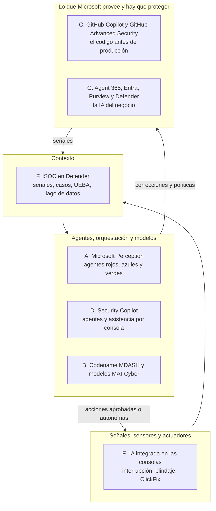

# La IA del lado de la defensa: capacidades agénticas de Microsoft frente a las 24 narrativas de ataque

**Frontier CISO Atlas · SOC agéntico · Análisis y matriz v0.1 · 25 de noviembre de 2026**

| Pieza | Contenido |
|---|---|
| Qué es | Desarrollo narrativo que acompaña al libro Frontier_CISO_Atlas_SOC_Agentico_Capacidades_Agenticas_v0.1.xlsx: 75 capacidades agénticas públicas de Microsoft cruzadas con los 120 pasos y etapas de las 24 narrativas y de los anexos de excepción. |
| Pregunta | ¿En qué pasos la IA defensiva empata o supera la ventaja que la IA le dio al atacante, en cuáles solo acelera a las personas y en cuáles no hay respuesta agéntica? |
| Fecha de corte | 25-nov-2026, después de Microsoft Ignite (17 al 20-nov-2026) y de GitHub Universe (28-oct-2026). |
| Fuentes | Solo públicas: Microsoft Learn, blogs oficiales, Microsoft Tech Community, GitHub Blog, Changelog y Docs, y microsoft.ai. Sin especulación: solo lo disponible, en versión preliminar o anunciado con fecha. Las discrepancias entre fuentes se registran, no se resuelven por conveniencia. |
| Qué no hace | No modifica el Frontier CISO Atlas, el Plan CISO 365, la ontología, la taxonomía, el GM-24, el Magerit ampliado, las guías de excelencia operacional, los catálogos de KPI y OKR, los Ninja trainings ni el kit Madurez SecOps. Los cita por ID. |
| Estado | Propuesta sin validación del autor. El nivel asignado a cada paso es una lectura analítica, no una medición en un cliente. |

## En una página

1. **La IA cambió la física del ataque, no su forma.** Las narrativas siguen siendo cadenas de pasos; lo que cambió es la velocidad (del descubrimiento al exploit en alrededor de un día en el caso PHP2Shell), la escala (una campaña de phishing de 14 días comprimida en 85 minutos) y la superficie (los agentes del negocio como nuevos internos). Fuentes: [blog de Microsoft Security, 17-nov-2026](https://www.microsoft.com/en-us/security/blog/2026/11/17/security-for-the-agentic-era-powered-by-microsoft-perception/) y [blog de Perception](https://techcommunity.microsoft.com/blog/perception-blog/whats-new-with-microsoft-perception-at-ignite-2026/4571834).
2. **La respuesta de Microsoft es un stack, no un producto.** Señales y actuadores en Defender, Entra, Intune, Purview y Sentinel; una capa de contexto; y arriba agentes especializados que trabajan en equipo. Perception (GA desde el 17-nov-2026) orquesta agentes rojos, azules y verdes; el ISOC es la base común de señales; Security Copilot asiste dentro de cada consola; MDASH y GitHub cuidan el código antes de producción; Agent 365, Entra, Purview y Defender protegen la IA que la propia organización despliega.
3. **De 116 pasos evaluados, 38 (32,8 %) tienen una respuesta a velocidad de máquina**: 9 donde la defensa adelanta y 29 donde empata. En 54 la IA acelera a la persona y en 24 no hay respuesta agéntica.
4. **Donde la IA del atacante cambió algo (48 pasos), la defensa empata o adelanta en 18 (37,5 %).** La paridad existe, pero es parcial y depende de capacidades que, en buena parte, están en versión preliminar.
5. **La defensa no necesita ganar en todos los pasos, sino cortar uno.** 19 de las 30 cadenas (24 narrativas y 6 anexos) tienen al menos un corte a velocidad de máquina. Las 11 restantes (ESC-07, ESC-09, ESC-12, ESC-13, ESC-15, ESC-20, ESC-21, ESC-24, D2, D5, D7) dependen todavía de personas, procesos o capacidades no agénticas.
6. **El ransomware (ESC-04) es donde mejor se empata**: la interrupción automática de ataques compite en cuatro de sus pasos (credenciales, evasión, movimiento lateral y cifrado), y las narrativas que lo alimentan tienen cortes anticipados en la entrada: autenticación resistente al phishing, reconocimiento propio, blindaje de vulnerabilidades y protección contra ClickFix.
7. **Los silencios importan tanto como las capacidades**: nadie protege todavía al SOC agéntico de ser engañado (ESC-24); el envenenamiento de memoria (ESC-15) no se detecta como tal; OT no tiene respuesta agéntica y su base en Defender for IoT tiene retiro anunciado; recuperar es el momento con menos IA.
8. **Autonomía con límites explícitos.** De las 75 capacidades, 10 actúan solas sobre acciones reversibles (A3), 6 ejecutan con aprobación (A2), 10 proponen (A1), 28 informan (A0) y 12 son controles por política. Ninguna llega al ciclo cerrado (A4), y 47 pasos tienen una decisión que no se delega.

## Parte I. La pregunta y la tesis

### 1. Qué cambió del lado del atacante

El trabajo previo de este hilo ya mostró que la IA no inventó narrativas de ataque nuevas en la mayoría de los casos: enriqueció las existentes (ESC-17 a ESC-21) y abrió un blanco nuevo, la IA misma (ESC-14 a ESC-16 y ESC-22 a ESC-24). Las fuentes públicas de noviembre de 2026 confirman cuatro desplazamientos:

| Desplazamiento | Evidencia pública | Narrativas |
|---|---|---|
| Velocidad: del descubrimiento al exploit en horas | Exploit funcional de PHP2Shell en alrededor de un día; casi dos semanas después seguían expuestos unos 29 millones de servicios ([blog de Microsoft Security](https://www.microsoft.com/en-us/security/blog/2026/11/17/security-for-the-agentic-era-powered-by-microsoft-perception/)) | ESC-05, ESC-19, ESC-17 |
| Volumen: más vulnerabilidades de las que se pueden corregir | Más de 96.000 CVE publicados en 2026 y solo 26 % de las vulnerabilidades del catálogo KEV de CISA remediadas en 2025 ([blog de Microsoft Security](https://www.microsoft.com/en-us/security/blog/2026/11/17/security-for-the-agentic-era-powered-by-microsoft-perception/)); 1.413 CVE en octubre de 2026 ([blog de Defender](https://techcommunity.microsoft.com/blog/microsoftthreatprotectionblog/ignite-2026-whats-new-in-microsoft-defender--sentinel/4569975)) | ESC-05, ESC-19 |
| Escala: campañas industrializadas | Actividad de phishing como servicio que pasó de 14 días a 85 minutos y de 10 a 3.000 usuarios ([blog de Perception](https://techcommunity.microsoft.com/blog/perception-blog/whats-new-with-microsoft-perception-at-ignite-2026/4571834)); ClickFix, 12,8 % de las intrusiones observadas por Defender, con crecimiento de 23 veces ([blog de equipos](https://techcommunity.microsoft.com/blog/microsoftthreatprotectionblog/ignite-2026-what%E2%80%99s-new-in-endpoint-security/4573835)) | ESC-01, ESC-06, ESC-18 |
| Superficie: los agentes como nuevos internos | Microsoft plantea que los agentes, sin ser maliciosos, operan a velocidad de máquina con acceso amplio y pueden equivocarse, ser manipulados o comprometidos ([blog del 19-oct-2026](https://www.microsoft.com/en-us/security/blog/2026/10/19/agents-are-your-newest-insiders-security-must-move-at-their-speed/)) | ESC-14, ESC-15, ESC-16, ESC-22, ESC-23 |

La consecuencia operativa ya estaba en el relato integrado: un SOC que atiende alertas de a una no alcanza a un atacante que ejecuta en paralelo. La pregunta de este documento es la inversa: **¿qué parte de esa distancia cierra hoy la IA del lado de la defensa?**

### 2. La respuesta: un stack de defensa con agentes

Microsoft describe su respuesta como un stack de tres capas ([blog de Microsoft Security, 17-nov-2026](https://www.microsoft.com/en-us/security/blog/2026/11/17/security-for-the-agentic-era-powered-by-microsoft-perception/)): señales, sensores y actuadores en sus productos, la red, el sistema operativo, el navegador y la nube; una capa de contexto que organiza esas señales con el entorno de cada cliente; y arriba agentes especializados que trabajan en equipo con playbooks, dirigidos por un orquestador y con varios modelos. Las siete familias de este análisis se ubican así:

El doble rol de Microsoft que planteó el relato integrado se ve en el diagrama: la familia C y la familia G protegen lo que Microsoft provee (el código que se escribe con Copilot, los agentes que se construyen con Copilot Studio o Foundry); las familias A, B, D, E y F son las herramientas para proteger.

### 3. Cómo leer el mapa

- **Unidad de análisis:** cada paso de las 24 narrativas (86 pasos y 7 condiciones; los 4 enlaces se evalúan en la narrativa de entrada) y cada etapa de los anexos D1, D2, D5, D6, D7 y D8. En total, 120 filas y 116 evaluadas.
- **Escala de nivel (propuesta):** 3 Adelanta, la defensa encuentra o cierra la vía antes de que el atacante la use; 2 Empata, la defensa actúa a velocidad de máquina en el mismo paso; 1 Acelera a la persona, la IA acorta el trabajo pero la acción depende de alguien; 0 Sin respuesta agéntica. El nivel mide la contribución agéntica, no la protección total: la columna «Base no agéntica» del libro muestra lo que ya sostiene el paso (por ejemplo, la mitigación automática de DDoS).
- **Lógica de cadena:** el atacante necesita completar todos los pasos; la defensa necesita cortar uno. Por eso el libro muestra, por narrativa, los cortes posibles a velocidad de máquina y el mejor punto de corte, además del eslabón más débil, que es la regla del kit Madurez SecOps.
- **Estado:** cada capacidad lleva su estado público al 25-nov-2026 y la fuente. Una capacidad en versión preliminar cuenta como respuesta, pero no como control de base: es un piloto.

## Parte II. Las siete familias

| Familia | Capacidades | Qué aporta al hilo | Estado dominante |
|---|--:|---|---|
| A. Microsoft Perception | 12 | Orquesta equipos de agentes: rojos que buscan las rutas antes que el atacante, azules que clasifican, investigan y crean detecciones, verdes que priorizan y corrigen. | Agentes azules, Recon y priorización GA; pruebas web, reducción de riesgo e identidad en versión preliminar |
| B. Codename MDASH y modelos MAI-Cyber | 3 | Busca y demuestra vulnerabilidades explotables en el código propio con más de 100 agentes y varios modelos. | Versión preliminar ampliada, por inscripción |
| C. GitHub Copilot y GitHub Advanced Security | 15 | Lleva la seguridad al momento en que se escribe el código, también el que escriben los agentes: análisis con IA, corrección agéntica, secretos, paquetes y aplicaciones de IA. | Corrección agéntica y AI Scan de pull requests GA; el resto, versión preliminar desde Universe |
| D. Security Copilot y sus agentes | 11 | Asiste dentro de cada consola y aporta agentes por producto: triaje de phishing, inteligencia, acceso condicional, vulnerabilidades, DLP y riesgo interno. | Mayormente disponible; incluido en Microsoft 365 E5 y E7 |
| E. IA integrada en las consolas | 11 | Actúa sola a velocidad de máquina sobre acciones reversibles: interrupción automática, blindaje de vulnerabilidades, ClickFix, phishing por código de dispositivo. | Interrupción GA; blindaje y blindaje predictivo en versión preliminar |
| F. ISOC en Microsoft Defender | 6 | Da a personas y agentes la misma base de señales, contexto y casos; es el piso del SOC agéntico. | Núcleo GA desde Ignite; SIEM completo y retención ampliada en versión preliminar |
| G. Agent 365 y protección de la IA | 17 | Protege la IA del negocio: inventario, identidad, permisos acotados a la tarea, contención, protección en tiempo de ejecución, datos y modelos. | Base GA (Agent 365, Agent ID, MXC); permisos dinámicos y riesgo dinámico en versión preliminar |
| **Total** | **75** | | 42 disponibles, 28 en versión preliminar, 2 en versión preliminar limitada o privada y 3 anunciadas |

### A. Microsoft Perception

Perception pasó de proyecto a producto en Ignite ([Tech Community](https://techcommunity.microsoft.com/blog/perception-blog/whats-new-with-microsoft-perception-at-ignite-2026/4571834)). Su unidad de trabajo es el playbook: un objetivo de seguridad que un equipo de agentes persigue con aprobaciones humanas en las acciones de alto impacto ([Learn](https://learn.microsoft.com/en-us/security/agentic-security/agentic-security-concepts)). Tres datos públicos definen su alcance hoy: el agente de triaje cubre alrededor del 80 % del volumen de una cola típica de Defender, según el análisis de Microsoft sobre unos 8 millones de alertas, y la propia fuente aclara que no es una tasa garantizada por cliente; los agentes de triaje e investigación pueden dispararse solos y atender varios ataques en paralelo; y los playbooks son predefinidos por Microsoft, sin playbooks propios en esta versión. El agente de pruebas web se comparó con Incalmo contra OpenAI Codex con el mismo modelo y resolvió alrededor del doble de tareas dentro de los límites de la prueba ([benchmark](https://techcommunity.microsoft.com/blog/perception-blog/benchmarking-microsoft-perception-for-agentic-pen-testing/4573271)).

Para el hilo del SOC agéntico, Perception aporta lo que faltaba en el kit Madurez SecOps: agentes concretos para las etapas de triaje, investigación, ingeniería de detección y exposición. No reemplaza los playbooks PB-01 a PB-14: los alimenta.

### B. Codename MDASH y modelos MAI-Cyber

MDASH orquesta más de 100 agentes especializados para encontrar, debatir y demostrar vulnerabilidades explotables en el código fuente ([Learn](https://learn.microsoft.com/en-us/security-exposure-management/ai-code-security-overview)). Desde Ignite analiza repositorios de hasta 5 GB, corre en nubes reguladas y sus hallazgos guían al agente de pruebas web de Perception. Sigue en versión preliminar por inscripción, sin fecha de GA ni precio publicados. MAI Cyber 2 Flash, el modelo de seguridad de Microsoft, entra en versión preliminar y reemplaza al modelo del perfil MAI de MDASH desde mediados de diciembre para clientes elegibles ([microsoft.ai](https://microsoft.ai/news/introducing-mai-cyber-2-flash/)). Es la respuesta más directa a ESC-17 y ESC-19: usar la misma capacidad que el atacante para encontrar la falla primero.

### C. GitHub Copilot y GitHub Advanced Security

En GitHub Universe la seguridad del código se volvió agéntica ([Changelog](https://github.blog/changelog/label/universe26/)): la corrección agéntica de alertas (GA desde el 15-oct) abre pull requests validados por CodeQL; AI Scan cubre lenguajes que CodeQL no cubre; el análisis de aplicaciones de IA marca rutas de inyección indirecta y exceso de autonomía antes de publicar; la protección de envíos con IA bloquea secretos sin patrón conocido, también los que escriben los agentes; y el firewall de paquetes frena componentes npm maliciosos antes de que un agente los instale. Para el hilo, esta familia responde a ESC-08, ESC-10, ESC-14, ESC-22 y ESC-23 en su origen: el repositorio.

### D. Security Copilot y sus agentes

Security Copilot está incluido en Microsoft 365 E5 y E7, con 400 SCU por mes cada 1.000 usuarios y hasta 10.000 ([Learn](https://learn.microsoft.com/en-us/copilot/security/security-copilot-inclusion)); los agentes no se activan solos: cada uno se configura. Los agentes de Defender (triaje de phishing y su extensión a alertas de nube e identidad, inteligencia, caza, detección dinámica de amenazas) y los de Entra, Intune y Purview aceleran al analista dentro de su consola ([Learn](https://learn.microsoft.com/en-us/defender-xdr/security-copilot-agents-defender)). Su papel en el mapa es mayormente de nivel 1: acortan el tiempo de una persona. Microsoft diferencia a Security Copilot, asistente y orientado a tareas, de Perception, que coordina agentes; y registra que tres agentes de Intune fueron retirados en 2026.

### E. IA integrada en las consolas

Es la familia que más empata, porque actúa sola. La interrupción automática de ataques contiene usuarios, equipos y sesiones con un umbral de confianza alto ([Learn](https://learn.microsoft.com/en-us/defender-xdr/automatic-attack-disruption)); el blindaje de vulnerabilidades, nuevo en Ignite y activo por defecto, aplica protección temporal durante un ataque activo ([blog de Defender](https://techcommunity.microsoft.com/blog/microsoftthreatprotectionblog/ignite-2026-whats-new-in-microsoft-defender--sentinel/4569975), [blindaje](https://techcommunity.microsoft.com/blog/microsoftthreatprotectionblog/vulnerability-shielding-protect-the-time-before-the-patch/4572135)); el monitor del portapapeles corta ClickFix antes de la ejecución ([blog de equipos](https://techcommunity.microsoft.com/blog/microsoftthreatprotectionblog/ignite-2026-what%E2%80%99s-new-in-endpoint-security/4573835)); y la detección del phishing por código de dispositivo contra GitHub Copilot CLI deshabilita la cuenta comprometida. Secure Now y el análisis de rutas de ataque completan el lado preventivo.

### F. ISOC en Microsoft Defender

El ISOC une SIEM y XDR en el portal de Defender para clientes de Defender Suite, Microsoft 365 E5 y E7 ([Learn](https://learn.microsoft.com/en-us/defender-xdr/isoc-overview)). En Ignite pasaron a GA los casos, los playbooks, los libros de trabajo y la analítica de comportamiento; la amplitud completa del SIEM, la retención incluida de 90 días, la optimización del SOC y las detecciones como código quedaron en versión preliminar ([blog de Defender](https://techcommunity.microsoft.com/blog/microsoftthreatprotectionblog/ignite-2026-whats-new-in-microsoft-defender--sentinel/4569975)). En el mapa no aparece como el que corta, sino como el que hace posible que los demás corten: es la base de señales y contexto compartida por personas y agentes.

### G. Agent 365 y la protección de la IA

Es la respuesta a la IA como superficie. Agent 365 inventaría agentes de Microsoft, de socios y locales; Entra Agent ID les da identidad propia; los permisos dinámicos y el acceso condicional dinámico acotan su autoridad a la tarea (versión preliminar limitada); Microsoft Execution Containers los contiene por sistema operativo (GA); Defender audita o bloquea instrucciones maliciosas en tiempo de ejecución; y Purview audita y, desde enero de 2027, bloqueará datos sensibles en indicaciones ([Agent 365](https://techcommunity.microsoft.com/blog/agent-365-blog/whats-new-in-microsoft-agent-365-ignite-2026/4571753), [Entra](https://techcommunity.microsoft.com/blog/microsoft-entra-blog/ai-is-changing-access-see-how-microsoft-entra-helps-you-stay-ahead-/4556456), [Purview](https://techcommunity.microsoft.com/blog/microsoft-security-blog/secure-the-data-that-fuels-ai-with-microsoft-purview/4573266)). Microsoft resume el principio en cuatro responsabilidades continuas: conocer, contener, proteger y adaptar ([blog del 19-oct-2026](https://www.microsoft.com/en-us/security/blog/2026/10/19/agents-are-your-newest-insiders-security-must-move-at-their-speed/)).

## Parte III. Recorrido por las narrativas

### 4. El hilo conductor: ransomware (ESC-04)

| Paso | Qué hace el atacante | Capacidad principal | Nivel | Lectura |
|---|---|---|---|---|
| ESC-04-P1 | Entra por alguna de las narrativas de acceso (phishing, mesa de ayuda, borde, infostealer, proveedor) | — | Enlace | Enlace: se evalúa en la narrativa de acceso (ESC-01, 03, 05, 06, 08, 18, 19). |
| ESC-04-P2 | Vuelca credenciales de la memoria y del directorio | CON-01 Automatic attack disruption | 2 Empata | La interrupción automática de ransomware operado por personas contiene usuarios y equipos comprometidos al detectar el volcado de credenciales; el triaje y la investigación se disparan solos y corren en paralelo. |
| ESC-04-P3 | Desactiva o manipula el antivirus y el EDR | CON-01 Automatic attack disruption | 2 Empata | La manipulación del antivirus es una señal de alta confianza para la interrupción automática; el tablero de salud de los equipos muestra sensores que dejaron de informar. |
| ESC-04-P4 | Se mueve por SMB, WMI o RDP hacia servidores y controladores de dominio | CON-01 Automatic attack disruption | 2 Empata | Es el paso donde la defensa empata la velocidad: la interrupción automática aísla equipos y cuentas durante el movimiento lateral, antes del cifrado. |
| ESC-04-P5 | Roba datos antes de cifrar, para extorsionar dos veces | SCP-05 Agentes de triaje de Purview (DLP e Insider Risk Management) | 1 Acelera a la persona | El agente de triaje de alertas de DLP prioriza las salidas de datos y explica por qué; la investigación agéntica une la exfiltración con el resto del ataque. |
| ESC-04-P6 | Borra instantáneas y respaldos | PER-04 Attack Investigation Agent | 1 Acelera a la persona | La investigación agéntica detecta el borrado de instantáneas dentro de la historia del ataque; la protección real son los respaldos inmutables. |
| ESC-04-P7 | Cifra servidores y equipos y deja la operación fuera de servicio | CON-01 Automatic attack disruption | 2 Empata | La interrupción automática detiene el cifrado en curso conteniendo equipos y cuentas; la recuperación depende de respaldos probados. |
| ESC-04-P8 | Exige el pago con la amenaza de publicar los datos | — | 0 Sin respuesta agéntica | La extorsión es una decisión de gobierno: la IA ayuda a preparar el informe para el directorio y los reguladores, no a decidir. |

La lectura para el directorio es directa: **el ransomware tiene cuatro puntos donde la defensa ya compite a velocidad de máquina, y todos dependen de la interrupción automática de ataques, que está disponible**. Los tres pasos que quedan atrás no son técnicos en el mismo sentido: la exfiltración previa al cifrado no tiene contención autónoma pública, el borrado de respaldos se resuelve con respaldos inmutables, y la extorsión es una decisión de gobierno.

Más importante aún, doce narrativas desembocan en ESC-04. Si se miran sus pasos de entrada, aparecen los cortes anticipados:

| Entrada al ransomware | Corte agéntico | Nivel | Estado |
|---|---|---|---|
| ESC-01-P3 | PER-09 Identity Risk Reduction Agent (playbooks «Reduce credential phishing risk» y «Close identity attack paths used in your environment») | 3 Adelanta | Versión preliminar |
| ESC-18-P2 | PER-09 Identity Risk Reduction Agent (playbooks «Reduce credential phishing risk» y «Close identity attack paths used in your environment») | 3 Adelanta | Versión preliminar |
| ESC-05-P1 | PER-07 Posture Prioritization Agent (playbook «Plan for posture remediation») | 3 Adelanta | Disponible |
| ESC-05-P2 | PER-01 Recon Agent | 3 Adelanta | Disponible |
| ESC-19-P1 | CON-02 Vulnerability shielding (durante un ataque activo) | 3 Adelanta | Versión preliminar |
| ESC-06-P2 | CON-05 Protección contra ClickFix (monitor del portapapeles) | 3 Adelanta | Disponible |
| ESC-10-P1 | GH-05 Push protection beyond predefined secret patterns (protección de envíos con IA) | 3 Adelanta | Versión preliminar |

Esto cambia la conversación con el CISO: el mejor lugar para ganarle al ransomware no es el cifrado, sino la identidad y la exposición, varios pasos antes.

### 5. Las 24 narrativas y los anexos, uno por uno

| ID | Narrativa o anexo | Pasos | Cortes ≥ 2 | Mejor | Más débil | Nivel medio | Lectura |
|---|---|--:|--:|--:|--:|--:|---|
| ESC-01 | Phishing y robo de credenciales o de sesión | 4 | 3 | 3 | 1 | 2,00 | Tres de cuatro pasos tienen respuesta a velocidad de máquina. El corte más fuerte es anticipado: con autenticación resistente al phishing aprobada, la página intermedia deja de servir. Queda fuera la preparación del señuelo. |
| ESC-02 | Fraude por correo y de pagos (BEC) | 4 | 2 | 2 | 0 | 1,25 | La defensa empata mientras el fraude está en el buzón (interrupción del BEC). El paso final, el pago, lo decide tesorería y no tiene respuesta agéntica. |
| ESC-03 | Ingeniería social por voz y mesa de ayuda | 4 | 2 | 2 | 0 | 1,25 | Con autenticación resistente al phishing, el bombardeo de MFA pierde efecto. El engaño por voz a la mesa de ayuda sigue dependiendo de la verificación humana. |
| ESC-04 | Ransomware y extorsión de datos | 7 | 4 | 2 | 0 | 1,43 | La interrupción automática compite en cuatro pasos (credenciales, evasión, movimiento lateral y cifrado). La exfiltración previa, el borrado de respaldos y la extorsión no tienen contención agéntica. |
| ESC-05 | Explotación de servicios expuestos y dispositivos de borde | 4 | 3 | 3 | 1 | 2,25 | La defensa puede llegar antes que el atacante: reconocimiento y priorización agénticos y blindaje de vulnerabilidades. La persistencia se investiga sola, pero se contiene con aprobación. |
| ESC-06 | Malware común, infostealers y ejecución por el usuario | 5 | 1 | 3 | 0 | 1,20 | El monitor del portapapeles corta ClickFix antes de la ejecución. El resto del robo de credenciales depende de la detección clásica acelerada por IA. |
| ESC-07 | Espionaje de actores estatales | 4 | 0 | 1 | 1 | 1,00 | El espionaje paciente no tiene un paso donde la defensa actúe sola: la IA acelera la caza, la analítica de comportamiento y la creación de detecciones, pero el corte sigue siendo humano. |
| ESC-08 | Cadena de suministro de software y SaaS | 3 | 1 | 2 | 1 | 1,33 | El firewall de paquetes bloquea componentes npm maliciosos antes de instalarlos (versión preliminar). El compromiso de un SaaS o de las credenciales del proveedor no tiene respuesta agéntica propia. |
| ESC-09 | Amenaza interna | 3 | 0 | 1 | 0 | 0,67 | Es la narrativa con menos defensa agéntica: la IA ordena las alertas, pero las decisiones son de recursos humanos y legal. |
| ESC-10 | Compromiso de nube e identidades de carga de trabajo | 4 | 1 | 3 | 1 | 1,50 | La defensa adelanta en la condición (secretos y permisos excesivos). El uso de la credencial robada se investiga con IA, sin contención autónoma pública. |
| ESC-11 | OT e infraestructura crítica | 4 | 1 | 2 | 0 | 0,75 | La entrada por el borde se cubre como en ESC-05. Dentro de la planta no hay capacidad agéntica pública y la seguridad OT de Defender for IoT tiene retiro anunciado. |
| ESC-12 | Abuso automatizado de aplicaciones web | 4 | 0 | 1 | 0 | 0,25 | No hay respuesta agéntica en tiempo real al relleno de credenciales con CAPTCHA resuelto por IA. El valor está en probar la autenticación y proponer reglas de WAF. |
| ESC-13 | Denegación de servicio | 3 | 0 | 0 | 0 | 0,00 | La IA no cambió esta narrativa de forma demostrada y la mitigación automática de DDoS ya opera a velocidad de máquina sin agentes. |
| ESC-14 | Secuestro del agente por inyección indirecta | 4 | 3 | 2 | 1 | 1,75 | Tres de cuatro pasos tienen controles que operan al ritmo del ataque (correo, Prompt Shields y permisos acotados a la tarea), varios en versión preliminar. La exfiltración por el agente depende de una DLP anunciada para 2027. |
| ESC-15 | Envenenamiento de memoria, contexto o base de conocimiento | 4 | 0 | 1 | 0 | 0,75 | El atacante va adelante: hay visibilidad y riesgo dinámico, pero ninguna capacidad pública detecta el envenenamiento de memoria o de la base de conocimiento como tal. |
| ESC-16 | Abuso de identidad del agente y fallas en cascada | 4 | 2 | 2 | 1 | 1,50 | Entra Agent ID y los permisos dinámicos ponen al agente bajo las mismas reglas que una persona. La falla en cascada entre agentes solo se ve en la auditoría. |
| ESC-17 | Intrusión orquestada por agentes | 5 | 3 | 3 | 0 | 1,60 | Agentes contra agentes: el reconocimiento propio adelanta al del atacante y la interrupción automática compite en la entrada y la escalada. El cruce a OT queda sin respuesta. |
| ESC-18 | Robo de sesión y fraude por correo industrializados | 4 | 3 | 3 | 1 | 2,00 | Es donde mejor se ve el empate: triaje de alrededor del 80 % de la cola, cierre de rutas de identidad e interrupción del BEC. El fraude final vuelve a tesorería. |
| ESC-19 | Explotación en menos de un día | 4 | 2 | 3 | 1 | 1,75 | El blindaje de vulnerabilidades, activo por defecto, es la respuesta directa a la explotación en menos de un día; está en versión preliminar. |
| ESC-20 | Malware que consulta un modelo | 3 | 0 | 1 | 1 | 1,00 | La detección de comportamiento resiste al código que cambia, pero no hay un control agéntico que corte la consulta al modelo. |
| ESC-21 | Suplantación sintética | 3 | 0 | 1 | 0 | 0,33 | El atacante va adelante: la detección de medios sintéticos depende de un proveedor externo y solo cubre reuniones de Teams; las decisiones son humanas. |
| ESC-22 | Cadena de suministro agéntica | 3 | 2 | 2 | 1 | 1,67 | Gobierno de herramientas, firewall de MCP, contenedores de ejecución y protección en tiempo de ejecución forman una barrera en capas, mayormente en versión preliminar. |
| ESC-23 | Secuestro de capacidad de IA | 3 | 2 | 3 | 1 | 2,00 | La protección de envíos con IA y Prompt Shields cortan el robo de claves y la evasión del modelo. El consumo abusivo se detecta, pero no se contiene solo. |
| ESC-24 | Cegar o desviar la defensa autónoma | 3 | 0 | 1 | 1 | 1,00 | Es el silencio más importante: ninguna capacidad pública protege al SOC agéntico de ser cegado o engañado. Quedan el registro de sesiones, la auditoría y la revisión humana. |
| D1 | Fraude | 4 | 1 | 2 | 0 | 1,00 | La IA defensiva cubre la preparación dentro del buzón. El cambio de pago, el cobro y la toma de cuentas de clientes los decide el negocio. |
| D2 | Disponibilidad | 3 | 0 | 1 | 0 | 0,33 | La mitigación de la denegación de servicio es automática pero no agéntica; la IA solo ayuda a relacionarla con una extorsión en curso. |
| D5 | Espionaje y permanencia | 4 | 0 | 1 | 1 | 1,00 | La IA acelera la caza y la ingeniería de detección en las cuatro etapas, sin contención autónoma. |
| D6 | Proveedores y cadena de suministro | 4 | 1 | 2 | 0 | 1,00 | Hay cobertura en la cadena de software (paquetes y código propio). El acceso del proveedor y la concentración siguen siendo decisiones de terceros. |
| D7 | Riesgo interno | 4 | 0 | 1 | 0 | 0,75 | Triaje y postura de datos con IA; la DLP de indicaciones y la protección del anclaje están anunciadas para 2027. |
| D8 | OT e infraestructura crítica | 4 | 1 | 2 | 0 | 0,75 | Solo el borde de TI tiene respuesta agéntica; la planta depende de socios y de la continuidad. |

### 6. Lo que muestran los grupos

- **Identidad y correo (ESC-01, ESC-02, ESC-03, ESC-18).** Es el frente donde la defensa más se acercó al atacante: triaje autónomo de la cola, interrupción automática de AiTM y BEC, y un agente que propone cerrar las rutas de identidad con autenticación resistente al phishing. El límite es humano: el pago, el restablecimiento por la mesa de ayuda, la verificación por otro canal.
- **Exposición y explotación (ESC-05, ESC-19, ESC-17, ESC-11 en el borde).** Aquí la defensa puede adelantarse: reconocimiento propio, priorización por explotabilidad y blindaje mientras llega el parche. Es también donde más pesa la versión preliminar: el blindaje y el agente de reducción de riesgo todavía no son controles de base.
- **Malware y ejecución (ESC-06, ESC-20).** ClickFix tiene un corte autónomo; el malware que consulta un modelo no tiene un control agéntico que corte esa consulta.
- **Permanencia y datos (ESC-07, ESC-09, D5, D7).** La IA acelera la caza, la creación de detecciones y el triaje de alertas de datos, pero ningún paso se corta solo. Es el terreno del analista y de la ingeniería de detección asistida.
- **Nube y cadena de suministro (ESC-08, ESC-10, ESC-22, ESC-23, D6).** GitHub y Agent 365 cortan en el origen (secretos, paquetes, herramientas y servidores MCP), casi todo en versión preliminar desde octubre y noviembre.
- **La IA como superficie (ESC-14, ESC-15, ESC-16).** La inyección indirecta y el abuso de la identidad del agente tienen controles que operan al ritmo del ataque; el envenenamiento de memoria no.
- **Disponibilidad, fraude y suplantación (ESC-12, ESC-13, ESC-21, D1, D2).** La IA del atacante no cambió la denegación de servicio de forma demostrada, y la mitigación automática ya existe sin agentes. En la suplantación sintética y el relleno de credenciales, el atacante va adelante.
- **Cegar la defensa autónoma (ESC-24).** Ninguna capacidad pública protege específicamente al SOC agéntico de la inyección en la evidencia que leen sus agentes. Es el silencio que más conviene vigilar a medida que crece la autonomía.

### 7. Los anexos de excepción

| Anexo | Etapa | Capacidad principal | Nivel | Quién decide |
|---|---|---|---|---|
| D1 Fraude | D1-1 Preparación dentro del buzón | CON-01 Automatic attack disruption | 2 Empata | SOC |
| D1 Fraude | D1-2 Suplantación y pedido de cambio de pago | SCP-01 Phishing Triage Agent y su extensión, Security Alert Triage Agent | 1 Acelera a la persona | Tesorería y cuentas a pagar |
| D1 Fraude | D1-3 Cobro del pago desviado | — | 0 Sin respuesta agéntica | Tesorería, legal y banco |
| D1 Fraude | D1-4 Toma de cuentas de clientes | PER-02 Web App Pen Test Agent (playbooks «Run web pen test» y «Protect web app») | 1 Acelera a la persona | Canal digital y prevención del fraude |
| D2 Disponibilidad | D2-1 Saturación de la red o de la aplicación | — | 0 Sin respuesta agéntica | Infraestructura y redes |
| D2 Disponibilidad | D2-2 Agotamiento de recursos y caída del servicio | — | 0 Sin respuesta agéntica | Continuidad del negocio |
| D2 Disponibilidad | D2-3 Denegación de servicio como presión en una extorsión | PER-04 Attack Investigation Agent | 1 Acelera a la persona | Comité de crisis |
| D5 Espionaje y permanencia | D5-1 Permanencia con cuentas válidas y tokens | ISO-01 ISOC en Microsoft Defender: núcleo | 1 Acelera a la persona | SOC |
| D5 Espionaje y permanencia | D5-2 Recolección de correo y repositorios | SCP-05 Agentes de triaje de Purview (DLP e Insider Risk Management) | 1 Acelera a la persona | SOC con los dueños de la información |
| D5 Espionaje y permanencia | D5-3 Exfiltración lenta | SCP-05 Agentes de triaje de Purview (DLP e Insider Risk Management) | 1 Acelera a la persona | SOC |
| D5 Espionaje y permanencia | D5-4 Evasión y borrado de rastros | PER-05 Detection Authoring Agent (playbook «Detect emerging threats») | 1 Acelera a la persona | SOC (caza e ingeniería de detección) |
| D6 Proveedores y cadena de suministro | D6-1 Compromiso del proveedor o de su software | GH-07 GitHub package firewall | 2 Empata | Compras y gobierno de terceros |
| D6 Proveedores y cadena de suministro | D6-2 Uso del acceso legítimo del proveedor | PER-09 Identity Risk Reduction Agent (playbooks «Reduce credential phishing risk» y «Close identity attack paths used in your environment») | 1 Acelera a la persona | Dueño del servicio externalizado |
| D6 Proveedores y cadena de suministro | D6-3 Componente malicioso que corre con la confianza del original | AIA-06 Microsoft Execution Containers (MXC) | 1 Acelera a la persona | SOC con desarrollo |
| D6 Proveedores y cadena de suministro | D6-4 Incidente en el proveedor y concentración | — | 0 Sin respuesta agéntica | Compras, legal y dueño del servicio |
| D7 Riesgo interno | D7-1 Ingreso o reclutamiento de una persona con intención | CON-07 Detección de audio y video sintéticos en reuniones de Teams | 0 Sin respuesta agéntica | Recursos humanos y contratación |
| D7 Riesgo interno | D7-2 Acumulación de información fuera de su función | AIA-10 Microsoft Purview para IA: DSPM, auditoría y riesgo interno de agentes | 1 Acelera a la persona | Recursos humanos, legal y privacidad |
| D7 Riesgo interno | D7-3 Salida de la información | SCP-05 Agentes de triaje de Purview (DLP e Insider Risk Management) | 1 Acelera a la persona | SOC |
| D7 Riesgo interno | D7-4 Investigación, desvinculación y accesos residuales | SCP-07 Access Review Agent | 1 Acelera a la persona | Recursos humanos y legal |
| D8 OT e infraestructura crítica | D8-1 Entrada por el borde o por TI | PER-01 Recon Agent | 2 Empata | Operaciones de planta |
| D8 OT e infraestructura crítica | D8-2 Paso de TI a la red de planta | — | 0 Sin respuesta agéntica | Operaciones de planta |
| D8 OT e infraestructura crítica | D8-3 Manipulación de controladores | — | 0 Sin respuesta agéntica | Ingeniería de control y seguridad de procesos |
| D8 OT e infraestructura crítica | D8-4 Detención o destrucción del proceso | CON-01 Automatic attack disruption | 1 Acelera a la persona | Gerencia de planta y comité de crisis |

El patrón de los anexos confirma lo que mostró el paso 4 del hilo: en las excepciones decide otra área (tesorería, compras, recursos humanos, planta) y la IA defensiva aporta señal y evidencia, no la decisión.

## Parte IV. El balance

### 8. Las cifras

| Indicador | Valor |
|---|--:|
| Pasos y etapas evaluados | 116 |
| Adelanta (3) | 9 |
| Empata (2) | 29 |
| Acelera a la persona (1) | 54 |
| Sin respuesta agéntica (0) | 24 |
| A velocidad de máquina (nivel 2 o 3) | 38 (32,8 %) |
| Pasos donde la IA del atacante cambió algo | 48 |
| De ellos, a velocidad de máquina | 18 (37,5 %) |
| Pasos cuya capacidad principal está disponible (nivel 1 o más) | 70 |
| Pasos cuya capacidad principal está en versión preliminar (nivel 1 o más) | 22 |
| Cadenas con al menos un corte a velocidad de máquina | 19 de 30 |
| Cadenas con eslabón más débil en 0 | 16 de 30 |
| Nivel medio de las 24 narrativas / de los 6 anexos | 1,26 / 0,81 |

### 9. Por momento de la defensa

| Momento | Pasos | Nivel medio |
|---|--:|--:|
| Anticipar | 21 | 1,62 |
| Prevenir | 18 | 1,61 |
| Detectar y clasificar | 35 | 0,89 |
| Investigar y contener | 26 | 1,46 |
| Recuperar | 8 | 0,00 |
| Gobernar | 8 | 0,88 |

La IA defensiva rinde más antes y alrededor del ataque que en su centro: anticipar y prevenir tienen los niveles medios más altos; detectar y clasificar queda más abajo porque buena parte de lo que hace la IA allí es acelerar al analista, no cortar; y recuperar no tiene capacidad agéntica que restaure el negocio. Para un CISO, esto sugiere dónde invertir primero la autonomía: en la exposición y la identidad, y en la contención reversible.

### 10. La asimetría, ventaja por ventaja

| Ventaja del atacante | Respuesta agéntica | Balance | Qué falta |
|---|---|---|---|
| Del descubrimiento al exploit en horas o minutos | CON-02; PER-08; PER-07; CON-03; SCP-04 | Empata en parte | El blindaje proactivo cubre al inicio solo ejecución remota del lado del servidor; el parche sigue dependiendo de TI |
| Volumen de vulnerabilidades: más de 96.000 CVE publicados en 2026; 1.413 en el martes de parches de octubre | PER-07; PER-08; CON-04; SCP-04 | Acelera a la persona | Las iniciativas de actualización mensual llegan en enero de 2027 |
| Phishing industrializado: una campaña de 14 días bajó a 85 minutos y pasó de 10 a 3.000 usuarios | PER-03; SCP-01; CON-01 | Empata | El 80 % es cobertura agregada, no una tasa garantizada |
| Robo de sesión con página intermedia (AiTM): 44,6 % de las técnicas de phishing | PER-09; CON-01; CON-08; SCP-03 | Adelanta | Solo adelanta si se aprueba y despliega la autenticación resistente al phishing |
| Intrusión orquestada por agentes: 80 a 90 % de la operación táctica hecha por IA; unas 30 entidades atacadas | PER-03; PER-04; CON-01; CON-09; PER-01 | Empata | La contención autónoma exige confianza alta; el resto espera aprobación humana |
| Malware a medida y malware que consulta un modelo en tiempo de ejecución | PER-03; PER-04; SCP-06 | Acelera a la persona | No hay control agéntico que corte la consulta al modelo |
| ClickFix: 12,8 % de las intrusiones observadas por Defender y crecimiento de 23 veces en cinco meses | CON-05 | Adelanta | — |
| Suplantación sintética: voz, video e identidades fabricadas para cobrar, restablecer o ser contratado | CON-07 | Atacante adelante | Teléfono y canales fuera de Teams sin cobertura; la decisión es humana |
| Agentes como nuevos internos: inyección indirecta y abuso de herramientas y permisos | CON-10; AIA-12; AIA-08; AIA-04; AIA-02; AIA-06 | Empata | Permisos dinámicos en versión preliminar limitada y con E7 |
| Envenenamiento de la memoria, el contexto o la base de conocimiento | AIA-03; AIA-10; AIA-01 | Atacante adelante | Ninguna capacidad pública detecta el envenenamiento; la memoria del agente (FT-19) sigue sin fuente de señal |
| Cadena de suministro de herramientas de IA: unos 2.000 secretos de 225 víctimas; 19,7 % de paquetes recomendados por modelos no existía | GH-07; GH-05; GH-06; AIA-07; AIA-15; GH-11; AIA-06 | Empata en parte | El firewall de paquetes cubre solo npm |
| Secuestro de capacidad de IA (LLMjacking) | GH-05; GH-13; AIA-12; AIA-13 | Adelanta | El consumo abusivo se detecta, pero no se contiene solo |
| Cegar o engañar a la defensa autónoma | PER-12; ISO-02; ISO-05 | Atacante adelante | No hay protección pública específica contra la inyección en la evidencia que lee el agente de triaje |
| Más datos robados para la doble extorsión (275 % más) | SCP-05; PER-04; AIA-10 | Acelera a la persona | Sin contención autónoma pública de la exfiltración |
| La búsqueda con IA encuentra en segundos los datos sobreexpuestos | AIA-10; SCP-11; AIA-11 | Acelera a la persona | La protección del anclaje de Copilot llega en enero de 2027 |
| Volumen de señales y alertas que ninguna persona puede revisar | ISO-01; ISO-05; PER-03; SCP-08 | Empata | Los datos de terceros y la retención ampliada siguen en versión preliminar |

Resultado: de 16 ventajas, la defensa adelanta en 3, empata (total o en parte) en 6, solo acelera a la persona en 4 y va detrás en 3: suplantación sintética, envenenamiento de memoria y el intento de cegar a la defensa autónoma.

## Parte V. Autonomía y gobierno

### 11. Separar la capacidad de automatizar de la autoridad para ejecutar

El traspaso del autor ya lo había planteado y Microsoft lo formula de modo parecido: separar el suministro de inteligencia de la autoridad sobre ella, y dejar los controles que deciden qué puede hacer un agente fuera del modelo, donde no pueda saltarlos ([blog del 19-oct-2026](https://www.microsoft.com/en-us/security/blog/2026/10/19/agents-are-your-newest-insiders-security-must-move-at-their-speed/)). El catálogo lo refleja:

| Autonomía equivalente (propuesta) | Capacidades | Ejemplos |
|---|--:|---|
| A3 | 10 | interrupción automática, blindaje de vulnerabilidades, ClickFix, triaje de alertas |
| A2 | 6 | reducción de riesgo, reducción de riesgo de identidad, generador de playbooks |
| A1 | 10 | investigación agéntica, creación de detecciones, MDASH, corrección agéntica de GitHub |
| A0 | 28 | reconocimiento, priorización, inteligencia, agentes de Purview |
| Política | 12 | Agent ID, permisos dinámicos, contenedores de ejecución, firewall de paquetes |
| No aplica | 9 | ISOC, integraciones, servicio administrado |

Ninguna capacidad pública opera en ciclo cerrado (A4), lo que coincide con el plan 365, que no prevé L4. Y 47 de los 120 pasos y etapas tienen una decisión que no se delega: pagar o no, notificar, aprobar una política, aislar un servidor de negocio, detener una planta. La recomendación para el gobierno del SOC agéntico es tratar la autonomía como una decisión por tipo de acción, medida con K88 (tipos de acción de agentes con nivel de autonomía aprobado), K98 (decisiones automatizadas de alto impacto con supervisión humana verificada) y K175 (acciones de agentes revertidas).

## Parte VI. Medir el efecto

Los indicadores ya existen en el catálogo 2.0 del CISO 365; no hace falta crear nuevos para empezar.

| Función defensiva | Capacidades | Indicadores existentes | Propuestos del kit |
|---|---|---|---|
| Triaje a velocidad de máquina | PER-03; SCP-01; SCP-05 | K168 Alertas de severidad alta clasificadas dentro del objetivo; K169 Consistencia de clasificación entre analistas; K170 Falsos positivos de las detecciones prioritarias; K42 Tiempo medio de detección (MTTD) | — |
| Contención autónoma | CON-01; CON-02; CON-08; CON-09 | K45 Tiempo medio de contención (MTTC); K55 Incidentes contenidos con respuesta automatizada o asistida por IA; K175 Acciones de agentes revertidas; K179 Automatizaciones de respuesta fallidas | PROP-01 |
| Investigación y correlación | PER-04; ISO-01; ISO-05 | K42 Tiempo medio de detección (MTTD); K177 Tiempo medio de resolución (MTTR); K190 Evidencia de incidentes preservada con cadena de custodia | PROP-01 |
| Ingeniería de detección e inteligencia | PER-05; PER-06; SCP-08; SCP-02 | K43 Técnicas de ataque priorizadas con detección validada; K44 Campañas de hunting que mejoran la detección; K124 Casos de uso de detección con dueño, prueba y revisión vigentes; K127 Acciones derivadas de inteligencia de amenazas; K171 Detecciones sin revisión en los últimos 12 meses | — |
| Exposición antes del parche | PER-01; PER-07; PER-08; CON-02; CON-03; CON-11; SCP-04 | K140 Rutas de ataque abiertas hacia activos críticos; K46 Vulnerabilidades explotadas y exposiciones críticas remediadas en plazo; K138 Tiempo de corrección de vulnerabilidades críticas; K151 Tiempo de aplicación de parches críticos en dispositivos; K137 Activos expuestos a internet sin inventariar; K188 Vulnerabilidades críticas fuera de plazo con decisión de riesgo | — |
| Identidad resistente al phishing | PER-09; SCP-03; SCP-10 | K33 Autenticación resistente al phishing; K34 Accesos privilegiados sin privilegios permanentes (JIT) | — |
| Código y cadena de suministro | MDA-01; GH-01 a GH-15 | K38 Aplicaciones críticas con controles automatizados en el pipeline; K157 Vulnerabilidades críticas en producción fuera de plazo; K158 Secretos expuestos en repositorios revocados en plazo; K156 Claves y secretos en bóveda con rotación | — |
| Agentes del negocio | AIA-01 a AIA-17; PER-10 | K49 Inventario de sistemas de IA y agentes; K50 Agentes con dueño humano y autoridad delegada acotada; K53 Observabilidad de agentes integrada a la detección; K165 Agentes con identidad propia y permisos por herramienta revisados; K166 Agentes con evaluación adversarial vigente; K167 Agentes con detención de emergencia probada; K187 Sistemas de IA y agentes sin dueño o sin uso regularizados en plazo; K52 Interacciones con IA protegidas contra la fuga de datos | PROP-02 |
| Gobierno del SOC agéntico | PER-12; ISO-02; ISO-03 | K88 Tipos de acción de agentes con nivel de autonomía aprobado; K98 Decisiones automatizadas de alto impacto con supervisión humana verificada; K175 Acciones de agentes revertidas; K108 Desvío del costo por tarea automatizada | — |
| Personas y canales de engaño | CON-05; CON-06; CON-07 | K11 Comportamiento seguro: tasa de reporte de phishing; K163 Tasa de falla en simulaciones de ingeniería social; K152 Tiempo de retiro de mensajes maliciosos entregados | — |

Los resultados clave candidatos que ya propuso el relato integrado se conectan sin cambios: HR-KR2 (K55), HR-KR1 (K45) e IA-KR1 (PROP-01, correlación entre capas en 16 minutos o menos) miden la contención y la correlación que aportan las familias A, E y F; HR-KR3 (K140) mide la exposición que atacan los agentes rojos y verdes; IA-KR2 (PROP-02) mide la base que necesita la familia G. En el plan 365, el peso cae en los frentes F4 (detectar, responder y recuperar) y F6 (IA y agentes).

## Parte VII. El mercado y la cadencia

El usuario observa que otras soluciones del mercado ofrecen capacidades equivalentes y que eso indica una demanda real. Este análisis no compara fabricantes; sí registra la cadencia pública de Microsoft en 2026, que permite juzgar los tiempos:

| Fecha | Hito público | Estado |
|---|---|---|
| 18-nov-2025 | [Comienza el despliegue de Security Copilot incluido en Microsoft 365 E5 y E7 (400 SCU por mes cada 1.000 usuarios, hasta 10.000)](https://learn.microsoft.com/en-us/copilot/security/security-copilot-inclusion) | Inclusión |
| 7-abr-2026 | [GitHub: alertas de Dependabot asignables a agentes de IA](https://github.blog/changelog/2026-04-07-dependabot-alerts-are-now-assignable-to-ai-agents-for-remediation/) | GA |
| 1-may-2026 | [Microsoft Agent 365 disponible de forma general](https://techcommunity.microsoft.com/blog/agent-365-blog/what%E2%80%99s-new-in-agent-365-may-2026/4516340) | GA |
| 12-may-2026 | [Presentación de Codename MDASH, sistema agéntico de análisis de código](https://www.microsoft.com/en-us/security/blog/2026/05/12/defense-at-ai-speed-microsofts-new-multi-model-agentic-security-system-tops-leading-industry-benchmark/) | Versión preliminar limitada |
| 2-jun-2026 | [Build: MDASH en versión preliminar ampliada; integración nativa de Defender for Cloud con GitHub Code Security](https://www.microsoft.com/en-us/security/blog/2026/06/02/microsoft-build-2026-securing-code-agents-and-models-across-the-development-lifecycle/) | Versión preliminar y GA |
| 27-jul-2026 | [Presentación de Project Perception y del modelo MAI-Cyber-1-Flash; versión preliminar desde agosto. Protección en tiempo real de servidores de herramientas de Agent 365](https://blogs.microsoft.com/blog/2026/07/27/rethinking-security-for-the-age-of-ai/) | Versión preliminar y GA |
| 23-sep-2026 | [ISOC en Microsoft Defender en versión preliminar](https://learn.microsoft.com/en-us/defender-xdr/isoc-overview) | Versión preliminar |
| 7-oct-2026 | [GitHub: sandbox local para Copilot con Microsoft Execution Containers](https://github.blog/changelog/2026-10-07-local-sandboxing-for-github-copilot-now-generally-available/) | GA |
| 15-oct-2026 | [GitHub: corrección agéntica de alertas de code scanning y AI Scan para pull requests](https://github.blog/changelog/2026-10-15-agentic-autofix-for-code-scanning-alerts-general-availability/) | GA |
| 19-oct-2026 | [Perception se extiende a los agentes como nuevos internos (Guardian Agents)](https://www.microsoft.com/en-us/security/blog/2026/10/19/agents-are-your-newest-insiders-security-must-move-at-their-speed/) | Anuncio |
| 20-oct-2026 | [GitHub package firewall](https://github.blog/changelog/2026-10-20-github-package-firewall-in-public-preview/) | Versión preliminar |
| 28-oct-2026 | [GitHub Universe: AI Scan para repositorios, code scanning para aplicaciones de IA, protección de envíos con IA y alcanzabilidad de Dependabot](https://github.blog/changelog/label/universe26/) | Versión preliminar |
| 29-oct-2026 | [Defender: descubrimiento de agentes locales](https://techcommunity.microsoft.com/blog/MicrosoftThreatProtectionBlog/now-generally-available-discover-local-ai-agents-with-microsoft-defender/4568216) | GA |
| 5-nov-2026 | [Microsoft Execution Containers; permisos dinámicos y acceso condicional dinámico para agentes](https://www.microsoft.com/en-us/security/blog/2026/11/05/whats-new-in-microsoft-security-november-2026/) | GA y versión preliminar |
| 17-nov-2026 | [Ignite: Microsoft Perception GA; núcleo del ISOC GA; blindaje de vulnerabilidades y MAI Cyber 2 en versión preliminar; novedades de Agent 365, Entra y Purview](https://www.microsoft.com/en-us/security/blog/2026/11/17/security-for-the-agentic-era-powered-by-microsoft-perception/) | GA y versión preliminar |
| 17-nov-2026 | [GitHub: escaneo de secretos a demanda en la revisión de seguridad de Copilot; actividad de Copilot en Agent 365](https://github.blog/changelog/2026-11-17-secret-scanning-on-demand-for-developers-and-agents/) | Versión preliminar y disponible |
| Mediados de dic-2026 | [MAI Cyber 2 Flash reemplaza al modelo del perfil MAI de MDASH para clientes elegibles](https://microsoft.ai/news/introducing-mai-cyber-2-flash/) | Anunciada |
| Ene-2027 | [AI Readiness Initiatives en Perception; DLP para indicaciones a Copilot y agentes locales; protección del anclaje de Copilot](https://techcommunity.microsoft.com/blog/microsoft-security-blog/secure-the-data-that-fuels-ai-with-microsoft-purview/4573266) | Anunciada |

Dos observaciones objetivas: entre la presentación de MDASH (mayo) y la disponibilidad general de Perception (noviembre) pasaron seis meses; y el núcleo del ISOC pasó de versión preliminar a GA en ocho semanas. Las categorías que cubren estas capacidades (SOC con agentes, pruebas de penetración autónomas, seguridad de agentes, análisis de código con IA) existen también en otras ofertas del mercado; la única comparación pública citada aquí es la del agente de pruebas web con OpenAI Codex, publicada por Microsoft con Incalmo.

## Parte VIII. Silencios, límites y discrepancias

1. **ESC-24.** El SOC agéntico no tiene una protección pública específica contra la inyección en la evidencia que leen sus agentes ni contra el cegamiento de reglas y automatizaciones. Quedan el registro de sesiones de Perception, la auditoría de automatizaciones (versión preliminar) y la revisión humana por muestreo.
2. **ESC-15.** Ninguna capacidad pública detecta el envenenamiento de la memoria o de la base de conocimiento de un agente; la memoria del agente (FT-19) sigue sin fuente de señal. Hay visibilidad (Agent 365, Purview) y riesgo dinámico en versión preliminar.
3. **ESC-11; ESC-17-P5; D8.** OT sin capacidad agéntica. La seguridad OT de Defender for IoT tiene retiro anunciado y las fuentes públicas dan fechas distintas: 31-may-2028 (blog de socios, 12-nov-2026) y octubre de 2029 (comunicación de versiones, 2-nov-2026). No se elige una fecha: se registra la discrepancia. Microsoft deriva a integraciones validadas de socios.
4. **ESC-04-P6/P7; D2; D8.** Recuperar es el momento con menos IA: una sola capacidad pública (AIA-17, versión preliminar) y no restaura el negocio. La recuperación sigue en respaldos, continuidad y decisiones humanas.
5. **ESC-04-P5; ESC-07-P5; ESC-09-P3.** La exfiltración previa al cifrado no tiene contención autónoma pública. La DLP bloquea por política y el triaje prioriza.
6. **Catálogo.** Fuentes que discrepan sobre el estado: Perception GA frente al aviso «Limited Public Preview» en Learn; protección en tiempo de ejecución de agentes locales «GA*» frente a versión preliminar; códigos QR en Teams; política de agentes riesgosos de Insider Risk. Se registra el estado más prudente en el resumen y la discrepancia en el detalle.
7. **PER-03; SCP-01.** Dos agentes de triaje con nombres parecidos: Security Alert Triage Agent (Security Copilot, versión preliminar para nube e identidad) y Alert Triage Agent (Perception, GA). Las fuentes públicas no dicen si son el mismo.
8. **PER-*.** Licencias de Perception: el modelo es de consumo medido en SCU; no se publicó qué licencias lo incluyen. El agente de reducción de riesgo de identidad requiere Microsoft 365 E7. Las SCU incluidas en E5 y E7 corresponden a Security Copilot.
9. **MDA-01.** Codename MDASH no tiene fecha de GA ni precio publicados; el acceso es por inscripción o nominación. El registro del 7-oct-2026 notó que la documentación no listaba regiones de Latinoamérica: revalidar para MCSA.
10. **PER-12.** Los playbooks de Perception son predefinidos por Microsoft y no se pueden crear propios en esta versión: los playbooks PB-01 a PB-14 del kit no se trasladan uno a uno. Los playbooks del kit siguen siendo la referencia operativa; Perception aporta agentes a sus etapas.
11. **SCP-04.** Tres agentes de Intune fueron retirados (Device Offboarding el 1-jun-2026; Change Review y Policy Configuration el 31-ago-2026), aunque la página de resumen todavía los lista. Solo queda el Vulnerability Remediation Agent.
12. **CON-01.** La página vigente de la interrupción automática de ataques ya no enumera escenarios; ransomware operado por personas, BEC y AiTM provienen de publicaciones anteriores. No hay fuente pública para SAP.
13. **Catálogo 2.1.** Perception, ISOC, Microsoft Execution Containers, los modelos MAI-Cyber y la detección de medios sintéticos no tienen capacidad propia en el catálogo Edición Microsoft 2.1 (MS-xxx). Decisión del autor: incorporarlos o mantenerlos como capa nueva. Esta propuesta no modificó el catálogo.
14. **ESC-03; ESC-21; D7-1.** La suplantación por teléfono no tiene cobertura; la detección de medios sintéticos solo cubre reuniones de Teams y depende de un proveedor externo.
15. **ESC-12; D1-4.** El relleno de credenciales con CAPTCHA resuelto por IA no tiene respuesta agéntica en tiempo real. La protección contra bots del WAF no es agéntica.
16. **PER-03.** El 80 % del agente de triaje es cobertura agregada sobre unos 8 millones de alertas; no es una tasa garantizada por cliente. Medir con K168 y K170 en cada cliente.
17. **ISO-01.** Microsoft Sentinel en el portal de Azure se retira el 31-mar-2027; el camino es el portal de Defender y el ISOC.

Fuentes de las discrepancias de OT: [blog de socios del 12-nov-2026](https://techcommunity.microsoft.com/blog/partnernews/november-update-what%E2%80%99s-new-in-security-for-partners/4572658) y [comunicación de versiones del 2-nov-2026](https://www.microsoft.com/releasecommunications/api/v2/azure/576255).

## Parte IX. Qué hace un CISO con esto

1. **Elegir tres narrativas** por riesgo (la matriz Magerit y el sector las ordenan) y abrir su fila en la hoja Narrativas: cortes a velocidad de máquina, mejor punto de corte y eslabón más débil.
2. **Asegurar primero los cortes disponibles**: interrupción automática, triaje, investigación, Recon y priorización de la exposición, Security Copilot incluido en E5 y E7. Son la paridad que ya existe.
3. **Tratar la versión preliminar como piloto con fecha**: blindaje de vulnerabilidades, reducción de riesgo, reducción de riesgo de identidad, MDASH, permisos dinámicos, firewall de paquetes. Un piloto por trimestre, con indicador y criterio de salida.
4. **Decidir la autonomía por tipo de acción** antes de encender los disparadores automáticos, y medirla con K88, K98 y K175.
5. **Cubrir los silencios con procesos**: verificación por otro canal para pagos y restablecimientos, respaldos inmutables y probados, revisión humana por muestreo de los cierres del agente de triaje, plan de transición OT con un socio.
6. **Justificar la inversión con la asimetría**: cada ventaja del atacante tiene una respuesta, un estado y un indicador; las que todavía no tienen respuesta son riesgo residual que el directorio debe aceptar de forma explícita.

## Parte X. Decisiones pendientes del autor

| ID | Decisión | Propuesta |
|---|---|---|
| DA-01 | Validar la escala 0–3 (Adelanta, Empata, Acelera, Sin respuesta) | Mantenerla como lectura de contribución agéntica, separada de la madurez 0–4 del Atlas. |
| DA-02 | Validar el nivel asignado a cada paso | Revisión por grupo de narrativas, empezando por ESC-04 y sus doce entradas. |
| DA-03 | Adoptar «cortes a velocidad de máquina» junto con el eslabón más débil | Usar ambos: el primero orienta la inversión; el segundo, la madurez. |
| DA-04 | Incorporar Perception, ISOC, Microsoft Execution Containers, MAI-Cyber y la detección de medios sintéticos al catálogo Edición Microsoft 2.1 | Decisión del autor; esta capa los mantiene aparte para no modificar el catálogo. |
| DA-05 | Equivalencia de autonomía A0–A4 por capacidad | Validar las 75 asignaciones; en especial A3 para el triaje autónomo. |
| DA-06 | Cadencia de revalidación de estados | Mensual hasta marzo de 2027 (enero trae DLP de indicaciones, AI Readiness Initiatives y MAI Cyber 2 en MDASH). |
| DA-07 | Discrepancia de fechas del retiro de la seguridad OT de Defender for IoT | Confirmar con el equipo de cuenta; no elegir una fecha en documentos para clientes. |

## Anexo A. Catálogo resumido

| ID | Capacidad | Familia | Estado | Autonomía |
|---|---|---|---|---|
| PER-01 | Recon Agent | A | Disponible | A0 Informar |
| PER-02 | Web App Pen Test Agent (playbooks «Run web pen test» y «Protect web app») | A | Versión preliminar | A2 Ejecutar con aprobación |
| PER-03 | Alert Triage Agent (Triage Agent) | A | Disponible | A3 Ejecutar e informar |
| PER-04 | Attack Investigation Agent | A | Disponible | A1 Proponer |
| PER-05 | Detection Authoring Agent (playbook «Detect emerging threats») | A | Disponible | A1 Proponer |
| PER-06 | Threat Intelligence Agent | A | Disponible | A0 Informar |
| PER-07 | Posture Prioritization Agent (playbook «Plan for posture remediation») | A | Disponible | A0 Informar |
| PER-08 | Risk Reduction Agent (playbook «Reduce exposure risk») | A | Versión preliminar | A2 Ejecutar con aprobación |
| PER-09 | Identity Risk Reduction Agent (playbooks «Reduce credential phishing risk» y «Close identity attack paths used in your environment») | A | Versión preliminar | A2 Ejecutar con aprobación |
| PER-10 | Playbooks y agentes verdes para riesgo de postura de IA y comportamiento anómalo de agentes (Guardian Agents) | A | Anunciada | A2 Ejecutar con aprobación |
| PER-11 | Integraciones de Perception (MCP y API hacia SIEM, SOAR e ITSM; señales de AWS, Okta y Salesforce) | A | Versión preliminar | No aplica |
| PER-12 | Gobierno de Perception: sesiones, aprobaciones, disparadores automáticos y tableros de costo | A | Disponible | No aplica |
| MDA-01 | Codename MDASH | B | Versión preliminar | A1 Proponer |
| MDA-02 | Conector de GitHub para análisis agéntico de código | B | Versión preliminar limitada o privada | A0 Informar |
| MDA-03 | Modelos MAI-Cyber (MAI Cyber 1.1 Flash y MAI Cyber 2 Flash) | B | Versión preliminar | No aplica |
| GH-01 | Copilot Autofix | C | Disponible | A1 Proponer |
| GH-02 | Agentic autofix for code scanning alerts | C | Disponible | A1 Proponer |
| GH-03 | AI Scan (pull requests y repositorios) | C | Disponible | A0 Informar |
| GH-04 | Code scanning for AI applications | C | Versión preliminar | A0 Informar |
| GH-05 | Push protection beyond predefined secret patterns (protección de envíos con IA) | C | Versión preliminar | Política |
| GH-06 | Secret scanning en la revisión de seguridad de Copilot y en Copilot code review | C | Versión preliminar | A0 Informar |
| GH-07 | GitHub package firewall | C | Versión preliminar | Política |
| GH-08 | Dependabot reachability analysis | C | Versión preliminar | A0 Informar |
| GH-09 | Security campaigns e integración nativa de Defender for Cloud con GitHub Code Security | C | Disponible | A1 Proponer |
| GH-10 | Security extension for the GitHub Copilot app | C | Versión preliminar | A1 Proponer |
| GH-11 | Local sandboxing for GitHub Copilot (con Microsoft Execution Containers) | C | Disponible | Política |
| GH-12 | Alertas de Dependabot asignables a agentes de IA | C | Disponible | A1 Proponer |
| GH-13 | Public monitoring for enterprises (secretos filtrados en GitHub público) | C | Disponible | A0 Informar |
| GH-14 | Actividad de GitHub Copilot en Microsoft Agent 365 | C | Disponible | A0 Informar |
| GH-15 | Firewall del agente en la nube de Copilot | C | Disponible | Política |
| SCP-01 | Phishing Triage Agent y su extensión, Security Alert Triage Agent | D | Disponible | A3 Ejecutar e informar |
| SCP-02 | Threat Intelligence Briefing Agent | D | Disponible | A0 Informar |
| SCP-03 | Conditional Access Optimization Agent | D | Disponible | A1 Proponer |
| SCP-04 | Vulnerability Remediation Agent (Intune), dentro de Microsoft Perception in Intune | D | Versión preliminar | A2 Ejecutar con aprobación |
| SCP-05 | Agentes de triaje de Purview (DLP e Insider Risk Management) | D | Disponible | A0 Informar |
| SCP-06 | Asistencia integrada de Security Copilot (resúmenes de incidentes, respuesta guiada, análisis de scripts, lenguaje natural a KQL y resumen de detonación de correo) | D | Disponible | A0 Informar |
| SCP-07 | Access Review Agent | D | Versión preliminar | A0 Informar |
| SCP-08 | Dynamic Threat Detection Agent | D | Disponible | A0 Informar |
| SCP-09 | Threat Hunting Assistant y Security Analyst Agent | D | Disponible | A0 Informar |
| SCP-10 | Identity Risk Management Agent | D | Versión preliminar | A0 Informar |
| SCP-11 | Agentes de postura de datos de Purview (Data Security Posture Agent y DSI Posture Agent) | D | Versión preliminar | A0 Informar |
| CON-01 | Automatic attack disruption | E | Disponible | A3 Ejecutar e informar |
| CON-02 | Vulnerability shielding (durante un ataque activo) | E | Versión preliminar | A3 Ejecutar e informar |
| CON-03 | Secure Now | E | Disponible | A0 Informar |
| CON-04 | AI Readiness Initiatives | E | Anunciada | A1 Proponer |
| CON-05 | Protección contra ClickFix (monitor del portapapeles) | E | Disponible | A3 Ejecutar e informar |
| CON-06 | Protección contra códigos QR maliciosos en Teams | E | Versión preliminar | A3 Ejecutar e informar |
| CON-07 | Detección de audio y video sintéticos en reuniones de Teams | E | Versión preliminar | A0 Informar |
| CON-08 | Detección e interrupción del phishing por código de dispositivo contra agentes de programación (GitHub Copilot CLI) | E | Versión preliminar | A3 Ejecutar e informar |
| CON-09 | Predictive shielding | E | Versión preliminar | A3 Ejecutar e informar |
| CON-10 | Protección contra inyección de instrucciones en el correo | E | Versión preliminar | A3 Ejecutar e informar |
| CON-11 | Attack path analysis | E | Disponible | A0 Informar |
| ISO-01 | ISOC en Microsoft Defender: núcleo | F | Disponible | No aplica |
| ISO-02 | ISOC ampliado: SIEM completo, 90 días de retención incluida, optimización del SOC, Content Hub, detecciones como código y auditoría de automatizaciones | F | Versión preliminar | No aplica |
| ISO-03 | Generador de playbooks en lenguaje natural | F | Disponible | A2 Ejecutar con aprobación |
| ISO-04 | Normalización en la ingesta | F | Versión preliminar | No aplica |
| ISO-05 | Microsoft Sentinel data lake, Sentinel graph y servidor MCP de Sentinel | F | Disponible | No aplica |
| ISO-06 | Microsoft Defender Experts MDR | F | Disponible | No aplica |
| AIA-01 | Microsoft Agent 365: registro y observabilidad | G | Disponible | A0 Informar |
| AIA-02 | Microsoft Entra Agent ID (incluye agentes de plataformas conectadas y agentes locales) | G | Disponible | Política |
| AIA-03 | Dynamic Agent Risk | G | Versión preliminar | A0 Informar |
| AIA-04 | Permisos dinámicos (Entra ID Governance) y acceso condicional dinámico para agentes | G | Versión preliminar limitada o privada | Política |
| AIA-05 | Descubrimiento y gobierno de agentes locales | G | Disponible | A0 Informar |
| AIA-06 | Microsoft Execution Containers (MXC) | G | Disponible | Política |
| AIA-07 | Gobierno de herramientas en Agent 365 (registro de herramientas, complementos, skills y servidores MCP) | G | Disponible | Política |
| AIA-08 | Protección en tiempo de ejecución de agentes de IA | G | Disponible | A3 Ejecutar e informar |
| AIA-09 | Postura de seguridad de IA y de agentes (AI-SPM e inventario de agentes de terceros) | G | Disponible | A0 Informar |
| AIA-10 | Microsoft Purview para IA: DSPM, auditoría y riesgo interno de agentes | G | Disponible | A0 Informar |
| AIA-11 | DLP de Purview para indicaciones a Copilot y agentes locales, y protección del anclaje de Copilot por tipos de información sensible | G | Anunciada | Política |
| AIA-12 | Prompt Shields y protecciones de Microsoft Foundry (spotlighting, adherencia a la tarea y controles en llamadas a herramientas) | G | Disponible | Política |
| AIA-13 | Defender for AI Services (protección contra amenazas de IA) | G | Disponible | A0 Informar |
| AIA-14 | Detección de amenazas para agentes de Agent 365 | G | Versión preliminar | A0 Informar |
| AIA-15 | MCP firewall y controles de red por tipo de agente | G | Versión preliminar | Política |
| AIA-16 | Gestión automatizada del ciclo de vida de identidades de agentes | G | Disponible | Política |
| AIA-17 | Copia de seguridad y recuperación de Entra (identidades de agentes y políticas de acceso condicional) | G | Versión preliminar | No aplica |

El detalle de cada capacidad (qué hace, estado textual, licencia, fuente y fecha) está en la hoja Capacidades del libro.

## Anexo B. Cifras y dónde se calculan

| Cifra | Dónde |
|---|---|
| 75 capacidades, por estado, familia y autonomía | Libro, hoja Resumen, filas 3 a 20 |
| 120 filas, 116 evaluadas, niveles y proporciones | Hoja Resumen, filas 21 a 34 |
| Pasos y nivel medio por momento | Hoja Resumen, filas 35 a 46 |
| Cortes, mejor punto y eslabón más débil por narrativa | Hoja Narrativas, columnas I, J y K |
| Balance de las 16 ventajas del atacante | Hoja Asimetría y hoja Resumen, filas 53 a 57 |
| Base de pasos, condiciones y enlaces | Guía Narrativas paso a paso v0.1 y Hilo paso 4 (anexos) |

## Anexo C. Glosario breve

| Término | Significado en este documento |
|---|---|
| Agente | Software que razona, usa herramientas y ejecuta tareas con cierta autonomía. |
| Playbook (Perception) | Objetivo de seguridad que un equipo de agentes persigue en una sesión, con aprobaciones humanas. No confundir con los playbooks PB-01 a PB-14 del kit. |
| Corte a velocidad de máquina | Paso de una narrativa con nivel 2 o 3: la defensa actúa al ritmo del atacante o antes. |
| Versión preliminar | Capacidad publicada pero no disponible de forma general; se trata como piloto. |
| SCU | Unidad de cómputo de seguridad con la que se mide el consumo de Security Copilot y de Perception. |

