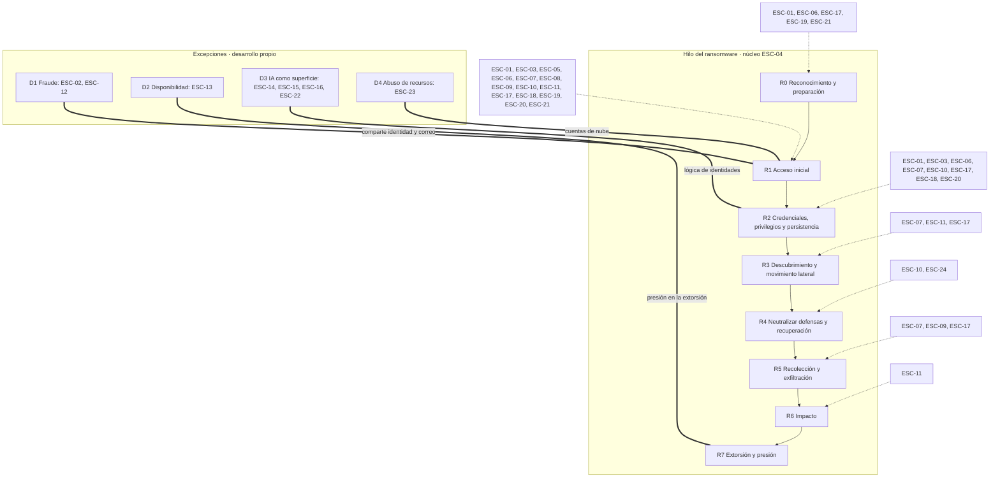

# Hilo conductor del SOC agéntico · Paso 1: las 24 narrativas frente al ransomware (v0.1)

**Frontier CISO Atlas · SOC agéntico** · 24 de noviembre de 2026 · Propuesta para validar por el autor

Libro de trabajo que acompaña esta nota: Frontier_CISO_Atlas_SOC_Agentico_Hilo_Paso1_24_Narrativas_v0.1.xlsx (hojas Resumen, Mapa, Etapas, Objetivos y Desarrollos).

## 1. Resultado

El ransomware funciona como hilo conductor: resuelve total o parcialmente **16 de las 24 narrativas**. Una es el núcleo (ESC-04), 8 quedan cubiertas y 7 cubiertas en parte. Las **8 restantes son excepciones** con desarrollo propio, agrupadas en 4 familias. Además, hay 4 familias que solo reúnen componentes de narrativas cubiertas en parte.

Lo que más pesa para el relato: la IA **como arma del atacante** entra al hilo del ransomware; la IA **como superficie de ataque** queda fuera y pide un hilo propio.

## 2. Cómo se leyó cada narrativa

Se hicieron tres preguntas a cada una de las 24. No se modificó ningún dato del catálogo de escenarios.

| Pregunta | Lectura | Valores |
|---|---|---|
| ¿Para qué? | El objetivo del atacante al que sirve. Cada objetivo se define por las amenazas de Magerit que lo materializan, sin crear un catálogo nuevo. | O1 Extorsión por ransomware · O2 Robo de información · O3 Sabotaje y destrucción · O4 Fraude · O5 Abuso de recursos · O6 Interrupción del servicio · O7 Manipulación de la IA del negocio |
| ¿Por dónde? | La etapa de la cadena del ransomware por la que entra, con tácticas ATT&CK de referencia. | R0 Reconocimiento y preparación → R1 Acceso inicial → R2 Credenciales, privilegios y persistencia → R3 Descubrimiento y movimiento lateral → R4 Neutralizar defensas y recuperación → R5 Recolección y exfiltración → R6 Impacto → R7 Extorsión y presión |
| ¿Qué tan cubierta? | Su relación con el hilo. | Núcleo · Cubierta · Cubierta en parte · Excepción |

Las narrativas no son excluyentes: una misma narrativa puede servir a varios objetivos y entrar por varias etapas. Por ejemplo, el phishing (ESC-01) sirve al ransomware, al robo de información y al fraude.

## 3. El hilo del ransomware

Las flechas continuas son la secuencia de etapas del ataque. Las punteadas indican «entra por esta etapa». Las de trazo grueso, sin punta, unen cada excepción con la etapa que comparte con el hilo. ESC-04 no aparece como entrada porque es la cadena misma.

En las etapas R0 y R1 se concentra lo que cambió con la IA. El atacante descubre y explota en menos de 24 horas (ESC-19), reconoce y orquesta con agentes (ESC-17) y fabrica señuelos, malware e identidades (ESC-01, ESC-06, ESC-21).

## 4. Las 24 de un vistazo

| ID | Narrativa | Clasificación | Etapas | Relación | Desarrollo propio |
|---|---|---|---|---|---|
| ESC-01 | Phishing y robo de credenciales o de sesión | Previa | R0; R1; R2 | **Cubierta** | — |
| ESC-02 | Fraude por correo y de pagos (BEC) | Previa | R1; R5 | **Excepción** | Fraude |
| ESC-03 | Ingeniería social por voz y mesa de ayuda | Previa | R1; R2 | **Cubierta** | — |
| ESC-04 | Ransomware y extorsión de datos | Previa | R2; R3; R4; R5; R6; R7 | **Núcleo** | — |
| ESC-05 | Explotación de servicios expuestos y dispositivos de borde | Previa | R1 | **Cubierta** | — |
| ESC-06 | Malware común, infostealers y ejecución por el usuario | Previa | R0; R1; R2 | **Cubierta** | — |
| ESC-07 | Espionaje de actores estatales | Previa | R1; R2; R3; R5 | **Cubierta en parte** | Espionaje y permanencia |
| ESC-08 | Cadena de suministro de software y SaaS | Previa | R1 | **Cubierta en parte** | Proveedores y cadena de suministro |
| ESC-09 | Amenaza interna | Previa | R1; R5 | **Cubierta en parte** | Riesgo interno |
| ESC-10 | Compromiso de nube e identidades de carga de trabajo | Previa | R1; R2; R4 | **Cubierta en parte** | Abuso de recursos |
| ESC-11 | OT e infraestructura crítica | Previa | R1; R3; R6 | **Cubierta en parte** | OT e infraestructura crítica |
| ESC-12 | Abuso automatizado de aplicaciones web | Previa | R1 | **Excepción** | Fraude |
| ESC-13 | Denegación de servicio | Previa | R7 | **Excepción** | Disponibilidad |
| ESC-14 | Secuestro del agente por inyección indirecta | Sin antecedente | — | **Excepción** | IA como superficie |
| ESC-15 | Envenenamiento de memoria, contexto o base de conocimiento | Sin antecedente | — | **Excepción** | IA como superficie |
| ESC-16 | Abuso de identidad del agente y fallas en cascada | Sin antecedente | — | **Excepción** | IA como superficie |
| ESC-17 | Intrusión orquestada por agentes | Previa enriquecida | R0; R1; R2; R3; R5 | **Cubierta** | — |
| ESC-18 | Robo de sesión y fraude por correo industrializados | Previa enriquecida | R1; R2 | **Cubierta** | — |
| ESC-19 | Explotación en menos de un día | Previa enriquecida | R0; R1 | **Cubierta** | — |
| ESC-20 | Malware que consulta un modelo | Previa enriquecida | R1; R2 | **Cubierta** | — |
| ESC-21 | Suplantación sintética | Previa enriquecida | R0; R1 | **Cubierta en parte** | Fraude |
| ESC-22 | Cadena de suministro agéntica | Previa con blanco nuevo | — | **Excepción** | IA como superficie |
| ESC-23 | Secuestro de capacidad de IA | Previa con blanco nuevo | — | **Excepción** | Abuso de recursos |
| ESC-24 | Cegar o desviar la defensa autónoma | Previa con blanco nuevo | R4 | **Cubierta en parte** | IA como superficie |

En el libro, la hoja Mapa agrega para cada una qué resuelve el hilo, qué queda para desarrollo propio, el actor típico, las amenazas y los activos de Magerit, las técnicas, los casos de uso y los playbooks del catálogo.

## 5. Excepciones y desarrollos propios

| ID | Desarrollo propio | Excepciones | Componentes | Por qué el ransomware no lo resuelve | Cómo incorporarlo (propuesta) |
|---|---|---|---|---|---|
| D1 | Fraude | ESC-02; ESC-12 | ESC-21 | Su objetivo es el dinero, no la operación: no hay cifrado ni movimiento lateral. | Excepción breve dentro del hilo: lo propio es el proceso de pago. |
| D2 | Disponibilidad | ESC-13 | — | Se defiende con protección de red y de aplicaciones, fuera del SOC según la guía. | Excepción breve dentro del hilo. |
| D3 | IA como superficie | ESC-14; ESC-15; ESC-16; ESC-22 | ESC-24 | El blanco son los agentes, sus fuentes, su memoria y sus permisos, no la infraestructura. | Hilo propio: es la otra mitad del relato, la IA como blanco y no solo como arma. |
| D4 | Abuso de recursos | ESC-23 | ESC-10 | El atacante no busca extorsionar sino consumir cómputo o capacidad de IA. | Dentro del hilo propio de la IA como superficie. |
| D5 | Espionaje y permanencia | — | ESC-07 | Busca permanecer sin ser visto, no hacerse notar. | Anexo del hilo: mismas etapas, otro objetivo. |
| D6 | Proveedores y cadena de suministro | — | ESC-08 | La decisión de riesgo se toma en compras y gobierno, no en el SOC. | Anexo de gobierno del riesgo de proveedores. |
| D7 | Riesgo interno | — | ESC-09 | Requiere recursos humanos, legal y contratación, además del SOC. | Anexo del hilo. |
| D8 | OT e infraestructura crítica | — | ESC-11 | Tiene protocolos, activos y riesgos físicos propios, y no hay guía del autor para OT. | Hilo propio cuando el cliente tenga OT (energía, agua, industria). |

Quedan abiertas a incorporarse al hilo cuando haga falta: cada una conserva qué comparte con él (hoja Desarrollos, columna «Qué comparte con el hilo»).

## 6. Tres hallazgos para el relato

1. **La IA como arma acelera el ransomware.** Las 5 narrativas previas enriquecidas por la IA entran al hilo (4 cubiertas y 1 en parte). Contar el ransomware ya explica qué cambió en velocidad y escala, y por qué hay que responder a tiempo de máquina.
2. **La IA como superficie necesita su propio hilo.** Las 3 narrativas sin antecedente y 2 de las 3 con blanco nuevo son excepciones. El blanco son los agentes, sus fuentes, su memoria y sus permisos. Ya existe un escenario guía para ese segundo hilo: ESC-25, la cadena Zava.
3. **El acceso inicial es el cuello de botella.** 16 de las 24 narrativas entran por R1, y R1 y R2 son también lo que comparten con el hilo tres de las cuatro familias de excepciones (fraude, abuso de recursos e IA como superficie). Es el argumento más directo para que un CISO priorice la protección del acceso y de la identidad.

Por objetivo, el ransomware (O1) y el robo de información (O2) son los que más narrativas reúnen: 16 cada uno.

## 7. Lo que no se tocó

Frontier CISO Atlas, Plan CISO 365, ontología, taxonomía, GM-24, Magerit ampliado, guías de excelencia operacional, catálogos de KPIs y OKRs y Ninja trainings. Esta capa los cita por sus identificadores. Los datos de las columnas de catálogo (qué agregó la IA, actor, amenazas, activos, técnicas, casos de uso, playbooks) se copiaron sin cambios de la Guía Madurez SecOps v0.1 (secciones 12, 13 y 15, y anexo B.1).

## 8. Para validar

1. **Etapas.** ¿Sirven R0 a R7 como columna vertebral, o prefieres usar una cadena de etapas que ya tengas definida en otro artefacto?
2. **Objetivos.** ¿Te sirven O1 a O7 como la capa de amenazas que va por encima de las narrativas? Están definidos con amenazas de Magerit, sin catálogo nuevo.
3. **Excepciones.** ¿Confirmas las 8 excepciones y que la IA como superficie se desarrolle como segundo hilo, con ESC-25 como guía?
4. **ESC-24.** La guía la clasifica como «previa con blanco nuevo», pero no dice de qué narrativa previa es variante. ¿Cuál es?

## 9. Siguiente paso: el hilo completo del ransomware

Recorrer cada etapa R0 a R7 con los artefactos existentes, por referencia:

1. Activos, superficies y riesgo (Magerit ampliado).
2. Controles (AI Zero Trust y NIST CSF 2.0).
3. Tecnologías de seguridad de Microsoft.
4. Fuentes de señal, correlaciones y casos de uso.
5. Playbooks de monitoreo y de respuesta, con su nivel de autonomía.
6. Prevención y contingencia: recuperación de los sistemas críticos.
7. Guías de excelencia operacional y Ninja trainings.
8. KPIs según sector y madurez, OKRs según la tecnología adquirida o a incorporar, y su lugar en el Plan CISO 365.

Las excepciones se suman después como anexos o como hilo propio, según lo que decidas en la sección 8.

---
@SCavanna · Principal CSA Security · Microsoft MCSA · Noviembre 2026
