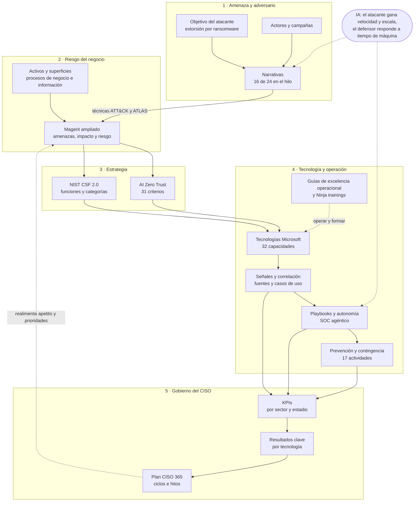

# El ransomware como hilo conductor: de la amenaza al KPI (v0.1)

**Frontier CISO Atlas · SOC agéntico · Paso 2** · 24 de noviembre de 2026 · Propuesta para validar por el autor

Libro de trabajo que acompaña este relato: Frontier_CISO_Atlas_SOC_Agentico_Hilo_Paso2_Ransomware_v0.1.xlsx. Paso anterior: Frontier_CISO_Atlas_SOC_Agentico_Hilo_Paso1_24_Narrativas_v0.1.

## 1. La idea en una frase

Una amenaza concreta, el ransomware, alcanza para recorrer todo lo que un CISO tiene que entender, decidir, operar y demostrar. La IA no cambia ese recorrido: cambia su velocidad, su escala y la superficie que hay que proteger.

El ransomware sirve de guía por dos razones. Para resolverlo hay que resolver también las otras narrativas que lo alimentan (16 de las 24 quedan dentro del hilo). Y el directorio lo reconoce como la mayor amenaza, lo que le da al CISO el apoyo político y económico que necesita.

## 2. El diagrama, evolucionado

El diagrama original tenía dos entradas que convergían. A la izquierda, las narrativas y campañas traducidas a ATT&CK y ATLAS. A la derecha, el modelado de amenazas con Magerit. Abajo, la operación: fuentes para el SIEM, correlación, playbooks, KPIs y OKRs. El hilo agrega lo que faltaba entre medio y arriba: el objetivo del atacante, los activos y procesos del negocio, la estrategia (AI Zero Trust y NIST CSF 2.0), las tecnologías con sus guías y su formación, la contingencia y el gobierno del CISO.

Las flechas continuas indican que una capa alimenta o determina a la siguiente. Las punteadas indican influencia o realimentación.

## 3. El recorrido, etapa por etapa

Cada etapa responde a la misma secuencia: qué busca el atacante, qué cambió con la IA, cómo se previene, cómo se ve, cómo se responde y cómo se mide. Las referencias son los identificadores de los artefactos existentes.

**R0 · Reconocimiento y preparación.** El atacante elige a la víctima y busca la vulnerabilidad. Con IA, descubre y usa como arma en menos de 24 horas (ESC-19) y fabrica señuelos, malware e identidades (ESC-01, ESC-06, ESC-21). Se previene con parches en plazo y la línea base controlada (ZT-DI-5, ZT-IN-1, ZT-IN-3). Se ve con la exposición y la inteligencia (FT-11, FT-13; Exposure Management y Defender Vulnerability Management). Se responde con PB-05 y con la protección previa al parche a velocidad de máquina (N3). Se mide con K46, K138 y K140.

**R1 · Acceso inicial.** Es el cuello de botella: 16 de las 24 narrativas entran por aquí. Con IA, el robo de sesión se industrializa (ESC-18) y aparecen agentes de voz que roban códigos de un solo uso (ESC-03). Se previene con MFA resistente a la suplantación, acceso condicional por riesgo y dispositivos conformes (ZT-ID-1, ZT-ID-2, ZT-DI-1). Se ve con identidad, correo y clics (FT-01, FT-05; UC-01, UC-03). Se responde con PB-02 y PB-03, revocando sesiones con autonomía A3. Se mide con K33, K118 y K42, y con el resultado clave C1-F3-KR1.

**R2 · Credenciales, privilegios y persistencia.** El acceso robado se convierte en control. Se previene sin privilegios permanentes y con identidades no humanas gobernadas (ZT-ID-3, ZT-ID-5). Se ve con las señales de Active Directory y Entra ID (FT-01, FT-04; Defender for Identity). Se responde con PB-02 y PB-04. Se mide con K34, K147 y K148, y con C2-F3-KR2 y C3-F3-KR3.

**R3 · Descubrimiento y movimiento lateral.** El atacante busca controladores de dominio, servidores y respaldos. Con IA, la intrusión se orquesta con agentes: entre 80 y 90 % de la operación táctica (ESC-17). Se previene con segmentación verificada y sensores en todos los equipos (ZT-RE-2, ZT-DI-4). Se ve uniendo señales de capas distintas en un solo caso (UC-18). Se responde con PB-01. Se mide con K36, K41, K43 y PROP-01.

**R4 · Neutralizar defensas y recuperación.** Antes de cifrar, el atacante intenta cegar la detección y destruir los respaldos (T1562, T1490). En un SOC agéntico, el blanco incluye a los propios agentes de defensa (ESC-24). Se previene con respaldos inalterables y una plataforma de control recuperable (ZT-DA-5, ZT-IN-5). Se ve con la salud de la telemetría (FT-22). Se responde con PB-01, PB-07 y PB-14. Se mide con K28, K173 y K172.

**R5 · Recolección y exfiltración.** Roba antes de cifrar para extorsionar dos veces; el catálogo registra un 275 % más de datos robados (ESC-04). Se previene clasificando y controlando la salida (ZT-DA-1 a ZT-DA-4). Se ve con DLP, riesgo interno y aplicaciones SaaS (FT-06, FT-08). Se responde con PB-09, endureciendo DLP de forma adaptativa (A3). Se mide con K37, K110, K155 y K154.

**R6 · Impacto.** El cifrado se propaga en minutos. Se responde con la interrupción automática de ataques y el aislamiento de equipos sin apagarlos (PB-01, A3). Los servidores y las cuentas privilegiadas requieren aprobación (A2). Los agentes que responden tienen autonomía aprobada y su actividad se registra fuera de su alcance (ZT-IA-3, ZT-IA-6). Se mide con K45, K55 y K179. **Hallazgo:** el plan 365 no tiene un resultado clave para esta etapa. El hilo propone HR-KR1 (K45) y HR-KR2 (K55) como candidatos.

**R7 · Extorsión y presión.** Llega la amenaza de publicación, a veces con denegación de servicio como presión. Ningún control ni ninguna tecnología resuelve esta etapa: es una decisión de gobierno. Cualquier decisión sobre la extorsión corresponde al comité de crisis, nunca al SOC (PB-01). Se prepara con PB-08 y PB-13. Se mide con K61, K191, K05, K15 y K130.

**RC · Recuperación y continuidad.** Es la etapa que decide si el incidente dura días o meses. Liberar la contención, rotar krbtgt y restaurar sobre producción son decisiones que no se delegan. Se prepara con respaldos probados, objetivos de recuperación aprobados por el negocio y la identidad recuperable en un entorno aislado. Se mide con K28, K30, K47 y K181, y con C1-F4-KR3, C3-F4-KR2, C3-F4-KR3 y C4-F4-KR2.

**GV · Gobierno del hilo.** Cierra el ciclo. El escenario se cuantifica (K89), la pérdida esperada se compara con el apetito (K26, K86) y el hilo se prueba de punta a punta con un ejercicio de adversario (K144, C3-F4-KR1). El resultado realimenta la priorización de Magerit.

## 4. Qué cambió con la IA

1. **Velocidad.** Entre el descubrimiento de una vulnerabilidad y su uso como arma pasan menos de 24 horas (ESC-19). Una campaña que antes tomaba 14 días ahora toma 85 minutos (ESC-18).
2. **Escala y eficacia.** Phishing como servicio industrializado, suplantación sintética e intrusiones orquestadas por agentes (ESC-17, ESC-18, ESC-21).
3. **Superficie nueva.** Los agentes del negocio y los del propio SOC pasan a ser blanco (ESC-14 a ESC-16 y ESC-24). Esta parte necesita su propio hilo, con la cadena Zava (ESC-25) como guía.
4. **Volumen.** Hay más señales, alertas y comportamientos que analizar. Responder a tiempo de máquina exige automatizar con niveles de autonomía aprobados (A0 a A4) y dejar explícitas las decisiones que solo toman personas.

**El doble rol de Microsoft.** Microsoft provee lo que hay que proteger y también las herramientas para protegerlo. Lo que se protege es la infraestructura (Azure), el trabajo y la comunicación (Microsoft 365) y la IA (Copilot, Foundry y los agentes). Las herramientas para protegerlo son Defender, Sentinel, Entra, Purview, Intune y Security Copilot. En el hilo se ven los dos roles a la vez: la identidad de Entra ID y el correo son la superficie de R1, los datos de SharePoint y OneDrive son el botín de R5, y Microsoft 365 Backup y Azure Backup sostienen RC. El relato no lo oculta: busca que las organizaciones crezcan y sean productivas, y que al mismo tiempo puedan defenderse.

## 5. Cómo elige el CISO

La hoja Selección del libro recibe tres datos y recalcula todo lo demás:

| Dato | De dónde sale | Qué cambia |
|---|---|---|
| Sector | Catálogo de KPIs y OKRs v1.2: niveles Directorio, Esencial, Complementario y Opcional | Qué KPIs son prioritarios para ese tipo de organización |
| Estadio del SOC | Guía Madurez SecOps v0.1: E1 a E5 | Qué tipo de indicador conviene medir ya y la meta de cada uno (umbral del estadio siguiente) |
| Licencia | Edición Microsoft v2.1: E3, E5 o E7 | Qué capacidades están disponibles, cuáles son parciales y cuáles son brechas a justificar |

La regla de madurez es una propuesta basada en los tipos de medida de NIST SP 800-55. En el estadio E1 se miden los indicadores de implementación (¿está desplegado?). Desde E2 se suman los de efectividad (¿funciona?), desde E3 los de eficiencia (¿es rápido y sostenible?) y desde E4 los de impacto (¿reduce la pérdida?).

**Ejemplo con los valores iniciales** (sector financiero, SOC en E2, licencia E3): 9 de los 65 KPIs del hilo son prioritarios. De las 32 capacidades del hilo, 7 son brechas, 11 son parciales, 11 se contratan por consumo en Azure y 3 están incluidas.

Las brechas son MS-EXP-01 Microsoft Security Exposure Management, MS-END-02 Microsoft Defender Vulnerability Management, MS-PRO-01 Microsoft Defender for Office 365, MS-PRO-02 Attack simulation training, MS-IDE-03 Microsoft Entra Privileged Identity Management, MS-IDE-07 Microsoft Defender for Identity, MS-DAT-04 Microsoft Purview Insider Risk Management.

Con E5 quedan 0 brechas y 3 parciales; con E7, 0 brechas y 2 parciales. Ese es el argumento para justificar la incorporación de tecnología: cada brecha está ligada a la etapa del hilo que deja sin cubrir y al indicador que no se puede medir. La columna «Qué se pierde si falta» de la hoja Tecnologías lo dice para cada capacidad.

El hilo mueve 22 de los 72 resultados clave del plan 365. Cada uno tiene una capacidad principal, así que el libro muestra cuáles dependen de una brecha con la licencia elegida. Los 3 resultados clave candidatos (HR-KR1 a HR-KR3) no están en el plan: su meta se calcula con el estadio objetivo.

## 6. Prevención y contingencia

La hoja Contingencia ordena 17 actividades en antes, durante y después del impacto:

- **Antes:** respaldos inmutables probados y objetivos de recuperación aprobados por el negocio. También acceso de emergencia fuera del dominio comprometido, contactos vigentes y una postura sobre la extorsión aprobada por la dirección.
- **Durante:** verificar lo que aisló la plataforma, aislar sin apagar, verificar los respaldos, suspender cuentas y activar la determinación de materialidad.
- **Después:** liberar la contención tras la validación forense, rotar credenciales, restaurar desde respaldos verificados, informar y cerrar las acciones correctivas.

Las decisiones que no se delegan están marcadas: liberar la contención, rotar krbtgt, restaurar sobre producción y cualquier decisión sobre la extorsión.

## 7. Silencios y límites

- No hay programa Ninja de respaldo ni de recuperación. Tampoco hay guía de excelencia operacional del autor para Azure Backup, Azure Site Recovery, Microsoft 365 Backup ni Defender for Cloud. Justo la etapa RC es la que tiene menos soporte de formación y de operación.
- El plan 365 no tiene un resultado clave para la contención (K45) ni para la respuesta automatizada (K55).
- Los niveles por sector existen solo para K01 a K64. El resto de los indicadores figura como «Sin nivel sectorial».
- Algunos identificadores de ATT&CK y ATLAS siguen marcados «a verificar» en la guía SecOps. No se tocaron.
- La asignación por etapa es criterio de esta entrega. La responsabilidad de cada función sigue siendo la que define el plan 365.

## 8. Para validar

1. ¿Te sirven las diez etapas, con RC (recuperación) y GV (gobierno) como etapas propias del hilo?
2. ¿Aceptas la regla de madurez por tipo de indicador?
3. ¿Son correctas las capacidades principales asignadas a cada resultado clave?
4. ¿Incorporamos los tres resultados clave candidatos (HR-KR1 a HR-KR3) como propuesta para los clientes, sin tocar el plan?

## 9. Siguiente paso

Hay tres opciones: el segundo hilo, el de la IA como superficie (ESC-14, ESC-15, ESC-16, ESC-22 y ESC-23, con ESC-25 como guía); los anexos de las excepciones (fraude, OT, proveedores y riesgo interno); o la versión visual para CISOs y directorios, con la plantilla de infografías de la serie.

---
@SCavanna · Principal CSA Security · Microsoft MCSA · Noviembre 2026
