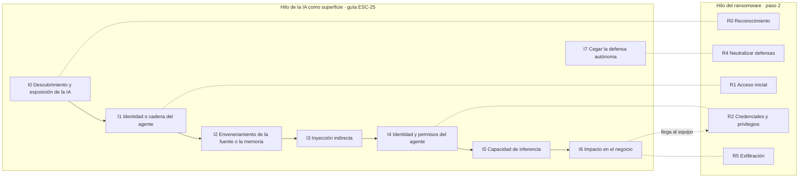

# La IA como superficie de ataque: el segundo hilo (v0.1)

**Frontier CISO Atlas · SOC agéntico · Paso 3** · 24 de noviembre de 2026 · Propuesta para validar por el autor

Libro de trabajo que acompaña este relato: Frontier_CISO_Atlas_SOC_Agentico_Hilo_Paso3_IA_Superficie_v0.1.xlsx. Pasos anteriores: las 24 narrativas frente al ransomware (paso 1) y el ransomware de punta a punta (paso 2).

## 1. La idea en una frase

El ransomware explica cómo la IA hace más fuerte al atacante. Este hilo explica qué pasa cuando el blanco es la propia IA de la organización: sus agentes, lo que leen, lo que recuerdan, sus permisos y su capacidad de cómputo.

## 2. Por qué la cadena Zava es la guía

ESC-25 ya existe en la Guía Madurez SecOps v0.1. Encadena cuatro narrativas: el robo de sesión, el envenenamiento de la base de conocimiento, el secuestro del agente por inyección y el secuestro de capacidad de IA. Termina en un equipo con PowerShell codificado.

En el caso hubo señal en las cinco etapas y nada las unió. La ventana del atacante fue de unos 75 minutos; con una regla de correlación entre capas (UC-18) habría bajado a 16 minutos como máximo. Es el mismo papel que cumple el ransomware en el primer hilo: un caso concreto que obliga a resolver todo lo demás. Además, termina donde empieza el ransomware: en el equipo.

## 3. El diagrama

Las flechas continuas son la secuencia del ataque. Las líneas punteadas sin punta unen etapas que comparten controles con el hilo del ransomware. La flecha punteada con texto marca el punto en que un hilo continúa en el otro.

## 4. El recorrido, etapa por etapa

**I0 · Descubrimiento y exposición de la IA.** El atacante busca agentes, extensiones y claves que nadie inventarió. Agentes nuevos y agentes locales aparecen en los equipos sin pasar por TI (UC-17). Se previene con inventario, dueño y propósito (ZT-IA-1). Se ve con FT-16 y FT-17. Se mide con K49, K187 y PROP-02, y con C1-F6-KR1.

**I1 · Acceso a la identidad o a la cadena del agente.** Es la puerta de entrada de la cadena Zava y la misma del ransomware: una identidad con permiso de escritura sobre lo que el agente lee. Se previene con MFA resistente a la suplantación y acceso condicional por riesgo (ZT-ID-1, ZT-ID-2). Se responde revocando las sesiones de quien escribió (PB-10, paso 4, A3). Se mide con K33 y K118.

**I2 · Envenenamiento de la fuente o de la memoria.** El blanco ya no es la disponibilidad, sino la integridad de lo que el agente sabe (ESC-15). Se previene con versionado, instantáneas y vencimiento de la memoria no verificada. Se ve con la auditoría y los registros del almacenamiento (FT-07, FT-18). Se responde con cuarentena del documento y congelamiento de escrituras (A3). **Silencio:** no hay fuente de seguridad nativa para la memoria del agente (FT-19).

**I3 · Secuestro del agente por inyección indirecta.** El contenido se vuelve instrucción (ESC-14). Se previene con filtros de entrada y de documentos, límites de acción fuera del modelo y pruebas adversariales (ZT-IA-5). En Foundry, la detección de ataques en documentos viene desactivada por defecto. Se ve con las alertas de protección de IA y la traza del agente (FT-09, FT-12). La plataforma une la alerta al caso automáticamente (UC-14). Se mide con K166 y K54, y con C3-F6-KR1.

**I4 · Abuso de la identidad y los permisos del agente.** El privilegio se traslada a las identidades no humanas (ESC-16). Se previene con identidad propia por agente, permisos por herramienta y autonomía aprobada (ZT-IA-2, ZT-IA-3). Se responde suspendiendo el agente y deshabilitando su entidad de servicio (A2). Se mide con K165 y K88, y con C2-F6-KR1 y C4-F6-KR1.

**I5 · Abuso de la capacidad de inferencia.** El recurso robado es capacidad de IA (ESC-23, ESC-10). Se ve con el consumo y las alertas del servicio de modelos (FT-09, FT-10; UC-12). Se responde restringiendo el despliegue con aprobación del dueño, porque interrumpe un servicio en producción (A2). Se mide con K148 y K156.

**I6 · Impacto en el negocio.** El agente actúa por el atacante: expone datos, ejecuta operaciones o llega a un equipo. Suspender el agente no revierte lo que ya emitió: hay que revisar las respuestas desde la primera escritura maliciosa. Se mide con PROP-01, el tiempo hasta correlacionar capas. Si la cadena llega al equipo, continúa en R2 y R3 del ransomware.

**I7 · Cegar la defensa autónoma.** El blanco son los agentes del propio SOC (ESC-24). Solo personas evalúan a esos agentes: muestreo humano y tasa de reversión de veredictos (PROP-03) antes de subir la autonomía (UC-20, PB-14). Se mide con K175 y K98, y con C4-F6-KR2 y C4-F6-KR3.

**IC · Recuperación y continuidad.** Detener el agente, restaurar su estado, revisar lo emitido, revalidar antes de reactivar y seguir operando sin IA. Se mide con K167, K56 y K166, y con C3-F6-KR2 y C3-F6-KR3.

**IG · Gobierno de la IA.** Evaluación de riesgo antes de cada caso de uso (K51), dueño humano con autoridad acotada (K50), autonomía aprobada (K88) y supervisión humana verificada (K98).

## 5. Lo que este hilo agrega al relato del CISO

1. **Cambia el tipo de daño.** En el ransomware se pierde la disponibilidad. Aquí se pierde la integridad del conocimiento y la autoridad delegada: el agente decide o actúa mal con permisos legítimos.
2. **Hay decisiones que no se delegan.** Revertir operaciones de negocio originadas en respuestas del agente y reactivar el agente corresponden al dueño del negocio (PB-10).
3. **El gobierno va antes que la tecnología.** 4 de los 16 resultados clave que mueve este hilo no dependen de ninguna capacidad de Microsoft: son decisiones de gobierno.
4. **El hilo cubre todo el frente F6 del plan 365.** Los 12 resultados clave de IA y agentes están en el hilo.

## 6. Cómo elige el CISO

La hoja Selección funciona igual que en el paso 2: sector, estadio y licencia. Aquí la licencia inicial es E5.

| Licencia | Brechas | Parciales | Lectura |
|---|---|---|---|
| E3 | 2 | 12 | Faltan MS-IAA-01 (Microsoft Agent 365), MS-PRO-01 (Microsoft Defender for Office 365). |
| E5 | 1 | 4 | Falta MS-IAA-01 (Microsoft Agent 365). De esa capacidad dependen 4 resultados clave del plan: C1-F6-KR1, C1-F6-KR3, C2-F6-KR3, C3-F6-KR2. |
| E7 | 0 | 2 | Siguen parciales MS-IDE-05 (Microsoft Entra Workload ID), MS-CUM-01 (Microsoft Purview Compliance Manager). |

Ese es el argumento para justificar tecnología en este hilo. Con E5, el hueco que queda es la observabilidad y el control de los agentes, y de él depende un tercio del frente F6. Según la edición Microsoft v2.1 del plan, Agent 365 viene incluido en E7.

En el sector, el eje E7 del catálogo de KPIs y OKRs v1.2 mide la presión de la IA y los agentes. Es máxima en el sector financiero (5), alta en el industrial y en logística (4), y media en gobierno, generación eléctrica y oil & gas (3).

## 7. Cruce de los dos hilos

| Hilo de la IA | Hilo del ransomware | Qué comparten |
|---|---|---|
| I0 Descubrimiento y exposición | R0 Reconocimiento | La lógica de exposición, aplicada a agentes, extensiones y claves |
| I1 Identidad o cadena del agente | R1 Acceso inicial | Los mismos controles de identidad y el mismo playbook (PB-02) |
| I4 Identidad y permisos del agente | R2 Credenciales y privilegios | El abuso de privilegios, ahora con identidades de agentes |
| I5 Capacidad de inferencia | R1 y R2 | El acceso por cuentas de nube (ESC-10); el objetivo es consumir, no extorsionar |
| I6 Impacto en el negocio | R2, R3 y R5 | Si llega al equipo, continúa en el ransomware; la exfiltración es común |
| I7 Cegar la defensa autónoma | R4 Neutralizar defensas | Neutralizar la defensa, ahora la autónoma |
| I2 e I3 | — | Sin equivalente: son lo realmente nuevo |

## 8. Silencios y límites

- No hay fuente de seguridad nativa para la memoria del agente (FT-19). La traza de ejecución depende de Agent 365, en Preview (FT-12).
- PB-10 y PB-14 son brechas en las guías del autor, y no hay rutinas de excelencia operacional para UC-12 a UC-16.
- Magerit no tiene tipo de activo «agente» y la CCN-STIC 817 no tipifica incidentes sobre agentes.
- No existe un estándar formal de Zero Trust para la IA (SUP-01). Los criterios ZT-IA son lo que coincide entre las fuentes.
- Varios identificadores de ATLAS siguen marcados «a verificar».
- Foundry y Defender for Cloud no tienen guía del autor; su programa Ninja se asignó por afinidad de producto.

## 9. Para validar

1. ¿Te sirven las diez etapas, con la cadena Zava como columna?
2. ¿Están bien asignadas las capacidades principales, en especial Agent 365 para K49, K50, K53 y K167?
3. ¿Incorporamos IA-KR1 (PROP-01 ≤ 16 minutos) e IA-KR2 (PROP-02, meta a fijar con la línea base) como candidatos?

---
@SCavanna · Principal CSA Security · Microsoft MCSA · Noviembre 2026
