# Hilo conductor, paso 4: anexos de las excepciones al ransomware (v0.1)

**Frontier CISO Atlas · SOC agéntico** · 25 de noviembre de 2026 · Propuesta para validar por el autor

Libro de trabajo que acompaña esta guía: Frontier_CISO_Atlas_SOC_Agentico_Hilo_Paso4_Anexos_Excepciones_v0.1.xlsx (hojas Resumen, Selección, Anexos, Etapas, Controles, Tecnologías, Indicadores, OKR y Contingencia).

## 1. Por qué hay anexos

El ransomware es el hilo conductor porque es la amenaza que más preocupa al directorio y la que más narrativas reúne: 12 de las 24 desembocan en él. Pero no todo ataque termina en un cifrado. El paso 1 dejó ocho grupos de excepciones: narrativas cuyo objetivo es otro (dinero, disponibilidad, permanencia, terceros, personas de adentro, el proceso físico o la propia IA).

Un anexo no repite lo que el ransomware ya cubre. Comparte con él los pasos de acceso e identidad y desarrolla solo sus **etapas propias**, con la misma cadena: objetivo del atacante, pregunta del defensor, amenaza Magerit, técnica, control Zero Trust, tecnología de Microsoft, guía de excelencia operacional, Ninja training, KPI, resultado clave del plan 365 y contingencia.

D3 (la IA como superficie) y D4 (el abuso de recursos) ya se desarrollaron en el paso 3. Este libro desarrolla los otros seis.

## 2. Resultado

Los seis anexos suman **23 etapas propias**, con 18 controles Zero Trust, 26 capacidades de Microsoft y 42 KPIs, sin repetir. Mueven 16 resultados clave del plan 365 y proponen 5 candidatos (AN-KR1 a AN-KR5) para indicadores propios que el plan no cubre.

| Anexo | Narrativas | Etapas | Capacidades | KPIs | Resultados clave del plan | Quién decide fuera del SOC |
|---|---|--:|--:|--:|--:|---|
| D1 Fraude | ESC-02; ESC-12; ESC-21 (y la variante industrializada ESC-18) | 4 | 6 | 7 | 1 | Tesorería, cuentas a pagar, canal digital y prevención del fraude |
| D2 Disponibilidad | ESC-13; Componente de ESC-12 (carga automatizada) | 3 | 4 | 5 | 1 | Infraestructura, redes y continuidad del negocio |
| D5 Espionaje y permanencia | ESC-07 (y la variante orquestada por agentes ESC-17) | 4 | 10 | 9 | 5 | Comité de crisis (decide observar o expulsar) y legal |
| D6 Proveedores y cadena de suministro | ESC-08 (y el blanco nuevo ESC-22) | 4 | 8 | 12 | 5 | Compras, legal y dueño de cada servicio externalizado |
| D7 Riesgo interno | ESC-09 (y la contratación fraudulenta de ESC-21) | 4 | 7 | 7 | 2 | Recursos humanos, legal y privacidad |
| D8 OT e infraestructura crítica | ESC-11 (y el cruce de TI a OT de ESC-17) | 4 | 6 | 9 | 4 | Gerencia de planta, operaciones e ingeniería de control |

## 3. Hallazgos

1. **En la mayoría de las etapas la decisión no es del SOC.** En 16 de las 23 etapas decide otra área: tesorería, compras, recursos humanos, legal, continuidad o la gerencia de planta. El SOC aporta la señal, la correlación y la evidencia, pero el corte lo hace un proceso del negocio. Esta es la diferencia de fondo con el ransomware, donde el SOC contiene.
2. **Cada anexo se separa del ransomware por su objetivo, no por su entrada.** 17 etapas tienen su par en el hilo del ransomware (R1: 6, R5: 4, R2: 3, R7: 2, R3: 2, RC: 1, R4: 1, R6: 1). Las 6 restantes no tienen equivalente: D1-2 suplantación y pedido de cambio de pago, D1-4 toma de cuentas de clientes, D2-1 saturación de la red o de la aplicación, D6-4 incidente en el proveedor y concentración, D7-4 investigación, desvinculación y accesos residuales, D8-3 manipulación de controladores.
3. **Con E5 la tecnología está; lo que falta es proceso.** Con E5 no hay brechas y 6 capacidades son parciales (MS-CUM-01, MS-IAA-03, MS-IDE-04, MS-IDE-05, MS-RED-01, MS-RED-04). Con E3 aparecen 8 brechas: MS-DAT-04, MS-EXP-01, MS-IDE-03, MS-IDE-04, MS-IDE-07, MS-PRO-01, MS-PRO-02, MS-RED-04. Con E7 no hay brechas y quedan 3 parciales. Aun con la licencia completa, lo que más falta en estos anexos es proceso: verificación fuera de banda, contratos con proveedores, investigación con garantías, operación manual de la planta.
4. **Los anexos están donde las guías del autor tienen menos cobertura.** 2 etapas no tienen playbook en la guía (D1-4, D2-1) y 4 no tienen guía de excelencia operacional para sus capacidades (D1-4, D2-1, D2-2, D8-3). OT no tiene guía del autor, y la guía deja la denegación de servicio y el abuso de aplicaciones web fuera del alcance del SOC.
5. **La IA cambió unos anexos y no otros.** Cambió el fraude (voz y video fabricados, buzones analizados con IA), el espionaje (agentes que ejecutan la mayor parte de la operación táctica), los proveedores (paquetes inexistentes recomendados por modelos), el riesgo interno (identidades fabricadas para ser contratado y la IA del puesto de trabajo que encuentra en segundos lo sobreexpuesto) y OT (un cruce de TI a OT orquestado por agentes). En 9 etapas no hay cambio documentado: D2-2, D2-3, D5-3, D6-2, D6-4, D7-3, D7-4, D8-3, D8-4. La denegación de servicio solo tiene evidencia débil.
6. **Los anexos traen indicadores que el plan 365 no tiene como resultado clave.** Se proponen cinco candidatos para su indicador propio: K163 (fraude), K29 (disponibilidad), K44 (espionaje), K154 (riesgo interno) y K40 (OT). Proveedores ya está cubierto por el plan (K31, K132, K62, K27). Los indicadores KX10, KX08 vienen del catálogo de servicios externalizados y no tienen función del plan 365 asignada.
7. **El peso de cada anexo depende del sector.** OT pesa en energía, Oil & Gas, industria y logística; el fraude, en finanzas; el espionaje, en gobierno y energía; el riesgo interno, donde hay información sensible o propiedad intelectual. La hoja Selección cambia la prioridad de los KPIs según el sector y el estadio del SOC.

## 4. Dónde se cruzan con el ransomware

Las líneas punteadas unen cada etapa propia con la etapa del ransomware que comparte. Las etapas sin línea no tienen equivalente en el ransomware.

```mermaid
flowchart LR
  subgraph RW["Hilo del ransomware (paso 2)"]
    R1["R1 Acceso inicial"]
    R2["R2 Credenciales, privilegios y persistencia"]
    R3["R3 Descubrimiento y movimiento lateral"]
    R4["R4 Neutralizar defensas y recuperación"]
    R5["R5 Recolección y exfiltración"]
    R6["R6 Impacto"]
    R7["R7 Extorsión y presión"]
    RC["RC Recuperación y continuidad"]
  end
  subgraph D1["D1 Fraude"]
    D1_1["D1-1 Preparación dentro del buzón"]
    D1_2["D1-2 Suplantación y pedido de cambio de pago"]
    D1_3["D1-3 Cobro del pago desviado"]
    D1_4["D1-4 Toma de cuentas de clientes"]
  end
  subgraph D2["D2 Disponibilidad"]
    D2_1["D2-1 Saturación de la red o de la aplicación"]
    D2_2["D2-2 Agotamiento de recursos y caída del servicio"]
    D2_3["D2-3 Denegación de servicio como presión en una extorsión"]
  end
  subgraph D5["D5 Espionaje y permanencia"]
    D5_1["D5-1 Permanencia con cuentas válidas y tokens"]
    D5_2["D5-2 Recolección de correo y repositorios"]
    D5_3["D5-3 Exfiltración lenta"]
    D5_4["D5-4 Evasión y borrado de rastros"]
  end
  subgraph D6["D6 Proveedores y cadena de suministro"]
    D6_1["D6-1 Compromiso del proveedor o de su software"]
    D6_2["D6-2 Uso del acceso legítimo del proveedor"]
    D6_3["D6-3 Componente malicioso que corre con la confianza del original"]
    D6_4["D6-4 Incidente en el proveedor y concentración"]
  end
  subgraph D7["D7 Riesgo interno"]
    D7_1["D7-1 Ingreso o reclutamiento de una persona con intención"]
    D7_2["D7-2 Acumulación de información fuera de su función"]
    D7_3["D7-3 Salida de la información"]
    D7_4["D7-4 Investigación, desvinculación y accesos residuales"]
  end
  subgraph D8["D8 OT e infraestructura crítica"]
    D8_1["D8-1 Entrada por el borde o por TI"]
    D8_2["D8-2 Paso de TI a la red de planta"]
    D8_3["D8-3 Manipulación de controladores"]
    D8_4["D8-4 Detención o destrucción del proceso"]
  end
  R1 -.- D1_1
  R2 -.- D1_1
  R7 -.- D1_3
  RC -.- D2_2
  R7 -.- D2_3
  R1 -.- D5_1
  R2 -.- D5_1
  R5 -.- D5_2
  R5 -.- D5_3
  R4 -.- D5_4
  R1 -.- D6_1
  R1 -.- D6_2
  R2 -.- D6_2
  R3 -.- D6_3
  R1 -.- D7_1
  R5 -.- D7_2
  R5 -.- D7_3
  R1 -.- D8_1
  R3 -.- D8_2
  R6 -.- D8_4
```

## 5. Los seis anexos

### D1 · Fraude

**Narrativas:** ESC-02; ESC-12; cubiertas en parte: ESC-21 (y la variante industrializada ESC-18). **Objetivo del atacante:** O4 Fraude. **Actores:** Cibercrimen (fraude); Cibercrimen (bots); Cibercrimen; contratación fraudulenta; Cibercrimen (phishing como servicio).

**Por qué el ransomware no lo resuelve:** Su objetivo es el dinero, no la operación: no hay cifrado ni movimiento lateral. **Qué comparte con él:** R1 y R2 (compromiso de identidad y de correo); R7 (decisión ejecutiva y notificación). **Quién decide fuera del SOC:** Tesorería, cuentas a pagar, canal digital y prevención del fraude.

| Etapa | Qué busca el atacante | Pregunta del defensor | Magerit | Técnica | Tecnología principal | KPI | Quién decide |
|---|---|---|---|---|---|---|---|
| D1-1 Preparación dentro del buzón | Leer el buzón comprometido para elegir a quién suplantar y en qué hilo de pagos entrar, y ocultar las respuestas | ¿Detectamos reglas de bandeja nuevas y la lectura de hilos de pagos desde una sesión de riesgo? | [A.19] Divulgación de información; [A.4] Manipulación de la configuración | T1114 Email Collection; T1564.008 Email Hiding Rules | MS-PRO-01 Microsoft Defender for Office 365 | K42 Tiempo medio de detección (MTTD) | SOC |
| D1-2 Suplantación y pedido de cambio de pago | Convencer a quien paga de cambiar la cuenta de destino, con un correo desde el buzón legítimo o con voz o video fabricados | ¿Se verifica fuera de banda todo cambio de datos bancarios, aunque venga de un buzón legítimo o de una llamada convincente? | [A.5] Suplantación de la identidad del usuario; [A.30] Ingeniería social | T1534 Internal Spearphishing; T1656 Impersonation | MS-PRO-01 Microsoft Defender for Office 365 | K163 Tasa de falla en simulaciones de ingeniería social | Tesorería y cuentas a pagar |
| D1-3 Cobro del pago desviado | Cobrar y mover el dinero antes de que la organización lo note | ¿Cuánto tarda la organización en saber que pagó a una cuenta falsa y en pedir al banco que retenga la transferencia? | [A.15] Modificación deliberada de la información | T1657 Financial Theft | MS-CUM-02 Microsoft Purview Audit y eDiscovery | K191 Clientes y socios afectados informados en el plazo comprometido | Tesorería, legal y banco |
| D1-4 Toma de cuentas de clientes | Probar credenciales filtradas en masa contra la aplicación de clientes y usar esas cuentas para comprar, canjear o revender | ¿Distinguimos el tráfico automatizado del humano y sabemos cuántas cuentas de clientes se tomaron? | [A.5] Suplantación de la identidad del usuario; [A.7] Uso no previsto | T1110.004 Credential Stuffing | MS-RED-02 Azure Firewall, Web Application Firewall y DDoS Protection | K191 Clientes y socios afectados informados en el plazo comprometido | Canal digital y prevención del fraude |

**Contingencia:**

- *Antes.* Verificación fuera de banda y doble control en todo cambio de datos de pago (Tesorería; no se delega).
- *Durante.* Eliminar reglas de reenvío y ocultamiento, revocar las sesiones y bloquear al remitente (SOC nivel 1; A3).
- *Durante.* Pedir al banco la retención de la transferencia y avisar a la contraparte (Tesorería y legal; persona).
- *Después.* Revisar pagos y cambios de datos maestros del proveedor afectado desde el primer acceso al buzón (Cuentas a pagar; persona).

### D2 · Disponibilidad

**Narrativas:** ESC-13; cubiertas en parte: Componente de ESC-12 (carga automatizada). **Objetivo del atacante:** O6 Interrupción del servicio; O1 Extorsión por ransomware. **Actores:** Hacktivistas; cibercrimen; Cibercrimen (bots).

**Por qué el ransomware no lo resuelve:** Se defiende con protección de red y de aplicaciones, fuera del SOC según la guía. **Qué comparte con él:** R7 (presión durante la extorsión); RC (recuperación de servicios críticos). **Quién decide fuera del SOC:** Infraestructura, redes y continuidad del negocio.

| Etapa | Qué busca el atacante | Pregunta del defensor | Magerit | Técnica | Tecnología principal | KPI | Quién decide |
|---|---|---|---|---|---|---|---|
| D2-1 Saturación de la red o de la aplicación | Dejar el servicio fuera de línea con tráfico de una red de equipos comprometidos o alquilada | ¿Absorbe la protección de red y de aplicaciones el volumen, y sabemos qué servicio cae primero? | [A.24] Denegación de servicio | T1498 Network Denial of Service; T1499 Endpoint Denial of Service | MS-RED-02 Azure Firewall, Web Application Firewall y DDoS Protection | K47 Tiempo de restauración de servicios críticos frente al RTO | Infraestructura y redes |
| D2-2 Agotamiento de recursos y caída del servicio | Que el servicio caiga y que la recuperación tarde | ¿Puede el proceso crítico operar degradado y en cuánto tiempo se restablece frente a su RTO? | [E.24] Caída del sistema por agotamiento de recursos (condición) | T1499 Endpoint Denial of Service | MS-RED-02 Azure Firewall, Web Application Firewall y DDoS Protection | K21 Procesos críticos con BIA vigente y dependencias mapeadas | Continuidad del negocio |
| D2-3 Denegación de servicio como presión en una extorsión | Sumar presión a una extorsión en curso o distraer al SOC mientras actúa por otro lado | ¿Sabe el SOC si la denegación de servicio es parte de una extorsión en curso o una distracción? | [A.24] Denegación de servicio; [A.29] Extorsión | T1498 Network Denial of Service | MS-XDR-02 Inteligencia de amenazas en el portal de Defender | K05 Tiempo hasta la decisión ejecutiva en crisis | Comité de crisis |

**Contingencia:**

- *Antes.* Protección contra denegación de servicio y WAF en todos los servicios expuestos, con capacidad probada (Infraestructura y redes; Automático en la plataforma).
- *Antes.* BIA con dependencias y operación degradada probada para los servicios expuestos (Continuidad del negocio; no).
- *Durante.* Unir la denegación de servicio con los incidentes abiertos y con la inteligencia sobre el actor (SOC; Automático).
- *Después.* Revisar capacidad y escalado con los datos del ataque (Infraestructura y redes; persona).

### D5 · Espionaje y permanencia

**Narrativas:** ninguna excepción completa; cubiertas en parte: ESC-07 (y la variante orquestada por agentes ESC-17). **Objetivo del atacante:** O2 Robo de información; O3 Sabotaje y destrucción. **Actores:** Estado-nación (APT); Estado-nación.

**Por qué el ransomware no lo resuelve:** Busca permanecer sin ser visto, no hacerse notar. **Qué comparte con él:** R1 a R3 y R5 (acceso, credenciales, movimiento lateral y exfiltración). **Quién decide fuera del SOC:** Comité de crisis (decide observar o expulsar) y legal.

| Etapa | Qué busca el atacante | Pregunta del defensor | Magerit | Técnica | Tecnología principal | KPI | Quién decide |
|---|---|---|---|---|---|---|---|
| D5-1 Permanencia con cuentas válidas y tokens | Quedarse meses con cuentas válidas y tokens de aplicación robados, sin hacer ruido | ¿Vemos tokens reutilizados y aplicaciones OAuth con permisos excesivos, aunque el acceso parezca legítimo? | [A.11] Acceso no autorizado; [A.6] Abuso de privilegios de acceso | T1078 Valid Accounts; T1528 Steal Application Access Token; T1550.001 Application Access Token | MS-IDE-02 Microsoft Entra ID Protection | K118 Accesos evaluados por política con señales de contexto | SOC |
| D5-2 Recolección de correo y repositorios | Leer el correo y los repositorios de interés sin superar los umbrales | ¿Detectamos búsquedas y lecturas de información sensible fuera del patrón habitual de la cuenta? | [A.14] Interceptación de información; [A.19] Divulgación de información | T1114 Email Collection; T1213 Data from Information Repositories | MS-DAT-01 Microsoft Purview Information Protection | K155 Datos sensibles sobreexpuestos corregidos | SOC con los dueños de la información |
| D5-3 Exfiltración lenta | Sacar la información poco a poco por servicios en la nube o canales cifrados | ¿Detectamos un aumento sostenido de salida hacia nubes no sancionadas o dominios nuevos, aunque cada envío sea chico? | [A.19] Divulgación de información | T1567 Exfiltration Over Web Service; T1030 Data Transfer Size Limits | MS-DAT-02 Microsoft Purview Data Loss Prevention | K154 Eventos de salida de datos sensibles resueltos en plazo | SOC |
| D5-4 Evasión y borrado de rastros | No dejar rastro: borrar registros, usar herramientas del sistema y mantenerse por debajo de los umbrales | ¿Buscamos activamente lo que no dispara alertas, y sabemos qué técnicas priorizadas tienen detección probada? | [A.3] Manipulación de los registros de actividad; [A.11] Acceso no autorizado | T1070 Indicator Removal; T1078 Valid Accounts | MS-SIE-01 Microsoft Sentinel | K44 Campañas de hunting que mejoran la detección | SOC (caza e ingeniería de detección) |

**Contingencia:**

- *Antes.* Registros críticos fuera del alcance del atacante, con integridad y retención conforme (Ingeniería de detección; —).
- *Antes.* Campañas de caza por hipótesis sobre las técnicas de los actores estatales del sector (SOC (caza); el agente propone; el analista valida).
- *Durante.* Decidir si se observa al actor o se lo expulsa, y cuándo (Comandante del incidente y comité de crisis; no se delega).
- *Durante.* Expulsión coordinada: revocar tokens y aplicaciones, rotar credenciales y cerrar todos los accesos a la vez (SOC con identidad; A2).
- *Después.* Determinar el alcance de lo robado y evaluar la notificación (SOC nivel 3 y legal; A4 (solo lectura)).

### D6 · Proveedores y cadena de suministro

**Narrativas:** ninguna excepción completa; cubiertas en parte: ESC-08 (y el blanco nuevo ESC-22). **Objetivo del atacante:** O1 Extorsión por ransomware; O2 Robo de información. **Actores:** Estado-nación y cibercrimen; Cibercrimen y estados.

**Por qué el ransomware no lo resuelve:** La decisión de riesgo se toma en compras y gobierno, no en el SOC. **Qué comparte con él:** R1 (entrada por un tercero de confianza) y R2 (escalada). **Quién decide fuera del SOC:** Compras, legal y dueño de cada servicio externalizado.

| Etapa | Qué busca el atacante | Pregunta del defensor | Magerit | Técnica | Tecnología principal | KPI | Quién decide |
|---|---|---|---|---|---|---|---|
| D6-1 Compromiso del proveedor o de su software | Comprometer a un proveedor, su actualización o sus componentes para llegar a muchos clientes a la vez | ¿Sabemos qué proveedores y componentes críticos tenemos y qué evidencia de control nos entregan? | [A.22] Manipulación de programas | T1195.002 Compromise Software Supply Chain | MS-XDR-02 Inteligencia de amenazas en el portal de Defender | K31 Proveedores críticos evaluados y con cláusulas de seguridad | Compras y gobierno de terceros |
| D6-2 Uso del acceso legítimo del proveedor | Entrar con las credenciales o el acceso remoto del proveedor, que nadie revisa | ¿Los accesos de proveedores tienen privilegio mínimo, autenticación fuerte, vencimiento y registro? | [A.11] Acceso no autorizado; [A.6] Abuso de privilegios de acceso | T1199 Trusted Relationship; T1078 Valid Accounts | MS-IDE-02 Microsoft Entra ID Protection | KX10 Accesos del proveedor con privilegio mínimo, autenticación fuerte y registro | Dueño del servicio externalizado |
| D6-3 Componente malicioso que corre con la confianza del original | Que su código corra dentro con la firma y los permisos del proveedor legítimo | ¿Detectamos el comportamiento anómalo de un software de confianza y podemos buscar hacia atrás cuando se divulga un compromiso? | [A.8] Difusión de software dañino; [A.22] Manipulación de programas | T1195.002 Compromise Software Supply Chain; T1059 Command and Scripting Interpreter | MS-END-01 Microsoft Defender for Endpoint | K157 Vulnerabilidades críticas en producción fuera de plazo | SOC con desarrollo |
| D6-4 Incidente en el proveedor y concentración | Golpear a muchos clientes a través de un proveedor común y dejar a la organización sin alternativa | ¿Cuántos servicios críticos dependen de un solo proveedor, y nos avisa a tiempo cuando tiene un incidente? | [A.24] Denegación de servicio (en el proveedor). La concentración no es una amenaza Magerit: se gobierna en GV.SC | T1199 Trusted Relationship | MS-CUM-01 Microsoft Purview Compliance Manager | K27 Servicios críticos concentrados en un proveedor sin alternativa | Compras, legal y dueño del servicio |

**Contingencia:**

- *Antes.* Proveedores críticos evaluados, con cláusulas de seguridad, plazo de notificación y plan de salida (Compras y gobierno de terceros; no).
- *Antes.* Accesos de proveedores con privilegio mínimo, vencimiento, autenticación fuerte y registro (Identidad y dueño del servicio; —).
- *Durante.* Deshabilitar la cuenta del proveedor y aislar sus componentes (SOC con el dueño del servicio; A2).
- *Durante.* Caza retroactiva de los indicadores publicados del compromiso del proveedor (SOC (caza); Automático).
- *Después.* Activar el plan de salida o el reemplazo si el proveedor no se recupera (Dueño del servicio y compras; no se delega).

### D7 · Riesgo interno

**Narrativas:** ninguna excepción completa; cubiertas en parte: ESC-09 (y la contratación fraudulenta de ESC-21). **Objetivo del atacante:** O2 Robo de información; O1 Extorsión por ransomware. **Actores:** Insider malicioso o negligente; contratación fraudulenta; Cibercrimen.

**Por qué el ransomware no lo resuelve:** Requiere recursos humanos, legal y contratación, además del SOC. **Qué comparte con él:** R1 (acceso facilitado) y R5 (exfiltración). **Quién decide fuera del SOC:** Recursos humanos, legal y privacidad.

| Etapa | Qué busca el atacante | Pregunta del defensor | Magerit | Técnica | Tecnología principal | KPI | Quién decide |
|---|---|---|---|---|---|---|---|
| D7-1 Ingreso o reclutamiento de una persona con intención | Ser contratado con una identidad fabricada o reclutar a alguien de adentro | ¿Se verifica la identidad de quien ingresa y se revisan sus accesos cuando cambia de función? | [A.5] Suplantación de la identidad del usuario; [A.6] Abuso de privilegios de acceso | T1656 Impersonation | MS-IDE-04 Microsoft Entra ID Governance | K112 Identidades con ciclo de vida automatizado | Recursos humanos y contratación |
| D7-2 Acumulación de información fuera de su función | Juntar información que no necesita para su trabajo, a veces con la ayuda de Copilot o de la búsqueda | ¿Detectamos accesos a información sensible fuera de la función y sabemos qué datos están sobreexpuestos? | [A.7] Uso no previsto; [A.6] Abuso de privilegios de acceso | T1213 Data from Information Repositories; T1119 Automated Collection | MS-DAT-04 Microsoft Purview Insider Risk Management | K155 Datos sensibles sobreexpuestos corregidos | Recursos humanos, legal y privacidad |
| D7-3 Salida de la información | Sacar la información por servicios web, correo personal o dispositivos | ¿Bloqueamos o advertimos la salida de datos sensibles según el riesgo de la persona? | [A.19] Divulgación de información; [E.19] Fugas de información (condición) | T1567 Exfiltration Over Web Service; T1052 Exfiltration Over Physical Medium | MS-DAT-02 Microsoft Purview Data Loss Prevention | K154 Eventos de salida de datos sensibles resueltos en plazo | SOC |
| D7-4 Investigación, desvinculación y accesos residuales | Irse con la información o dejar accesos abiertos para volver | ¿Se revocan todos los accesos a tiempo y la investigación preserva la evidencia con garantías? | [A.6] Abuso de privilegios de acceso; [A.11] Acceso no autorizado | T1098 Account Manipulation | MS-CUM-02 Microsoft Purview Audit y eDiscovery | K113 Tiempo de revocación de accesos tras la baja | Recursos humanos y legal |

**Contingencia:**

- *Antes.* Verificación de identidad en la contratación y revisión de accesos en cada cambio de función (Recursos humanos; no automatizar).
- *Antes.* Política de investigación de riesgo interno con seudónimos, aprobada por legal, privacidad y recursos humanos (Legal y privacidad; —).
- *Durante.* Endurecer DLP sobre la persona según su nivel de riesgo (Plataforma; A3).
- *Después.* Revocar todos los accesos a tiempo y preservar la evidencia con cadena de custodia (Identidad, recursos humanos y legal; A4 (solo lectura)).

### D8 · OT e infraestructura crítica

**Narrativas:** ninguna excepción completa; cubiertas en parte: ESC-11 (y el cruce de TI a OT de ESC-17). **Objetivo del atacante:** O3 Sabotaje y destrucción; O1 Extorsión por ransomware. **Actores:** Estado-nación; hacktivistas.

**Por qué el ransomware no lo resuelve:** Tiene protocolos, activos y riesgos físicos propios, y no hay guía del autor para OT. **Qué comparte con él:** R1 (borde), R3 (movimiento lateral) y R6 (impacto que detiene la planta). **Quién decide fuera del SOC:** Gerencia de planta, operaciones e ingeniería de control.

| Etapa | Qué busca el atacante | Pregunta del defensor | Magerit | Técnica | Tecnología principal | KPI | Quién decide |
|---|---|---|---|---|---|---|---|
| D8-1 Entrada por el borde o por TI | Llegar a la red de TI por un equipo de borde, un acceso remoto de un tercero o un ransomware en curso | ¿Están parchados los equipos de borde y aprobados y registrados los accesos remotos a la planta? | [A.11] Acceso no autorizado; [E.20] Vulnerabilidades de los programas (condición) | T1133 External Remote Services; T1190 Exploit Public-Facing Application | MS-EXP-01 Microsoft Security Exposure Management | K46 Vulnerabilidades explotadas y exposiciones críticas remediadas en plazo | Operaciones de planta |
| D8-2 Paso de TI a la red de planta | Usar una identidad de TI para alcanzar la red industrial y sus protocolos | ¿Vemos una identidad de TI que usa protocolos industriales en la red de planta? | [A.11] Acceso no autorizado | T0886 Remote Services (ATT&CK for ICS, ID a verificar); T1021 Remote Services | MS-RED-04 Microsoft Defender for IoT | K36 Segmentación de activos críticos verificada | Operaciones de planta |
| D8-3 Manipulación de controladores | Cambiar la lógica, los parámetros o la configuración de los controladores | ¿Detectamos cambios de lógica o de parámetros fuera de una ventana de mantenimiento aprobada? | [A.23] Manipulación de los equipos | T0831 Manipulation of Control; T0836 Modify Parameter (ATT&CK for ICS, ID a verificar) | MS-RED-04 Microsoft Defender for IoT | K40 Zonas OT e IIoT que alcanzan su nivel de seguridad objetivo | Ingeniería de control y seguridad de procesos |
| D8-4 Detención o destrucción del proceso | Detener la planta o destruir equipos, o que un ransomware en TI obligue a detenerla | ¿Puede la planta operar en modo manual o degradado y en cuánto tiempo se recupera? | [A.26] Ataque destructivo; [A.24] Denegación de servicio | T0813 Denial of Control (ATT&CK for ICS, ID a verificar); T1485 Data Destruction | MS-XDR-01 Microsoft Defender XDR | K29 Operación degradada probada en procesos críticos | Gerencia de planta y comité de crisis |

**Contingencia:**

- *Antes.* Segmentación entre TI y OT verificada y accesos remotos de terceros aprobados y registrados (Operaciones de planta; —).
- *Antes.* Respaldo de la lógica de control y operación manual probada (Ingeniería de control; no).
- *Durante.* Aislar TI de OT cuando un ransomware avanza en TI (SOC con operaciones; A2 en TI; A1 en OT).
- *Después.* Recuperar los controladores desde una versión conocida y validar con ingeniería de control antes de volver a producir (Ingeniería de control; no se delega).

## 6. Lo que no se tocó

El catálogo de escenarios, Magerit ampliado, el plan CISO 365, la ontología, la taxonomía, GM-24, las guías de excelencia operacional, los catálogos de KPIs y OKRs y los Ninja trainings. Esta capa los cita por sus identificadores. Las etapas, las asignaciones, los sectores donde pesa cada anexo y los cinco candidatos son propuestas. Los identificadores de ATT&CK for ICS (T0886, T0831, T0836 y T0813) quedan marcados para verificar.

## 7. Para validar

1. ¿Te sirven las etapas propias de cada anexo, o agregarías alguna?
2. ¿Están bien asignados los dueños fuera del SOC? Son la parte más sensible para conversar con cada cliente.
3. ¿Aceptas los cinco candidatos AN-KR1 a AN-KR5 como propuesta para el plan 365?
4. ¿Los sectores donde pesa cada anexo coinciden con lo que ves en MCSA?

---
@SCavanna · Principal CSA Security · Microsoft MCSA · Noviembre 2026
