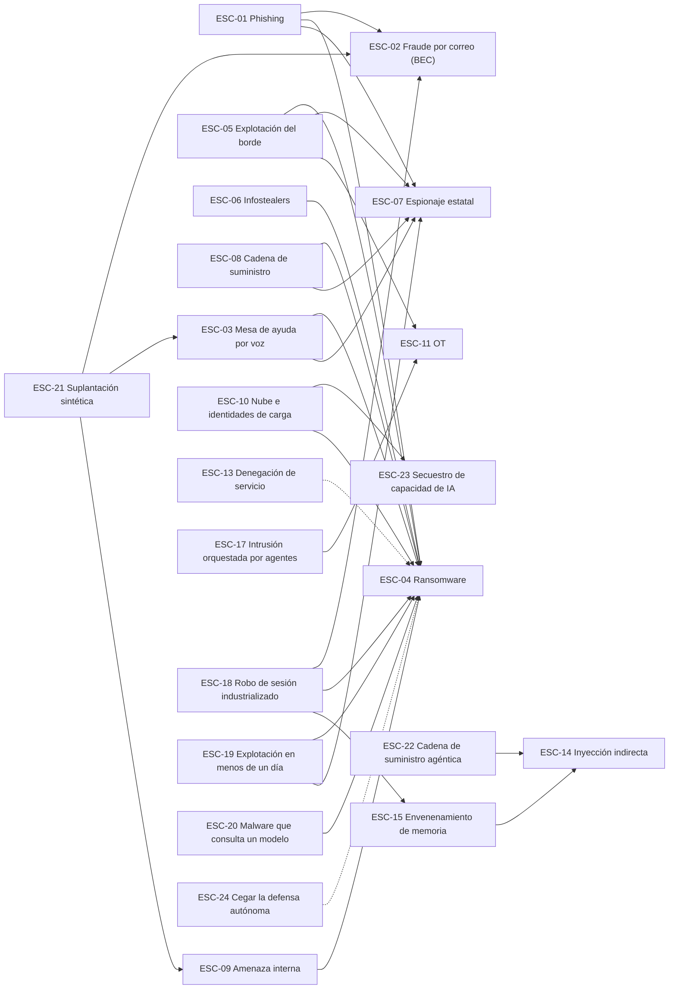

# Las 24 narrativas de ataque, paso a paso (v0.1)

**Frontier CISO Atlas · SOC agéntico** · 25 de noviembre de 2026 · Propuesta para validar por el autor

Libro de trabajo que acompaña esta guía: Frontier_CISO_Atlas_SOC_Agentico_Narrativas_Paso_a_Paso_v0.1.xlsx (hojas Narrativas, Pasos, Encadenamientos, Magerit, Controles, Capacidades e Indicadores).

## 1. Qué es una narrativa

Una narrativa es una secuencia de pasos que un atacante ejecuta para alcanzar un objetivo. Cada paso tiene un objetivo táctico (la táctica) y varias formas de ejecutarse (las técnicas), que cambian según el actor. El ataque se explica por los pasos que se ejecutaron. Una campaña es una ejecución real de una narrativa por un actor concreto. En MITRE, el equivalente formal más cercano es Attack Flow.

Cada paso se escribe como en la tarjeta de referencia (paso, capa, qué ocurre y pregunta del SOC) y se amplía con lo que lo conecta al resto del Atlas:

| Campo | Qué dice |
|---|---|
| Tipo | Paso del atacante, condición (oportunidad que aprovecha) o enlace (viene de otra narrativa) |
| Táctica y capa | Para qué da el paso y dónde ocurre: identidad, correo, equipos, red, nube, datos, IA, proceso de negocio, OT |
| Técnica | Cómo lo hace, en ATT&CK, ATLAS u OWASP |
| Amenaza y activo Magerit | Qué le pasa a qué activo de la organización |
| Señal y caso de uso | Con qué fuente se ve y con qué lógica se une |
| Pregunta del SOC | Lo que el SOC tiene que poder responder en ese paso |
| Control Zero Trust | Dónde se corta la cadena |
| Capacidad, guía y Ninja | Con qué tecnología de Microsoft, cómo se opera y cómo se forma al equipo |
| Indicador, CSF 2.0 y resultado clave | Cómo se mide y qué meta del plan 365 mueve |

## 2. Resultado

Las 24 narrativas suman **86 pasos del atacante**, **7 condiciones** y **4 enlaces**. Se encadenan entre sí por **39 relaciones**: 28 de continuidad, 7 de variante y 4 que componen la cadena Zava (ESC-25).

Por su objetivo, 9 narrativas llegan a un objetivo final, 11 terminan en un objetivo intermedio (un acceso, una credencial, un punto de apoyo) que alimenta a otras y 4 pueden ser una cosa u otra.

| Origen de la técnica | Filas |
|---|--:|
| Catálogo | 52 |
| Propuesta | 25 |
| Sin técnica (enlace o condición) | 11 |
| Catálogo (ID a verificar) | 5 |
| Catálogo y propuesta | 2 |
| Catálogo y propuesta (ID a verificar) | 1 |
| Propuesta (ID a verificar) | 1 |

## 3. Hallazgos

1. **La correspondencia con Magerit es por paso, y casi siempre ya estaba en el catálogo.** 78 filas usan una amenaza que el catálogo ya lista para esa narrativa. Solo 7 necesitan una que no figura: ESC-02-P2 ([A.19]), ESC-02-P3 ([A.4]), ESC-04-P2 ([A.11]), ESC-04-P3 ([A.4]), ESC-04-P4 ([A.6]), ESC-10-P4 ([A.7]), ESC-21-P3 ([A.15]). Están concentradas en la intrusión del ransomware: la lista del catálogo para ESC-04 describe el impacto (cifrado, destrucción, extorsión), pero no los pasos que llevan hasta ahí.
2. **9 pasos ocurren fuera de la organización y no tienen amenaza Magerit.** Son el reconocimiento y la preparación del atacante. Magerit modela lo que le pasa a los activos; antes de que el atacante los toque, solo actúa la inteligencia de amenazas (6 de esos pasos tienen como señal la inteligencia, FT-13).
3. **Las condiciones son oportunidades, no pasos.** Las 7 condiciones son amenazas Magerit de tipo error ([E]): vulnerabilidades sin parche, errores de configuración, errores de los usuarios, alteraciones accidentales. Ahí actúa la prevención, antes de que haya atacante.
4. **La identidad es la capa con más pasos** (13 de 86), seguida de IA y datos con 10 cada una. Coincide con el cuello de botella del hilo del ransomware: el acceso inicial.
5. **3 pasos no tienen fuente de señal**: ESC-04-P8, ESC-15-P1, ESC-21-P1. Son la decisión sobre la extorsión, el reconocimiento de las fuentes de un agente y la fabricación de una identidad sintética. Se cubren con gobierno, inventario y controles de proceso, no con detección.
6. **Las narrativas se encadenan.** ESC-04 (Ransomware) es la que más narrativas recibe: 12. Las que más alimentan a otras son ESC-01 (Phishing), ESC-05 (Explotación del borde), ESC-18 (Robo de sesión industrializado), ESC-21 (Suplantación sintética), con 3 cada una. Por eso el ransomware sirve de hilo: para llegar a él, el atacante recorre las demás.
7. **La tarjeta de referencia mostró una narrativa que el catálogo no tiene**: una cuenta comprometida por fatiga de MFA que entra al espacio de IA y prueba instrucciones para romper sus límites (jailbreak, AML.T0054). Queda entre ESC-14 (inyección indirecta) y ESC-09 (abuso con acceso legítimo). No se agregó: es una candidata para que decidas.

## 4. Cómo se encadenan

Las flechas indican que una narrativa continúa en otra o se suma a ella. Las relaciones de variante y la composición de la cadena Zava están en la hoja Encadenamientos.

La línea punteada (se suma a) marca dos casos: la denegación de servicio como presión durante la extorsión (ESC-13) y la neutralización de la defensa autónoma antes de cifrar (ESC-24).

## 5. Las 24, paso a paso

Cada tabla muestra lo esencial. El libro agrega, para cada paso, la táctica, el activo, el origen de cada dato, lo que cambió con la IA, la fuente, el caso de uso, el control, la tecnología, la guía, el Ninja training, el indicador y el resultado clave.

### ESC-01 · Phishing y robo de credenciales o de sesión

**Objetivo:** Robar la sesión o la credencial de un usuario (intermedio). **Viene de:** —. **Continúa en:** ESC-02; ESC-04; ESC-07.

**Pregunta del SOC:** ¿Une el SOC el clic, el inicio de sesión desde infraestructura nueva y la reutilización de la sesión en un solo caso?

| # | Tipo | Capa | Qué hace el atacante | Técnica | Amenaza Magerit | Pregunta del SOC en ese paso |
|---|---|---|---|---|---|---|
| 1 | Paso | Fuera de la organización | Prepara señuelos personalizados y la infraestructura intermedia (AiTM) | T1583 Acquire Infrastructure | Sin amenaza (fuera de la organización) | ¿La inteligencia nos avisa de dominios e infraestructura que imitan a la organización? |
| 2 | Paso | Correo y colaboración | Envía el correo con el enlace a la página falsa | T1566 Phishing | [A.30] Ingeniería social | ¿Se retiró el mensaje y sabemos quién hizo clic? |
| 3 | Paso | Identidad | La página intermedia captura la contraseña, el código MFA y la cookie de sesión | T1557 Adversary-in-the-Middle; T1539 Steal Web Session Cookie | [A.5] Suplantación de la identidad del usuario | ¿Hay un inicio de sesión desde infraestructura nueva o IP anónima justo después de un clic? |
| 4 | Paso | Identidad | Reutiliza la sesión robada para entrar como el usuario | T1078 Valid Accounts | [A.11] Acceso no autorizado | ¿La sesión se usa desde un dispositivo o una ubicación que no corresponden? |

### ESC-02 · Fraude por correo y de pagos (BEC)

**Objetivo:** Desviar un pago a una cuenta del atacante (final). **Viene de:** ESC-01; ESC-18; ESC-21. **Continúa en:** —.

**Pregunta del SOC:** ¿Une el SOC la sesión de riesgo, las reglas de bandeja nuevas y el pedido de cambio de datos bancarios?

| # | Tipo | Capa | Qué hace el atacante | Técnica | Amenaza Magerit | Pregunta del SOC en ese paso |
|---|---|---|---|---|---|---|
| 1 | Enlace | Correo y colaboración | Compromete un buzón (narrativas ESC-01 o ESC-18) | T1566 Phishing | [A.30] Ingeniería social | ¿El buzón tuvo un inicio de sesión de riesgo reciente? |
| 2 | Paso | Correo y colaboración | Lee el buzón para elegir a quién suplantar y en qué hilo de pagos entrar | T1114 Email Collection | [A.19] Divulgación de información | ¿Hay lecturas o búsquedas inusuales («factura», «transferencia») desde una sesión de riesgo? |
| 3 | Paso | Correo y colaboración | Crea reglas de bandeja para ocultar las respuestas | T1564.008 Email Hiding Rules | [A.4] Manipulación de la configuración | ¿Aparecieron reglas de reenvío u ocultamiento nuevas? |
| 4 | Paso | Proceso de negocio | Escribe desde el buzón legítimo pidiendo cambiar la cuenta de destino | T1534 Internal Spearphishing | [A.5] Suplantación de la identidad del usuario | ¿Hay un pedido de cambio de datos bancarios en un hilo después de actividad de riesgo en el buzón? |
| 5 | Paso | Proceso de negocio | Se paga a la cuenta del atacante | T1657 Financial Theft | [A.15] Modificación deliberada de la información | ¿Hubo verificación fuera de banda y doble control antes de pagar? |

### ESC-03 · Ingeniería social por voz y mesa de ayuda

**Objetivo:** Obtener acceso con la ayuda involuntaria de la mesa de ayuda (intermedio). **Viene de:** ESC-21. **Continúa en:** ESC-04; ESC-07.

**Pregunta del SOC:** ¿Une el SOC el restablecimiento hecho por la mesa de ayuda con el inicio de sesión de riesgo que lo sigue?

| # | Tipo | Capa | Qué hace el atacante | Técnica | Amenaza Magerit | Pregunta del SOC en ese paso |
|---|---|---|---|---|---|---|
| 1 | Paso | Fuera de la organización | Reúne datos públicos del empleado para sonar creíble | T1589 Gather Victim Identity Information | Sin amenaza (fuera de la organización) | ¿Sabemos qué datos de nuestros empleados están expuestos? |
| 2 | Paso | Personas | Llama a la mesa de ayuda haciéndose pasar por el empleado | T1566.004 Spearphishing Voice | [A.30] Ingeniería social | ¿La mesa de ayuda registra y verifica cada pedido de restablecimiento? |
| 3 | Paso | Identidad | Logra un restablecimiento de contraseña o de MFA, o bombardea con pedidos de MFA hasta que el usuario aprueba | T1621 MFA Request Generation | [A.5] Suplantación de la identidad del usuario | ¿Un restablecimiento hecho por la mesa de ayuda fue seguido de un inicio de sesión de riesgo o de un método nuevo? |
| 4 | Paso | Identidad | Entra con la cuenta y usa sus privilegios | T1078 Valid Accounts | [A.6] Abuso de privilegios de acceso | ¿La cuenta accede a recursos o roles que no usaba? |

### ESC-04 · Ransomware y extorsión de datos

**Objetivo:** Cobrar por devolver la operación y por no publicar los datos (final). **Viene de:** ESC-01; ESC-03; ESC-05; ESC-06; ESC-08; ESC-09; ESC-10; ESC-18; ESC-19; ESC-20. **Continúa en:** —.

**Pregunta del SOC:** ¿Ve el SOC la secuencia credenciales → defensas → movimiento lateral → respaldos → cifrado, y contiene antes del cifrado masivo?

| # | Tipo | Capa | Qué hace el atacante | Técnica | Amenaza Magerit | Pregunta del SOC en ese paso |
|---|---|---|---|---|---|---|
| 1 | Enlace | Identidad | Entra por alguna de las narrativas de acceso (phishing, mesa de ayuda, borde, infostealer, proveedor) | Según la narrativa de entrada | Según la narrativa de entrada | ¿De qué narrativa vino el acceso? |
| 2 | Paso | Identidad | Vuelca credenciales de la memoria y del directorio | T1003 OS Credential Dumping | [A.11] Acceso no autorizado | ¿Hay acceso a la memoria de credenciales o replicación del directorio desde un equipo que no corresponde? |
| 3 | Paso | Equipos | Desactiva o manipula el antivirus y el EDR | T1562 Impair Defenses | [A.4] Manipulación de la configuración | ¿Algún sensor dejó de informar o cambió su configuración de protección? |
| 4 | Paso | Red interna y servidores | Se mueve por SMB, WMI o RDP hacia servidores y controladores de dominio | T1021 Remote Services | [A.6] Abuso de privilegios de acceso | ¿Una cuenta administrativa se conecta a muchos equipos en poco tiempo? |
| 5 | Paso | Datos | Roba datos antes de cifrar, para extorsionar dos veces | T1567 Exfiltration Over Web Service | [A.19] Divulgación de información | ¿Sale un volumen inusual hacia almacenamiento en la nube o dominios nuevos? |
| 6 | Paso | Respaldos | Borra instantáneas y respaldos | T1490 Inhibit System Recovery | [A.18] Destrucción de información | ¿Se ejecutaron comandos que borran instantáneas o respaldos? |
| 7 | Paso | Equipos | Cifra servidores y equipos y deja la operación fuera de servicio | T1486 Data Encrypted for Impact | [A.8] Difusión de software dañino; [A.24] Denegación de servicio | ¿Se detecta el cifrado incipiente y se aísla en minutos? |
| 8 | Paso | Proceso de negocio | Exige el pago con la amenaza de publicar los datos | Sin técnica propia en ATT&CK | [A.29] Extorsión | ¿El comité de crisis tiene preparada la decisión y la notificación? |

### ESC-05 · Explotación de servicios expuestos y dispositivos de borde

**Objetivo:** Conseguir un punto de apoyo dentro de la red (intermedio). **Viene de:** —. **Continúa en:** ESC-04; ESC-07; ESC-11.

**Pregunta del SOC:** ¿Une el SOC la vulnerabilidad expuesta con la actividad posterior a la explotación en ese activo?

| # | Tipo | Capa | Qué hace el atacante | Técnica | Amenaza Magerit | Pregunta del SOC en ese paso |
|---|---|---|---|---|---|---|
| 1 | Condición | Red y borde | Hay un servicio expuesto o un equipo de borde con una vulnerabilidad sin corregir | — | [E.20] Vulnerabilidades de los programas; [E.21] Errores de mantenimiento de programas | ¿Sabemos qué está expuesto y qué vulnerabilidades explotadas tiene? |
| 2 | Paso | Fuera de la organización | Escanea internet en busca de la versión vulnerable | T1595 Active Scanning | Sin amenaza (fuera de la organización) | ¿Vemos escaneos dirigidos a nuestros servicios expuestos? |
| 3 | Paso | Red y borde | Explota la aplicación expuesta o el acceso remoto | T1190 Exploit Public-Facing Application; T1133 External Remote Services | [A.11] Acceso no autorizado | ¿Hay actividad posterior a la explotación en el activo vulnerable? |
| 4 | Paso | Red y borde | Instala una puerta trasera o modifica el software del equipo | T1505.003 Web Shell | [A.22] Manipulación de programas | ¿Cambió el software del equipo fuera de una ventana de cambio? |

### ESC-06 · Malware común, infostealers y ejecución por el usuario

**Objetivo:** Robar credenciales y venderlas como acceso (intermedio). **Viene de:** —. **Continúa en:** ESC-04.

**Pregunta del SOC:** ¿Une el SOC la ejecución del usuario, la lectura de credenciales y su uso posterior desde otro lugar?

| # | Tipo | Capa | Qué hace el atacante | Técnica | Amenaza Magerit | Pregunta del SOC en ese paso |
|---|---|---|---|---|---|---|
| 1 | Condición | Personas | El usuario no reconoce el engaño | — | [E.1] Errores de los usuarios | ¿Medimos cuánto cae la gente en simulaciones? |
| 2 | Paso | Equipos | El usuario ejecuta un archivo o pega un comando (por ejemplo, ClickFix) | T1204 User Execution | [A.8] Difusión de software dañino | ¿Un proceso de usuario lanza un intérprete con un script codificado? |
| 3 | Paso | Equipos | Corre el script que descarga el ladrón de credenciales | T1059 Command and Scripting Interpreter | [A.8] Difusión de software dañino | ¿Se descargó y ejecutó un binario desde un script? |
| 4 | Paso | Equipos | Lee contraseñas y cookies guardadas en el navegador | T1555 Credentials from Password Stores | [A.19] Divulgación de información | ¿Un proceso no esperado lee los almacenes de credenciales? |
| 5 | Paso | Red y borde | Envía lo robado al atacante, que lo vende como acceso | T1041 Exfiltration Over C2 Channel | [A.19] Divulgación de información | ¿El equipo habló con un destino nuevo justo después de leer credenciales? |

### ESC-07 · Espionaje de actores estatales

**Objetivo:** Obtener información durante meses sin ser visto (final). **Viene de:** ESC-01; ESC-03; ESC-05; ESC-08; ESC-19. **Continúa en:** —.

**Pregunta del SOC:** ¿Detecta el SOC actividad de bajo volumen y larga duración con tokens reutilizados y exfiltración lenta?

| # | Tipo | Capa | Qué hace el atacante | Técnica | Amenaza Magerit | Pregunta del SOC en ese paso |
|---|---|---|---|---|---|---|
| 1 | Enlace | Identidad | Entra por alguna de las narrativas de acceso | Según la narrativa de entrada | Según la narrativa de entrada | ¿De qué narrativa vino el acceso? |
| 2 | Paso | Identidad | Roba tokens de aplicación y los reutiliza | T1528 Steal Application Access Token; T1550 Use Alternate Authentication Material | [A.6] Abuso de privilegios de acceso | ¿Hay un consentimiento o una aplicación nueva con permisos amplios, o tokens usados desde otro lugar? |
| 3 | Paso | Identidad | Usa cuentas válidas para quedarse meses sin ser visto | T1078 Valid Accounts | [A.11] Acceso no autorizado | ¿Qué cuentas tienen actividad persistente de bajo volumen desde orígenes poco habituales? |
| 4 | Paso | Correo y colaboración | Lee el correo y los repositorios de interés | T1114 Email Collection | [A.14] Interceptación de información | ¿Hay búsquedas inusuales de documentos etiquetados? |
| 5 | Paso | Datos | Saca los datos poco a poco para no disparar umbrales | T1567 Exfiltration Over Web Service | [A.19] Divulgación de información | ¿Hay un aumento sostenido de tráfico hacia nubes no sancionadas o dominios nuevos? |

### ESC-08 · Cadena de suministro de software y SaaS

**Objetivo:** Entrar a través de un tercero de confianza (intermedio). **Viene de:** —. **Continúa en:** ESC-04; ESC-07.

**Pregunta del SOC:** ¿Distingue el SOC el uso legítimo del proveedor de su abuso?

| # | Tipo | Capa | Qué hace el atacante | Técnica | Amenaza Magerit | Pregunta del SOC en ese paso |
|---|---|---|---|---|---|---|
| 1 | Paso | Proveedores | Compromete el software, la actualización o las credenciales de un proveedor | T1195 Supply Chain Compromise | [A.22] Manipulación de programas | ¿La inteligencia nos avisa de compromisos en nuestros proveedores? |
| 2 | Paso | Identidad | Usa el acceso legítimo del proveedor | T1199 Trusted Relationship | [A.11] Acceso no autorizado | ¿Las credenciales del proveedor se usan desde ubicaciones o dispositivos no registrados? |
| 3 | Paso | Equipos | El componente malicioso corre con la confianza del original | T1195 Supply Chain Compromise | [A.8] Difusión de software dañino | ¿Un componente actualizado se comporta distinto de su versión anterior? |

### ESC-09 · Amenaza interna

**Objetivo:** Sacar información o facilitar un acceso desde adentro (final o intermedio). **Viene de:** ESC-21. **Continúa en:** ESC-04.

**Pregunta del SOC:** ¿Une el SOC el acceso fuera de función con la salida de datos y las señales de riesgo interno?

| # | Tipo | Capa | Qué hace el atacante | Técnica | Amenaza Magerit | Pregunta del SOC en ese paso |
|---|---|---|---|---|---|---|
| 1 | Paso | Personas | Actúa un interno con acceso legítimo, o alguien contratado con una identidad fabricada | T1078 Valid Accounts | [A.6] Abuso de privilegios de acceso | ¿La contratación verificó la identidad fuera de banda? |
| 2 | Paso | Datos | Busca y junta información fuera de su función | T1213 Data from Information Repositories | [A.7] Uso no previsto | ¿Accede a información fuera de su alcance habitual? |
| 3 | Paso | Datos | Saca la información por servicios web o dispositivos | T1567 Exfiltration Over Web Service | [A.19] Divulgación de información; [E.19] Fugas de información | ¿Hay coincidencias de DLP o señales de riesgo interno en aumento? |

### ESC-10 · Compromiso de nube e identidades de carga de trabajo

**Objetivo:** Controlar recursos de la nube con identidades robadas (intermedio). **Viene de:** ESC-08. **Continúa en:** ESC-23; ESC-04.

**Pregunta del SOC:** ¿Une el SOC el cambio en la entidad de servicio con su uso anómalo y con el consumo?

| # | Tipo | Capa | Qué hace el atacante | Técnica | Amenaza Magerit | Pregunta del SOC en ese paso |
|---|---|---|---|---|---|---|
| 1 | Condición | Nube | Hay secretos expuestos o identidades de carga con permisos de más | — | [E.4] Errores de configuración | ¿Hay secretos en código o identidades con permisos excesivos? |
| 2 | Paso | Nube | Usa una credencial de nube o de entidad de servicio robada | T1078.004 Cloud Accounts | [A.11] Acceso no autorizado | ¿La entidad de servicio inicia sesión desde una IP o con un patrón nuevos? |
| 3 | Paso | Nube | Agrega credenciales o roles a la identidad | T1098 Account Manipulation | [A.6] Abuso de privilegios de acceso; [A.4] Manipulación de la configuración | ¿Se agregaron secretos, certificados o roles a una entidad de servicio? |
| 4 | Paso | Nube | Usa el cómputo para sí, incluida la capacidad de IA | T1496 Resource Hijacking | [A.7] Uso no previsto | ¿Hay picos de consumo sin explicación? |

### ESC-11 · OT e infraestructura crítica

**Objetivo:** Detener o dañar el proceso físico (final). **Viene de:** ESC-05; ESC-17. **Continúa en:** —.

**Pregunta del SOC:** ¿Ve el SOC el paso de una identidad de TI a la red de planta?

| # | Tipo | Capa | Qué hace el atacante | Técnica | Amenaza Magerit | Pregunta del SOC en ese paso |
|---|---|---|---|---|---|---|
| 1 | Paso | Red y borde | Entra por equipos de borde expuestos | T1190 Exploit Public-Facing Application | [A.11] Acceso no autorizado | ¿Hay explotación de equipos de borde que conectan con la planta? |
| 2 | Paso | OT | Una identidad de TI usa protocolos industriales en la red de planta | T1021 Remote Services; ICS T0886 Remote Services | [A.11] Acceso no autorizado | ¿Una identidad corporativa habla protocolos industriales? |
| 3 | Paso | OT | Cambia la lógica o la configuración de los controladores | ICS T0831 Manipulation of Control | [A.23] Manipulación de los equipos | ¿Cambió la lógica de un controlador fuera de una ventana de mantenimiento? |
| 4 | Paso | OT | Borra equipos o detiene el proceso | T1485 Data Destruction; T1561 Disk Wipe | [A.26] Ataque destructivo; [A.24] Denegación de servicio | ¿Hay borrado masivo en servidores críticos o detención del proceso? |

### ESC-12 · Abuso automatizado de aplicaciones web

**Objetivo:** Tomar cuentas de clientes para defraudar (final). **Viene de:** —. **Continúa en:** —.

**Pregunta del SOC:** ¿Distingue el SOC el tráfico automatizado del humano en la aplicación web? (La guía lo deja fuera del alcance del SOC.)

| # | Tipo | Capa | Qué hace el atacante | Técnica | Amenaza Magerit | Pregunta del SOC en ese paso |
|---|---|---|---|---|---|---|
| 1 | Paso | Fuera de la organización | Consigue listas de credenciales filtradas | T1589.001 Credentials | Sin amenaza (fuera de la organización) | ¿Sabemos qué credenciales de nuestros clientes circulan? |
| 2 | Paso | Aplicaciones web | Prueba credenciales en masa y resuelve los desafíos con IA | T1110.004 Credential Stuffing; resolución de CAPTCHA con IA (ATT&CK v20, ID a verificar) | [A.5] Suplantación de la identidad del usuario | ¿Hay volumen anómalo de intentos y desafíos resueltos de forma automática? |
| 3 | Paso | Proceso de negocio | Usa las cuentas de clientes para comprar, canjear o revender | T1657 Financial Theft | [A.7] Uso no previsto | ¿Hay transacciones desde cuentas que acaban de cambiar de patrón? |
| 4 | Paso | Aplicaciones web | La carga automatizada degrada el servicio | T1499 Endpoint Denial of Service | [A.24] Denegación de servicio | ¿La aplicación se degradó por la carga automatizada? |

### ESC-13 · Denegación de servicio

**Objetivo:** Dejar el servicio fuera de línea (final). **Viene de:** —. **Continúa en:** ESC-04.

**Pregunta del SOC:** ¿Sabe el SOC si la denegación de servicio es presión de una extorsión en curso?

| # | Tipo | Capa | Qué hace el atacante | Técnica | Amenaza Magerit | Pregunta del SOC en ese paso |
|---|---|---|---|---|---|---|
| 1 | Paso | Fuera de la organización | Arma o alquila una red de equipos comprometidos | T1583.005 Botnet | Sin amenaza (fuera de la organización) | ¿La inteligencia anticipa campañas contra el sector? |
| 2 | Paso | Red y borde | Satura la red o la aplicación | T1498 Network Denial of Service; T1499 Endpoint Denial of Service | [A.24] Denegación de servicio | ¿Se mitiga el volumen antes de que el servicio caiga? |
| 3 | Condición | Red y borde | Los recursos se agotan y el sistema cae | — | [E.24] Caída del sistema por agotamiento de recursos | ¿Hay capacidad y plan de operación degradada? |

### ESC-14 · Secuestro del agente por inyección indirecta

**Objetivo:** Hacer que el agente actúe para el atacante (final). **Viene de:** ESC-15. **Continúa en:** —.

**Pregunta del SOC:** ¿Une el SOC la alerta de inyección con quién escribió el contenido y con lo que hizo el agente?

| # | Tipo | Capa | Qué hace el atacante | Técnica | Amenaza Magerit | Pregunta del SOC en ese paso |
|---|---|---|---|---|---|---|
| 1 | Paso | Datos | Escribe instrucciones ocultas en un correo, documento o página que el agente va a leer | AML.T0051 LLM Prompt Injection (indirecta) | [A.15] Modificación deliberada de la información | ¿Quién escribió el contenido que el agente leyó? |
| 2 | Paso | IA | El agente trata ese contenido como instrucción | AML.T0051 LLM Prompt Injection (indirecta); OWASP ASI01 | [A.7] Uso no previsto | ¿Hubo alerta de inyección y se unió al caso de la identidad y de la fuente? |
| 3 | Paso | IA | El agente usa sus herramientas y permisos para el atacante | AML.T0053 AI Agent Tool Invocation | [A.6] Abuso de privilegios de acceso | ¿La secuencia de herramientas del agente es anómala o toca un límite de permisos? |
| 4 | Paso | Datos | El agente revela o envía datos | AML.T0086 Exfiltration via AI Agent Tool Invocation | [A.19] Divulgación de información | ¿Las respuestas o acciones del agente sacaron datos sensibles? |

### ESC-15 · Envenenamiento de memoria, contexto o base de conocimiento

**Objetivo:** Alterar lo que el agente sabe o recuerda (final o intermedio). **Viene de:** ESC-18. **Continúa en:** ESC-14.

**Pregunta del SOC:** ¿Une el SOC la escritura en la fuente con la identidad en riesgo y con el cambio en las respuestas?

| # | Tipo | Capa | Qué hace el atacante | Técnica | Amenaza Magerit | Pregunta del SOC en ese paso |
|---|---|---|---|---|---|---|
| 1 | Paso | IA | Averigua qué fuentes indexa el agente | AML.T0064 Gather RAG-Indexed Targets | Sin amenaza (fuera de la organización) | ¿Tenemos el mapa de qué fuentes consume cada agente? |
| 2 | Paso | Datos | Carga o modifica contenido en la fuente o en la memoria del agente | AML.T0070 RAG Poisoning; AML.T0080 AI Agent Context Poisoning | [A.15] Modificación deliberada de la información; [A.11] Acceso no autorizado | ¿Una identidad en riesgo escribió en una fuente que consume un agente? |
| 3 | Paso | IA | El contenido envenenado vuelve en cada consulta y altera las respuestas | Consecuencia de AML.T0070 | [A.15] Modificación deliberada de la información | ¿Detectamos cambios lentos en la memoria y en las respuestas? |
| 4 | Condición | Datos | La fuente o la memoria se alteran sin atacante, por error | — | [E.15] Alteración accidental de la información | ¿Hay versionado para volver a un estado conocido? |

### ESC-16 · Abuso de identidad del agente y fallas en cascada

**Objetivo:** Usar la identidad y los permisos del agente (final o intermedio). **Viene de:** —. **Continúa en:** —.

**Pregunta del SOC:** ¿Ve el SOC la secuencia de herramientas y la comunicación entre agentes?

| # | Tipo | Capa | Qué hace el atacante | Técnica | Amenaza Magerit | Pregunta del SOC en ese paso |
|---|---|---|---|---|---|---|
| 1 | Paso | Identidad | Roba o usa las credenciales del agente, o lo suplanta | OWASP ASI03 | [A.5] Suplantación de la identidad del usuario | ¿La identidad del agente se usa desde donde no corresponde? |
| 2 | Paso | IA | Usa los permisos y las herramientas del agente | OWASP ASI03; AML.T0053 AI Agent Tool Invocation | [A.6] Abuso de privilegios de acceso | ¿Hay eventos de límite de permisos o herramientas nuevas en uso? |
| 3 | Paso | IA | Un agente engaña a otro y la secuencia se altera en cadena | OWASP ASI07, ASI08; comunicación entre agentes (ATLAS, ago-2026, ID a verificar) | [A.10] Alteración de secuencia | ¿La comunicación entre agentes es anómala? |
| 4 | Condición | IA | La cadena de agentes falla sin atacante | — | [E.10] Errores de secuencia | ¿Hay detención de emergencia probada? |

### ESC-17 · Intrusión orquestada por agentes

**Objetivo:** Robar información o sabotear con una operación automatizada (final). **Viene de:** —. **Continúa en:** ESC-11.

**Pregunta del SOC:** ¿Correlaciona el SOC las etapas a la velocidad del atacante?

| # | Tipo | Capa | Qué hace el atacante | Técnica | Amenaza Magerit | Pregunta del SOC en ese paso |
|---|---|---|---|---|---|---|
| 1 | Paso | Fuera de la organización | Agentes del atacante reconocen la superficie y buscan vulnerabilidades | Reconocimiento y orquestación autónomos (ATLAS, ago-2026, IDs a verificar) | Sin amenaza (fuera de la organización) | ¿Vemos reconocimiento automatizado contra nuestros activos expuestos? |
| 2 | Paso | Identidad | Entra con credenciales válidas o explotando un servicio | T1078 Valid Accounts; T1190 Exploit Public-Facing Application | [A.11] Acceso no autorizado | ¿La entrada se une con lo que pasa después? |
| 3 | Paso | Identidad | Escala y se mueve más rápido que una persona | T1021 Remote Services; T1078 Valid Accounts | [A.6] Abuso de privilegios de acceso | ¿El tiempo hasta correlacionar capas es menor que el del atacante? |
| 4 | Paso | Datos | Recolecta y saca información | T1567 Exfiltration Over Web Service | [A.19] Divulgación de información | ¿Hay salida de datos fuera de patrón? |
| 5 | Paso | OT | Si llega a la planta, cruza de TI a OT | Técnicas de la intrusión (ATT&CK for ICS, a mapear) | [A.26] Ataque destructivo | ¿Una identidad de TI entró a la red de planta? |

### ESC-18 · Robo de sesión y fraude por correo industrializados

**Objetivo:** Robar sesiones a escala para fraude o acceso (intermedio). **Viene de:** —. **Continúa en:** ESC-02; ESC-04; ESC-15.

**Pregunta del SOC:** ¿Une el SOC el robo de sesión con el dispositivo o el método nuevo y con las reglas de bandeja?

| # | Tipo | Capa | Qué hace el atacante | Técnica | Amenaza Magerit | Pregunta del SOC en ese paso |
|---|---|---|---|---|---|---|
| 1 | Paso | Correo y colaboración | Lanza campañas de phishing como servicio contra miles de buzones | T1566 Phishing | [A.30] Ingeniería social | ¿Retiramos el mensaje antes de los clics? |
| 2 | Paso | Identidad | La página intermedia roba la cookie de sesión | T1557 Adversary-in-the-Middle; T1539 Steal Web Session Cookie | [A.5] Suplantación de la identidad del usuario | ¿Hay inicio de sesión desde infraestructura nueva tras un clic? |
| 3 | Paso | Identidad | Registra un dispositivo o un método MFA y crea reglas de bandeja | T1098.005 Device Registration; T1564.008 Email Hiding Rules | [A.11] Acceso no autorizado | ¿Tras un inicio de sesión de riesgo aparece un dispositivo, un método o una regla nuevos? |
| 4 | Paso | Correo y colaboración | Busca cuentas y contactos para el fraude o la siguiente víctima, y altera datos de pago | T1087 Account Discovery | [A.15] Modificación deliberada de la información | ¿Hay pedidos de cambio de datos de pago desde buzones comprometidos? |

### ESC-19 · Explotación en menos de un día

**Objetivo:** Entrar antes de que exista o se aplique el parche (intermedio). **Viene de:** —. **Continúa en:** ESC-04; ESC-07.

**Pregunta del SOC:** ¿Protege el SOC antes del parche y caza hacia atrás cuando aparece el indicador?

| # | Tipo | Capa | Qué hace el atacante | Técnica | Amenaza Magerit | Pregunta del SOC en ese paso |
|---|---|---|---|---|---|---|
| 1 | Condición | Red y borde | Una vulnerabilidad recién divulgada sigue sin parche aplicado | — | [E.20] Vulnerabilidades de los programas | ¿Cuánto tardamos en corregir las vulnerabilidades críticas? |
| 2 | Paso | Fuera de la organización | Convierte la vulnerabilidad en un exploit en horas | T1588.006 Vulnerabilities; T1587.004 Exploits | Sin amenaza (fuera de la organización) | ¿La inteligencia nos dice qué se está explotando hoy? |
| 3 | Paso | Red y borde | Explota la aplicación expuesta | T1190 Exploit Public-Facing Application; T1133 External Remote Services | [A.11] Acceso no autorizado | ¿Aplicamos protección temporal antes del parche? |
| 4 | Paso | Red y borde | Deja un implante para volver | T1505.003 Web Shell | [A.22] Manipulación de programas | ¿Cazamos hacia atrás en el lago de datos cuando se publica el indicador? |

### ESC-20 · Malware que consulta un modelo

**Objetivo:** Ejecutar código generado en tiempo real para evadir la detección (intermedio). **Viene de:** ESC-06. **Continúa en:** ESC-04.

**Pregunta del SOC:** ¿Ve el SOC a un proceso no esperado hablando con un servicio de modelos?

| # | Tipo | Capa | Qué hace el atacante | Técnica | Amenaza Magerit | Pregunta del SOC en ese paso |
|---|---|---|---|---|---|---|
| 1 | Paso | Equipos | El malware se ejecuta en el equipo | T1059 Command and Scripting Interpreter | [A.8] Difusión de software dañino | ¿Hay un intérprete lanzado por un proceso no esperado? |
| 2 | Paso | Red y borde | Pide a un servicio de modelos que le genere comandos o código | T1071 Application Layer Protocol | [A.7] Uso no previsto | ¿Un proceso no esperado llama a un servicio de modelos? |
| 3 | Paso | Equipos | Ejecuta lo generado: roba credenciales o datos | T1059 Command and Scripting Interpreter | [A.8] Difusión de software dañino | ¿El código ejecutado cambia en cada corrida? |

### ESC-21 · Suplantación sintética

**Objetivo:** Obtener un pago, un restablecimiento o un puesto con una identidad falsa (final o intermedio). **Viene de:** —. **Continúa en:** ESC-02; ESC-03; ESC-09.

**Pregunta del SOC:** ¿Existe verificación fuera de banda y doble control en pagos, restablecimientos y contrataciones? (Control de proceso, fuera del SOC.)

| # | Tipo | Capa | Qué hace el atacante | Técnica | Amenaza Magerit | Pregunta del SOC en ese paso |
|---|---|---|---|---|---|---|
| 1 | Paso | Fuera de la organización | Fabrica voz, video o una identidad completa con IA | T1587 Develop Capabilities; T1585 Establish Accounts | Sin amenaza (fuera de la organización) | ¿Sabemos qué procesos aceptan una identidad solo por voz o video? |
| 2 | Paso | Personas | Se hace pasar por un directivo, un proveedor o un candidato en una llamada o videollamada | T1656 Impersonation; T1566.004 Spearphishing Voice | [A.5] Suplantación de la identidad del usuario; [A.30] Ingeniería social | ¿Hubo verificación fuera de banda? |
| 3 | Paso | Proceso de negocio | Logra un pago, un restablecimiento o una contratación | T1657 Financial Theft | [A.15] Modificación deliberada de la información | ¿El cambio pasó por doble control? |

### ESC-22 · Cadena de suministro agéntica

**Objetivo:** Ejecutar código malicioso dentro de los agentes (intermedio). **Viene de:** —. **Continúa en:** ESC-14.

**Pregunta del SOC:** ¿Sabe el SOC qué componentes ejecutan sus agentes y cuándo cambian?

| # | Tipo | Capa | Qué hace el atacante | Técnica | Amenaza Magerit | Pregunta del SOC en ese paso |
|---|---|---|---|---|---|---|
| 1 | Paso | Proveedores | Publica o altera una extensión, herramienta o servidor MCP | T1195 Supply Chain Compromise; OWASP ASI04; AML.T0110 AI Agent Tool Poisoning | [A.22] Manipulación de programas | ¿Se instaló una extensión, herramienta o servidor MCP no aprobado? |
| 2 | Paso | IA | El agente carga el componente y lo ejecuta con su confianza | T1195 Supply Chain Compromise | [A.8] Difusión de software dañino | ¿Cambió el comportamiento del agente tras actualizar un componente? |
| 3 | Paso | Datos | El componente extrae conversaciones o datos | OWASP ASI04 | [A.19] Divulgación de información | ¿Salen datos de conversaciones hacia destinos nuevos? |

### ESC-23 · Secuestro de capacidad de IA

**Objetivo:** Consumir o revender la capacidad de IA de la víctima (final). **Viene de:** ESC-10. **Continúa en:** —.

**Pregunta del SOC:** ¿Une el SOC el acceso anómalo de la entidad de servicio con el pico de consumo?

| # | Tipo | Capa | Qué hace el atacante | Técnica | Amenaza Magerit | Pregunta del SOC en ese paso |
|---|---|---|---|---|---|---|
| 1 | Paso | Nube | Obtiene claves de API o credenciales de la entidad que usa el servicio de modelos | T1078.004 Cloud Accounts | [A.11] Acceso no autorizado | ¿Hay acceso desde IP anónimas con la entidad de servicio? |
| 2 | Paso | IA | Usa herramientas para saltar las protecciones del modelo | AML.T0054 LLM Jailbreak | [A.7] Uso no previsto | ¿Hay alertas de jailbreak desde esa identidad? |
| 3 | Paso | IA | Consume o revende la capacidad | T1496 Resource Hijacking (LLMJacking) | [A.7] Uso no previsto; [E.24] Caída del sistema por agotamiento de recursos | ¿Hay un pico de consumo sin explicación? |

### ESC-24 · Cegar o desviar la defensa autónoma

**Objetivo:** Cegar o engañar a la defensa, incluida la autónoma (intermedio). **Viene de:** ESC-04; ESC-17. **Continúa en:** ESC-04.

**Pregunta del SOC:** ¿Quién vigila al SOC: la salud de la plataforma y los veredictos de sus agentes?

| # | Tipo | Capa | Qué hace el atacante | Técnica | Amenaza Magerit | Pregunta del SOC en ese paso |
|---|---|---|---|---|---|---|
| 1 | Enlace | Identidad | Llega con privilegios desde otra narrativa (por ejemplo, el paso 2 de ESC-04) | Según la narrativa de entrada | Según la narrativa de entrada | ¿De qué narrativa vino el acceso? |
| 2 | Paso | Operaciones del SOC | Deshabilita reglas, conectores o automatizaciones | T1562 Impair Defenses (subtécnica de v20, ID a verificar) | [A.4] Manipulación de la configuración | ¿Cayó la ingesta o se deshabilitaron reglas? |
| 3 | Paso | Operaciones del SOC | Manipula o borra registros | T1070 Indicator Removal | [A.3] Manipulación de los registros de actividad | ¿Hay huecos o borrados en los registros? |
| 4 | Paso | IA | Inyecta contenido en alertas o evidencia para que el agente de triaje cierre el caso | AML.T0051 LLM Prompt Injection | [A.15] Modificación deliberada de la información | ¿Subió la tasa de reversión de los veredictos del agente? |

## 6. Lo que no se tocó

El catálogo de escenarios, Magerit ampliado, el plan CISO 365, la ontología, la taxonomía, GM-24, las guías de excelencia operacional, los catálogos de KPIs y OKRs y los Ninja trainings. Esta capa los cita por sus identificadores. Cuando un dato no estaba en el catálogo, figura como propuesta.

Los identificadores de ATLAS agregados (AML.T0053, AML.T0054, AML.T0064, AML.T0070, AML.T0080, AML.T0086 y AML.T0110) se contrastaron con referencias publicadas el 25 de noviembre de 2026; conviene confirmarlos en el sitio de ATLAS. Los de ATT&CK for ICS (T0886 y T0831) quedan marcados para verificar.

## 7. Para validar

1. ¿Te sirve el formato de cada paso, con las condiciones separadas de los pasos del atacante?
2. ¿Aceptas las 7 amenazas Magerit propuestas, sobre todo las de la intrusión del ransomware?
3. ¿Agregamos como candidata la narrativa del jailbreak con una cuenta legítima, o la dejamos dentro de ESC-14?
4. ¿Revisamos los encadenamientos, en especial los que llegan al ransomware?

---
@SCavanna · Principal CSA Security · Microsoft MCSA · Noviembre 2026
