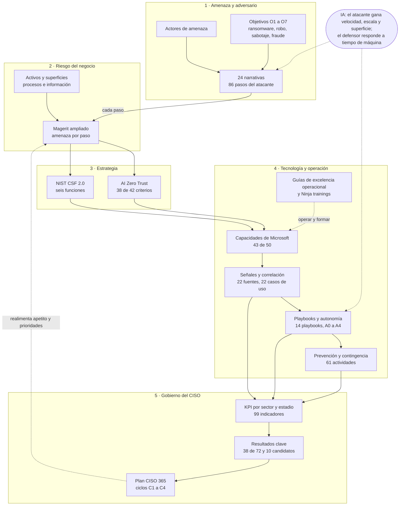

# Del ataque al indicador: relato integrado del SOC agéntico para el CISO (v0.1)

**Frontier CISO Atlas · SOC agéntico · Relato integrado** · 25 de noviembre de 2026 · Propuesta para validar por el autor

Este relato reúne en una sola línea de pensamiento lo construido hasta ahora: las 24 narrativas paso a paso, el hilo del ransomware, el hilo de la IA como superficie, los seis anexos de excepciones y la infografía. Se apoya en los artefactos existentes del Atlas y los cita por su identificador, sin modificarlos.

| Pieza | Qué aporta al relato |
|---|---|
| Frontier_CISO_Atlas_SOC_Agentico_Narrativas_Paso_a_Paso_v0.1 (libro y guía) | Las 24 narrativas como secuencias de pasos, cada una con su amenaza Magerit y su pregunta del SOC |
| Frontier_CISO_Atlas_SOC_Agentico_Hilo_Paso1_24_Narrativas_v0.1 | Dónde entra cada narrativa en la cadena del ransomware y cuáles son excepciones |
| Frontier_CISO_Atlas_SOC_Agentico_Hilo_Paso2_Ransomware_v0.1 | El ransomware de punta a punta, desde la amenaza hasta el resultado clave |
| Frontier_CISO_Atlas_SOC_Agentico_Hilo_Paso3_IA_Superficie_v0.1 | El segundo hilo: cuando el blanco es la IA de la organización |
| Frontier_CISO_Atlas_SOC_Agentico_Hilo_Paso4_Anexos_Excepciones_v0.1 | Fraude, disponibilidad, espionaje, proveedores, riesgo interno y OT |
| Frontier_CISO_Atlas_SOC_Agentico_Infografia_CISO_v1 | La versión del relato en una lámina, para el directorio |

**Cómo leerlo.** La parte I cuenta la historia y está pensada para el CISO y para quienes deciden con él. La parte II muestra cómo usar los libros para tomar decisiones. La parte III deja la trazabilidad: qué ya existía, qué se agregó, qué falta y qué queda por decidir.

## En una página

1. **Una amenaza que el directorio entiende alcanza para explicar casi todo.** El ransomware comparte etapas con 16 de las 24 narrativas, y 12 desembocan en él o se suman a él. Para detenerlo hay que resolver casi todo lo demás.
2. **Una narrativa es una secuencia de pasos, y cada paso se puede medir.** Las 24 suman 86 pasos del atacante. Cada paso lleva a una amenaza de Magerit, un control, una tecnología, una señal, una pregunta del SOC y un indicador.
3. **La IA rompió el equilibrio de tiempos.** Una vulnerabilidad se convierte en arma en menos de 24 horas (ESC-19). Una campaña que antes tomaba 14 días hoy toma 85 minutos (ESC-18). Un agente puede ejecutar entre el 80 y el 90 % de la operación táctica de una intrusión (ESC-17). La defensa tiene que responder a tiempo de máquina, con autonomía aprobada y con las decisiones humanas explícitas.
4. **La IA también es un blanco.** Los agentes del negocio y los del propio SOC pueden ser engañados o envenenados, o usados con sus permisos legítimos. Es un segundo hilo, y dos de sus etapas no tienen equivalente en el ransomware: el envenenamiento de lo que el agente sabe y la inyección indirecta.
5. **La identidad es el cuello de botella.** 16 de las 24 narrativas entran por el acceso inicial, y la identidad es la capa con más pasos (13 de 86).
6. **Con E5, lo que falta no es tecnología: es proceso y gobierno.** En los tres desarrollos, E3 deja 10 brechas de tecnología, E5 deja una (Microsoft Agent 365) y E7 ninguna. Pero en 16 de las 23 etapas de los anexos la decisión es de otra área: tesorería, compras, recursos humanos, legal o la planta.
7. **El trabajo cabe en el plan del CISO.** Los desarrollos mueven 38 de los 72 resultados clave del Plan CISO 365. Entre ellos están todos los del frente de detección, respuesta y recuperación (F4) y todos los de IA y agentes (F6). Usan 99 indicadores y proponen 10 resultados clave candidatos.
8. **Falta el lenguaje del directorio.** Solo 3 de los 99 indicadores son de impacto. El puente con el directorio es la pérdida esperada de los escenarios prioritarios frente al apetito (K26), que hoy no es la medida de ningún resultado clave del plan.

---

# Parte I · El relato

## 1. Lo que hay que proteger

Toda organización existe para ejecutar procesos, sea una empresa o un gobierno: cobrar, pagar, producir, atender, regular. Esos procesos corren sobre activos: identidades, equipos, servidores, bases de datos, aplicaciones, redes, servicios en la nube y plantas industriales. Desde hace poco, también sobre agentes de IA que leen, deciden y actúan. Cada activo expone una superficie de ataque, y en muchos vive información confidencial.

Magerit da el vocabulario para nombrar esos activos y lo que les puede pasar, y el Atlas ya lo usa en su modelo de gestión de riesgo ampliado. Le falta una pieza: Magerit no tiene un tipo de activo «agente», y la CCN-STIC 817 no tipifica incidentes sobre agentes. El relato trata al agente como un activo más, sin cambiar el modelo.

**El doble rol de Microsoft.** Microsoft provee buena parte de lo que hay que proteger y también las herramientas para protegerlo. Las capacidades de la segunda columna son las que usa este relato, con los nombres de la edición Microsoft v2.1 del Plan CISO 365.

| Lo que Microsoft provee y hay que proteger | Con qué se protege (capacidades del relato) |
|---|---|
| La infraestructura donde corren los sistemas del negocio (Azure) | Defender for Cloud, Microsoft Sentinel, Azure Backup, Azure Site Recovery, Azure Firewall, Web Application Firewall y DDoS Protection |
| El trabajo y la comunicación con clientes y proveedores (Microsoft 365) | Microsoft Defender XDR, Defender for Office 365, Microsoft Purview, Microsoft Intune, Microsoft 365 Backup |
| La identidad de las personas, las cargas de trabajo y los agentes (Microsoft Entra ID) | Entra ID Protection, Privileged Identity Management, ID Governance, Defender for Identity, Entra Agent ID |
| La IA del negocio (Microsoft 365 Copilot, Microsoft Foundry y los agentes) | Microsoft Agent 365, protecciones de Purview para IA generativa, Defender for AI Services, controles de seguridad de Foundry |
| La operación de la defensa | Microsoft Security Copilot y la automatización de Microsoft Sentinel |

El relato busca dos cosas a la vez: que las organizaciones crezcan y sean productivas sobre esas plataformas, y que puedan defenderse de quien quiere abusar de ellas. El Plan CISO 365 es agnóstico al proveedor: las capacidades de Microsoft se agregan como un mapeo, sin reemplazar los objetivos de riesgo.

## 2. Quién ataca y para qué

Del otro lado hay **actores de amenaza** que persiguen **objetivos**: el cibercrimen organizado, los actores estatales, los hacktivistas, las personas de adentro y los proveedores comprometidos. El relato usa siete objetivos, definidos con las amenazas de Magerit que los materializan (paso 1):

| Objetivo | Qué busca el atacante |
|---|---|
| O1 Extorsión por ransomware | Cobrar por devolver la operación y por no publicar los datos |
| O2 Robo de información | Llevarse datos, propiedad intelectual o secretos |
| O3 Sabotaje y destrucción | Dañar sin intención de cobrar |
| O4 Fraude | Desviar dinero o tomar cuentas de clientes |
| O5 Abuso de recursos | Consumir cómputo o capacidad de IA ajena |
| O6 Interrupción del servicio | Dejar sin servicio a clientes o ciudadanos |
| O7 Manipulación de la IA del negocio | Hacer que un agente decida o actúe a favor del atacante |

Los objetivos no son excluyentes. Un ransomware moderno roba antes de cifrar, para extorsionar dos veces: persigue O1 y O2 a la vez. Por eso la extorsión y el robo de información son los objetivos que más narrativas reúnen, 16 cada uno.

**Qué es una narrativa.** Es la secuencia de pasos que un atacante ejecuta para alcanzar un objetivo. Cada paso tiene un propósito, la táctica, y varias formas de ejecutarse, las técnicas, que cambian según el actor. Por eso un ransomware se explica por los pasos que se ejecutaron, aunque cada grupo los ejecute a su manera. Una campaña es una ejecución real de una narrativa por un actor concreto. En MITRE, el equivalente formal más cercano es Attack Flow. ATT&CK y ATLAS son bases de conocimiento de técnicas, no catálogos de narrativas.

**Las 24 narrativas**, en cuatro grupos:

| Grupo | Narrativas | Qué representan |
|---|---|---|
| Previas (13) | ESC-01 a ESC-13 | Las vías conocidas: phishing, fraude por correo, mesa de ayuda, ransomware, borde expuesto, infostealers, espionaje estatal, cadena de suministro, amenaza interna, nube, OT, abuso de aplicaciones web y denegación de servicio |
| Previas enriquecidas por la IA (5) | ESC-17 a ESC-21 | Las mismas vías, más rápidas y a escala: intrusión orquestada por agentes, robo de sesión industrializado, explotación en menos de un día, malware que consulta un modelo y suplantación sintética |
| Sin antecedente (3) | ESC-14 a ESC-16 | Lo realmente nuevo: inyección indirecta, envenenamiento de la memoria y abuso de la identidad del agente |
| Previas con blanco nuevo (3) | ESC-22 a ESC-24 | Técnicas conocidas contra blancos nuevos: la cadena de suministro agéntica, la capacidad de IA y la defensa autónoma |

ESC-25, la cadena Zava, no es una narrativa más: es un escenario compuesto que encadena cuatro de ellas.

**La relación con Magerit es por paso.** Cada paso del atacante le hace algo a un activo, y eso tiene nombre en Magerit. De los 86 pasos, 70 usan una amenaza que el catálogo ya lista para esa narrativa y 7 necesitan una que no figura. Los 9 restantes son reconocimiento y preparación fuera de los activos de la organización, como reunir datos de empleados o comprar infraestructura, y no tienen amenaza Magerit: ahí solo actúa la inteligencia de amenazas. Las amenazas de tipo error ([E]) no son pasos sino condiciones: la vulnerabilidad sin parche o el error de configuración que el atacante aprovecha. En ellas actúa la prevención, antes de que haya atacante.

## 3. Por qué el ransomware es el hilo conductor

Hay tres razones.

1. **El directorio lo reconoce como la mayor amenaza.** Eso le da al CISO el apoyo político y económico que necesita.
2. **Reúne a las demás.** 16 de las 24 narrativas comparten al menos una etapa con él: es el núcleo de una, cubre 8 y cubre en parte otras 7. Además, 12 desembocan en él o se suman a él. Diez continúan en un ransomware; la denegación de servicio (ESC-13) se suma como presión durante la extorsión, y cegar la defensa autónoma (ESC-24), como preparación antes de cifrar. Las que más alimentan a otras son el phishing (ESC-01), la explotación del borde (ESC-05), el robo de sesión industrializado (ESC-18) y la suplantación sintética (ESC-21).
3. **Recorre las seis funciones del NIST CSF 2.0.** Gobernar, identificar, proteger, detectar, responder y recuperar tienen indicadores en el hilo.

En el catálogo de escenarios, el ransomware es una narrativa (ESC-04). En el relato es además un objetivo (O1). La capa nueva distingue la vía del objetivo sin cambiar el catálogo.

**Un ransomware, paso a paso (ESC-04).** Así se ve la narrativa núcleo. La pregunta que la resume es si el SOC ve la secuencia de credenciales, defensas, movimiento lateral, respaldos y cifrado, y si contiene antes del cifrado masivo.

| # | Qué hace el atacante | Amenaza Magerit | Pregunta del SOC en ese paso |
|---|---|---|---|
| 1 | Entra por alguna de las narrativas de acceso (phishing, mesa de ayuda, borde, infostealer, proveedor) | Según la narrativa de entrada | ¿De qué narrativa vino el acceso? |
| 2 | Vuelca credenciales de la memoria y del directorio | [A.11] Acceso no autorizado | ¿Hay acceso a la memoria de credenciales o replicación del directorio desde un equipo que no corresponde? |
| 3 | Desactiva o manipula el antivirus y el EDR | [A.4] Manipulación de la configuración | ¿Algún sensor dejó de informar o cambió su configuración de protección? |
| 4 | Se mueve por SMB, WMI o RDP hacia servidores y controladores de dominio | [A.6] Abuso de privilegios de acceso | ¿Una cuenta administrativa se conecta a muchos equipos en poco tiempo? |
| 5 | Roba datos antes de cifrar, para extorsionar dos veces | [A.19] Divulgación de información | ¿Sale un volumen inusual hacia almacenamiento en la nube o dominios nuevos? |
| 6 | Borra instantáneas y respaldos | [A.18] Destrucción de información | ¿Se ejecutaron comandos que borran instantáneas o respaldos? |
| 7 | Cifra servidores y equipos y deja la operación fuera de servicio | [A.8] Difusión de software dañino; [A.24] Denegación de servicio | ¿Se detecta el cifrado incipiente y se aísla en minutos? |
| 8 | Exige el pago con la amenaza de publicar los datos | [A.29] Extorsión | ¿El comité de crisis tiene preparada la decisión y la notificación? |

En el hilo, esos pasos se ordenan en ocho etapas del ataque (R0 Reconocimiento y preparación, R1 Acceso inicial, R2 Credenciales, privilegios y persistencia, R3 Descubrimiento y movimiento lateral, R4 Neutralizar defensas y recuperación, R5 Recolección y exfiltración, R6 Impacto y R7 Extorsión y presión). Se agregan dos etapas del defensor: RC Recuperación y continuidad, y GV Gobierno del hilo.

## 4. Qué cambió con la IA

La IA hizo más asimétrica la lucha entre atacantes y defensores. El atacante ganó en cuatro frentes:

| Cambio | Qué dice el catálogo | Qué exige a la defensa |
|---|---|---|
| **Velocidad** | Entre el descubrimiento de una vulnerabilidad y su uso como arma pasan menos de 24 horas (ESC-19). Una campaña que tomaba 14 días hoy toma 85 minutos (ESC-18). | Gestionar la exposición antes del parche: rutas de ataque, protección previa al parche a velocidad de máquina y plazos de corrección medidos (K46, K138, K140) |
| **Escala y eficacia** | Phishing como servicio, suplantación sintética de voz y video, e intrusiones en las que un agente ejecuta entre el 80 y el 90 % de la operación táctica (ESC-17, ESC-18, ESC-21) | Identidad resistente a la suplantación y verificación fuera de banda en los procesos sensibles |
| **Superficie nueva** | Los agentes del negocio y los del propio SOC pasan a ser blanco (ESC-14 a ESC-16, ESC-22 a ESC-24) | Inventario, identidad propia y límites para cada agente; un hilo propio para la IA como superficie |
| **Volumen** | Más señales, alertas y comportamientos que analizar, en menos tiempo | Correlación entre capas y respuesta automatizada con autonomía aprobada |

El atacante puede encontrar una vulnerabilidad y explotarla antes de que el fabricante publique el parche. Y si el parche existe, puede llegar antes de que la víctima lo aplique. Por eso la prevención ya no alcanza con parchear a tiempo: hay que saber qué está expuesto y qué camino lleva a los activos críticos.

**El caso que lo muestra.** En la cadena Zava (ESC-25), hubo señal en las cinco etapas del ataque y nada las unió. La ventana del atacante fue de unos 75 minutos. Con una regla de correlación entre capas (UC-18), habría bajado a 16 minutos como máximo. El problema no fue la falta de datos sino la falta de una lógica que los uniera a tiempo.

**Qué cambia en la defensa.** Responder a tiempo de máquina no es automatizarlo todo. Es separar la capacidad de un agente para ejecutar una acción de la autorización institucional para hacerlo. La Guía Madurez SecOps v0.1 (§19.3) fija esa escala y su equivalencia con el plan 365:

| Nivel | Qué hace el agente | Qué hace la persona | Nivel del plan 365 |
|---|---|---|---|
| A0 Informar | Resume y recomienda | Decide y ejecuta | L0 |
| A1 Proponer | Prepara la acción | Ejecuta | L1 |
| A2 Ejecutar con aprobación | Ejecuta después de una aprobación explícita | Aprueba cada acción | L2 |
| A3 Ejecutar e informar | Ejecuta acciones reversibles dentro de límites | Revisa después y puede revertir | L3 |
| A4 Ciclo cerrado | Ejecuta el flujo completo | Audita por muestreo | L4, no previsto en el plan |

En el ransomware, revocar sesiones y aislar un equipo sin apagarlo son acciones A3. Aislar servidores o suspender cuentas privilegiadas requiere aprobación (A2). Hay decisiones que no se delegan nunca: cualquier decisión sobre la extorsión (corresponde al comité de crisis), liberar la contención, rotar la cuenta krbtgt, restaurar sobre producción, revertir operaciones de negocio originadas en un agente y reactivar un agente. Los agentes del propio SOC también se evalúan: muestreo humano y tasa de reversión de veredictos (PROP-03) antes de subir su autonomía.

## 5. Del paso al riesgo: Magerit

Las narrativas dicen cómo ataca el adversario. Magerit dice qué le pasa a cada activo y cuánto le importa eso al negocio. La unión ocurre en cada paso: el paso 2 del ransomware es un acceso no autorizado ([A.11]) a la identidad; el paso 6, una destrucción de información ([A.18]) en los respaldos.

Esa correspondencia aporta lo que el catálogo de indicadores necesitaba: un denominador. Indicadores como K89 (escenarios prioritarios cuantificados) o K43 (técnicas de ataque priorizadas con detección validada) necesitan saber cuáles son los escenarios prioritarios. Las narrativas priorizadas con Magerit lo dicen.

Tres matices:

- **No todo es Magerit.** Los 9 pasos fuera de la organización se cubren con inteligencia de amenazas (FT-13), y 3 pasos no tienen ninguna fuente de señal: la decisión sobre la extorsión (ESC-04-P8), el reconocimiento de las fuentes de un agente (ESC-15-P1) y la fabricación de una identidad sintética (ESC-21-P1). Se cubren con gobierno, inventario y controles de proceso, no con detección.
- **La lista del catálogo para ESC-04 describe el impacto y no el camino.** Por eso 3 de las 7 amenazas que hubo que proponer están en la intrusión del ransomware: ESC-04-P2 [A.11], ESC-04-P3 [A.4] y ESC-04-P4 [A.6].
- **El riesgo residual es una propuesta.** La Guía Madurez SecOps v0.1 propone estimarlo como el potencial por uno menos la eficacia de las salvaguardas, con factores por nivel de madurez. Sigue sin validar.

## 6. Del riesgo al control: AI Zero Trust y NIST CSF 2.0

Cada paso de una narrativa tiene un lugar donde la cadena se puede cortar. La estrategia Zero Trust del plan 365 tiene 42 criterios en 8 dominios: identidades, dispositivos, aplicaciones y cargas, datos, infraestructura, red, visibilidad, automatización y gobierno, e IA y agentes. Los tres desarrollos usan 38 de esos 42 criterios.

| Dónde se corta | Ejemplo en el relato |
|---|---|
| En el acceso | MFA resistente a la suplantación, acceso condicional por riesgo y dispositivos conformes (ZT-ID-1, ZT-ID-2, ZT-DI-1) cortan R1 |
| En el privilegio | Sin privilegios permanentes e identidades no humanas gobernadas (ZT-ID-3, ZT-ID-5) cortan R2 |
| En la recuperación | Respaldos inalterables y una plataforma de control recuperable (ZT-DA-5, ZT-IN-5) quitan al atacante su palanca en R4 |
| En los datos | Clasificar y controlar la salida (ZT-DA-1 a ZT-DA-4) reduce el botín de R5 |
| En el agente | Inventario con dueño (ZT-IA-1), identidad propia y permisos por herramienta (ZT-IA-2), autonomía aprobada (ZT-IA-3), límites de acción fuera del modelo (ZT-IA-5) y registro fuera de su alcance (ZT-IA-6) |

El NIST CSF 2.0 ordena lo mismo por función. Los 99 indicadores del relato se reparten así: 13 de gobernar, 21 de identificar, 29 de proteger, 13 de detectar, 14 de responder y 9 de recuperar. El peso de «proteger» confirma lo que dicen las narrativas: buena parte de la batalla se gana antes de que haya alerta.

No existe un estándar formal de «Zero Trust para la IA» en NIST ni en The Open Group (supuesto SUP-01 del plan). Los criterios ZT-IA reúnen lo que coincide entre las fuentes.

## 7. Del control a la tecnología: capacidades, guías y formación

Los controles se implementan con tecnología. El relato usa 43 de las 50 capacidades de la edición Microsoft v2.1 del plan. Cada una está ligada a las etapas que cubre, a una guía de excelencia operacional del autor y a un programa Ninja de formación.

**Lo que cambia con la licencia**, sumando los tres desarrollos:

| Licencia | Incluidas | Parciales | Brechas | Por consumo en Azure |
|---|--:|--:|--:|--:|
| E3 | 3 | 13 | 10 | 16 |
| E5 | 19 | 8 | 1 | 15 |
| E7 | 24 | 4 | 0 | 15 |

Con E3, una capacidad figura como «ver licencia» (Purview Data Security Posture Management). Las 10 brechas de E3 son Exposure Management, Defender Vulnerability Management, Defender for Office 365, Attack simulation training, Privileged Identity Management, ID Governance, Defender for Identity, Purview Insider Risk Management, Agent 365 y Defender for IoT. Con E5 queda una sola, Agent 365, que viene incluida en E7. Las capacidades por consumo (Sentinel, Defender for Cloud, los respaldos y la red de Azure, entre otras) no dependen de la licencia de Microsoft 365.

**Las guías y la formación.** Los desarrollos citan 20 de los 23 módulos del repositorio de guías de excelencia operacional del autor (EO-00 a EO-22) y 12 programas Ninja. Dos de esos programas, los de Defender for Cloud y Foundry, se asignaron por afinidad de producto. 16 de las 43 capacidades no tienen guía del autor. El hueco más serio está en la recuperación: no hay guía ni programa Ninja para Azure Backup, Azure Site Recovery ni Microsoft 365 Backup. Justamente la etapa que decide si un incidente dura días o meses es la que tiene menos soporte de operación y de formación.

## 8. De la tecnología a la operación: señal, correlación y respuesta

Una tecnología instalada no detiene nada si nadie mira sus señales a tiempo. En la operación, cada paso de cada narrativa trae una pregunta del SOC. En el phishing, por ejemplo: ¿hay un inicio de sesión desde infraestructura nueva justo después de un clic? Responder esa pregunta exige tres piezas del kit Madurez SecOps:

- **Fuentes de señal** (FT-01 a FT-22): identidad, correo, equipos, nube, datos, IA, OT.
- **Casos de uso y correlación** (UC-01 a UC-22): la lógica que une señales de capas distintas en un solo caso. UC-18 es la regla entre capas que habría bajado la ventana de la cadena Zava de unos 75 minutos a 16 como máximo.
- **Playbooks** (PB-01 a PB-14): qué se hace, en qué orden, con qué autonomía y quién decide, sobre el flujo de ocho etapas de la guía (preparar, detectar y correlacionar, interrumpir y contener, triage, investigar, expulsar y remediar, recuperar y validar, mejorar y gobernar).

Los tres desarrollos usan las 22 fuentes, los 22 casos de uso y los 14 playbooks del kit. Ninguna pieza quedó sin una narrativa que la justifique, y ninguna narrativa quedó sin pregunta del SOC.

Los huecos también son operativos. No hay fuente de seguridad nativa para la memoria de un agente (FT-19). La traza de ejecución de los agentes depende de Agent 365, que está en Preview (FT-12). Y cinco playbooks no tienen respaldo en las guías del autor: PB-08 (materialidad), PB-10 (agentes del negocio), PB-11 (OT), PB-12 y PB-14.

## 9. Cuando a pesar de todo hay impacto: prevención y contingencia

Ningún control es perfecto, así que el relato tiene que llegar al día en que el ataque funciona. Los tres desarrollos ordenan 61 actividades de prevención y contingencia: 26 antes del impacto, 19 durante y 16 después.

- **Antes:** respaldos inmutables con restauración probada, objetivos de recuperación aprobados por el negocio, acceso de emergencia fuera del dominio comprometido, operación degradada probada en los procesos críticos y una postura sobre la extorsión aprobada por la dirección.
- **Durante:** verificar lo que aisló la plataforma, aislar sin apagar, suspender cuentas y agentes, pedir al banco la retención de una transferencia o aislar TI de OT, según el caso.
- **Después:** liberar la contención tras la validación forense, rotar credenciales, restaurar desde respaldos verificados, revisar lo que emitió un agente desde la primera escritura maliciosa e informar.

De las 61 actividades, 25 las decide o ejecuta solo una persona, y 20 se pueden automatizar con un nivel de autonomía aprobado o las ejecuta la plataforma. La contingencia es el lugar donde el relato vuelve al negocio. Los objetivos de recuperación, la operación manual de la planta y la decisión sobre la extorsión no los fija el SOC.

## 10. Cómo demuestra el CISO que funciona: KPI, OKR y Plan 365

El CISO tiene objetivos anuales y necesita demostrar su desempeño. Los indicadores (KPI) dicen si la operación funciona. Los resultados clave (OKR) dicen si la madurez avanza. El Plan CISO 365 los ordena en el año.

**Elegir KPI según el tipo de organización y su madurez.** Cada libro tiene una hoja Selección con tres entradas: sector, estadio del SOC y licencia.

- El **sector** marca qué indicadores son prioritarios, con los niveles del catálogo de KPIs y OKRs v1.2 (Directorio, Esencial, Complementario y Opcional). Esos niveles existen solo para K01 a K64.
- El **estadio** (E1 a E5, Guía Madurez SecOps v0.1) marca qué tipo de indicador conviene medir ya. La regla propuesta sigue los tipos de medida de NIST SP 800-55: implementación desde E1, efectividad desde E2, eficiencia desde E3 e impacto desde E4. La meta de cada indicador es el umbral del estadio siguiente.
- La **licencia** marca qué indicadores se pueden medir con la tecnología disponible.

Los 99 indicadores del relato son 41 de implementación, 48 de efectividad, 7 de eficiencia y 3 de impacto. Esa distribución es coherente con una defensa que todavía se está construyendo, pero deja corto al CISO frente al directorio. Los tres de impacto son K26 (pérdida esperada de los escenarios prioritarios frente al apetito), K47 (tiempo de restauración de servicios críticos frente al RTO) y K27 (servicios críticos concentrados en un proveedor sin alternativa).

**Elegir OKR según la tecnología adquirida.** Cada resultado clave del plan que mueve el relato tiene una capacidad principal. Con la licencia elegida, el libro marca cuáles dependen de una brecha. Así el CISO sabe qué metas puede comprometer con lo que ya tiene y cuáles necesitan una inversión.

**El relato en el año del CISO.** Los desarrollos mueven 38 de los 72 resultados clave del plan, distribuidos así por ciclo y por frente:

| Ciclo del plan | Pregunta del ciclo (plan 365) | F1 | F2 | F3 | F4 | F5 | F6 | Total |
|---|---|--:|--:|--:|--:|--:|--:|--:|
| C1 Conocer, estabilizar y ordenar (días 1–90; H30, H60, H90) | ¿Qué puede dañarnos hoy, quién responde por cada función y qué necesito que la dirección decida? | 0 | 0 | 3 | 3 | 1 | 3 | 10 |
| C2 Adecuar (días 91–180; H180) | ¿Cada función opera al nivel requerido, en todos los entornos y con quien corresponde? | 1 | 0 | 2 | 3 | 2 | 3 | 11 |
| C3 Evolucionar y probar (días 181–270; H270) | ¿Lo que decimos que tenemos funciona cuando se lo exige, también en lo que opera un tercero? | 1 | 0 | 3 | 3 | 1 | 3 | 11 |
| C4 Demostrar y sostener (días 271–365; H365) | ¿Cuál es nuestro nivel real de riesgo, mejoramos, invertimos bien y estamos preparados? | 0 | 0 | 0 | 3 | 0 | 3 | 6 |
| **Total** | | **2** | **0** | **8** | **12** | **4** | **12** | **38** |

Frentes: F1 Gobierno y rendición de cuentas, F2 Programa, personas y presupuesto, F3 Identificar y proteger, F4 Detectar, responder y recuperar, F5 Ecosistema, F6 IA y agentes.

Las narrativas responden a la pregunta del primer ciclo: qué puede dañarnos hoy. El ejercicio de adversario de extremo a extremo (C3-F4-KR1, K144) responde a la del tercero, si lo que decimos que tenemos funciona. Los dos resultados clave de F1 que mueve el relato son el puente con el directorio: el apetito con umbrales medibles (C2-F1-KR1, K86) y los escenarios prioritarios cuantificados (C3-F1-KR1, K89). F2 no tiene ningún resultado clave movido por los hilos, y es justo el frente donde se juega el presupuesto (sección 15).

**Lo que el plan no tiene.** Los desarrollos proponen 10 resultados clave candidatos para indicadores que el plan no mide como resultado clave:

| Candidato | Indicador | Por qué |
|---|---|---|
| HR-KR1 | K45 Tiempo medio de contención | La contención del ransomware (R6) no tiene resultado clave |
| HR-KR2 | K55 Incidentes contenidos con respuesta automatizada o asistida por IA | La respuesta a tiempo de máquina no tiene resultado clave |
| HR-KR3 | K140 Rutas de ataque abiertas hacia activos críticos | La exposición previa al parche (R0) |
| IA-KR1 | PROP-01 Tiempo hasta correlacionar señales de capas distintas (≤ 16 minutos) | La lección de la cadena Zava |
| IA-KR2 | PROP-02 Agentes del negocio con dueño, fuentes de conocimiento e identidad mapeadas (meta a fijar con la línea base) | El inventario de la IA (I0) |
| AN-KR1 | K163 Tasa de falla en simulaciones de ingeniería social | Fraude |
| AN-KR2 | K29 Operación degradada probada en procesos críticos | Disponibilidad |
| AN-KR3 | K44 Campañas de hunting que mejoran la detección | Espionaje |
| AN-KR4 | K154 Eventos de salida de datos sensibles resueltos en plazo | Riesgo interno |
| AN-KR5 | K40 Zonas OT e IIoT que alcanzan su nivel de seguridad objetivo | OT |

**El ciclo se cierra.** Lo que se mide vuelve al riesgo. El escenario se cuantifica (K89), la pérdida esperada se compara con el apetito (K26, K86) y el hilo se prueba de punta a punta con un ejercicio de adversario (K144). El resultado realimenta la priorización de Magerit para el ciclo siguiente.

Las flechas continuas indican que una capa alimenta a la siguiente; las punteadas, influencia o realimentación.

## 11. Más allá del ransomware

El ransomware no lo explica todo. El relato tiene dos extensiones, y ambas reutilizan lo que el ransomware ya resolvió.

**La IA como superficie (segundo hilo).** El ransomware explica cómo la IA hace más fuerte al atacante. Este hilo explica qué pasa cuando el blanco es la propia IA de la organización: sus agentes, lo que leen, lo que recuerdan, sus permisos y su capacidad de cómputo. Su guía es la cadena Zava (ESC-25), y sus etapas van de I0 (exposición de la IA) a I7 (cegar la defensa autónoma), con IC (recuperación) e IG (gobierno).

- **Cambia el tipo de daño.** En el ransomware se pierde la disponibilidad. Aquí se pierde la integridad de lo que el agente sabe y la autoridad que se le delegó: el agente actúa mal con permisos legítimos.
- **Seis de sus etapas cruzan el ransomware y dos no.** La identidad del agente se protege como cualquier identidad (I1 con R1, I4 con R2), y si la cadena llega a un equipo continúa como un ransomware. El envenenamiento de la fuente o la memoria (I2) y la inyección indirecta (I3) no tienen equivalente: son lo realmente nuevo.
- **Con E5 falta una capacidad, y pesa.** Sin Agent 365 no llega la traza de ejecución de los agentes (FT-12): los casos de uso UC-14 y UC-15 pierden su señal principal, y 4 de los 12 resultados clave del frente F6 dependen de esa capacidad.
- **El gobierno va antes que la tecnología.** 4 de los 16 resultados clave que mueve este hilo no dependen de ninguna capacidad de Microsoft: son decisiones de gobierno.

**Los anexos de excepciones.** Seis familias de narrativas tienen otro objetivo: D1 Fraude, D2 Disponibilidad, D5 Espionaje y permanencia, D6 Proveedores y cadena de suministro, D7 Riesgo interno y D8 OT e infraestructura crítica. Comparten con el ransomware la entrada y desarrollan solo sus 23 etapas propias. Su lección es distinta: en 16 de esas 23 etapas la decisión es de otra área (tesorería, compras, recursos humanos, legal, continuidad o la planta). El SOC aporta la señal, la correlación y la evidencia, y el corte lo hace un proceso del negocio. El peso de cada anexo depende del sector: el fraude pesa en finanzas, OT en energía, Oil & Gas, industria y logística, y el espionaje en gobierno y energía.

---

# Parte II · Cómo usarlo

## 12. Las preguntas del CISO y dónde está la respuesta

| Pregunta del CISO | Dónde está la respuesta |
|---|---|
| ¿Qué amenazas pesan más en mi organización? | Paso 1, hojas Mapa y Objetivos; anexos, columna de sectores donde pesa cada uno |
| ¿Por dónde entraría un atacante y qué haría después? | Narrativas paso a paso, hojas Pasos y Encadenamientos |
| ¿Qué le pasaría a mis activos y cuánto importa? | Narrativas paso a paso, hoja Magerit; modelo Magerit ampliado del autor para la valoración |
| ¿Dónde corto la cadena? | Hojas Controles de cada libro (criterios Zero Trust y CSF 2.0) |
| ¿Qué tecnología necesito y qué tengo? | Hojas Tecnologías: columnas E3, E5, E7, «Con tu licencia» y «Qué se pierde si falta» |
| ¿Quién la opera y cómo se forma el equipo? | Mismas hojas: guía de excelencia operacional y programa Ninja de cada capacidad |
| ¿Qué señales necesito y cómo las correlaciono? | Hojas Hilo, Etapas y Pasos: fuentes (FT) y casos de uso (UC) por etapa y por paso |
| ¿Cómo respondo y quién decide? | Playbooks (PB), autonomía A0 a A4 y la columna «Quién decide» de los anexos |
| ¿Qué hago si igual hay impacto? | Hojas Contingencia: antes, durante y después, con responsable y cómo se prueba |
| ¿Qué KPI elijo? | Hojas Selección e Indicadores: recomendación según sector y estadio |
| ¿Qué OKR comprometo este año? | Hojas OKR: resultado clave, capacidad principal y estado con mi licencia |
| ¿Cómo justifico una inversión? | Hoja Tecnologías, columna «Qué se pierde si falta», y los resultados clave que dependen de una brecha |

## 13. Un recorrido de ejemplo

Los libros vienen con un caso inicial: una organización del sector financiero, con el SOC en el estadio E2. Así se lee:

1. **El ransomware con E3.** De los 65 indicadores del hilo, 9 son prioritarios para ese sector y ese estadio. De las 32 capacidades, 7 son brechas, 11 son parciales, 11 se contratan por consumo en Azure y 3 están incluidas.
2. **El ransomware con E5.** Las brechas bajan a 0 y quedan 3 parciales. La conversación con el directorio cambia de «falta tecnología» a «hay que operarla».
3. **La IA como superficie con E5.** Queda 1 brecha (Agent 365), de la que dependen 4 resultados clave del frente F6. El sector financiero tiene la presión máxima de IA y agentes en el catálogo v1.2 (eje E7, nivel 5).
4. **Los anexos con E5.** No hay brechas y quedan 6 capacidades parciales. Lo que falta es proceso: verificación fuera de banda en tesorería, cláusulas con proveedores e investigación con garantías. En finanzas pesa el fraude (candidato AN-KR1, K163).
5. **El mensaje al directorio.** El ransomware como historia, la IA como cambio de velocidad y la pérdida esperada frente al apetito (K26) como cifra.

Al cambiar el sector, el estadio o la licencia en la hoja Selección, todos los libros recalculan qué indicadores priorizar, qué metas fijar y qué brechas quedan.

## 14. Cómo justificar una tecnología

La justificación sigue la cadena del relato hacia atrás: la capacidad que falta deja ciega una señal, la señal deja sin lógica a un caso de uso, el caso de uso deja sin cubrir una etapa del ataque, y el indicador de esa etapa queda sin medición. Ejemplos tomados de la columna «Qué se pierde si falta»:

| Si falta… | Qué se pierde | Dónde duele |
|---|---|---|
| Defender for Identity (brecha con E3) | Las señales de Active Directory (FT-04): UC-04 no ve el volcado de credenciales ni el movimiento lateral por Kerberos y NTLM | R2, R3 y RC del ransomware; D8-2 en OT |
| Defender for Office 365 (brecha con E3) | Safe Links y el registro de clics (FT-05): UC-01 pierde el primer eslabón | R1, la entrada de la cadena Zava (I1) y el fraude (D1) |
| Exposure Management (brecha con E3) | Rutas de ataque y puntos de estrangulamiento (FT-11): K140 no tiene medición nativa | R0, donde la IA más aceleró al atacante |
| Agent 365 (brecha con E3 y E5) | La traza de ejecución de los agentes (FT-12): UC-14 y UC-15 pierden su señal principal y K53 su fuente | El hilo de la IA y 4 resultados clave del frente F6 |
| Defender for IoT (parcial con E5) | El inventario y la señal de protocolos industriales (FT-15): UC-08 queda ciego | D8, OT e infraestructura crítica |

El argumento no es «falta un producto», sino «esta etapa del ataque queda sin ver y esta meta del plan queda en riesgo».

## 15. Lo que el relato aporta al presupuesto y a las personas

F2, el frente del programa, las personas y el presupuesto, no tiene ningún resultado clave movido por los hilos, pero el relato le da insumos:

- Para el costo total conocido (C1-F2-KR3, K104): las brechas por licencia y las capacidades por consumo, ligadas a las etapas que cubren.
- Para la formación específica del personal de alto riesgo (C3-F2-KR2, K106): los programas Ninja asignados a cada capacidad.
- Para el informe anual al directorio (C4-F1-KR1): la historia completa, con sus cifras y sus silencios.

Estas tres vinculaciones son una propuesta de lectura y no figuran en los libros.

---

# Parte III · Trazabilidad

## 16. Qué ya existía y qué se agregó

| Artefacto existente (solo lectura, citado por ID) | Qué toma el relato |
|---|---|
| Catálogo de escenarios y kit Madurez SecOps v0.1 (libro y guía) | ESC-01 a ESC-25, FT-01 a FT-22, UC-01 a UC-22, PB-01 a PB-14, autonomía A0 a A4, estadios E1 a E5, PROP-01 a PROP-07 |
| Modelo Magerit ampliado del autor | Amenazas [A] y [E] y tipos de activo |
| Frontier CISO Atlas · Modelo Operativo CISO 365, catálogo 2.0 revisión 2 | 224 indicadores, 24 objetivos y 72 resultados clave en los frentes F1 a F6, ciclos C1 a C4, hitos H30 a H365, 42 criterios Zero Trust, supuesto SUP-01 |
| Edición Microsoft v2.1 del plan 365 | 50 capacidades MS-…, licencias E3, E5 y E7 |
| Catálogo de KPIs y OKRs v1.2 | Niveles por sector para K01 a K64 y eje E7 de presión de la IA |
| Guías de excelencia operacional del autor (repositorio AB) | Módulos EO-00 a EO-22 |
| Ninja trainings | Programas por capacidad |
| Ontología, taxonomía y GM-24 | No se usaron de forma directa; no se tocaron |

| Capa nueva (esta tarea) | Qué agrega |
|---|---|
| Narrativas paso a paso | 86 pasos, 7 condiciones y 4 enlaces, con su amenaza Magerit, su señal y su pregunta del SOC |
| Paso 1 | Objetivos O1 a O7, etapas R0 a R7 y la clasificación de las 24 frente al ransomware |
| Paso 2 | El hilo del ransomware, con RC y GV, y la hoja Selección (sector, estadio y licencia) |
| Paso 3 | El hilo de la IA como superficie, de I0 a I7 con IC e IG |
| Paso 4 | Seis anexos con 23 etapas propias y la columna «Quién decide» |
| Infografía v1 | La lámina para el directorio |
| Este relato | La línea de pensamiento que une todo lo anterior |

## 17. Silencios y límites

- **La recuperación es la etapa con menos soporte.** No hay guía de excelencia operacional ni programa Ninja para Azure Backup, Azure Site Recovery ni Microsoft 365 Backup.
- **El plan no tiene resultados clave para la contención (K45) ni para la respuesta automatizada (K55).**
- **Solo 3 de los 99 indicadores son de impacto,** y K26 no es la medida de ningún resultado clave.
- **La IA tiene huecos de señal y de modelo.** No hay fuente de seguridad nativa para la memoria del agente (FT-19); la traza de los agentes está en Preview (FT-12); Magerit no tiene activo «agente» y no existe un estándar formal de Zero Trust para la IA (SUP-01).
- **Hay playbooks y guías que faltan.** PB-08, PB-10, PB-11, PB-12 y PB-14 no tienen respaldo en las guías del autor. OT no tiene guía del autor, y la guía deja la denegación de servicio y el abuso de aplicaciones web fuera del SOC. 16 de las 43 capacidades no tienen guía del autor.
- **Tres pasos no tienen señal** (ESC-04-P8, ESC-15-P1, ESC-21-P1): se cubren con gobierno y procesos.
- **Los niveles por sector existen solo para K01 a K64.** El resto de los indicadores figura sin nivel sectorial.
- **Hay identificadores a verificar.** Siguen marcados los de ATLAS (AML.T0053, T0054, T0064, T0070, T0080, T0086, T0110) y los de ATT&CK for ICS (T0886, T0831, T0836, T0813).
- **Los estados de producto pueden haber cambiado.** Lo que se cita como disponible o en Preview debe revalidarse después de Microsoft Ignite (17 al 20 de noviembre de 2026).
- **Las asignaciones son criterio de estas entregas.** La responsabilidad de cada función sigue siendo la que define el plan 365, y las licencias se leen de la edición Microsoft v2.1, no de una lista de precios.

## 18. Decisiones pendientes del autor

| Pieza | Decisión | Propuesta por defecto |
|---|---|---|
| Paso 1 | ¿Sirven R0 a R7 como columna vertebral y O1 a O7 como capa de objetivos? | Mantenerlas |
| Paso 1 | ¿De qué narrativa previa es variante ESC-24? | Sin dato en la guía |
| Narrativas | ¿Se aceptan el formato de paso y las 7 amenazas Magerit propuestas? | Aceptarlas como capa nueva |
| Narrativas | ¿Se agrega la candidata 25 (cuenta comprometida que prueba un jailbreak, AML.T0054)? | Agregarla entre ESC-14 y ESC-09 |
| Paso 2 | ¿Se aceptan RC y GV como etapas, la regla de madurez por tipo de indicador y HR-KR1 a HR-KR3? | Aceptarlos como propuesta para clientes |
| Paso 3 | ¿Agent 365 como capacidad principal de K49, K50, K53 y K167, y los candidatos IA-KR1 e IA-KR2? | Aceptarlos |
| Paso 4 | ¿Las etapas propias, los dueños fuera del SOC, los sectores y AN-KR1 a AN-KR5? | Validarlos con clientes de MCSA |
| Infografía v1 | ¿Se aprueba, se ajusta o se convierte en serie? | Abierta |
| Este relato | ¿Sirve esta estructura de tres partes? ¿Se suman las vinculaciones con F2 de la sección 15? | Abierta |

---

## Anexo A · Glosario mínimo

| Término | Significado en el relato |
|---|---|
| Narrativa | Secuencia de pasos que un atacante ejecuta para alcanzar un objetivo (ESC-01 a ESC-24) |
| Paso, condición y enlace | Acción del atacante; oportunidad que aprovecha (amenaza Magerit [E]); llegada desde otra narrativa |
| Táctica y técnica | Para qué da el paso y cómo lo hace (ATT&CK, ATLAS, OWASP) |
| Campaña | Ejecución real de una narrativa por un actor concreto |
| Attack Flow | El formato de MITRE más cercano a una narrativa |
| Objetivo (O1 a O7) | Lo que busca el atacante, definido con amenazas Magerit |
| Etapa | Tramo de un hilo: R0 a R7, RC y GV en el ransomware; I0 a I7, IC e IG en la IA; D1-1 a D8-4 en los anexos |
| Criterio Zero Trust | Condición verificable de la estrategia del plan 365 (ZT-ID-1 y siguientes) |
| Capacidad | Tecnología de Microsoft de la edición v2.1 (MS-IDE-01 y siguientes) |
| FT, UC y PB | Fuente de señal, caso de uso y correlación, y playbook del kit Madurez SecOps |
| A0 a A4 | Autonomía de un agente del SOC; equivale a L0 a L4 del plan 365 |
| E1 a E5 | Estadios de madurez del SOC |
| K, KSG, KX y PROP | Indicadores del catálogo 2.0 y propuestos por el kit SecOps |
| Cn-Fn-KRn | Resultado clave del plan 365 por ciclo y frente |
| HR-, IA- y AN-KR | Resultados clave candidatos, fuera del plan |
| Brecha, parcial, consumo | Capacidad no incluida en la licencia, incluida en parte, o contratada por uso en Azure |

## Anexo B · Cifras del relato y su fuente

| Cifra | Valor | Fuente |
|---|---|---|
| Narrativas que comparten etapas con el ransomware | 16 de 24 | Paso 1, hoja Mapa |
| Narrativas que desembocan o se suman al ransomware | 12 | Narrativas paso a paso, hoja Encadenamientos |
| Narrativas que entran por el acceso inicial (R1) | 16 de 24 | Paso 1, hoja Mapa |
| Pasos del atacante, condiciones y enlaces | 86, 7 y 4 | Narrativas paso a paso, hoja Pasos |
| Pasos de la capa de identidad | 13 de 86 | Narrativas paso a paso, hoja Pasos |
| Pasos con amenaza del catálogo, propuesta y sin amenaza | 70, 7 y 9 (de 86) | Narrativas paso a paso, hoja Pasos |
| Velocidad de la IA | Menos de 24 horas; 14 días a 85 minutos; 80 a 90 % | Catálogo de escenarios: ESC-19, ESC-18, ESC-17 |
| Cadena Zava | 75 minutos; 16 con UC-18 | Guía Madurez SecOps v0.1, ESC-25 |
| Criterios Zero Trust usados | 38 de 42 | Hojas Controles de los pasos 2 a 4 |
| Capacidades usadas | 43 de 50 | Hojas Tecnologías de los pasos 2 a 4 |
| Brechas por licencia (E3, E5, E7) | 10, 1 y 0 | Hojas Tecnologías de los pasos 2 a 4 |
| Indicadores y su tipo | 99: 41, 48, 7 y 3 | Hojas Indicadores de los pasos 2 a 4 |
| Resultados clave del plan movidos | 38 de 72 | Hojas OKR de los pasos 2 a 4 |
| Resultados clave candidatos | 10 | Hojas OKR de los pasos 2 a 4 |
| Actividades de contingencia | 61: 26, 19 y 16 | Hojas Contingencia de los pasos 2 a 4 |
| Etapas de los anexos que decide otra área | 16 de 23 | Paso 4, hoja Etapas |
| Fuentes, casos de uso y playbooks usados | 22, 22 y 14 | Hojas Hilo y Etapas de los pasos 2 a 4 |
| Módulos de guías y programas Ninja citados | 20 de 23 y 12 | Hojas Tecnologías de los pasos 2 a 4 |

Las sumas de los pasos 2 a 4 cuentan cada identificador una sola vez, aunque aparezca en más de un libro.

---
@SCavanna · Principal CSA Security · Microsoft MCSA · Noviembre 2026
