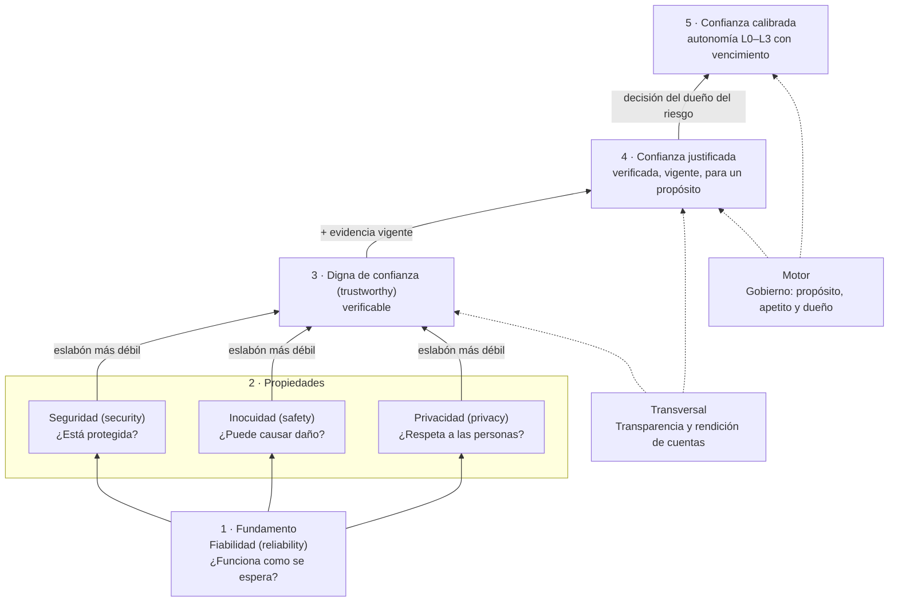

# Trust · Confianza en la IA

## De la protección a la confianza justificada: guía para el CISO y para su conversación con el directorio

---

## Índice

1. La idea en una página
2. Qué se corrigió del texto de partida
3. Los conceptos, uno por uno
4. La arquitectura: cinco peldaños, un motor y una condición transversal
5. Las fórmulas, bien escritas
6. Seguridad e inocuidad en la IA agéntica
7. Confianza calibrada: el riesgo de confiar de más
8. Las tres caras de la confianza en el Atlas
9. Idioma: diferencias, conflictos y forma correcta de interpretar
10. Dónde vive cada pieza en el Frontier CISO Atlas
11. Para el directorio: cómo comunicarlo
- Anexo A. Texto de partida corregido
- Anexo B. Glosario canónico (inglés → español)
- Anexo C. Fuentes
- Anexo D. Estado, decisiones y pendientes

---

## 1. La idea en una página

**Mensaje ejecutivo:** **Security × Safety = Trust**. En español: **Seguridad × Inocuidad = Confianza**.

Se usa «×» y no «+» a propósito: si una de las dos vale cero, no hay confianza. Ninguna compensa a la otra.

Debajo del mensaje hay una arquitectura de cinco peldaños. Cada uno responde una pregunta distinta y exige más evidencia que el anterior.

| Peldaño | Pregunta | Qué hace falta | Dónde está en el Atlas |
|---|---|---|---|
| 1. Fundamento | ¿Funciona como se espera, de forma consistente? | Fiabilidad (reliability) | Evaluación de calidad del agente (K166) |
| 2. Propiedades | ¿Está protegida? ¿Puede causar daño? ¿Respeta a las personas y sus datos? | Seguridad, inocuidad y privacidad, combinadas por el eslabón más débil | Pilar 1 · Proteger; frentes F3 y F6 |
| 3. Digna de confianza | ¿Merece confianza? | Que todo lo anterior sea verificable | Nivel 2 «Implementado» de la escala del Atlas |
| 4. Confianza justificada | ¿Tenemos razones vigentes para depender de ella, para este propósito? | Evidencia probada en los últimos 12 meses | Nivel 3 «Probado»; K60 |
| 5. Confianza calibrada | ¿Cuánta autonomía le damos y hasta cuándo? | Autonomía proporcional a la evidencia, revisada ante cada cambio | Nivel 4 «Adaptativo»; autonomía L0–L3; K88 y K98 |

Dos piezas atraviesan los cinco peldaños:

- **Transparencia y rendición de cuentas.** Sin ellas no se puede verificar nada.
- **Gobierno.** No es un sumando: es el motor que fija el propósito, el apetito de riesgo y el dueño, y exige la evidencia para subir cada peldaño.

**Tres ideas para el directorio:**

1. La confianza no se declara: se demuestra con evidencia vigente.
2. Vale lo que su eslabón más débil.
3. Se concede como autonomía, para un propósito, y vence.

**Frase de cierre:** *la confianza no se declara: se concede como autonomía, y solo hasta donde llega la evidencia.*

**Aviso de idioma.** En español, «security» y «safety» se traducen con la misma palabra: «seguridad». Este documento usa **seguridad** solo para security e **inocuidad** para safety. La sección 9 explica por qué y cómo leer los textos que no siguen esta regla.

---

## 2. Qué se corrigió del texto de partida

El texto de partida proponía «Security + Safety = Trust» como mensaje, sostenía que las dos son necesarias pero no suficientes, y terminaba en dos fórmulas: «Security + Safety + Governance = Trustworthiness» y «Trustworthiness + Evidence = Justified Trust».

**Lo que se conserva:**

- Seguridad e inocuidad son condiciones necesarias, pero no suficientes.
- La confianza es el resultado de una demostración, no una propiedad técnica.
- La distinción entre merecer confianza (trustworthiness) y tener confianza justificada (justified trust).
- Mantener una frase memorable para el directorio y desarrollar debajo una arquitectura rigurosa.

**Lo que se corrige:**

| # | Qué decía | Problema | Corrección | Base |
|---|---|---|---|---|
| 1 | «Security + Safety = Trust» y «Trust = f(…)», escritos como suma | Una suma admite compensar: mucho de una tapa poco de la otra. | «×» en el mensaje; mínimo (eslabón más débil) en la fórmula de trabajo. | NIST AI RMF 1.0, sección 3; regla del Atlas «no promediar» |
| 2 | En la tabla, Trust = «tener razones verificables para depender del sistema» | Esa es la definición de trustworthiness de ISO/IEC TS 5723, no de trust. El propio texto separa los dos conceptos más adelante, así que se contradice. | Digna de confianza = **verificable**. Confianza justificada = **verificada, vigente y para un propósito**. | ISO/IEC TS 5723:2022 |
| 3 | Cinco factores en la sección 2; tres en la sección 5 | Desaparecen la fiabilidad y la transparencia. NIST pone la fiabilidad como base de todas las demás características. | La fiabilidad es el peldaño 1; la transparencia es transversal. | NIST AI RMF 1.0, figura 4 |
| 4 | Sin privacidad | Microsoft define la IA digna de confianza como segura, inocua y privada; NIST incluye la privacidad entre las características. | La privacidad entra en el peldaño 2. | Microsoft, 24-sep-2024; NIST AI RMF 1.0 |
| 5 | Governance como un término más de la suma | El gobierno es una función, no una propiedad del sistema. En NIST, GOVERN atraviesa las demás funciones. | El gobierno es el motor que hace subir de peldaño. | NIST AI RMF 1.0, sección 5 |
| 6 | Frontera nítida entre security y safety | En los agentes, los mismos controles sirven a las dos. El SAF incluye en la seguridad de la IA los errores involuntarios y la salida insegura. | Zona compartida, con reparto explícito de responsabilidades (sección 6). | Microsoft SAF, seguridad de la IA |
| 7 | «Secure but unsafe: ejecuta una acción autorizada que produce consecuencias perjudiciales» | Mezcla dos casos distintos. | (a) El agente tenía más autoridad de la necesaria: falla de seguridad. (b) El daño ocurre dentro de una autoridad legítima: falla de inocuidad. | Microsoft SAF: mínimo privilegio y autonomía acotada |
| 8 | «Safe but insecure: puede ser manipulado mediante prompt injection» | Es un estado inestable: frente a un atacante, la falta de seguridad termina en daño. | Se conserva como advertencia, no como categoría estable. | Hilo «IA como superficie», etapas I3 → I6 |
| 9 | Sin calibración | Falta el caso más frecuente: confiar en algo que no lo merece. | Sección 7. | Pregunta P1-PRO-087 |
| 10 | Sin tiempo | La evidencia vence. Un cambio de modelo, instrucciones, herramientas o permisos la invalida. | La confianza justificada tiene fecha de vencimiento. | Principio «Lo que no se probó, no se afirma» |
| 11 | Sin autonomía | En un agente, la confianza se expresa en lo que se le deja hacer. | Peldaño 5: autonomía L0–L3. | Catálogo CISO 365 v2.0 |
| 12 | Sin adversario | La IA adversaria ataca la confianza misma: suplantación, envenenamiento, engaño. | Sección 8. | Pilar 3 «IA adversaria» |
| 13 | «Controles de seguridad operacional» para safety; «responsabilidad» para accountability | Chocan con «operaciones de seguridad» y con responsibility. | «Inocuidad»; «rendición de cuentas». | Sección 9 |
| 14 | «Trust» y «Trustworthiness» sin versión en español | En el español de Microsoft y de la UE, «confiable» y «fiable» significan cosas distintas según la fuente. | Glosario canónico (anexo B). | Sección 9 |

El texto corregido completo, con la misma estructura del original, está en el anexo A.

---

## 3. Los conceptos, uno por uno

Cada concepto responde una pregunta distinta. La pregunta es la forma más eficaz de no confundirlos, sobre todo en español.

| Concepto (inglés) | Español canónico | Pregunta que responde | Definición operativa | Fuente |
|---|---|---|---|---|
| Reliability | **Fiabilidad** | ¿Funciona como se espera, de forma consistente y durante el tiempo previsto? | Capacidad de funcionar como se requiere, sin fallas, durante un intervalo y en condiciones dadas. Incluye exactitud y robustez. | NIST AI RMF 1.0 §3.1, que toma la definición de ISO/IEC TS 5723 |
| Security | **Seguridad** (ciberseguridad cuando conviva con safety) | ¿Está protegida frente a quien quiere abusar de ella? | Mantener confidencialidad, integridad y disponibilidad con mecanismos que impiden el acceso y el uso no autorizados. Incluye la resiliencia y además la prevención, protección, respuesta y recuperación frente a ataques. | NIST AI RMF 1.0 §3.3 |
| Safety | **Inocuidad** | ¿Puede causar daño, incluso funcionando según su diseño? | No llevar, bajo condiciones definidas, a un estado que ponga en peligro la vida, la salud, los bienes o el ambiente. Se mejora con pruebas, monitoreo en tiempo real y capacidad de detener, modificar o intervenir. | NIST AI RMF 1.0 §3.2, que toma la definición de ISO/IEC TS 5723 |
| Privacy | **Privacidad** | ¿Respeta la autonomía, la identidad y la dignidad de las personas y el uso de sus datos? | Normas y prácticas que limitan la intrusión y la observación y dan a las personas control sobre lo que se revela de ellas. | NIST AI RMF 1.0 §3.6 |
| Transparency | **Transparencia** | ¿Qué pasó? | Información disponible sobre el sistema y sus resultados, adecuada a cada rol. NIST la distingue de la explicabilidad (¿cómo?) y de la interpretabilidad (¿por qué?). | NIST AI RMF 1.0 §3.4 y §3.5 |
| Accountability | **Rendición de cuentas** | ¿Quién responde? | Responder por los resultados del sistema. Presupone transparencia. En el Atlas: «La rendición de cuentas no se delega». | NIST AI RMF 1.0 §3.4; catálogo CISO 365 |
| Governance | **Gobierno** | ¿Quién decide el propósito, el apetito y el dueño, y con qué evidencia? | Función que dirige, decide y supervisa. No es una propiedad del sistema. | NIST AI RMF 1.0 §5; plano «Gobierno» del CISO 365 |
| Evidence | **Evidencia** | ¿Qué demuestra que funciona hoy? | Resultado de una prueba, un ejercicio o una revisión independiente. En el Atlas, el nivel «Probado» exige que sea de los últimos 12 meses. | Escala 0–4 del Atlas |
| Assurance | **Aseguramiento** | ¿Quién produce la evidencia y con qué independencia? | Actividad que produce evidencia válida para terceros: auditoría, verificación independiente, atestación. | Territorio T08 de la taxonomía |
| Trustworthiness | **Merecimiento de confianza** (adjetivo: **digna de confianza**) | ¿Merece confianza? | Capacidad de cumplir las expectativas de las partes interesadas de manera **verificable**. Es una propiedad del sistema y de la organización que lo opera. | ISO/IEC TS 5723:2022, 3.1.1 |
| Trust | **Confianza** | ¿Decidimos depender de ella, para qué y hasta cuándo? | Decisión de una parte de depender de otra para un propósito, aceptando un riesgo. No es una propiedad: es una relación entre quien confía, aquello en lo que confía, el propósito y el período. | Definición de trabajo del Atlas |
| Justified trust | **Confianza justificada** | ¿Tenemos razones vigentes para esa decisión? | Confianza respaldada por evidencia vigente de que la IA es digna de confianza para ese propósito. | Definición de trabajo del Atlas |
| Calibrated trust | **Confianza calibrada** | ¿Confiamos tanto como corresponde, ni más ni menos? | La confianza depositada coincide con el merecimiento demostrado y se ajusta cuando este cambia. | Definición de trabajo del Atlas |
| Confidence | **Grado de certeza** | ¿Cuánta certeza tenemos sobre este dato o esta inferencia? | Medida de certeza sobre una información. No es trust, aunque en español también se diga «confianza». | Sección 9, conflicto CI-7 |

**Dos aclaraciones que evitan la mayoría de los errores:**

- **Merecer confianza no es tener confianza.** Una IA puede merecerla y no recibirla, o recibirla sin merecerla. La primera es una propiedad que se verifica; la segunda es una decisión que alguien toma.
- **Verificable no es verificado.** Que algo se pueda comprobar (peldaño 3) no significa que se haya comprobado ni que la comprobación siga vigente (peldaño 4).

---

## 4. La arquitectura: cinco peldaños, un motor y una condición transversal



### 4.1 Peldaño 1 · Fundamento: fiabilidad

- **Pregunta:** ¿la IA hace lo que se espera, con la exactitud necesaria y de forma consistente?
- **Por qué es la base:** NIST presenta la validez y la fiabilidad como condición necesaria y base de las demás características. Una IA que se equivoca de forma impredecible no puede ser digna de confianza aunque esté perfectamente protegida.
- **Evidencia típica:** evaluaciones de calidad con conjuntos de prueba representativos, tasas de error y pruebas fuera de las condiciones de entrenamiento.
- **En el Atlas:** K166 (agentes con evaluación de calidad y prueba adversarial de los últimos 6 meses). La autonomía L1 ya exige «evaluación de calidad».

### 4.2 Peldaño 2 · Propiedades: seguridad, inocuidad y privacidad

- **Pregunta:** ¿está protegida, puede causar daño y respeta a las personas?
- **Regla de combinación:** se toma el **mínimo**, no el promedio. NIST afirma que el merecimiento de confianza (trustworthiness) es tan fuerte como su característica más débil, y el Atlas ya aplica la regla del eslabón más débil y prohíbe promediar niveles.
- **Evidencia típica:**
  - Seguridad: identidad propia por agente, permisos por herramienta, hallazgos de red teaming corregidos, observabilidad integrada a la detección.
  - Inocuidad: detención de emergencia probada, acciones reversibles, capacidad de operar sin la IA, filtros de contenido.
  - Privacidad: protección contra fuga de datos en las interacciones con IA, minimización y retención.
- **En el Atlas:** K165, K54, K53 (seguridad); K167, K56, K175 (inocuidad); K52 (privacidad). Pilar 1, premisa «Proteger»: identidad, datos, defensas frente a las amenazas propias de la IA y límites técnicos a la autonomía.

### 4.3 Peldaño 3 · Digna de confianza

- **Pregunta:** ¿podríamos demostrarle a un tercero que cumple lo que esperamos de ella?
- **Condición:** que las propiedades del peldaño 2 sean **verificables**: inventario, dueño, propósito declarado, evaluación previa de riesgo e impacto, registros.
- **Equivalencia en la escala del Atlas:** nivel 2 «Implementado» (opera de forma regular y deja evidencia).
- **En el Atlas:** K49 (inventario de sistemas de IA y agentes), K50 (agentes con dueño humano y autoridad delegada acotada), K51 (casos de uso con evaluación previa de riesgo e impacto).

### 4.4 Peldaño 4 · Confianza justificada

- **Pregunta:** ¿tenemos razones vigentes para depender de ella en este propósito?
- **Condición:** evidencia **probada y vigente**: prueba, ejercicio o revisión independiente de los últimos 12 meses.
- **Equivalencia en la escala del Atlas:** nivel 3 «Probado». El principio del Atlas lo dice sin rodeos: lo que no se probó, no se afirma.
- **En el Atlas:** K60 (controles clave con efectividad probada), K80 (evidencia recolectada de forma automática) y, para servicios de terceros, KX06 (discrepancia entre lo informado y lo verificado).
- **Consecuencia práctica:** el porcentaje de controles en nivel 3 o superior es, en la práctica, el indicador de confianza justificada. No hace falta una métrica nueva.

### 4.5 Peldaño 5 · Confianza calibrada, expresada como autonomía

- **Pregunta:** ¿cuánta autonomía le damos, para qué acciones y hasta cuándo?
- **Condición:** la autonomía delegada no supera la confianza justificada ni la capacidad de supervisar y revertir.
- **Equivalencia en la escala del Atlas:** nivel 4 «Adaptativo» (se mide, se mejora y se ajusta ante cambios).
- **El Atlas ya lo implementa.** Cada nivel de autonomía del catálogo CISO 365 exige más evidencia que el anterior:

| Nivel | Qué puede hacer el agente | Condición que exige el Atlas |
|---|---|---|
| L0 | Solo informa | Ficha del agente e identidad de lectura |
| L1 | Propone; la persona ejecuta | Además, evaluación de calidad |
| L2 | Propone y ejecuta tras aprobación humana registrada | Además, límites de lote, detención de emergencia probada y prueba adversarial |
| L3 | Ejecuta acciones reversibles y de bajo impacto, con auditoría posterior por muestreo | Además, indicadores de riesgo con umbrales, revisión trimestral y autorización formal |
| L4 | Autónomo con límites estrictos | No previsto en el plan |

- **En el Atlas:** K88 (tipos de acción con nivel de autonomía aprobado por el dueño del riesgo), K98 (decisiones automatizadas de alto impacto con supervisión humana verificada por muestreo), K175 (acciones de agentes que debieron revertirse).
- **Nota:** el kit del SOC agéntico usa su propia escala A0–A4 para las acciones del SOC. Las dos escalas conviven; este documento no las unifica.

### 4.6 La confianza vence

La confianza justificada baja de peldaño, y hay que volver a ganarla, cuando ocurre cualquiera de estos hechos:

- Cambia el modelo, las instrucciones de sistema, las herramientas o los permisos del agente.
- Vence la evidencia: 12 meses para el nivel «Probado»; 6 meses para la evaluación adversarial de K166.
- Ocurre un incidente o una acción que hubo que revertir.
- Cambia el propósito o el contexto de uso.

### 4.7 El motor y la condición transversal

- **Gobierno (motor).** Fija el propósito, el apetito de riesgo y el dueño; aprueba el nivel de autonomía; exige la evidencia para subir de peldaño. En el Atlas: frente F1 «Gobierno y rendición de cuentas», frente F6 «IA y agentes», funciones GOB-G4.2 «Apetito de riesgo» y GOB-G6.2 «Liderazgo ético y medición de la efectividad», premisa «Gobernar» del pilar 1.
- **Transparencia y rendición de cuentas (transversal).** Sin registros, trazabilidad y un responsable con nombre no se puede verificar ningún peldaño. En el Atlas: premisa «Ver» del pilar 1 (inventario, trazabilidad, auditoría, detección y respuesta, con evidencia continua de que los controles funcionan) y territorio T08 «Trust & Assurance».

---

## 5. Las fórmulas, bien escritas

**Para el directorio (mensaje):**

> **Security × Safety = Trust**
> **Seguridad × Inocuidad = Confianza**

**Para el CISO (fórmulas de trabajo):**

```text
Merecimiento de confianza = mínimo(fiabilidad, seguridad, inocuidad, privacidad)
                            con transparencia y rendición de cuentas como condición

Confianza justificada     = merecimiento de confianza
                            + evidencia vigente (nivel 3 «Probado»)
                            para un propósito y un período

Autonomía delegada        ≤ mínimo(confianza justificada,
                                   capacidad de supervisar y revertir)

Gobierno                  = el motor: no suma; decide propósito, apetito y dueño,
                            y exige la evidencia para subir cada peldaño
```

**Cómo leerlas:**

- No son un cálculo numérico. Son reglas de decisión.
- «Mínimo» significa que el nivel de confianza de un sistema de IA es el del peldaño más bajo que cumple por completo. No se promedia.
- La tercera fórmula es la que el CISO lleva al directorio: ningún agente recibe más autonomía que la que su evidencia justifica ni más de la que la organización puede supervisar y revertir.

---

## 6. Seguridad e inocuidad en la IA agéntica

### 6.1 Por qué la frontera se borra en los agentes

En un modelo que solo responde preguntas, la seguridad (que nadie lo manipule) y la inocuidad (que lo que diga no cause daño) se pueden tratar por separado. En un agente que actúa con herramientas, no:

- El SAF de Microsoft define la autonomía como la consideración de seguridad central de los agentes, pide mínimo privilegio, casos de uso acotados, dueños claros y monitoreo, y advierte que la organización responde por lo que sus agentes hacen en su nombre.
- El mismo SAF incluye dentro de la seguridad de la IA el abuso por atacantes externos y por personas internas, incluidos los errores involuntarios, y cuenta la salida insegura entre las consideraciones de seguridad de la IA generativa.
- El propio Microsoft, en su definición de IA digna de confianza, trata la inocuidad como un paraguas que incluye seguridad y privacidad.

Conclusión: en los agentes, los mismos controles (identidad, permisos, autonomía acotada, detención, monitoreo) sirven a la seguridad y a la inocuidad. Lo que hay que separar no son los controles sino **quién rinde cuentas por cada tipo de falla**.

### 6.2 Los casos, corregidos

| Situación | Ejemplo | Qué falló en realidad | Quién rinde cuentas |
|---|---|---|---|
| Segura pero no inocua (a): exceso de autoridad | Un agente de soporte con permiso para borrar cuentas, cuando solo necesitaba leerlas, borra una por error. | Diseño de la autoridad: violó el mínimo privilegio. Es una falla de **seguridad**. | CISO |
| Segura pero no inocua (b): daño dentro de la autoridad legítima | La interrupción automática de un ataque aísla un servidor de producción por un falso positivo y detiene la facturación. | El agente hizo lo autorizado, pero el efecto fue dañino. Es una falla de **inocuidad**. | Dueño del riesgo del proceso, con el CISO por los límites técnicos (reversibilidad, lote, detención) |
| Inocua pero no segura | Un asistente con buenos filtros de contenido que obedece instrucciones ocultas en un documento. | Estado inestable: mientras no haya atacante, no pasa nada; con atacante, la inyección termina en daño. | CISO |
| Segura e inocua, pero no digna de confianza | Un agente protegido y con límites cuyos resultados son inconsistentes, no quedan registrados o no tienen dueño. | Fallan la fiabilidad, la transparencia o la rendición de cuentas. | Dueño del caso de uso; gobierno |
| Digna de confianza, pero sin confianza justificada | Un agente bien diseñado cuya última prueba tiene 14 meses, o al que le cambiaron el modelo. | Falta evidencia vigente. «Lo que no se probó, no se afirma.» | Dueño del caso de uso; CISO verifica |

### 6.3 Reparto de responsabilidades

Propuesta de reparto, a calibrar en cada organización:

| Dimensión | Pregunta | Rinde cuentas | Aporta | Evidencia en el Atlas |
|---|---|---|---|---|
| Seguridad | ¿Está protegida? | CISO | Plataforma, identidad, SOC | K165, K54, K53 |
| Inocuidad por contención | ¿Cuánto daño puede hacer y cómo lo detenemos? | Dueño del riesgo del proceso (aprueba la autonomía) | CISO (límites técnicos, detención, reversibilidad) | K88, K167, K175 |
| Inocuidad del comportamiento | ¿Lo que produce puede dañar a personas o al negocio? | Dueño del caso de uso; oficina de IA responsable | CISO (señales y detección de abuso) | K51, K98 |
| Privacidad | ¿Respeta a las personas y sus datos? | Responsable de protección de datos | CISO (controles de fuga de datos) | K52 |
| Fiabilidad | ¿Funciona como se espera? | Dueño técnico del sistema | Equipo de evaluación | K166 |
| Confianza justificada | ¿Decidimos depender, para qué y hasta cuándo? | Dueño del riesgo del negocio; el directorio supervisa | CISO (evidencia y verificación) | K60, K98 |

### 6.4 Un ejemplo del Atlas: el hilo de la IA como superficie

El paso 3 del hilo conductor del SOC agéntico describe cómo un atacante convierte la IA de la organización en superficie de ataque. Leído con esta guía:

| Etapa del hilo | Qué ocurre | Dimensión que falla |
|---|---|---|
| I0 Exposición | El agente ingiere contenido externo no verificado. | Seguridad (superficie) |
| I2 Envenenamiento de la fuente o la memoria | El atacante altera lo que el agente cree saber. | Seguridad que se vuelve fiabilidad |
| I3 Inyección indirecta | Instrucciones ocultas en un documento o un correo. | Seguridad |
| I4 Identidad y permisos del agente | El agente tiene más autoridad de la necesaria. | Seguridad (mínimo privilegio) |
| I6 Impacto en el negocio | Una acción del agente produce daño real. | Inocuidad |
| I7 Cegar la defensa autónoma | El atacante desactiva o engaña a los agentes de defensa. | Confianza en la IA de defensa (pilar 2) |

La cadena muestra la idea central de la sección: **un vector de seguridad termina en un daño de inocuidad**. Por eso «inocua pero no segura» no es una categoría estable.

---

## 7. Confianza calibrada: el riesgo de confiar de más

El texto de partida analizaba qué hace falta para merecer confianza, pero no qué pasa cuando la confianza depositada no coincide con la merecida. Ese desajuste es el riesgo más frecuente en la adopción de IA.

| | **Se confía** | **No se confía** |
|---|---|---|
| **Merece confianza** | **Confianza calibrada.** Es el objetivo. | **Desconfianza.** Se pierde valor; las personas buscan herramientas no autorizadas (IA en la sombra). |
| **No merece confianza** | **Exceso de confianza.** Sesgo de automatización: se acepta el resultado sin revisarlo. Es el caso más peligroso y el más común. | **Rechazo justificado.** Correcto, hasta que la evidencia cambie. |

**Señales de exceso de confianza:** aprobaciones de agentes que nunca se rechazan, resultados de IA usados en decisiones sin revisión registrada, controles de IA que se dan por eficaces sin haberse probado.

**Señales de desconfianza:** sistemas de IA sin dueño o sin uso, uso de herramientas no autorizadas, procesos que siguen siendo manuales a pesar de tener una IA aprobada.

**En el Atlas:**

- P1-PRO-087: ¿cómo evitamos que la fatiga de aprobaciones y el sesgo de automatización conviertan la supervisión humana en un trámite?
- P1-VIS-051: ¿qué controles de IA damos por eficaces sin garantías demostradas?
- P1-VIS-067: ¿qué evidencia hay de que las personas revisan lo que produce la IA antes de usarlo para decidir?
- Indicadores: K98 (supervisión verificada por muestreo, no declarada), K175 (acciones revertidas), K187 (sistemas de IA sin dueño o sin uso regularizados).

---

## 8. Las tres caras de la confianza en el Atlas

El texto de partida trataba solo la confianza en la IA que la organización usa. Los tres pilares del Atlas muestran que hay tres caras:

| Pilar | Confianza en qué | Riesgo principal | Pregunta del Atlas |
|---|---|---|---|
| P1 · Seguridad de la IA | En la IA que la organización usa para productividad y procesos | Exceso de confianza; agentes con más autoridad que la necesaria | P1-GOB-080: ¿cómo demostramos a clientes, auditores y reguladores que nuestra IA es digna de confianza? · P1-VIS-065: ¿qué indicadores de confianza en la IA presentamos al directorio? |
| P2 · IA para la seguridad | En la IA que defiende a la organización | Que la defensa se equivoque o sea engañada, y nadie lo detecte | P2-CUM-004: ¿podemos confiar en un registro de riesgos que actualiza la IA, y quién responde ante el directorio por lo que no detectó? |
| P3 · IA adversaria | La confianza como blanco del atacante | Suplantación sintética, envenenamiento de memoria, cegar la defensa | P3-ENG-003: ¿cómo evitamos que un deepfake del CEO o del CFO nos haga transferir dinero? |

**Dos datos del trabajo sobre el SOC agéntico que ilustran las caras 2 y 3:**

- En el análisis de capacidades agénticas frente a las 24 narrativas de ataque, el atacante va adelante en tres casos: suplantación sintética, envenenamiento de memoria y cegar la defensa. Los tres atacan la confianza, no un control técnico aislado.
- En el mismo análisis hay 47 pasos con decisiones que no se delegan a un agente. Y en el hilo del ransomware, la etapa R7 (extorsión y presión) es siempre una decisión de gobierno, nunca del SOC. La confianza justificada en la IA de defensa tiene un límite explícito.

**Zero Trust y confianza justificada son el mismo principio.** El Atlas dice «ninguna confianza implícita: ni en la red, ni en el dispositivo, ni en el proveedor, ni en el agente; cada acceso se decide con evidencia». Zero Trust elimina la confianza **implícita**; la confianza justificada es confianza **explícita y basada en evidencia**. No se contradicen: son las dos caras de la misma regla.

---

## 9. Idioma: diferencias, conflictos y forma correcta de interpretar

### 9.1 El problema en una frase

El inglés usa dos palabras para lo que en español suele ser una («security» y «safety» → «seguridad») y cinco palabras para la familia de la confianza («trust», «trustworthy», «reliable», «dependable», «confidence») que en español se reparten entre «confianza», «confiable», «confiabilidad» y «fiable». Cada fuente oficial las reparte de una manera distinta.

### 9.2 Cómo traducen las fuentes oficiales

| Concepto (inglés) | Microsoft LATAM, «IA Confiable de Microsoft» (24-sep-2024) | Microsoft, principios de IA responsable (español) | Microsoft Learn (es-es), «¿Qué es la IA responsable?» | Reglamento de IA de la UE (texto en español) | Otras fuentes oficiales |
|---|---|---|---|---|---|
| Security | «Seguridad» | «seguridad», en el principio «Privacidad y seguridad» | «protección» en el índice («Privacidad y protección»); «seguridad» en el texto | «ciberseguridad» (art. 15) | — |
| Safety | «Protección» | «seguridad», en el principio «Confiabilidad y seguridad» | «seguridad» («confiabilidad y seguridad») | «seguridad»: el art. 1 protege «la salud, la seguridad y los derechos fundamentales» | OMS, FAO y OPS: «inocuidad de los alimentos» (food safety), distinta de «seguridad alimentaria» (food security) |
| Trustworthy | «confiable»: una IA «segura, protegida y privada» | — | — | «fiable»: el art. 1 promueve una IA «centrada en el ser humano y fiable» | — |
| Reliability | — | «confiabilidad» | «confiabilidad» | se expresa como «precisión» y «solidez» (art. 15) | — |
| Dependability | — | — | — | — | UNE-EN IEC 60300-1:2024: «Gestión de la confiabilidad» = Dependability management |
| Accountability | — | «responsabilidad» | «responsabilidad» | — | — |

**Lectura de la tabla:** la misma palabra española significa cosas distintas según la fuente, y el mismo concepto inglés tiene tres traducciones distintas solo dentro de Microsoft.

### 9.3 Los conflictos, uno por uno

**CI-1 · «Seguridad» con dos significados**
- **Dónde:** principios de IA responsable de Microsoft en español («Confiabilidad y seguridad» es reliability and safety; «Privacidad y seguridad» es privacy and security). Reglamento de IA de la UE: «seguridad» es safety y «ciberseguridad» es security.
- **Riesgo:** el CISO lee una obligación de inocuidad del Reglamento como propia, o la ignora porque cree que es suya y ya la cubre. El directorio oye «seguridad» y piensa solo en ciberataques.
- **Interpretación correcta:** en un texto regulatorio europeo en español, «seguridad» sin prefijo es safety salvo que el contexto diga otra cosa. En el Atlas, «seguridad» es siempre security, y safety es «inocuidad».

**CI-2 · «Protección» con tres significados**
- **Dónde:** Microsoft LATAM traduce safety como «Protección». Microsoft Learn (es-es) usa «protección» para security en «Privacidad y protección». NIST CSF y el Atlas usan «Proteger» para la función PR de seguridad, y el pilar 1 tiene una premisa «Proteger» (subpilar «Protección»).
- **Riesgo:** un mismo texto puede usar «protección» para la inocuidad y para la seguridad.
- **Interpretación correcta:** en el Atlas, «proteger» y «protección» se refieren siempre a la función PR de seguridad. Nunca a safety.

**CI-3 · «Confiable» y «confiabilidad»**
- **Dónde:** Microsoft LATAM usa «IA confiable» para trustworthy AI. Los principios de Microsoft usan «confiabilidad» para reliability. La norma UNE-EN IEC 60300-1 usa «confiabilidad» para dependability. El Atlas usa «confiable» en la pregunta P1-GOB-080 y «confiabilidad» en el alcance del territorio T08.
- **Riesgo:** «IA confiable» puede leerse como «IA que funciona bien» (fiabilidad) cuando quiere decir «IA que merece confianza».
- **Interpretación correcta:** «digna de confianza» para trustworthy; «fiabilidad» para reliability; «confiabilidad» solo al citar normas IEC (dependability). Los textos existentes del Atlas no se editan: P1-GOB-080 se lee como «digna de confianza» y el alcance de T08 como «merecimiento de confianza».

**CI-4 · «Fiable»**
- **Dónde:** el Reglamento de IA de la UE usa «fiable» para trustworthy. En ingeniería, «fiabilidad» suele ser reliability.
- **Interpretación correcta:** en el Reglamento, «IA fiable» es trustworthy AI, un concepto más amplio que la fiabilidad técnica.

**CI-5 · «Seguridad operacional»**
- **Dónde:** el texto de partida la usaba para safety.
- **Riesgo:** choca con «operaciones de seguridad» (SecOps), con el plano «Operación» del CISO 365 y con el territorio T06 «Security Operations».
- **Interpretación correcta:** no usarla en el Atlas para safety. Usar «inocuidad».

**CI-6 · «Confianza» frente a «Zero Trust»**
- **Riesgo:** el directorio oye «confianza cero» y «confianza justificada» en la misma reunión y cree que se contradicen.
- **Interpretación correcta:** Zero Trust elimina la confianza implícita; la confianza justificada es explícita y basada en evidencia. Es el mismo principio (sección 8).

**CI-7 · «Confianza» como grado de certeza**
- **Dónde:** el Atlas ya usa «confianza alta» y «confianza media» para la certeza de una relación inferida (por ejemplo, en el documento de evidencia de valor de seguridad), y el kit Security 360 informa el «estado y confianza» de cada dato. NIST usa «confidence» para la seguridad que da la transparencia.
- **Riesgo:** leer «confianza alta» en una matriz como «la IA merece confianza».
- **Interpretación correcta:** en esos campos, «confianza» es grado de certeza (confidence), no trust. No se cambia el nombre de los campos existentes.

**CI-8 · «Responsabilidad»**
- **Dónde:** Microsoft traduce accountability como «responsabilidad». En español, «responsabilidad» también es responsibility (quien ejecuta) y liability (responsabilidad legal).
- **Riesgo:** en una matriz de responsabilidades, confundir a quien ejecuta con quien responde.
- **Interpretación correcta:** accountability = «rendición de cuentas» (el Atlas: «La rendición de cuentas no se delega»); responsibility = «responsabilidad» (quien ejecuta); liability = «responsabilidad legal».

**CI-9 · «Seguridad de la IA»**
- **Dónde:** el pilar 1 del Atlas se llama «Seguridad de la IA» y significa AI security. En el debate público, «seguridad de la IA» también se usa para AI safety.
- **Contexto:** la frontera se mueve incluso en inglés. El 14 de febrero de 2025, el gobierno del Reino Unido renombró su AI Safety Institute como AI Security Institute, para concentrarlo en los riesgos con implicaciones de seguridad y dejar fuera el sesgo y la libertad de expresión.
- **Interpretación correcta:** en el Atlas, «seguridad de la IA» es security. Para safety, «inocuidad de la IA».

### 9.4 Regla de interpretación en cinco pasos

1. **Identificar el idioma original.** Si el texto es una traducción, buscar el término en el original antes de interpretarlo.
2. **Resolver por la pregunta, no por la palabra:**

| Si la frase pregunta… | El concepto es… |
|---|---|
| ¿Está protegida frente a un abuso? | Security · seguridad |
| ¿Puede causar daño? | Safety · inocuidad |
| ¿Funciona como se espera? | Reliability · fiabilidad |
| ¿Merece confianza? | Trustworthiness · merecimiento de confianza |
| ¿Decidimos depender de ella? | Trust · confianza |
| ¿Cuánta certeza tenemos? | Confidence · grado de certeza |
| ¿Quién responde? | Accountability · rendición de cuentas |

3. **Aplicar el criterio de cada tipo de fuente:**
   - Texto regulatorio europeo en español: «seguridad» = safety; «ciberseguridad» = security; «fiable» = trustworthy.
   - Material de Microsoft en español: verificar el título en inglés de la sección.
   - Documentos del Atlas: aplicar el glosario canónico del anexo B.
4. **Al escribir:** un término por concepto, con el inglés entre paréntesis la primera vez. Nunca usar «seguridad», «protección», «confiable» o «fiable» solos cuando puedan leerse de dos maneras.
5. **Frente al directorio:** decir la pregunta en lugar del término técnico («que esté protegida», «que no cause daño», «que podamos demostrarlo») y usar el inglés solo como etiqueta del mensaje.

### 9.5 Cómo decir el mensaje en español

- **Versión técnica:** «Seguridad × Inocuidad = Confianza».
- **Versión para el directorio:** «Que esté protegida y que no cause daño. Sin las dos, no hay confianza; con las dos, hay que demostrarlo.»
- **Etiqueta en inglés, si el directorio la conoce:** «Security × Safety = Trust».

---

## 10. Dónde vive cada pieza en el Frontier CISO Atlas

Esta guía no crea estructura nueva. Cada pieza ya existe en el Atlas y se cita por su identificador.

### 10.1 Mapa de correspondencias

| Pieza de esta guía | Artefacto del Atlas | Identificadores | Estado del artefacto |
|---|---|---|---|
| Principios | Catálogo CISO 365 v2.0, revisión 2 | «Ninguna confianza implícita»; «Lo que no se probó, no se afirma»; «La rendición de cuentas no se delega»; «Los agentes son una tercera clase de trabajador» | Propuesta de base vigente |
| Escalera de evidencia | Escala de evaluación 0–4 | 1 Documentado · 2 Implementado · 3 Probado · 4 Adaptativo | Vigente |
| Autonomía | Catálogo CISO 365 | L0–L4 (L4 no previsto) | Vigente |
| Autonomía en el SOC | Kit del SOC agéntico | A0–A4 | Propuesta v0.1; convive con L0–L4 |
| Gobierno y frentes | Catálogo CISO 365 | F1 «Gobierno y rendición de cuentas»; F6 «IA y agentes»; GOB-G4.2; GOB-G6.2 | Vigente |
| Protección de la IA | Catálogo CISO 365 | OPE-ID-07 «Inventario y evaluación de sistemas de IA y agentes»; OPE-PR-11 «Protección de sistemas de IA y agentes»; GES-M3.2 | Vigente |
| Gobernar, proteger, ver | Tres pilares v4.0, pilar 1 | Premisas Gobernar, Proteger y Ver; subpilares Gobierno, Protección y Visibilidad | Propuesta pendiente de validación del COE |
| Preguntas | Tres pilares v4.0 | P1-GOB-080, P1-VIS-065, P1-PRO-084, P1-PRO-087, P1-VIS-051, P1-VIS-067, P2-CUM-004, P3-ENG-003 | Ídem |
| Territorios y dominios | Taxonomía 5.3 | T07 «AI & Autonomous Systems»; T08 «Trust & Assurance»; D07 «Privacy & Data Protection Engineering»; D18 «Operational Technology» (inocuidad industrial) | Vigente |
| Variables de equilibrio | Taxonomía 6.0 | HV02 «Autoridad delegada frente a capacidad de supervisión»; HV04 «Confianza de las partes interesadas sostenida por evidencia»; RC05 «Restitución de la confianza» | Propuesta pendiente de aprobación |
| Conceptos puente | GM-24, 40 conceptos híbridos | HC-009 «Gobierno de identidades no humanas»; HC-012 «Confianza verificable en decisiones de IA»; HC-021 «Recuperación como prueba de confianza» | Candidatos, sin aprobación curricular |
| IA como superficie | SOC agéntico, hilo paso 3 | Etapas I0–I7, IC, IG; guía ESC-25 | Propuesta v0.1 |
| IA de defensa | SOC agéntico, capacidades agénticas | Asimetría; 47 pasos no delegables; R7 | Propuesta v0.1 |
| Directorio | Narrativa para el directorio y los síndicos (CISO 365, documento 14, v2.0) | 12 indicadores, entre ellos K60 y K98 | Vigente |

### 10.2 Indicadores por peldaño

Umbrales E2 · E3 · E4 · E5 del catálogo CISO 365 v2.0 (E3 es el mínimo; E4, la meta). Los de base «Provisoria» se calibran con la línea base de cada organización.

| Peldaño | Indicador | Qué mide | Umbrales | Base |
|---|---|---|---|---|
| 1 · Fiabilidad | K166 | Agentes con evaluación de calidad y prueba adversarial de los últimos 6 meses | 30 · 55 · 80 · 95 % | Provisoria |
| 2 · Seguridad | K165 | Agentes con identidad propia y permisos por herramienta revisados | 40 · 65 · 85 · 98 % | Provisoria |
| 2 · Seguridad | K54 | Hallazgos críticos de red teaming de IA corregidos | 40 · 60 · 80 · 95 % | Provisoria |
| 2 · Seguridad | K53 | Observabilidad de agentes integrada a la detección | 20 · 40 · 70 · 90 % | Provisoria |
| 2 · Inocuidad | K167 | Agentes con detención de emergencia probada | 40 · 70 · 90 · 100 % | Provisoria |
| 2 · Inocuidad | K56 | Procesos críticos con IA capaces de operar sin ella | 25 · 50 · 75 · 95 % | Provisoria |
| 2 · Privacidad | K52 | Interacciones con IA protegidas contra la fuga de datos | 30 · 50 · 75 · 95 % | Provisoria |
| 3 · Digna de confianza | K49 | Inventario de sistemas de IA y agentes | 30 · 50 · 75 · 95 % | Provisoria |
| 3 · Digna de confianza | K50 | Agentes con dueño humano y autoridad delegada acotada | 30 · 50 · 75 · 95 % | Provisoria |
| 3 · Digna de confianza | K51 | Casos de uso con evaluación previa de riesgo e impacto | 40 · 60 · 80 · 95 % | Provisoria |
| 4 · Justificada | K60 | Controles clave con efectividad probada | 40 · 60 · 80 · 95 % | Firme |
| 4 · Justificada | K80 | Controles clave con evidencia recolectada de forma automática | 20 · 40 · 65 · 85 % | Firme |
| 4 · Justificada (terceros) | KX06 | Discrepancia entre lo informado por el proveedor y lo verificado (menor es mejor) | 30 · 20 · 10 · 5 % | Firme |
| 5 · Calibrada | K88 | Tipos de acción de agentes con nivel de autonomía aprobado por el dueño del riesgo | 40 · 60 · 80 · 95 % | Provisoria |
| 5 · Calibrada | K98 | Decisiones automatizadas de alto impacto con supervisión humana verificada por muestreo | 40 · 60 · 80 · 95 % | Provisoria |
| 5 · Calibrada | K175 | Acciones de agentes que debieron revertirse (menor es mejor) | 10 · 5 · 2 · 1 % | Provisoria |

**Regla de lectura:** el nivel de confianza de un sistema de IA es el del peldaño más bajo que cumple por completo. Un agente con K167 en «No cumple» no tiene confianza justificada, aunque todos sus demás indicadores estén en la meta.

---

## 11. Para el directorio: cómo comunicarlo

### 11.1 Lo que le importa al directorio

La narrativa del Atlas para el directorio parte de una observación: la pregunta de fondo del directorio no es técnica, sino si puede confiar en lo que se le informa. Con la IA, la confianza aparece dos veces: confianza en la IA y confianza en el informe sobre la IA. Los dos se resuelven igual: con evidencia vigente y verificable.

### 11.2 El mensaje en un párrafo

*Usamos inteligencia artificial y agentes que preparan y toman decisiones en nombre de la organización. Para depender de ellos no alcanza con que estén protegidos: también tienen que no causar daño, funcionar como esperamos y respetar a las personas. La confianza vale lo que el más débil de esos aspectos. No la declaramos: la demostramos con pruebas de los últimos doce meses, y la concedemos como autonomía, para un propósito y con fecha de vencimiento. Ningún agente tiene más autonomía que la que su evidencia justifica, ni más de la que podemos supervisar y revertir.*

### 11.3 Tres ideas

1. **La confianza no se declara: se demuestra.** Lo que el proveedor afirma y lo que la organización documenta es el punto de partida. La confianza empieza cuando lo probamos en nuestro propio uso.
2. **Vale lo que su eslabón más débil.** No se compensa una debilidad con una fortaleza.
3. **Se concede como autonomía, y vence.** Cada cambio de modelo, permisos o propósito obliga a volver a demostrarla.

### 11.4 Lo que se le pide al directorio

| Decisión | Por qué le corresponde al directorio |
|---|---|
| Aprobar el principio: ningún sistema de IA ni agente opera con más autonomía que la que su evidencia justifica. | Es una regla de apetito de riesgo. |
| Aprobar el techo de autonomía: hasta L3 (acciones reversibles y de bajo impacto, con autorización formal); L4 no previsto. Aprobar la lista de decisiones que nunca se delegan (por ejemplo, responder a una extorsión). | Fija cuánto riesgo automatizado acepta la organización. |
| Confirmar quién rinde cuentas por cada dimensión (sección 6.3). | La rendición de cuentas no se delega, ni a un proveedor ni a un agente. |
| Exigir una verificación independiente anual y que el informe trimestral incluya los indicadores de confianza en la IA. | Le da con qué supervisar. |

### 11.5 Lo que recibe el directorio

Dos de los 12 indicadores del informe trimestral del Atlas ya sirven para esto: **K60** (controles clave con efectividad probada, que abarca los controles de IA definidos como clave) y **K98** (decisiones automatizadas de alto impacto con supervisión humana verificada). Se propone agregar tres como anexo del informe:

| Indicador | Pregunta del directorio que responde |
|---|---|
| K49 · Inventario de sistemas de IA y agentes | ¿Sabemos qué IA usamos? |
| K88 · Tipos de acción con nivel de autonomía aprobado | ¿Alguien decidió cuánto puede hacer cada agente? |
| K167 · Agentes con detención de emergencia probada | ¿Podemos detenerlos si algo sale mal? |

Mismo formato que el resto del informe: valor, estadio, tendencia y estado.

### 11.6 Preguntas que el directorio debería hacer

| Pregunta | Dónde está la respuesta |
|---|---|
| ¿Qué sistemas de IA y agentes usamos, y quién responde por cada uno? | K49, K50 |
| ¿Qué decisiones toma hoy un sistema automatizado y quién las supervisa? | K98; registro de sistemas de IA |
| ¿Cuánta autonomía tiene cada agente y quién la aprobó? | K88 |
| ¿Podemos detener un agente en minutos? ¿Cuándo lo probamos por última vez? | K167 |
| ¿Qué controles de IA damos por eficaces sin haberlos probado? | K60; pregunta P1-VIS-051 |
| ¿Cómo evitamos que un deepfake del CEO o del CFO nos haga transferir dinero? | Pregunta P3-ENG-003; ejercicio de suplantación |

### 11.7 Objeciones previsibles

| Objeción | Respuesta |
|---|---|
| «Si aplicamos Zero Trust, ¿por qué hablamos de confianza?» | Zero Trust elimina la confianza implícita. Lo que proponemos es confianza explícita, basada en evidencia. Es el mismo principio. |
| «El proveedor ya garantiza que su IA es segura.» | Sus compromisos, atestaciones e informes son un insumo valioso, pero no cubren cómo la configuramos, qué permisos le damos, qué datos ve ni para qué la usamos. Esa parte la verificamos nosotros. |
| «¿Esto es de seguridad o de ética?» | De las dos. El CISO responde por la seguridad y por los límites técnicos; el dueño del caso de uso y la oficina de IA responsable, por el comportamiento; el responsable de protección de datos, por la privacidad. |
| «Si la IA es más rápida, ¿por qué no la dejamos actuar sola?» | Puede hacerlo en acciones reversibles y de bajo impacto, con evidencia. Velocidad sin evidencia es riesgo sin decisión. |
| «¿Quién responde si la IA se equivoca?» | La organización. Un proveedor o un agente pueden ejecutar una función; quien responde ante el directorio es siempre la organización. |

### 11.8 Guion de tres minutos

1. «Hoy usamos IA y agentes que preparan y toman decisiones por nosotros. La pregunta no es si confiamos en la tecnología, sino si tenemos razones para confiar.»
2. «Para merecer confianza, la IA tiene que estar protegida, no causar daño, funcionar como esperamos y respetar a las personas. Si falla una de esas cuatro, falla todo: no se compensa.»
3. «No pedimos que confíen en lo que decimos. Les traemos evidencia de los últimos doce meses: qué controles probamos (K60) y qué decisiones automatizadas supervisamos de verdad (K98).»
4. «La confianza la concedemos como autonomía. Hoy ningún agente actúa solo fuera de acciones reversibles y de bajo impacto, y podemos detenerlos (K167).»
5. «Les pedimos tres decisiones: aprobar ese techo de autonomía, confirmar quién responde por cada aspecto y exigir una verificación independiente anual.»

### 11.9 Palabras para usar y para evitar frente al directorio

| Usar | Evitar | Por qué |
|---|---|---|
| «protegida», «que no cause daño» | «seguridad» a secas cuando hable de los dos | CI-1 |
| «digna de confianza», «podemos demostrarlo» | «confiable» | CI-3 |
| «evidencia de los últimos doce meses» | «estamos cubiertos» | La afirmación sin prueba es nivel 1 |
| «quién rinde cuentas» | «quién es responsable» (ambiguo) | CI-8 |
| «confianza explícita, basada en evidencia» | «confiamos en el proveedor» | Sección 8 |
| «autonomía aprobada» | «la IA decide» | Peldaño 5 |

---

## Anexo A. Texto de partida corregido

Versión corregida del texto «Security + Safety = Trust», con la misma estructura que el original.

**Security × Safety = Trust** (Seguridad × Inocuidad = Confianza) es una formulación potente para la seguridad de la IA, el gobierno de la IA y la empresa de frontera. Una precisión importante: **la seguridad y la inocuidad son condiciones necesarias para la confianza, pero no suficientes, y ninguna compensa a la otra.**

### A.1 Conceptos diferentes

| Concepto | Pregunta fundamental | Objetivo |
|---|---|---|
| Fiabilidad (reliability) | ¿Funciona como se espera? | Comportamiento correcto, consistente y predecible durante el tiempo previsto. |
| Seguridad (security) | ¿Está protegida? | Evitar accesos no autorizados, ataques, compromisos y abusos. |
| Inocuidad (safety) | ¿Puede causar daño? | Evitar consecuencias perjudiciales, incluso cuando el sistema funciona según su diseño. |
| Privacidad (privacy) | ¿Respeta a las personas? | Proteger la autonomía, la identidad y los datos de las personas. |
| Merecimiento de confianza (trustworthiness) | ¿Merece confianza? | Cumplir las expectativas de las partes interesadas de manera verificable. |
| Confianza (trust) | ¿Decidimos depender de ella? | Depender del sistema para un propósito, dentro de límites conocidos y aceptando un riesgo. |

### A.2 La relación conceptual

**Merecimiento de confianza = mínimo(fiabilidad, seguridad, inocuidad, privacidad)**, con la transparencia y la rendición de cuentas como condición transversal.

- Se toma el mínimo, no la suma: la confianza vale lo que su eslabón más débil.
- La fiabilidad es la base: sin ella, las demás propiedades no alcanzan.
- La transparencia (qué pasó) y la rendición de cuentas (quién responde) atraviesan todo: sin ellas, nada se puede verificar.
- El gobierno no es un término de la fórmula: es el motor que decide el propósito, el apetito y el dueño, y exige la evidencia.

### A.3 Aplicado a la IA agéntica

En los agentes, los mismos controles (identidad, permisos, autonomía acotada, detención, monitoreo) sirven a la seguridad y a la inocuidad. Un agente puede estar:

- **Seguro pero no inocuo, por exceso de autoridad:** tiene más permisos de los necesarios y los usa. Es una falla de seguridad (mínimo privilegio).
- **Seguro pero no inocuo, dentro de su autoridad legítima:** hace lo autorizado y el efecto es dañino. Es una falla de inocuidad.
- **Inocuo pero no seguro:** tiene buenos límites de comportamiento, pero puede ser manipulado mediante inyección de instrucciones. Es un estado inestable: frente a un atacante, termina en daño.
- **Seguro e inocuo, pero no digno de confianza:** sus resultados son inconsistentes, no quedan registrados o no tiene un dueño claro.
- **Digno de confianza, pero sin confianza justificada:** su evidencia venció o cambió algo desde la última prueba.

Y hay un riesgo que no depende del agente sino de las personas: **confiar de más**. El sesgo de automatización convierte la supervisión humana en un trámite.

### A.4 Propuesta para el CISO

Cinco peldaños:

1. **Fiabilidad:** ¿funciona como se espera?
2. **Seguridad, inocuidad y privacidad:** ¿está protegida, puede causar daño, respeta a las personas?
3. **Merecimiento de confianza:** ¿podemos demostrar que es apropiado confiar en ella para un propósito determinado?
4. **Confianza justificada:** ¿lo demostramos con evidencia de los últimos doce meses?
5. **Confianza calibrada:** ¿cuánta autonomía le damos, para qué acciones y hasta cuándo?

La confianza es el resultado de esa demostración, no una propiedad técnica. Y vence: cada cambio de modelo, permisos o propósito obliga a demostrarla otra vez.

### A.5 Una formulación más precisa

Mensaje ejecutivo, que se conserva:

> **Security × Safety = Trust** · **Seguridad × Inocuidad = Confianza**

Debajo, para el CISO:

- **Merecimiento de confianza** = mínimo(fiabilidad, seguridad, inocuidad, privacidad), con transparencia y rendición de cuentas.
- **Confianza justificada** = merecimiento de confianza + evidencia vigente, para un propósito y un período.
- **Autonomía delegada** ≤ mínimo(confianza justificada, capacidad de supervisar y revertir).

Para el CISO, la conclusión es: **la confianza no debe apoyarse solo en lo que afirma el proveedor, sino en capacidades, controles y evidencia verificada en el propio uso.** La evidencia del proveedor es un insumo; la verificación es de la organización.

---

## Anexo B. Glosario canónico (inglés → español)

| Inglés | Español canónico en el Atlas | Evitar | Pregunta que responde | Nota |
|---|---|---|---|---|
| Security | seguridad; ciberseguridad cuando conviva con safety | protección (para el concepto) | ¿Está protegida? | «Proteger» queda reservado para la función PR. |
| Safety | inocuidad; adjetivo: inocua | seguridad, seguridad operacional, protección | ¿Puede causar daño? | RAE: «inocuo» es lo que no hace daño. Mismo uso que OMS, FAO y OPS. |
| Privacy | privacidad | — | ¿Respeta a las personas y sus datos? | — |
| Reliability | fiabilidad | confiabilidad | ¿Funciona como se espera? | Microsoft usa «confiabilidad»: leerla como fiabilidad. |
| Dependability | confiabilidad (solo al citar IEC) | — | ¿Funciona como y cuando se necesita? | UNE-EN IEC 60300-1. |
| Robustness | robustez; solidez en el Reglamento de IA de la UE | — | ¿Mantiene el desempeño en condiciones variadas? | — |
| Resilience | resiliencia | — | ¿Vuelve a funcionar después de un evento adverso? | NIST la incluye dentro de security. |
| Trust | confianza | — | ¿Decidimos depender de ella? | Es una relación, no una propiedad. |
| Trustworthy / trustworthiness | digna de confianza / merecimiento de confianza | confiable, fiable | ¿Merece confianza? | En el Reglamento de la UE, «fiable». En Microsoft LATAM, «confiable». |
| Justified trust | confianza justificada | — | ¿Tenemos razones vigentes? | Nivel 3 «Probado». |
| Calibrated trust | confianza calibrada | — | ¿Confiamos lo justo? | Nivel 4 «Adaptativo». |
| Overtrust / automation bias | exceso de confianza / sesgo de automatización | — | ¿Aceptamos sin revisar? | P1-PRO-087. |
| Confidence | grado de certeza | confianza (en ese sentido) | ¿Cuánta certeza tenemos? | Los campos «confianza alta/media» del Atlas se leen así. |
| Transparency | transparencia | — | ¿Qué pasó? | — |
| Explainability | explicabilidad | — | ¿Cómo se decidió? | — |
| Interpretability | interpretabilidad | — | ¿Por qué y qué significa? | — |
| Accountability | rendición de cuentas | responsabilidad (ambiguo) | ¿Quién responde? | «La rendición de cuentas no se delega». |
| Responsibility | responsabilidad | — | ¿Quién ejecuta? | La «R» de una matriz de responsabilidades. |
| Liability | responsabilidad legal | — | ¿Quién paga las consecuencias? | — |
| Assurance | aseguramiento | — | ¿Quién produce la evidencia, con qué independencia? | Territorio T08. |
| Evidence | evidencia | — | ¿Qué lo demuestra hoy? | — |
| Governance | gobierno | gobernanza (aceptable, no preferido) | ¿Quién decide y supervisa? | Plano «Gobierno» del CISO 365. |
| Zero Trust | Zero Trust (sin traducir) | confianza cero | ¿Hay confianza implícita? | Mismo principio que la confianza justificada. |

---

## Anexo C. Fuentes

Todas consultadas el 25 de noviembre de 2026.

**Marcos y normas**

- NIST, *AI Risk Management Framework (AI RMF 1.0)*, NIST AI 100-1, enero de 2023. Sección 3, «AI Risks and Trustworthiness». https://airc.nist.gov/airmf-resources/airmf/3-sec-characteristics/ · https://nvlpubs.nist.gov/nistpubs/ai/NIST.AI.100-1.pdf. NIST indica que hay una versión revisada en preparación: revalidar cuando se publique.
- ISO/IEC TS 5723:2022, *Trustworthiness — Vocabulary*, definición 3.1.1 («ability to meet stakeholders' expectations in a verifiable way»). Plataforma de consulta de ISO: https://www.iso.org/obp/ui/en/. En revisión sistemática según ISO.
- Reglamento (UE) 2024/1689 de Inteligencia Artificial, texto en español, artículos 1 y 15 (versión modificada por el Reglamento (UE) 2026/1744). https://artificialintelligenceact.eu/es/article/1/ · https://artificialintelligenceact.eu/es/article/15/ (reproducen el texto oficial publicado en el Diario Oficial de la UE).
- UNE-EN IEC 60300-1:2024, *Gestión de la confiabilidad* (Dependability management). https://www.une.org/encuentra-tu-norma/busca-tu-norma/norma?c=N0073276

**Microsoft**

- «Microsoft Trustworthy AI: Unlocking human potential starts with trust», Takeshi Numoto, 24 de septiembre de 2024. https://blogs.microsoft.com/blog/2024/09/24/microsoft-trustworthy-ai-unlocking-human-potential-starts-with-trust/
- «IA Confiable de Microsoft: Liberar el potencial humano comienza con la confianza», Source LATAM, 24 de septiembre de 2024. https://news.microsoft.com/source/latam/noticias-de-microsoft/ia-confiable-de-microsoft-liberar-el-potencial-humano-comienza-con-la-confianza
- Microsoft, «Responsible AI» (seis principios). https://www.microsoft.com/en-us/ai/responsible-ai
- Microsoft, «Principios y enfoque de inteligencia artificial responsable» (español). https://www.microsoft.com/es-ar/ai/principles-and-approach
- Microsoft Learn (es-es), «¿Qué es la inteligencia artificial responsable?». https://learn.microsoft.com/es-es/azure/machine-learning/concept-responsible-ai?view=azureml-api-2
- Microsoft Learn, «AI security in the Security Adoption Framework». https://learn.microsoft.com/en-us/security/saf/foundations/ai-security-governance

**Idioma y otros organismos**

- Real Academia Española, *Diccionario de la lengua española*, «inocuo». https://dle.rae.es/inocuo
- OMS, «Inocuidad de los alimentos». https://www.who.int/es/news-room/fact-sheets/detail/food-safety
- FAO, «Preguntas y respuestas sobre inocuidad alimentaria». https://www.fao.org/food-safety/about/q-a-on-food-safety/es
- Gobierno del Reino Unido, «Tackling AI security risks to unleash growth and deliver Plan for Change», 14 de febrero de 2025. https://www.gov.uk/government/news/tackling-ai-security-risks-to-unleash-growth-and-deliver-plan-for-change

**Frontier CISO Atlas (por referencia)**

- Frontier CISO Atlas · Modelo Operativo CISO 365, catálogo v2.0, revisión 2 (15-nov-2026): principios, escala 0–4, autonomía L0–L4, frentes, funciones e indicadores.
- Narrativa para el directorio y los síndicos (CISO 365, documento 14, v2.0).
- El CISO y la IA: tres pilares, v4.0 (13-nov-2026): pilares 1 a 3 y «Lo que plantean los marcos».
- Taxonomía 5.3 (vigente) y Taxonomía 6.0 (propuesta).
- TheNextCISO GM-24, 40 conceptos híbridos (candidatos).
- SOC agéntico: hilo conductor, paso 3 «La IA como superficie», y capacidades agénticas frente a las 24 narrativas (v0.1).

---

## Anexo D. Estado, decisiones y pendientes

**Aceptado por el autor (25-nov-2026):**

- Las 14 correcciones de la sección 2.
- El mensaje «Security × Safety = Trust» con su versión en español.
- El glosario canónico del anexo B como convención para los documentos nuevos del Atlas.

**No modificado (regla del Atlas: los artefactos se usan por referencia):**

- Taxonomía, ontología, catálogo CISO 365, tres pilares, GM-24, kit del SOC agéntico.
- Los textos existentes que usan «confiable», «confiabilidad» o «confianza» en otro sentido no se editan: se leen con las reglas de la sección 9 (P1-GOB-080, alcance de T08, campos «confianza alta/media»).

**Pendientes:**

- Decidir si el glosario canónico se incorpora al glosario general del Atlas.
- Calibrar con la línea base de cada organización los umbrales de base «Provisoria» de la sección 10.2.
- HV02, HV04 y RC05 dependen de la aprobación de la Taxonomía 6.0; HC-009, HC-012 y HC-021, de la aprobación curricular de GM-24.
- La escala A0–A4 del kit del SOC y la escala L0–L4 del catálogo conviven; su relación queda como está.
- Revalidar las definiciones de NIST cuando se publique la revisión del AI RMF.
- Validar con la oficina de IA responsable y el responsable de protección de datos de cada organización el reparto de la sección 6.3.

---

*@SCavanna - Principal CSA Security - Microsoft MCSA - Noviembre 2026*
